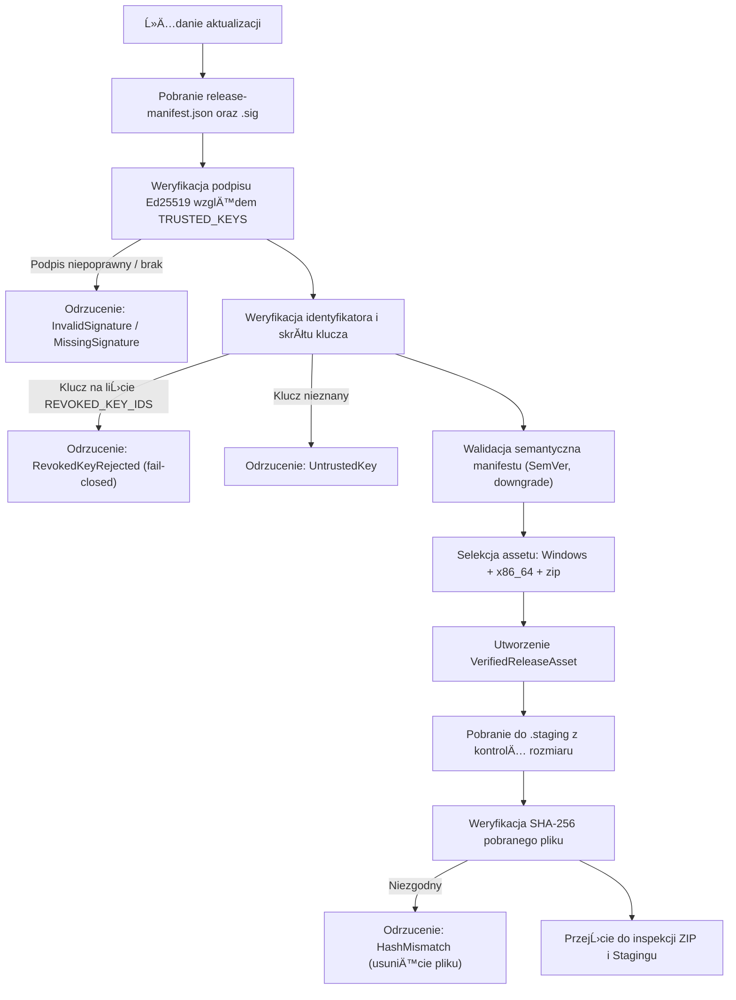

# PROJEKT ARCHITEKTONICZNY: AKTUALIZATOR WINDOWS (PORTABLE ZIP)
# Dokument: DESIGN_3_0_A_WINDOWS_UPDATE.md

---

## 1. Status Dokumentu
- **Identyfikator:** `UPDATE-DESIGN-WIN`
- **Etap:** `STAGE-M2-INSTALLER-DESIGN-GATE`
- **Status dokumentu:** `REVIEWED` (Zgodnie z zasadami Sekcji 46; oczekuje na formalne zatwierdzenie otwartych decyzji właściciela przez Właściciela repozytorium)
- **Gotowość wykonawcza M3:** `BLOCKED_BY_OWNER_DECISIONS` (Sekcja 39 i 54)
- **Data opracowania:** 2026-11-07 (Rzeczywista data wykonania M2)
- **Strefa czasowa:** `+01:00` (CET / Europe/Warsaw)
- **Autor / Rola:** GĹ‚Ăłwny Architekt Techniczny SPLogbook, Starszy Programista Rust 2024, Specjalista Bezpiecznych AktualizatorĂłw

---

## 2. Wersja i Historia Zmian
- **Wersja:** `2.0.0`
- **Historia:**
  - `v1.0.0` (2026-09-29): Wczesny szkic koncepcyjny zablokowania błędu traktowania pliku ZIP jako EXE (historyczny commit w fazie pre-M1).
  - `v2.0.0` (2026-11-07): Kompletny projekt architektoniczny aktualizatora Windows Portable ZIP, integrujÄ…cy zweryfikowane mechanizmy manifest-first (Ed25519), silnik `UpdatePlan`, fail-closed ochronÄ™ baz SQLite i danych uĹĽytkownika, izolowany staging, model helpera, deterministyczny rollback oraz procedury odzyskiwania po awarii.

---

## 3. Baseline Git i Kontekst Techniczny
- **Baseline Git HEAD:** `5ddec14bd40b70ab099ba289ecdd952340c6da54`
- **Gałąź referencyjna:** `main` / `repair/full-system-remediation`
- **Wersja oprogramowania:** SPLogbook `v1.2.0` (kod źródłowy Rust 2024, MSRV 1.85+)
- **Relacja do Etapu M1:** Etap M1 został w pełni zrealizowany i zweryfikowany testami oprogramowania (`STAGE_M1_COVERAGE_AND_STATUS_REPORT.md`, 36/36 kryteriów `WIN-M1` spełnionych). Niniejszy dokument stanowi specyfikację docelową fazy M2 bez modyfikacji kodu.

---

## 4. Zakres Projektu (In-Scope)
Projekt obejmuje:
1. Oficjalnie wspierany model dystrybucji Windows: aplikacja przenośna (Portable) dostarczana w płaskim archiwum ZIP (`SPLogbook-Windows-x64.zip`).
2. Wykrywanie typu instalacji oraz walidację uprawnień zapisu (Write Access Preflight).
3. Ścisłą integrację z kryptograficznym kontraktem zaufania manifest-first (`release-manifest.json` + podpis Ed25519).
4. InspekcjÄ™ struktury pakietu ZIP przed dekompresjÄ… (limity dekompresyjne, ochrona przed Zip-Slip, zakaz symlinkĂłw).
5. BezpiecznÄ… dekompresjÄ™ do izolowanego katalogu stagingu (`.staging`).
6. Generowanie i rygorystyczną walidację planu aktualizacji (`UpdatePlan`) z zachowaniem zasady `UNKNOWN DATA CLASSIFICATION → DO NOT OVERWRITE`.
7. Ochronę danych użytkownika (`default_log.db`, logi łączności, pliki ADIF/Cabrillo), konfiguracji (`station_config.json`) oraz baz referencyjnych (`databases/serviceLOG.db`, `databases/callbook.db`).
8. ArchitekturÄ™ procesu pomocniczego (Updater Helper) radzÄ…cego sobie z blokadÄ… wykonywalnego pliku PE przez system Windows (File Locking).
9. ProcedurÄ™ transakcyjnej podmiany plikĂłw z tworzeniem izolowanej kopii zapasowej (`.rollback`).
10. Uruchomienie kandydata aktualizacji z flagÄ… `--check-health-startup` oraz weryfikacjÄ™ zdrowia (Health Confirmation).
11. Automatyczny, deterministyczny i idempotentny mechanizm wycofania zmian (Rollback).
12. Procedury czyszczenia (Cleanup) oraz usuwania pozostałości po przerwanych lub nieudanych próbach (Crash Recovery).
13. Zabezpieczenia współbieżności (Update Lock) oraz zasady bezpiecznego anulowania.
14. Macierz zagrożeń bezpieczeństwa i macierz testów akceptacyjnych dla Etapu M3.

---

## 5. Poza Zakresem Projektu (Out-of-Scope)
Projekt jawnie wyklucza i pozostawia jako przyszłe, odrębne inicjatywy:
1. ImplementacjÄ™ instalatora Microsoft Installer (MSI), WiX Toolset, Inno Setup czy NSIS.
2. Automatyczną eskalację uprawnień przez User Account Control (UAC) / `runas`. W modelu Portable próba aktualizacji w katalogu chronionym (np. `C:\Program Files`) kończy się jawną odmową, a nie podnoszeniem uprawnień.
3. Modyfikację schematu manifestu wydań, wprowadzanie nowych pól JSON bez zatwierdzenia.
4. Zmianę aktywnych kluczy zaufania oraz modyfikację polityki odwołania klucza `splogbook-release-2026-01`.
5. Nowe migracje schematĂłw baz danych SQLite.
6. Dystrybucję i aktualizację instalacji wielodostępnych (multi-user / service-level).

---

## 6. Obecny Format Wydania Windows
Zgodnie z potokiem `.github/workflows/build-and-release.yml` oraz audytem `UPDATE_ARTIFACT_INVENTORY_REPORT.md`:
- **Nazwa assetu:** `SPLogbook-Windows-x64.zip`
- **Format kontenera:** ZIP (DEFLATE / Store)
- **Docelowa platforma:** `windows` (`ReleasePlatform::Windows`)
- **Architektura:** `x86_64` (`ReleaseArchitecture::X86_64`)
- **Model archiwum:** `FLAT ARCHIVE` (pliki binarne, biblioteki i podkatalog `databases/` umieszczone bezpośrednio w korzeniu archiwum ZIP, bez wspólnego katalogu nadrzędnego).
- **GĹ‚Ăłwny plik wykonywalny:** `SPLogbook.exe` (PE32+ executable, x86-64, subsystem Windows GUI).
- **Zależności wykonawcze:** Wbudowane biblioteki DLL kompilowane statycznie lub dystrybuowane w katalogu programu.
- **Zawartość podkatalogu `databases/`:** Początkowe ziarna referencyjne `serviceLOG.db` (baza prefiksów, okręgów i IOTA) oraz `callbook.db` (lokalny indeks znaków).

---

## 7. Modele Instalacji (Installation Types)
Aktualizator definiuje ścisły typ wyliczeniowy rodzajów instalacji Windows:

```rust
#[derive(Debug, Clone, Copy, PartialEq, Eq)]
pub enum WindowsInstallationType {
    /// Instalacja przenośna w katalogu z pełnymi prawami zapisu dla bieżącego użytkownika
    /// (np. C:\SPLogbook, D:\HamRadio\SPLogbook, %USERPROFILE%\PortableApps\SPLogbook).
    PortableUserWritable,
    /// Instalacja w lokalizacji zablokowanej do zapisu dla bieżącego procesu (np. brak uprawnień NTFS).
    PortableReadOnly,
    /// Instalacja w chronionym katalogu systemowym (np. C:\Program Files, C:\Program Files (x86), C:\Windows).
    SystemProtectedDirectory,
    /// Ścieżka sieciowa UNC (np. \\server\share\SPLogbook) — nieobsługiwana ze względów bezpieczeństwa.
    NetworkShareUnc,
    /// Stan nieznany lub błąd walidacji ścieżki.
    Unknown,
}
```

### Reguły detekcji i zachowania:
1. **Weryfikacja ścieżki UNC:** Jeśli ścieżka pliku wykonywalnego zaczyna się od `\\` lub prefiksu `\\?\UNC\`, instalacja jest klasyfikowana jako `NetworkShareUnc`. Aktualizacja zostaje natychmiast przerwana (fail-closed) z komunikatem ostrzegawczym.
2. **Weryfikacja katalogĂłw systemowych:** ĹšcieĹĽka bazowa jest porĂłwnywana z lokalizacjami `%ProgramFiles%`, `%ProgramFiles(x86)%` oraz `%SystemRoot%`. W przypadku wykrycia instalacji w tych obszarach:
   - Klasyfikacja: `SystemProtectedDirectory`.
   - Zachowanie: Aktualizator kategorycznie odmawia automatycznej podmiany w modelu portable. Wyświetla monit: *"SPLogbook znajduje się w katalogu chronionym systemowo. Automatyczna aktualizacja portable jest zablokowana. Pobierz i rozpakuj nową wersję ręcznie lub przenieś program do katalogu użytkownika."*
3. **Preflight zapisu (Write Probe):** W katalogu programu podejmowana jest próba utworzenia, zapisu i usunięcia pliku testowego `.update_probe_<uuid>.tmp`.
   - Sukces: `PortableUserWritable`.
   - Błąd `PermissionDenied`: `PortableReadOnly` — aktualizacja zostaje zablokowana przed rozpoczęciem pobierania.

---

## 8. Kontrakt Zaufania (Trust Flow)
Aktualizator Windows bezwzględnie egzekwuje model `manifest-first`:



### Nienaruszalne reguły zaufania:
- Klucz `splogbook-release-2026-01` pozostaje trwale i nieodwracalnie odwołany (`REVOKED_KEY_IDS`). Próba użycia tego klucza natychmiast przerywa proces.
- Wydanie `v1.2.0`, którego manifest podpisano odwołanym kluczem, jest weryfikowane jako niegodne zaufania.
- Pobranie pliku ZIP jest dopuszczalne **wyłącznie** po pomyślnej weryfikacji podpisanego manifestu. Brak manifestu lub błąd podpisu powoduje natychmiastowe zaniechanie połączeń do pliku ZIP.

---

## 9. Selekcja Assetu Wydania (Asset Selection)
Asset instalacyjny Windows musi spełniać ścisłą triadę identyfikacyjną:
1. `platform == "windows"` (`ReleasePlatform::Windows`)
2. `arch == "x86_64"` (`ReleaseArchitecture::X86_64`)
3. `package_type == "zip"` (`ReleasePackageType::Zip`)
4. `filename` musi kończyć się na `.zip` (niewrażliwe na wielkość liter) i odpowiadać wzorcowi `SPLogbook-Windows-x64.zip`.
5. W manifeście musi znajdować się **dokładnie jeden** asset spełniający powyższe kryteria. Wystąpienie zduplikowanych assetów dla Windows skutkuje błędem `UpdaterError::AmbiguousArtifact`.

---

## 10. Inspekcja Archiwum ZIP (Package Inspection)
Przed przystąpieniem do jakiejkolwiek dekompresji, pobrany plik ZIP podlega rygorystycznej inspekcji nagłówków w strumieniu pamięciowym lub plikowym:
- **Maksymalna liczba wpisĂłw w archiwum:** 10 000 wpisĂłw (`ArchiveLimits::MAX_ENTRIES`).
- **Maksymalny Ĺ‚Ä…czny rozmiar po rozpakowaniu:** 200 MB (`ArchiveLimits::MAX_TOTAL_BYTES`).
- **Maksymalny rozmiar pojedynczego pliku:** 100 MB (`ArchiveLimits::MAX_ENTRY_BYTES`).
- **Współczynnik kompresji (Decompression Bomb Protection):** Odrzucenie wpisów o nienaturalnym stosunku rozmiaru skompresowanego do rozpakowanego (> 100:1 dla plików powyżej 1 MB).
- **Blokada dowiązań symbolicznych (Symlinki):** Wszelkie wpisy będące dowiązaniami symbolicznymi lub punktami reparse (NTFS Junctions) są bezwzględnie odrzucane (`ArchiveLimits::allow_symlinks = false`).
- **Wykrywanie kolizji nazw i wielkości liter (Case-Collisions):** Normalizacja nazw do postaci małoliterowej w strukturze indeksu — wykrycie prób zduplikowania ścieżek różniących się wyłącznie wielkością znaków powoduje natychmiastowe przerwanie z błędem `UpdaterError::UnsafeArchivePath`.

---

## 11. Bezpieczna Dekompresja ZIP (ZIP Extraction)
Dekompresja realizowana jest wyłącznie przez dedykowaną, bezpieczną funkcję `extract_zip_safe_windows`:
1. **Ochrona przed Zip-Slip:** Każda ścieżka wpisu w archiwum jest walidowana przez `validate_archive_relative_path`.
   - Bezwzględny zakaz występowania separatorów nadrzędnych (`..`).
   - Bezwzględny zakaz ścieżek zaczynających się od separatora dysku lub katalogu głównego (`/`, `\`, `C:`).
   - Bezwzględny zakaz nazw zarezerwowanych DOS/Windows (`CON`, `PRN`, `AUX`, `NUL`, `COM1`..`COM9`, `LPT1`..`LPT9`).
2. **Kanonikalizacja docelowa:** Po zbudowaniu pełnej ścieżki wewnątrz folderu stagingu, weryfikowane jest, czy `dest_path.starts_with(&staging_canonical)`. Wyjście poza katalog stagingu powoduje rzucenie błędu `UpdaterError::ZipSlip`.
3. **Prawa dostępu:** Utworzone pliki otrzymują standardowe uprawnienia użytkownika; atrybuty `ReadOnly` lub `Hidden` z archiwum są czyszczone.

---

## 12. Izolowany Staging (Staging Architecture)
- Wszystkie pliki rozpakowywane sÄ… do tymczasowego podkatalogu `.staging` wewnÄ…trz katalogu instalacji aplikacji (`$baseDir\.staging`).
- **Spłaszczanie katalogu (Root Flattening):** Jeżeli cała zawartość archiwum znajduje się w pojedynczym katalogu nadrzędnym (np. `SPLogbook-Windows-x64/`), funkcja `flatten_single_root_directory` przesuwa zawartość poziom wyżej. W obecnym formacie Windows (`FLAT ARCHIVE`) pliki trafiają bezpośrednio do `.staging`.
- **Walidacja układu stagingu:** Funkcja `validate_staging_layout` sprawdza, czy w korzeniu `.staging` znajduje się binarka `SPLogbook.exe`. Jej brak skutkuje przerwaniem procesu z błędem `UpdaterError::InvalidStagingLayout`.

---

## 13. Budowanie Planu Aktualizacji (UpdatePlan Contract)
Plan aktualizacji jest wyliczany w sposĂłb czysto funkcyjny przez `UpdatePlan::generate(&staging, base_dir)` bez wykonywania operacji I/O modyfikujÄ…cych stan programu.

```rust
pub struct UpdatePlan {
    pub replace_files: Vec<(PathBuf, PathBuf)>, // (staging_rel, active_abs)
    pub create_files: Vec<(PathBuf, PathBuf)>,  // (staging_rel, active_abs)
    pub preserve_files: Vec<(PathBuf, String)>, // (active_abs, reason)
    pub rejected_files: Vec<(PathBuf, String)>, // (staging_rel, reason)
}
```

### Kryteria podziału:
1. `replace_files`: Pliki programu (`SPLogbook.exe`, biblioteki DLL, oficjalne zasoby w `resources/`), ktĂłre juĹĽ istniejÄ… w `$baseDir`.
2. `create_files`: Nowe pliki programu, nowe biblioteki DLL lub nowe ziarna baz danych (`FirstInstallSeed`), jeśli dany plik docelowy **nie istnieje** w aktywnej instalacji.
3. `preserve_files`: Wszystkie istniejÄ…ce pliki uĹĽytkownika, konfiguracja oraz istniejÄ…ce bazy danych referencyjnych/seedĂłw.
4. `rejected_files`: Wszelkie nierozpoznane pliki w paczce aktualizacyjnej (zasada fail-closed).

---

## 14. Klasyfikacja PlikĂłw i Ochrona Danych (File Classification Policy)
Klasyfikator `classify_update_path(&Path)` przypisuje każdą ścieżkę do jednej z poniższych klas:

| Klasa pliku (`UpdateFileClass`) | Wzorzec ścieżki / nazwy | Polityka w Stagingu | Czy może nadpisać istniejący plik? | Polityka Rollbacku |
|---|---|---|---|---|
| **ProgramFile** | `SPLogbook.exe`, `*.dll`, `resources/**`, `assets/**` | `replace_files` lub `create_files` | **TAK** (wyłącznie po verified backupie) | Przywracany z kopii w `.rollback` |
| **RuntimeLibrary** | Biblioteki dynamiczne DLL | `replace_files` lub `create_files` | **TAK** (po backupie) | Przywracana z `.rollback` |
| **FirstInstallSeed** | `databases/serviceLOG.db`, `databases/callbook.db` | Dozwolony jako `create_files` tylko przy nowej instalacji | **BEZWZGLĘDNIE NIE** (jeśli plik istnieje lokalnie, trafia do `preserve_files`) | Nienaruszany przez rollback |
| **UserConfiguration** | `station_config.json`, `config/**`, `*.conf`, `*.cfg` | Wykrycie w ZIP trafia do `rejected_files` | **BEZWZGLĘDNIE NIE** (nigdy nie nadpisywać) | Nienaruszany przez rollback |
| **UserData** | `default_log.db`, `*.db-wal`, `*.db-shm`, `*.adi`, `logs/**` | Wykrycie w ZIP trafia do `rejected_files` | **BEZWZGLĘDNIE NIE** (nigdy nie nadpisywać) | Nienaruszany przez rollback |
| **ReferenceData** | Bazy referencyjne | Chronione domyślnie | **NIE** (wymaga dedykowanego mechanizmu migracji) | Nienaruszany przez rollback |
| **ReleaseMetadata** | `manifest.json`, `changelog.md`, `license.txt` | Informacyjne | **NIE** (nie kopiować do korzenia aplikacji) | Pomijany |
| **Unknown** | Każdy inny plik nierozpoznany | Odrzucany (`rejected_files`) | **BEZWZGLĘDNIE NIE** (fail-closed) | Pomijany |

---

## 15. Architektura Procesu Pomocniczego (Helper Model Decision)
System Windows zakłada wyłączną blokadę zapisu (Exclusive Execute/Write Lock) na uruchomionym pliku `SPLogbook.exe`. Podmiana pliku binarnego wymaga zewnętrznego procesu pomocniczego.

### PorĂłwnanie wariantĂłw:

| Kryterium oceny | Opcja A: PowerShell Helper (Aktualna) | Opcja B: Natywny Helper EXE (`splogbook-updater.exe`) |
|---|---|---|
| **Dostępność w OS** | Dostępny domyślnie w Windows 10 i 11 | Wymaga skompilowania i dystrybucji osobnego pliku PE |
| **Zależności wykonawcze** | Wymaga środowiska PowerShell 5.1+ | Samodzielny plik binarny Rust (brak zewnętrznych interpreterów) |
| **Bezpieczeństwo parametrów** | Wymaga rygorystycznego cytowania ścieżek (`replace('\'', "''")`) | Bezpośrednie przekazywanie argumentów przez API procesów OS |
| **Odporność na wstrzykiwanie** | Wrażliwy na błędy parsowania, jeśli ścieżka zawiera znaki specjalne | 100% odporny na command injection (przekazywanie strukturalne) |
| **Polityka ExecutionPolicy** | Wymaga flagi `-ExecutionPolicy Bypass` | Nie podlega politykom ExecutionPolicy |
| **Ryzyko heurystyki antywirusowej (AMSI)** | PodwyĹĽszone: skrypty PowerShell modyfikujÄ…ce pliki EXE bywajÄ… flagowane | Niskie: standardowy proces pomocniczy podpisany cyfrowo |
| **Obsługa błędów i diagnostyka** | Trudniejsza w debugowaniu, ograniczona do strumieni PowerShell | Pełne, strukturalne logowanie do pliku diagnostycznego JSON |
| **Rozmiar dystrybucji** | 0 bajtĂłw w archiwum (generowany w locie) | ~1-2 MB dodatkowego rozmiaru w archiwum ZIP |

### Decyzja architektoniczna:
- **Cel bieżący M3 (M3 Current Target):** Ulepszony, w pełni utwardzony skrypt PowerShell (`generate_powershell_update_script`), eliminujący wszelkie dzikie karty, stosujący literały ścieżek (`-LiteralPath`), izolację backupu i bezpośrednie tablice plików z `UpdatePlan`.
- **Cel długoterminowy (Long-Term Target):** Kompilacja natywnego programu pomocniczego `splogbook-updater.exe` (wymaga formalnej decyzji właściciela `OWNER-M2-03`).

---

## 16. Zamknięcie Starego Procesu (Process Shutdown Coordination)
1. Główny proces SPLogbook przygotowuje środowisko, zapisuje plan, generuje skrypt pomocniczy w `%TEMP%\SPLogbook_update_<pid>.ps1` i uruchamia go w tle.
2. Helper otrzymuje identyfikator PID procesu macierzystego (`$pidToWait = <pid>`).
3. Główny proces SPLogbook dokonuje czystego zamknięcia bazy SQLite (checkpoint WAL), zapisuje stan konfiguracji i kończy pracę (`std::process::exit(0)`).
4. Helper monitoruje proces macierzysty za pomocą pętli:
   ```powershell
   $deadline = (Get-Date).AddSeconds(90)
   while (Get-Process -Id $pidToWait -ErrorAction SilentlyContinue) {
       if ((Get-Date) -gt $deadline) {
           # Przekroczono limit czasu oczekiwania na zamknięcie
           exit 1
       }
       Start-Sleep -Milliseconds 250
   }
   Start-Sleep -Milliseconds 500
   ```
5. Jeśli proces nie zamknie się w ciągu 90 sekund, proces aktualizacji zostaje bezpiecznie przerwany bez dotykania plików programu.

---

## 17. Kopia Zapasowa Przed Zastosowaniem (Backup Contract)
1. Przed wykonaniem jakiejkolwiek modyfikacji w katalogu instalacji, helper tworzy dedykowany podkatalog kopii zapasowej: `$baseDir\.rollback`.
2. Stary katalog `.rollback` (jeśli istniał) jest bezwzględnie usuwany.
3. Kopia obejmuje **wyłącznie** pliki ze zbioru `replace_files` zdefiniowane w `UpdatePlan`:
   ```powershell
   foreach ($rel in $replaceFiles) {
       $orig = Join-Path $baseDir $rel
       if (Test-Path -LiteralPath $orig) {
           $dest = Join-Path $rollback $rel
           $destDir = Split-Path $dest -Parent
           if (-not (Test-Path -LiteralPath $destDir)) {
               New-Item -ItemType Directory -Force -Path $destDir | Out-Null
           }
           Copy-Item -LiteralPath $orig -Destination $dest -Force
       }
   }
   ```
4. **Zasada nadrzędna:** Bazy danych użytkownika (`default_log.db`), konfiguracja (`station_config.json`) oraz bazy referencyjne (`serviceLOG.db`) **nie są kopiowane** do `.rollback`, co gwarantuje, że proces rollbacku w żadnych okolicznościach nie nadpisze nowszych danych użytkownika.

---

## 18. Zastosowanie Aktualizacji (Apply Phase)
Podmiana plikĂłw odbywa siÄ™ w dwĂłch precyzyjnych krokach bez uĹĽycia jakichkolwiek masek wieloznacznych (`*`):
1. **Podmiana istniejÄ…cych plikĂłw programu (`replaceFiles`):**
   ```powershell
   foreach ($rel in $replaceFiles) {
       $src = Join-Path $staging $rel
       $dst = Join-Path $baseDir $rel
       Copy-Item -LiteralPath $src -Destination $dst -Force
   }
   ```
2. **Utworzenie nowych dopuszczonych plikĂłw (`createFiles`):**
   ```powershell
   foreach ($rel in $createFiles) {
       $src = Join-Path $staging $rel
       $dst = Join-Path $baseDir $rel
       $dstDir = Split-Path $dst -Parent
       if (-not (Test-Path -LiteralPath $dstDir)) {
           New-Item -ItemType Directory -Force -Path $dstDir | Out-Null
       }
       Copy-Item -LiteralPath $src -Destination $dst -Force
   }
   ```
3. Zastosowanie operacji `Copy-Item -LiteralPath` zapobiega interpretacji znaków specjalnych (np. nawiasów kwadratowych w ścieżkach).

---

## 19. Uruchomienie Kandydata (Launch Candidate)
1. Przed uruchomieniem kandydata usuwany jest ewentualny stary plik potwierdzenia:
   ```powershell
   if (Test-Path -LiteralPath $healthOk) {
       Remove-Item -Force -LiteralPath $healthOk
   }
   ```
2. Helper uruchamia zaktualizowany proces z flagÄ… diagnostycznÄ…:
   ```powershell
   $newProc = Start-Process -FilePath $exe -ArgumentList "--check-health-startup" -PassThru
   ```
3. Uchwyt `$newProc` pozwala na monitorowanie, czy proces nie zakończył się przedwcześnie awarią (crash/segfault).

---

## 20. Potwierdzenie Zdrowia (Health Confirmation Contract)
1. Nowo uruchomiony proces w trybie `--check-health-startup` wykonuje:
   - InicjalizacjÄ™ podstawowych podsystemĂłw Rusta.
   - Odczyt i deserializacjÄ™ pliku konfiguracyjnego `station_config.json`.
   - PrĂłbÄ™ otwarcia bazy danych SQLite w trybie odczytu.
   - Weryfikację obecności zasobów GUI.
2. Po pomyślnym teście proces zapisuje plik `$baseDir\.health_ok`.
3. Helper oczekuje na pojawienie siÄ™ pliku przez maksymalnie 15 sekund:
   ```powershell
   $healthDeadline = (Get-Date).AddSeconds(15)
   $success = $false
   while ((Get-Date) -lt $healthDeadline) {
       if (Test-Path -LiteralPath $healthOk) {
           $success = $true
           break
       }
       if ($newProc.HasExited) {
           # Kandydat uległ natychmiastowej awarii
           break
       }
       Start-Sleep -Milliseconds 250
   }
   ```
4. Jeśli w ciągu 15 sekund plik `.health_ok` nie powstanie lub proces kandydata zakończy się kodem błędu, aktualizacja jest uznawana za nieudaną i natychmiast przechodzi do fazy Rollbacku.

---

## 21. Wycofanie Zmian (Rollback Contract)
Procedura rollbacku jest w 100% deterministyczna i idempotentna:
```powershell
if (-not $success) {
    # 1. Zatrzymanie wiszÄ…cego lub wadliwego procesu kandydata
    Stop-Process -Id $newProc.Id -Force -ErrorAction SilentlyContinue

    # 2. Usunięcie wszystkich nowo utworzonych plików programu
    foreach ($rel in $createFiles) {
        $target = Join-Path $baseDir $rel
        if (Test-Path -LiteralPath $target) {
            Remove-Item -LiteralPath $target -Force -ErrorAction SilentlyContinue
        }
    }

    # 3. PrzywrĂłcenie oryginalnych plikĂłw z katalogu .rollback
    foreach ($rel in $replaceFiles) {
        $bkp = Join-Path $rollback $rel
        if (Test-Path -LiteralPath $bkp) {
            Copy-Item -LiteralPath $bkp -Destination (Join-Path $baseDir $rel) -Force
        }
    }

    # 4. Ponowne uruchomienie poprzedniej, sprawdzonej wersji programu
    Start-Process -FilePath $exe
}
```
### Właściwości gwarantowane:
- Żadne pliki z `preserve_files` (bazy, konfiguracja) nie są dotykane.
- Nowe pliki programu, które mogłyby powodować konflikty wersji, są usuwane.
- Poprzednia wersja binarki `SPLogbook.exe` i bibliotek DLL powraca na swoje miejsce.

---

## 22. Czyszczenie (Cleanup Contract)
W przypadku pomyślnego potwierdzenia zdrowia (`$success == $true`):
1. Helper usuwa katalog stagingu: `Remove-Item -Recurse -Force -LiteralPath $staging`.
2. Helper usuwa katalog kopii zapasowej: `Remove-Item -Recurse -Force -LiteralPath $rollback`.
3. Helper usuwa znacznik zdrowia: `Remove-Item -Force -LiteralPath $healthOk`.
4. Helper usuwa swój własny skrypt z katalogu `%TEMP%`.
5. Helper kończy działanie kodem 0.

---

## 23. Odzyskiwanie po Awarii Zasilania / Crashu (Crash Recovery)
Jeżeli nastąpi nagła utrata zasilania lub zabicie procesu helpera podczas operacji kopiowania:
1. **Wykrywanie przy starcie:** Podczas standardowego startu `SPLogbook.exe` sprawdza obecność katalogu `.rollback` oraz brak flagi aktywnego procesu helpera.
2. **Reguła rozstrzygania:**
   - Jeśli w katalogu `$baseDir` istnieje plik `.rollback` zawierający poprawny plik `SPLogbook.exe`, a główny plik wykonywalny jest uszkodzony lub nie uruchamia się, operator otrzymuje instrukcję ratunkową lub aplikacja wykonuje procedurę automatycznego odtworzenia z `.rollback`.
   - Niedokończona próba aktualizacji **nigdy** nie jest wznawiana automatycznie w przód (zakaz ponawiania podmiany bez ponownej pełnej weryfikacji manifestu i SHA-256).

---

## 24. Blokada Współbieżności (Concurrency Lock)
1. Aktualizator tworzy plik blokady `$baseDir\.update.lock` przed rozpoczęciem pobierania.
2. Struktura pliku blokady (JSON):
   ```json
   {
       "attempt_id": "9b1deb4d-3b7d-4bad-9bdd-2b0d7b3dcb6d",
       "pid": 12345,
       "started_at": 1799276400,
       "version": "1.2.1"
   }
   ```
3. Przed rozpoczęciem nowej próby badane jest, czy proces o wskazanym PID istnieje. Jeśli PID nie istnieje w systemie (Stale Lock), plik blokady jest bezpiecznie zwalniany.
4. Blokada uniemożliwia równoległe uruchomienie dwóch instancji procedury aktualizacji w tym samym katalogu.

---

## 25. Polityka Anulowania (Cancellation Policy)
1. **Faza bezpieczna (Pre-Apply):**
   - Podczas sprawdzania manifestu, pobierania pliku ZIP oraz rozpakowywania do `.staging`, użytkownik może w każdej chwili anulować operację.
   - Skutek: Natychmiastowe przerwanie pobierania, usunięcie pliku tymczasowego `.SPLogbook_update_*.zip`, usunięcie katalogu `.staging`, zwolnienie blokady `.update.lock`. Stan programu pozostaje w 100% nienaruszony.
2. **Faza krytyczna (Post-Apply / Swap):**
   - Od momentu przekazania sterowania do helpera i rozpoczęcia podmiany plików, anulowanie operacji przez użytkownika jest programowo zablokowane w GUI.
   - Przerwanie procesu helpera wymusza wykonanie procedury Rollbacku.

---

## 26. Badanie Pojemności Dysku (Disk Space Preflight)
Przed zatwierdzeniem pobierania wyliczane jest wymagane miejsce na dysku docelowym:
$$\text{RequiredSpace} = \text{DeclaredDownloadSize} + \text{MaxExtractedSize} + \text{ReplacedFilesSize} + \text{SafetyMargin}$$
- `SafetyMargin` wynosi sztywno **50 MB**.
- Dla typowego wydania SPLogbook: $15\text{ MB (ZIP)} + 60\text{ MB (staging)} + 40\text{ MB (backup)} + 50\text{ MB} = 165\text{ MB}$.
- Jeśli wolne miejsce na dysku partycji docelowej (oraz partycji `%TEMP%`) jest mniejsze niż wymagany próg, aktualizacja jest wstrzymywana z komunikatem `UpdaterError::Io("Niewystarczająca ilość wolnego miejsca na dysku.")`.

---

## 27. Uprawnienia i Ĺšrodowisko Windows
- Aktualizator działa wyłącznie w kontekście uprawnień zalogowanego użytkownika (Standard User).
- W przypadku wykrycia braku praw zapisu do katalogu docelowego, aktualizator **nie uruchamia** mechanizmu UAC (`runas`), lecz zgłasza błąd uprawnień.
- Obsługa długich ścieżek (`\\?\` prefix) jest stosowana wewnątrz kodu Rust dla zapewnienia odporności na przekroczenie limitu `MAX_PATH` (260 znaków).

---

## 28. Model Błędów (Windows Error Hierarchy)
Błędy aktualizatora mapowane są na precyzyjne warianty `UpdaterError`:
- `UpdaterError::SafetyGate`: Próba użycia nieobsługiwanego pakietu (np. instalatora MSI).
- `UpdaterError::InvalidStagingLayout`: Brak pliku `SPLogbook.exe` w rozpakowanym archiwum.
- `UpdaterError::ZipSlip`: Wykrycie próby wyjścia poza katalog stagingu w nagłówku ZIP.
- `UpdaterError::ArchiveLimitExceeded`: Przekroczenie limitu dekompresji (bomba dekompresyjna).
- `UpdaterError::HealthCheckFailed`: Niepowodzenie testu zdrowia kandydata i wykonanie rollbacku.
- `UpdaterError::Io`: Błędy blokady plikowej NTFS, brak uprawnień lub błędy kopiowania.

---

## 29. Logowanie Audytowe i Telemetria Lokalna
- Rejestr zdarzeń aktualizatora zapisywany jest do lokalnego pliku tekstowego `$baseDir\update_audit.log`.
- **Zasady redakcji danych poufnych:**
  - Bezwzględny zakaz logowania kluczy prywatnych, tokenów sesyjnych, danych QSO, danych stacji i zawartości konfiguracji.
  - Logowane są wyłącznie: identyfikator próby (`attempt_id`), wersja docelowa, skrót SHA-256 manifestu, skrót assetu, kody etapów oraz czas trwania operacji.

---

## 30. Macierz Zagrożeń Bezpieczeństwa Windows (Security Matrix)

| ID ZagroĹĽenia | Wektor ataku / BĹ‚Ä…d | Ĺšrodowisko | Mechanizm mitygacji w projekcie | Ryzyko szczÄ…tkowe |
|---|---|---|---|---|
| **THR-WIN-01** | Zip-Slip (traversal `..\`) | Ekstrakcja ZIP | `validate_archive_relative_path` + canonicalize prefix check | Brak (fail-closed) |
| **THR-WIN-02** | Command Injection w PowerShell | Helper skrypt | Przekazywanie parametrów przez precyzyjne tablice literałów, brak `Invoke-Expression` | Zminimalizowane |
| **THR-WIN-03** | Nadpisanie bazy łączności | Podmiana plików | `UpdatePlan` klasyfikuje `default_log.db` jako `UserData` (pomijane) | Wyeliminowane |
| **THR-WIN-04** | Nadpisanie bazy `serviceLOG.db` | Podmiana plikĂłw | Klasyfikacja jako `FirstInstallSeed` (kopiowane tylko gdy brak pliku) | Wyeliminowane |
| **THR-WIN-05** | Podmiana niezweryfikowanego EXE | Pobieranie | WymĂłg `VerifiedReleaseAsset` z podpisem Ed25519 i SHA-256 | Wyeliminowane |
| **THR-WIN-06** | DLL Search-Order Hijacking | Uruchomienie kandydata | Sprawdzanie spójności bibliotek w katalogu aplikacji, brak szukania w CWD | Niskie |
| **THR-WIN-07** | Zablokowanie programu przez crash nowej wersji | Uruchomienie kandydata | Health confirmation (`.health_ok`) + automatyczny rollback | Niskie |
| **THR-WIN-08** | Stary znacznik zdrowia | Health check | Usunięcie `.health_ok` przed uruchomieniem kandydata | Wyeliminowane |

---

## 31. Macierz TestĂłw Implementacyjnych dla Etapu M3 (Windows Test Matrix)

| ID Testu | Zakres testu | Warunki wejściowe / Fixture | Oczekiwany rezultat | Poziom testu |
|---|---|---|---|---|
| **TEST-WIN-01** | Bezpieczna ekstrakcja ZIP | Archiwum ZIP ze ścieżką `..\..\Windows\system32\malicious.dll` | `Err(UpdaterError::ZipSlip)` | Unit (Rust) |
| **TEST-WIN-02** | Odrzucenie symlinkĂłw | Archiwum ZIP zawierajÄ…ce wpis symlinka | `Err(UpdaterError::UnsafeArchivePath)` | Unit (Rust) |
| **TEST-WIN-03** | Ochrona baz danych w UpdatePlan | Staging z nowym `serviceLOG.db`, active z istniejÄ…cym | `preserve_files` zawiera bazÄ™, brak w `replace_files` | Unit (Rust) |
| **TEST-WIN-04** | Generowanie skryptu PowerShell | `UpdatePlan` z plikami programu i danymi | Brak `$staging\*`, brak `$rollback\*`, obecne `$replaceFiles` | Unit (Rust) |
| **TEST-WIN-05** | Rollback przy awarii zdrowia | Nowa binarka kończąca się kodem 1 (crash) | Przywrócenie oryginalnego `SPLogbook.exe`, usunięcie nowych plików | Integration (OS) |
| **TEST-WIN-06** | Ścieżki ze spacjami | Ścieżka instalacji: `C:\My Logbook\SPLogbook\` | Poprawne cytowanie, brak błędów składni PowerShell | Integration (OS) |
| **TEST-WIN-07** | Odmowa dla Program Files | ĹšcieĹĽka: `C:\Program Files\SPLogbook` | `Err(UpdaterError::SafetyGate)` przed pobraniem | Unit / Integration |

---

## 32. Kompatybilność Wsteczna i Migracje
- Projekt w pełni obsługuje istniejącą strukturę katalogów wersji `v1.2.0`.
- Wszystkie istniejÄ…ce pliki uĹĽytkownika (`default_log.db`, `station_config.json`, `databases/serviceLOG.db`) pozostajÄ… na swoich standardowych miejscach.
- Zmiana nie wymaga modyfikacji struktur bazodanowych ani instalowania zewnętrznych sterowników.

---

## 33. Rejestr Decyzji Właściciela dla Windows
W toku projektowania zidentyfikowano następujące decyzje leżące w gestii Właściciela:
- **`OWNER-M2-01`:** Potwierdzenie, że Windows pozostaje wyłącznie w formacie Portable ZIP w M3. (Rekomendacja architektoniczna: **APPROVED**).
- **`OWNER-M2-02`:** Potwierdzenie, że MSI / Inno Setup stanowi odrębny, przyszły etap. (Rekomendacja architektoniczna: **APPROVED**).
- **`OWNER-M2-03`:** WybĂłr helpera dla M3: ulepszony PowerShell czy kompilowany EXE `splogbook-updater.exe`. (Rekomendacja architektoniczna: **PowerShell w M3, natywny EXE w M4**).
- **`OWNER-M2-09`:** Usunięcie katalogu `.rollback` po pomyślnym potwierdzeniu zdrowia. (Rekomendacja architektoniczna: **APPROVED — natychmiastowe usuwanie w celu oszczędności miejsca**).

---

## 34. Kryteria Akceptacji Implementacji M3 (Definition of Done)
Etap M3 dla platformy Windows będzie mógł zostać uznany za zrealizowany wyłącznie po spełnieniu:
1. Wszystkie testy jednostkowe planera i rozpakowywania ZIP przechodzÄ… w 100% na Windows CI runnerze.
2. Generator skryptu PowerShell produkuje wyłącznie skrypty używające `-LiteralPath` i jawnych list plików z `UpdatePlan`.
3. Wyeliminowano wszelkie wystąpienia poleceń z maskami wieloznacznymi `$staging\*` i `$rollback\*`.
4. Test symulacyjny nieudanego health checku wykazuje pełne, automatyczne przywrócenie binarki z `.rollback` bez uszczerbku dla danych QSO i pliku konfiguracyjnego.
5. Kod nie wymaga uprawnień administratora ani polecenia `runas`.

---

## 35. Odrzucone Alternatywy Architektoniczne
1. **Odrzucono: Bezpośrednie nadpisywanie plików przez PowerShell bez planowania:** Powodowało niszczenie baz danych użytkownika i konfiguracji.
2. **Odrzucono: Automatyczne podnoszenie uprawnień UAC (`runas`):** W modelu aplikacji przenośnej instalowanej w folderze użytkownika UAC jest zbędne, a jego wymuszanie rodzi zagrożenia bezpieczeństwa i komplikuje automatyzację.
3. **Odrzucono: Traktowanie archiwum ZIP jako pliku wykonywalnego:** Zidentyfikowany i wyeliminowany błąd z wersji legacy.

---

## 36. Ryzyka SzczÄ…tkowe (Residual Risks)
1. **Blokada przez oprogramowanie antywirusowe (Antivirus Lock):** Niektóre programy antywirusowe mogą zablokować nowo rozpakowany plik PE na czas skanowania w locie, powodując chwilowy błąd `AccessDenied`.
   - *Mitygacja w M3:* Helper wprowadzi 3 próby kopiowania z 500 ms odstępem czasowym przed zgłoszeniem błędu.
2. **Polityka ExecutionPolicy Restricted w środowiskach domenowych:** W rzadkich konfiguracjach korporacyjnych parametr `-ExecutionPolicy Bypass` może zostać zablokowany przez GPO.
   - *Mitygacja:* Zgłoszenie błędu z instrukcją dla użytkownika lub przejście na natywny helper EXE w kolejnym wydaniu.
