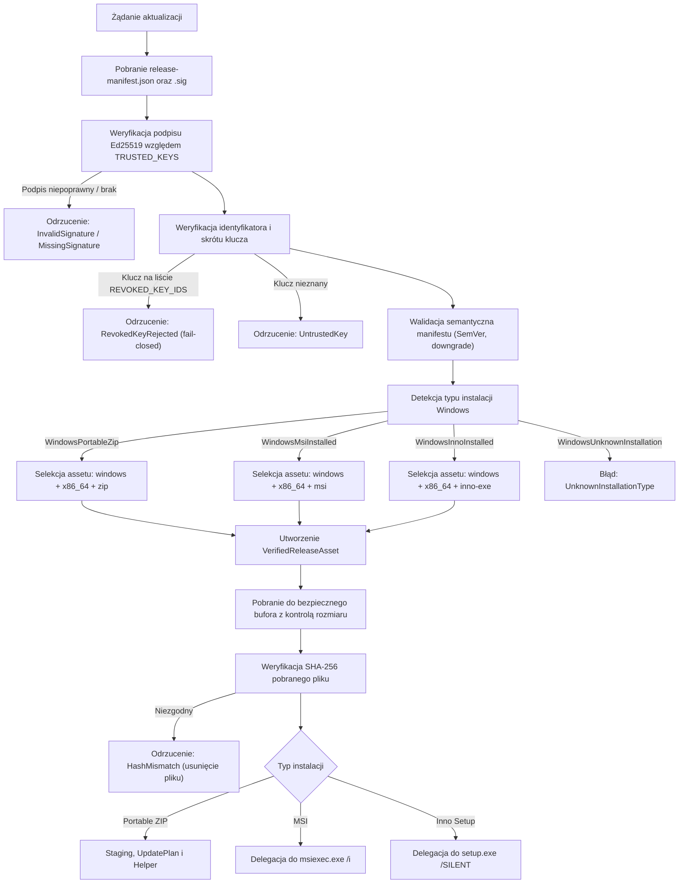

# PROJEKT ARCHITEKTONICZNY: PAKIETY INSTALACYJNE I AKTUALIZATOR WINDOWS (PORTABLE ZIP, WIX MSI, INNO SETUP)
# Dokument: DESIGN_3_0_A_WINDOWS_UPDATE.md

---

## 1. Status Dokumentu
- **Identyfikator:** `UPDATE-DESIGN-WIN`
- **Etap:** `STAGE-M2-INSTALLER-DESIGN-GATE` / `STAGE-M2-OWNER-DECISIONS-APPROVAL-GATE`
- **Status dokumentu:** `APPROVED` (Formalnie zatwierdzony po decyzjach Właściciela `OWNER-M2-01`, `OWNER-M2-02`, `OWNER-M2-03` w bramce zatwierdzenia decyzji)
- **Gotowość wykonawcza M3:** `READY_FOR_IMPLEMENTATION` (M3-BLOCKING DECISIONS: 0; prace implementacyjne M3 nierozpoczęte)
- **Data opracowania:** 2026-11-07 (Rzeczywista data wykonania bramki M2)
- **Strefa czasowa:** `+01:00` (CET / Central European Standard Time, UTC+01:00)
- **Autor / Rola:** Główny Architekt Techniczny SPLogbook, Starszy Programista Rust 2024, Specjalista Windows Installer, WiX Toolset, Inno Setup, PowerShell i Natywnych Helperów

---

## 2. Wersja i Historia Zmian
- **Wersja:** `2.1.0`
- **Historia:**
  - `v1.0.0` (2026-09-29): Wczesny szkic koncepcyjny zablokowania błędu traktowania pliku ZIP jako EXE (historyczny commit w fazie pre-M1).
  - `v2.0.0` (2026-11-07): Kompletny projekt architektoniczny aktualizatora Windows Portable ZIP, integrujący zweryfikowane mechanizmy manifest-first (Ed25519), silnik `UpdatePlan`, fail-closed ochronę baz SQLite i danych użytkownika, izolowany staging, model helpera, deterministyczny rollback oraz procedury odzyskiwania po awarii (`REVIEWED`).
  - `v2.1.0` (2026-11-07): Formalne zatwierdzenie rozszerzonego zakresu M3 przez Właściciela Projektu (`STAGE-M2-OWNER-DECISIONS-APPROVAL-GATE`). Włączenie pakietu MSI (WiX Toolset), instalatora EXE (Inno Setup), modelu Dual-Helper (natywny `splogbook-updater.exe` jako cel główny, utwardzony PowerShell jako fallback kompatybilności), formuły badania pojemności dysku zamiast arbitralnego 50 MB, polityki wzajemnej wyłączności formatów, rygorystycznego zakazu anulowania po przejściu w fazę `Applying` oraz pełnej macierzy testów natywnych Windows (`APPROVED`).

---

## 3. Baseline Git i Kontekst Techniczny
- **Baseline Git HEAD:** `9730304b372bbe81d8be0bc45262028f6ef2408e`
- **Gałąź referencyjna:** `main` / `repair/full-system-remediation`
- **Wersja oprogramowania:** SPLogbook `v1.2.0` (kod źródłowy Rust 2024, MSRV 1.85+)
- **Relacja do Etapu M1 i M2:** Etap M1 został w pełni zrealizowany i zweryfikowany testami oprogramowania — spełnione 36/36 kryteriów `WIN-M1`. Projekt bazowy instalatorów został zamknięty w bramce projektowej M2, a niniejsza wersja v2.1.0 formalizuje zatwierdzony rozszerzony zakres implementacji Etapu M3.

---

## 4. Zakres Projektu (In-Scope)
Projekt obejmuje trzy oficjalne formaty dystrybucji Windows oraz ich mechanizmy aktualizacji z zachowaniem ścisłego podziału odpowiedzialności:
1. **Portable ZIP (`SPLogbook-Windows-x64.zip`):**
   - Oficjalny format przenośny dla instalacji bezuprawnieniowych.
   - Własny silnik transakcyjny SPLogbook: staging (`.staging`), weryfikacja planu (`UpdatePlan`), transakcyjna podmiana plików, automatyczny rollback (`.rollback`), health check (`--check-health-startup` + `.health_ok`) i sprzątanie (`.update.lock`).
2. **Pakiet MSI Windows Installer (`SPLogbook-Windows-x64.msi`):**
   - Oficjalny format instalatora korporacyjnego i systemowego, budowany za pomocą **WiX Toolset**.
   - Definicja `ProductCode`, `UpgradeCode`, deterministyczne wersjonowanie SemVer, reguły `MajorUpgrade`.
   - Obsługa czystej instalacji, aktualizacji w miejscu (Upgrade), naprawy (Repair) oraz deinstalacji (Uninstall).
   - Wykorzystanie natywnego mechanizmu transakcyjnego i rollbacku Windows Installer.
   - Ochrona baz danych i konfiguracji użytkownika w profilu `%APPDATA%\SPLogbook` (wykluczenie z deinstalacji MSI).
   - Bezwzględny zakaz niestandardowych akcji (Custom Actions) niszczących integralność transakcji instalatora.
3. **Interaktywny instalator Setup EXE (`SPLogbook-Windows-x64-Setup.exe`):**
   - Oficjalny instalator interaktywny dla użytkowników końcowych, budowany za pomocą **Inno Setup**.
   - Wykrywanie istniejących wersji programu, interaktywny kreator instalacji, opcjonalny tryb cichy (`/SILENT`, `/VERYSILENT`) z jawnym kodem powrotu.
   - Prawidłowa deinstalacja z zachowaniem nienaruszonych danych użytkownika w `%APPDATA%`.
   - Wykrywanie kolizji z instalacją MSI i odmowa instalacji równoległej w tej samej lokalizacji.
4. **Model procesów pomocniczych (Dual Helper Model):**
   - **Primary Target:** Natywny, skompilowany w Rust program pomocniczy `splogbook-updater.exe`.
   - **Controlled Compatibility Fallback:** Utwardzony generator skryptu PowerShell (`generate_powershell_update_script`).
   - Obie ścieżki helpera podlegają identycznej, bezwzględnej polityce bezpieczeństwa i współdzielą ten sam kontrakt danych domenowych (`VerifiedReleaseAsset`, `UpdatePlan`, `UpdateAttemptId`).
5. **Wykrywanie typu instalacji Windows (Installation Type Preflight):**
   - Rozróżnianie: `WindowsPortableZip`, `WindowsMsiInstalled`, `WindowsInnoInstalled`, `WindowsUnknownInstallation`.
6. **Rozdział odpowiedzialności aktualizacyjnej:**
   - Format Portable ZIP jest aktualizowany przez własny silnik transakcyjny SPLogbook.
   - Formaty zarządzane systemowo (MSI, Inno Setup) delegują wykonanie do natywnego mechanizmu instalatora (`msiexec.exe` lub instalatora setup). Kod SPLogbook nigdy nie podmienia bezpośrednio plików należących do pakietu systemowego Windows Installer ani Inno Setup.
7. **Formuła preflightu dyskowego:**
   - Zastąpienie sztywnego 50 MB pełną, matematycznie uzasadnioną formułą uwzględniającą narzut instalatora i bufor systemu plików.
8. **Zasady anulowania transakcji:**
   - Anulowanie dozwolone wyłącznie przed wejściem w stan `Applying`. Po rozpoczęciu podmiany plików anulowanie jest kategorycznie zablokowane (`OWNER-M2-13`).
9. **Kompleksowa macierz testów natywnych dla Windows runnera w CI.**

---

## 5. Poza Zakresem Projektu (Out-of-Scope)
Projekt jawnie wyklucza:
1. Bezpośrednią podmianę plików binarnych w katalogu `Program Files` należących do pakietu MSI lub instalacji Inno Setup z pominięciem procedury instalatora.
2. Automatyczną, niewidoczną eskalację uprawnień (ciche `runas` / obejście UAC). Wszelka instalacja systemowa musi odbywać się przez standardowy dialog UAC systemu Windows wyzwalany przez proces instalatora.
3. Samodzielną migrację w locie między formatem Portable a MSI lub Inno Setup bez jawnej decyzji użytkownika i odrębnego kreatora migracji.
4. Modyfikację schematu manifestu wydań w niniejszej bramce (rozszerzenie manifestu stanowi zadanie specyfikacji M3 / dedykowane zadanie przedimplementacyjne).
5. Podpisywanie instalatorów kluczem produkcyjnym w trakcie fazy projektowej (wymaga dedykowanej infrastruktury certyfikatów Authenticode).

---

## 6. Formaty Wydania Windows w Etapie M3
W ramach rozszerzonego zakresu M3 pipeline wydań Windows generuje trzy oficjalne assety:

| Asset | Format / Narzędzie | Typ pakietu (`package_type`) | Mechanizm instalacji / aktualizacji |
|---|---|---|---|
| `SPLogbook-Windows-x64.zip` | ZIP (Flat Archive) | `windows-portable-zip` | Własny transakcyjny silnik SPLogbook + helper (`splogbook-updater.exe` / PowerShell) |
| `SPLogbook-Windows-x64.msi` | MSI / WiX Toolset v4/v5 | `windows-msi` | Windows Installer (`msiexec.exe /i <package>`) z transakcyjnym rollbackiem MSI |
| `SPLogbook-Windows-x64-Setup.exe` | PE Setup / Inno Setup 6+ | `windows-inno-exe` | Interaktywny instalator Inno Setup (`<setup.exe> /SILENT` po autoryzacji UAC) |

- **Wspólne cechy binarne:**
  - Kompilacja x86_64, subsystem Windows GUI, wersja PE zintegrowana z zasobami wersji (wersja, ikona, manifest DPI-aware).
  - Statyczne linkowanie runtime C/C++ oraz hermetyzacja wymaganych bibliotek DLL w katalogu aplikacji.
  - Wyjściowy plik wykonywalny: `SPLogbook.exe`.
  - Natywny program pomocniczy: `splogbook-updater.exe`.

---

## 7. Modele Instalacji (Installation Types) i Detekcja
Aktualizator definiuje ścisły typ wyliczeniowy rodzajów instalacji Windows:

```rust
#[derive(Debug, Clone, Copy, PartialEq, Eq, Hash)]
pub enum WindowsInstallationType {
    /// Instalacja przenośna w katalogu użytkownika z pełnymi prawami zapisu
    /// (np. C:\SPLogbook, D:\HamRadio\SPLogbook, %USERPROFILE%\PortableApps\SPLogbook).
    WindowsPortableZip,
    /// Instalacja systemowa zarządzana przez Windows Installer (pakiet MSI zbudowany przez WiX).
    WindowsMsiInstalled,
    /// Instalacja zarządzana przez dedykowany instalator Inno Setup.
    WindowsInnoInstalled,
    /// Instalacja w chronionym katalogu systemowym (Program Files) bez rozpoznanego rejestru instalatora,
    /// ścieżka sieciowa UNC lub stan niespójny.
    WindowsUnknownInstallation,
}
```

### Reguły detekcji i inspekcji rejestru:
1. **Weryfikacja ścieżki UNC:** Jeśli ścieżka bazowa zaczyna się od `\\` lub `\\?\UNC\`, klasyfikowana jest jako `WindowsUnknownInstallation`. Aktualizacja sieciowa jest natychmiast blokowana (fail-closed).
2. **Inspekcja rejestru Windows Installer (MSI):**
   - Sprawdzenie klucza `HKLM\Software\Microsoft\Windows\CurrentVersion\Uninstall\{ProductCode}` oraz klucza `UpgradeCode`.
   - Weryfikacja, czy ścieżka `InstallLocation` odpowiada bieżącemu katalogowi `SPLogbook.exe`.
   - Jeśli wpis istnieje: klasyfikacja jako `WindowsMsiInstalled`.
3. **Inspekcja rejestru Inno Setup:**
   - Sprawdzenie klucza `HKLM\Software\Microsoft\Windows\CurrentVersion\Uninstall\SPLogbook_is1` (lub `HKCU`).
   - Weryfikacja obecności pliku deinstalatora `unins000.exe` w katalogu programu.
   - Jeśli wpis i deinstalator istnieją: klasyfikacja jako `WindowsInnoInstalled`.
4. **Weryfikacja katalogu przenośnego (Portable):**
   - Jeśli program nie występuje w rejestrze MSI ani Inno, a katalog bazowy nie znajduje się w `%ProgramFiles%`, `%ProgramFiles(x86)%` ani `%SystemRoot%` i posiada zweryfikowane uprawnienia zapisu dla bieżącego procesu: klasyfikacja jako `WindowsPortableZip`.
5. **Katalog chroniony / nieznany:**
   - Jeśli program znajduje się w `%ProgramFiles%` bez poprawnego wpisu MSI/Inno lub brak jest praw zapisu: klasyfikacja jako `WindowsUnknownInstallation`.

### Polityka Wzajemnej Wyłączności (Mutual Exclusivity Policy):
- Modele instalacji są rozłączne.
- Instalacja MSI odrzuca instalację w katalogu zawierającym aktywną instalację Inno Setup lub niespójny katalog portable.
- Instalator Inno Setup sprawdza rejestr MSI przed instalacją i blokuje nadpisanie instalacji zarządzanej przez Windows Installer.
- Auto-updater SPLogbook nigdy nie próbuje aplikować pakietu MSI na instalację Portable ZIP, ani archiwum ZIP na instalację MSI. Wybór assetu z manifestu jest ściśle związany z wykrytym `WindowsInstallationType`.

---

## 7a. Architektura Pakietu MSI (WiX Toolset)
Oficjalny pakiet instalacyjny Windows Installer budowany jest za pomocą WiX Toolset v4/v5 z zachowaniem standardów Microsoft Windows Logo:
1. **Identyfikacja pakietu:**
   - Stały identyfikator rodziny: `UpgradeCode = "B7D14532-6A10-4F8A-9A4B-3DE189E502B0"`.
   - Dynamiczny identyfikator wydania: `ProductCode = "*"` (generowany deterministycznie dla każdego wydania SemVer).
2. **Logika aktualizacji (MajorUpgrade):**
   ```xml
   <MajorUpgrade
       DowngradeErrorMessage="!(loc.NewerVersionInstalled)"
       Schedule="afterInstallInitialize"
       AllowSameVersionUpgrades="no" />
   ```
   - Reguła `Schedule="afterInstallInitialize"` gwarantuje usunięcie starych plików przed zapisem nowych oraz pełną transakcyjność i rollback w razie błędu.
3. **Komponenty i struktura katalogów:**
   - Program Files: `[ProgramFiles64Folder]\SPLogbook`. Zawiera wyłącznie pliki wykonywalne (`SPLogbook.exe`, `splogbook-updater.exe`), biblioteki DLL oraz ziarna referencyjne.
   - Dane użytkownika: `%APPDATA%\SPLogbook`. Bazy danych SQLite (`default_log.db`), konfiguracja stacji (`station_config.json`) i lokalne logi łączności umieszczane są w katalogu profilu użytkownika i **nigdy nie są rejestrowane jako komponenty MSI**, co zabezpiecza je przed usunięciem w trakcie odinstalowywania lub naprawy pakietu.
4. **Bezwzględny zakaz destrukcyjnych akcji niestandardowych (Custom Actions):**
   - Pakiet MSI nie zawiera żadnych skryptów VBScript ani JScript.
   - Wszelkie operacje systemowe (skróty w Menu Start, wpisy rejestru, zapora sieciowa) realizowane są przez natywne tablice MSI (`Shortcut`, `RegistryValue`, `FirewallException`).
5. **Obsługa operacji Windows Installer:**
   - Czysta instalacja: `msiexec.exe /i SPLogbook-Windows-x64.msi /qn /l*v "%TEMP%\SPLogbook_msi_install.log"`.
   - Aktualizacja: tożsama komenda, Windows Installer automatycznie wykrywa `UpgradeCode` i przeprowadza `MajorUpgrade`.
   - Naprawa: `msiexec.exe /f SPLogbook-Windows-x64.msi /qn`.
   - Deinstalacja: `msiexec.exe /x SPLogbook-Windows-x64.msi /qn`.
6. **Kody powrotu Windows Installer:**
   - `0`: Sukces (ERROR_SUCCESS).
   - `3010`: Sukces, wymagany restart systemu (ERROR_SUCCESS_REBOOT_REQUIRED) — raportowane w GUI z monitem o restart.
   - `1602`: Anulowanie przez użytkownika (ERROR_INSTALL_USEREXIT).
   - `1603`: Błąd krytyczny (ERROR_INSTALL_FAILURE) — analiza pliku logu.

---

## 7b. Architektura Instalatora Interaktywnego (Inno Setup)
Oficjalny instalator Setup EXE budowany jest za pomocą Inno Setup 6+ z myślą o prostocie instalacji interaktywnej:
1. **Identyfikacja aplikacji:**
   - Stały identyfikator aplikacji: `AppId={{C8E28541-7B21-4A9B-8F5C-4EF298F613C1}}`.
   - Rejestracja w `Uninstall\SPLogbook_is1`.
2. **Koordynacja uruchomionych procesów:**
   - Dyrektywa `CloseApplications=yes` oraz `CloseApplicationsFilter=SPLogbook.exe`.
   - Automatyczne powiadomienie użytkownika o konieczności zamknięcia programu przed podmianą plików.
3. **Ochrona danych użytkownika:**
   - Sekcja `[UninstallDelete]` **nie zawiera** wpisów usuwających katalog `%APPDATA%\SPLogbook`.
   - Deinstalator Inno Setup usuwa wyłącznie pliki zarejestrowane w `[Files]` i skróty `[Icons]`.
4. **Blokada kolizji z pakietem MSI:**
   - Sekcja `[Code]` instalatora Inno Setup weryfikuje obecność klucza rejestru `UpgradeCode` MSI. W razie wykrycia aktywnej instalacji MSI, instalator wyświetla komunikat błędu i odmawia instalacji:
     ```pascal
     function InitializeSetup(): Boolean;
     begin
       if RegKeyExists(HKEY_LOCAL_MACHINE, 'Software\Microsoft\Windows\CurrentVersion\Uninstall\{B7D14532-6A10-4F8A-9A4B-3DE189E502B0}_is1') or
          RegKeyExists(HKEY_LOCAL_MACHINE, 'Software\Classes\Installer\UpgradeCodes\0B205E981ED3B4A9A9B4A9E189E502B0') then
       begin
         MsgBox('Wykryto instalację SPLogbook zarządzaną przez pakiet MSI. Użyj instalatora MSI lub usuń pakiet MSI przed kontynuacją.', mbError, MB_OK);
         Result := False;
         Exit;
       end;
       Result := True;
     end;
     ```
5. **Parametry wywołania z auto-updatera:**
   - Auto-updater SPLogbook uruchamia instalator: `SPLogbook-Windows-x64-Setup.exe /SILENT /NORESTART /LOG="%TEMP%\SPLogbook_inno_setup.log"`.
   - Kody powrotu: 0 = Sukces, 1 = Błąd inicjalizacji, 2 = Anulowano przez użytkownika, 3 = Błąd krytyczny.

---

## 8. Kontrakt Zaufania (Trust Flow)
Aktualizator Windows bezwzględnie egzekwuje model `manifest-first`:



### Nienaruszalne reguły zaufania:
- Klucz `splogbook-release-2026-01` pozostaje trwale i nieodwracalnie odwołany (`REVOKED_KEY_IDS`). Próba użycia tego klucza natychmiast przerywa proces.
- Wydanie `v1.2.0`, którego manifest podpisano odwołanym kluczem, jest weryfikowane jako niegodne zaufania.
- Pobranie jakiegokolwiek assetu (ZIP, MSI, Inno Setup) jest dopuszczalne **wyłącznie** po pomyślnej weryfikacji podpisanego manifestu. Brak manifestu lub błąd podpisu powoduje natychmiastowe zaniechanie połączeń do plików binarnych.

---

## 9. Selekcja Assetu Wydania (Asset Selection)
Asset instalacyjny Windows musi spełniać ścisłą triadę identyfikacyjną powiązaną z typem instalacji:
1. `platform == "windows"` (`ReleasePlatform::Windows`).
2. `arch == "x86_64"` (`ReleaseArchitecture::X86_64`).
3. `package_type`:
   - Dla `WindowsPortableZip`: `package_type == "zip"` (`windows-portable-zip`).
   - Dla `WindowsMsiInstalled`: `package_type == "msi"` (`windows-msi`).
   - Dla `WindowsInnoInstalled`: `package_type == "inno-exe"` (`windows-inno-exe`).
4. W manifeście musi znajdować się **dokładnie jeden** asset spełniający kryteria dla danego typu instalacji. Wystąpienie zduplikowanych assetów skutkuje błędem `UpdaterError::AmbiguousArtifact`.

---

## 10. Inspekcja Archiwum ZIP (Package Inspection dla Portable)
Przed przystąpieniem do jakiejkolwiek dekompresji w formacie portable, pobrany plik ZIP podlega rygorystycznej inspekcji nagłówków w strumieniu pamięciowym lub plikowym:
- **Maksymalna liczba wpisów w archiwum:** 10 000 wpisów (`ArchiveLimits::MAX_ENTRIES`).
- **Maksymalny łączny rozmiar po rozpakowaniu:** 200 MB (`ArchiveLimits::MAX_TOTAL_BYTES`).
- **Maksymalny rozmiar pojedynczego pliku:** 100 MB (`ArchiveLimits::MAX_ENTRY_BYTES`).
- **Współczynnik kompresji (Decompression Bomb Protection):** Odrzucenie wpisów o nienaturalnym stosunku rozmiaru skompresowanego do rozpakowanego (> 100:1 dla plików powyżej 1 MB).
- **Blokada dowiązań symbolicznych (Symlinki):** Wszelkie wpisy będące dowiązaniami symbolicznymi lub punktami reparse (NTFS Junctions) są bezwzględnie odrzucane (`ArchiveLimits::allow_symlinks = false`).
- **Wykrywanie kolizji nazw i wielkości liter (Case-Collisions):** Normalizacja nazw do postaci małoliterowej w strukturze indeksu — wykrycie prób zduplikowania ścieżek różniących się wyłącznie wielkością znaków powoduje natychmiastowe przerwanie z błędem `UpdaterError::UnsafeArchivePath`.

---

## 11. Bezpieczna Dekompresja ZIP (ZIP Extraction)
Dekompresja formatu portable realizowana jest wyłącznie przez dedykowaną, bezpieczną funkcję `extract_zip_safe_windows`:
1. **Ochrona przed Zip-Slip:** Każda ścieżka wpisu w archiwum jest walidowana przez `validate_archive_relative_path`.
   - Bezwzględny zakaz występowania separatorów nadrzędnych (`..`).
   - Bezwzględny zakaz ścieżek zaczynających się od separatora dysku lub katalogu głównego (`/`, `\`, `C:`).
   - Bezwzględny zakaz nazw zarezerwowanych DOS/Windows (`CON`, `PRN`, `AUX`, `NUL`, `COM1`..`COM9`, `LPT1`..`LPT9`).
2. **Kanonikalizacja docelowa:** Po zbudowaniu pełnej ścieżki wewnątrz folderu stagingu, weryfikowane jest, czy `dest_path.starts_with(&staging_canonical)`. Wyjście poza katalog stagingu powoduje rzucenie błędu `UpdaterError::ZipSlip`.
3. **Prawa dostępu:** Utworzone pliki otrzymują standardowe uprawnienia użytkownika; atrybuty `ReadOnly` lub `Hidden` z archiwum są czyszczone.

---

## 12. Izolowany Staging (Staging Architecture)
- Wszystkie pliki portable rozpakowywane są do tymczasowego podkatalogu `.staging` wewnątrz katalogu instalacji aplikacji (`$baseDir\.staging`).
- **Spłaszczanie katalogu (Root Flattening):** Jeżeli cała zawartość archiwum znajduje się w pojedynczym katalogu nadrzędnym (np. `SPLogbook-Windows-x64/`), funkcja `flatten_single_root_directory` przesuwa zawartość poziom wyżej. W obecnym formacie Windows (`FLAT ARCHIVE`) pliki trafiają bezpośrednio do `.staging`.
- **Walidacja układu stagingu:** Funkcja `validate_staging_layout` sprawdza, czy w korzeniu `.staging` znajduje się binarka `SPLogbook.exe`. Jej brak skutkuje przerwaniem procesu z błędem `UpdaterError::InvalidStagingLayout`.

---

## 13. Budowanie Planu Aktualizacji (UpdatePlan Contract)
Plan aktualizacji jest wyliczany w sposób czysto funkcyjny przez `UpdatePlan::generate(&staging, base_dir)` bez wykonywania operacji I/O modyfikujących stan programu.

```rust
pub struct UpdatePlan {
    pub replace_files: Vec<(PathBuf, PathBuf)>, // (staging_rel, active_abs)
    pub create_files: Vec<(PathBuf, PathBuf)>,  // (staging_rel, active_abs)
    pub preserve_files: Vec<(PathBuf, String)>, // (active_abs, reason)
    pub rejected_files: Vec<(PathBuf, String)>, // (staging_rel, reason)
}
```

### Kryteria podziału:
1. `replace_files`: Pliki programu (`SPLogbook.exe`, `splogbook-updater.exe`, biblioteki DLL, oficjalne zasoby w `resources/`), które już istnieją w `$baseDir`.
2. `create_files`: Nowe pliki programu, nowe biblioteki DLL lub nowe ziarna baz danych (`FirstInstallSeed`), jeśli dany plik docelowy **nie istnieje** w aktywnej instalacji.
3. `preserve_files`: Wszystkie istniejące pliki użytkownika, konfiguracja oraz istniejące bazy danych referencyjnych/seedów.
4. `rejected_files`: Wszelkie nierozpoznane pliki w paczce aktualizacyjnej (zasada fail-closed).

---

## 14. Klasyfikacja Plików i Ochrona Danych (File Classification Policy)
Klasyfikator `classify_update_path(&Path)` przypisuje każdą ścieżkę do jednej z poniższych klas:

| Klasa pliku (`UpdateFileClass`) | Wzorzec ścieżki / nazwy | Polityka w Stagingu | Czy może nadpisać istniejący plik? | Polityka Rollbacku |
|---|---|---|---|---|
| **ProgramFile** | `SPLogbook.exe`, `splogbook-updater.exe`, `*.dll`, `resources/**`, `assets/**` | `replace_files` lub `create_files` | **TAK** (wyłącznie po verified backupie) | Przywracany z kopii w `.rollback` |
| **RuntimeLibrary** | Biblioteki dynamiczne DLL | `replace_files` lub `create_files` | **TAK** (po backupie) | Przywracana z `.rollback` |
| **FirstInstallSeed** | `databases/serviceLOG.db`, `databases/callbook.db` | Dozwolony jako `create_files` tylko przy nowej instalacji | **BEZWZGLĘDNIE NIE** (jeśli plik istnieje lokalnie, trafia do `preserve_files`) | Nienaruszany przez rollback |
| **UserConfiguration** | `station_config.json`, `config/**`, `*.conf`, `*.cfg` | Wykrycie w ZIP trafia do `rejected_files` | **BEZWZGLĘDNIE NIE** (nigdy nie nadpisywać) | Nienaruszany przez rollback |
| **UserData** | `default_log.db`, `*.db-wal`, `*.db-shm`, `*.adi`, `logs/**` | Wykrycie w ZIP trafia do `rejected_files` | **BEZWZGLĘDNIE NIE** (nigdy nie nadpisywać) | Nienaruszany przez rollback |
| **ReferenceData** | Bazy referencyjne | Chronione domyślnie | **NIE** (wymaga dedykowanego mechanizmu migracji) | Nienaruszany przez rollback |
| **ReleaseMetadata** | `manifest.json`, `changelog.md`, `license.txt` | Informacyjne | **NIE** (nie kopiować do korzenia aplikacji) | Pomijany |
| **Unknown** | Każdy inny plik nierozpoznany | Odrzucany (`rejected_files`) | **BEZWZGLĘDNIE NIE** (fail-closed) | Pomijany |

---

## 15. Architektura Procesu Pomocniczego (Dual Helper Model)
System Windows zakłada wyłączną blokadę zapisu (Exclusive Execute/Write Lock) na uruchomionym pliku `SPLogbook.exe`. Podmiana pliku binarnego w formacie portable wymaga zewnętrznego procesu pomocniczego.

### Zatwierdzony model dwutorowy (Dual Helper Model — `OWNER-M2-03`):
1. **Primary Target: Natywny program pomocniczy `splogbook-updater.exe`:**
   - Samodzielny, lekki plik binarny kompilowany z Rusta w ramach workspace.
   - Odporny na reguły ExecutionPolicy PowerShell oraz heurystyki antywirusowe AMSI.
   - Przyjmuje parametry strukturalne w formacie JSON lub jawnych flagach CLI bez ryzyka command injection.
   - Prowadzi strukturalne logowanie do pliku JSON.
2. **Controlled Compatibility Fallback: Utwardzony generator PowerShell (`generate_powershell_update_script`):**
   - Zachowany jako mechanizm zapasowy dla środowisk, w których natywny helper nie został jeszcze wdrożony lub uległ uszkodzeniu.
   - Bezwzględnie wyeliminowano wszelkie maski wieloznaczne (`*`).
   - Używa wyłącznie precyzyjnych tablic literałów (`-LiteralPath`).
   - Zakaz używania `Invoke-Expression` i niezweryfikowanego string interpolation.

### Wspólny kontrakt bezpieczeństwa dla obu implementacji helpera:
- Obie implementacje operują na **identycznym** planie aktualizacji `UpdatePlan`.
- Obie realizują **identyczny** kontrakt kopii zapasowej w `.rollback`.
- Obie weryfikują health check kandydata z identycznym timeoutem (15 sekund) i obsługują znacznik `.health_ok`.
- Obie wykonują w 100% deterministyczny rollback przy awarii kandydata.
- Obie egzekwują czyszczenie stagingu i kopii zapasowej po pomyślnym potwierdzeniu zdrowia.
- **Zakaz utrzymywania rozbieżnych polityk bezpieczeństwa:** żadna implementacja nie może omijać planu, nadpisywać danych użytkownika ani eskalować uprawnień.

---

## 16. Zamknięcie Starego Procesu (Process Shutdown Coordination)
1. Główny proces SPLogbook przygotowuje środowisko, zapisuje plan aktualizacji i uruchamia proces helpera w tle.
2. Helper otrzymuje identyfikator PID procesu macierzystego (`pid_to_wait`).
3. Główny proces SPLogbook dokonuje czystego zamknięcia bazy SQLite (checkpoint WAL), zapisuje stan konfiguracji i kończy pracę (`std::process::exit(0)`).
4. Helper monitoruje proces macierzysty za pomocą pętli z limitem czasu 90 sekund.
5. Jeśli proces nie zamknie się w ciągu 90 sekund, proces aktualizacji zostaje bezpiecznie przerwany bez modyfikacji plików programu.

---

## 17. Kopia Zapasowa Przed Zastosowaniem (Backup Contract)
1. Przed wykonaniem jakiejkolwiek modyfikacji w katalogu instalacji, helper tworzy dedykowany podkatalog kopii zapasowej: `$baseDir\.rollback`.
2. Stary katalog `.rollback` (jeśli istniał) jest bezwzględnie usuwany.
3. Kopia obejmuje **wyłącznie** pliki ze zbioru `replace_files` zdefiniowane w `UpdatePlan`.
4. **Zasada nadrzędna:** Bazy danych użytkownika (`default_log.db`), konfiguracja (`station_config.json`) oraz bazy referencyjne (`serviceLOG.db`) **nie są kopiowane** do `.rollback`, co gwarantuje, że proces rollbacku w żadnych okolicznościach nie nadpisze nowszych danych użytkownika.

---

## 18. Zastosowanie Aktualizacji Portable (Apply Phase)
Podmiana plików odbywa się w dwóch precyzyjnych krokach bez użycia jakichkolwiek masek wieloznacznych (`*`):
1. **Podmiana istniejących plików programu (`replace_files`):** Kopiowanie każdego pliku z `.staging` do `$baseDir` z użyciem literałów ścieżek.
2. **Utworzenie nowych dopuszczonych plików (`create_files`):** Kopiowanie nowych plików binarnych lub seedów, jeśli plik docelowy nie istnieje.
3. Zastosowanie operacji literałowych zapobiega interpretacji znaków specjalnych w ścieżkach NTFS.

---

## 19. Uruchomienie Kandydata (Launch Candidate)
1. Przed uruchomieniem kandydata usuwany jest ewentualny stary plik potwierdzenia: `.health_ok`.
2. Helper uruchamia zaktualizowany proces z flagą diagnostyczną:
   `SPLogbook.exe --check-health-startup`
3. Uchwyt procesu kandydata pozwala na monitorowanie, czy proces nie zakończył się przedwcześnie awarią (crash/segfault).

---

## 20. Potwierdzenie Zdrowia (Health Confirmation Contract)
1. Nowo uruchomiony proces w trybie `--check-health-startup` wykonuje:
   - Inicjalizację podstawowych podsystemów Rusta.
   - Odczyt i deserializację pliku konfiguracyjnego `station_config.json`.
   - Próbę otwarcia bazy danych SQLite w trybie odczytu.
   - Weryfikację obecności zasobów GUI.
2. Po pomyślnym teście proces zapisuje plik `$baseDir\.health_ok`.
3. Helper oczekuje na pojawienie się pliku przez maksymalnie 15 sekund.
4. Jeśli w ciągu 15 sekund plik `.health_ok` nie powstanie lub proces kandydata zakończy się kodem błędu, aktualizacja jest uznawana za nieudaną i natychmiast przechodzi do fazy Rollbacku.

---

## 21. Wycofanie Zmian (Rollback Contract)
Procedura rollbacku jest w 100% deterministyczna i idempotentna:
1. Zatrzymanie wiszącego lub wadliwego procesu kandydata.
2. Usunięcie wszystkich nowo utworzonych plików programu (`create_files`).
3. Przywrócenie oryginalnych plików programu z katalogu `.rollback` do `$baseDir`.
4. Ponowne uruchomienie poprzedniej, sprawdzonej wersji programu.
5. **Gwarancje:** Dane użytkownika i konfiguracja pozostają w 100% nienaruszone.

---

## 22. Czyszczenie (Cleanup Contract)
W przypadku pomyślnego potwierdzenia zdrowia:
1. Helper usuwa katalog stagingu: `.staging`.
2. Helper usuwa katalog kopii zapasowej: `.rollback`.
3. Helper usuwa znacznik zdrowia: `.health_ok`.
4. Helper zwalnia blokadę `.update.lock`.
5. Helper kończy działanie kodem 0.

---

## 23. Odzyskiwanie po Awarii Zasilania / Crashu (Crash Recovery)
1. Podczas standardowego startu `SPLogbook.exe` sprawdza obecność katalogu `.rollback` oraz brak flagi aktywnego procesu helpera.
2. Jeśli w katalogu `$baseDir` istnieje katalog `.rollback` zawierający poprawny plik `SPLogbook.exe`, a główny plik wykonywalny jest uszkodzony, aplikacja wykonuje procedurę automatycznego odtworzenia z `.rollback`.
3. Niedokończona próba aktualizacji **nigdy** nie jest wznawiana automatycznie w przód.

---

## 24. Blokada Współbieżności (Concurrency Lock)
1. Aktualizator tworzy plik blokady `$baseDir\.update.lock` przed rozpoczęciem pobierania.
2. Struktura pliku blokady (JSON):
   ```json
   {
       "attempt_id": "9b1deb4d-3b7d-4bad-9bdd-2b0d7b3dcb6d",
       "pid": 12345,
       "started_at": 1799276400,
       "version": "1.2.1"
   }
   ```
3. Przed rozpoczęciem nowej próby badane jest, czy proces o wskazanym PID istnieje. Jeśli PID nie istnieje w systemie (Stale Lock), plik blokady jest bezpiecznie zwalniany.

---

## 25. Polityka Anulowania (Cancellation Policy — `OWNER-M2-13`)
1. **Faza bezpieczna (Pre-Apply):**
   - Podczas sprawdzania wydania (`CheckingRelease`), pobierania manifestu (`FetchingManifest`), weryfikacji manifestu (`VerifyingManifest`), wyboru assetu (`SelectingAsset`), pobierania (`Downloading`), weryfikacji skrótu (`VerifyingDownload`), inspekcji pakietu (`InspectingPackage`), rozpakowywania (`Staging`), budowy planu (`BuildingUpdatePlan`) oraz oczekiwania na akceptację (`AwaitingApply`), użytkownik może w każdej chwili anulować operację.
   - Skutek: Natychmiastowe przerwanie operacji I/O, usunięcie plików tymczasowych, usunięcie stagingu, zwolnienie blokady `.update.lock`. Stan programu pozostaje w 100% nienaruszony.
2. **Faza krytyczna (Post-Apply / `Applying`):**
   - Od momentu wejścia w stan `Applying` (przekazanie sterowania do helpera lub uruchomienie instalatora systemowego), **anulowanie operacji przez użytkownika jest bezwzględnie zablokowane** (`OWNER-M2-13`).
   - Przycisk w GUI jest wyszarzony/zablokowany.
   - Żądanie anulowania nie przerywa procedury zapisu plików.
   - W przypadku wystąpienia błędu w tej fazie, następuje automatyczny rollback lub procedury recovery właściwego instalatora.

---

## 26. Badanie Pojemności Dysku (Disk Space Preflight)
Arbitralny margines 50 MB został kategorycznie zastąpiony ścisłą formułą preflightu dyskowego:

$$	ext{RequiredSpace} = 	ext{DeclaredDownloadSize} + 	ext{MaxExtractedSize} + 	ext{BackupSize} + 	ext{PackageManagerOverhead} + 	ext{TransactionMetadataSize} + 	ext{FilesystemSafetyMargin}$$

### Składniki formuły dla Windows:
- **`DeclaredDownloadSize`:** Rozmiar pobieranego assetu zdeklarowany w podpisanym manifeście wydań (`size`).
- **`MaxExtractedSize`:** Dla Portable ZIP — maksymalny dozwolony rozmiar po rozpakowaniu (z nagłówków / limitów dekompresji, np. 60–80 MB). Dla MSI / Inno Setup — 0 (rozpakowywanie odbywa się wewnątrz instalatora).
- **`BackupSize`:** Dla Portable ZIP — łączny rozmiar plików podlegających podmianie (`replace_files`), kopiowanych do `.rollback` (~40–50 MB). Dla MSI / Inno — narzut punktu przywracania systemu Windows Installer.
- **`PackageManagerOverhead`:** Dla Portable ZIP — 0. Dla MSI — narzut bufora transakcyjnego Windows Installer (`%SystemRoot%\Installer`) szacowany na $1.5 	imes 	ext{Rozmiar MSI}$. Dla Inno Setup — bufor pliku deinstalatora i kopii zapasowej (~5 MB).
- **`TransactionMetadataSize`:** Narzut na pliki blokady, log audytowy i metadane transakcji (~1 MB).
- **`FilesystemSafetyMargin`:** Konfigurowalny bufor bezpieczeństwa systemu plików NTFS:
  - Wartość minimalna: **25 MB**.
  - Wartość maksymalna: **100 MB**.
  - Wartość domyślna: **32 MB**.
  - Bufor ten zapobiega całkowitemu wyczerpaniu tablic alokacji MFT i wolnego miejsca na partycji systemowej.

### Zachowanie w przypadku braku miejsca:
Jeśli wolne miejsce na partycji docelowej lub partycji `%TEMP%` jest mniejsze niż wyliczone `RequiredSpace`, proces zostaje przerwany przed rozpoczęciem pobierania z typowanym błędem `UpdaterError::Io("Niewystarczająca ilość wolnego miejsca na dysku.")`.

---

## 27. Uprawnienia i Środowisko Windows
- Aktualizator Portable działa wyłącznie w kontekście uprawnień zalogowanego użytkownika (Standard User) bez eskalacji UAC.
- Pakiety MSI oraz Inno Setup w przypadku instalacji systemowej (`Program Files`) wyzwalają standardowy, systemowy mechanizm autoryzacji UAC systemu Windows w procesie instalatora (`msiexec.exe` lub `setup.exe`).
- Kod SPLogbook nigdy nie uruchamia samodzielnie nieautoryzowanych procedur `runas` w tle.
- Obsługa długich ścieżek (`\\?\` prefix) jest stosowana wewnątrz kodu Rust dla zapewnienia odporności na przekroczenie limitu `MAX_PATH` (260 znaków).

---

## 28. Model Błędów (Windows Error Hierarchy)
Błędy aktualizatora mapowane są na precyzyjne warianty `UpdaterError`:
- `UpdaterError::SafetyGate`: Próba użycia nieobsługiwanego pakietu lub instalacji w nieobsługiwanej lokalizacji.
- `UpdaterError::InvalidStagingLayout`: Brak pliku `SPLogbook.exe` w rozpakowanym archiwum.
- `UpdaterError::ZipSlip`: Wykrycie próby wyjścia poza katalog stagingu w nagłówku ZIP.
- `UpdaterError::ArchiveLimitExceeded`: Przekroczenie limitu dekompresji (bomba dekompresyjna).
- `UpdaterError::HealthCheckFailed`: Niepowodzenie testu zdrowia kandydata i wykonanie rollbacku.
- `UpdaterError::InstallerExecutionFailed`: Błąd wywołania zewnętrznego instalatora MSI lub Inno Setup (kod powrotu inny niż 0/3010).
- `UpdaterError::InstallationConflict`: Wykrycie kolizji formatów (np. próba instalacji Inno Setup na istniejącą instalację MSI).
- `UpdaterError::Io`: Błędy blokady plikowej NTFS, brak uprawnień lub błędy kopiowania.

---

## 29. Logowanie Audytowe i Telemetria Lokalna
- Rejestr zdarzeń aktualizatora zapisywany jest do lokalnego pliku tekstowego `$baseDir\update_audit.log`.
- Logi instalatora MSI kierowane są do `%TEMP%\SPLogbook_msi_install.log`.
- Logi instalatora Inno Setup kierowane są do `%TEMP%\SPLogbook_inno_setup.log`.
- **Zasady redakcji danych poufnych:**
  - Bezwzględny zakaz logowania kluczy prywatnych, tokenów sesyjnych, danych QSO, danych stacji i zawartości konfiguracji.
  - Logowane są wyłącznie: identyfikator próby (`attempt_id`), wersja docelowa, skrót SHA-256 manifestu, skrót assetu, kody etapów oraz czas trwania operacji.

---

## 30. Macierz Zagrożeń Bezpieczeństwa Windows (Security Matrix)

| ID Zagrożenia | Wektor ataku / Błąd | Środowisko | Mechanizm mitygacji w projekcie | Ryzyko szczątkowe |
|---|---|---|---|---|
| **THR-WIN-01** | Zip-Slip (traversal `..\`) | Ekstrakcja ZIP | `validate_archive_relative_path` + canonicalize prefix check | Brak (fail-closed) |
| **THR-WIN-02** | Command Injection w PowerShell | Helper skrypt | Przekazywanie parametrów przez precyzyjne tablice literałów, brak `Invoke-Expression` | Zminimalizowane |
| **THR-WIN-03** | Nadpisanie bazy łączności | Podmiana plików | `UpdatePlan` klasyfikuje `default_log.db` jako `UserData` (pomijane) | Wyeliminowane |
| **THR-WIN-04** | Nadpisanie bazy `serviceLOG.db` | Podmiana plików | Klasyfikacja jako `FirstInstallSeed` (kopiowane tylko gdy brak pliku) | Wyeliminowane |
| **THR-WIN-05** | Podmiana niezweryfikowanego EXE | Pobieranie | Wymóg `VerifiedReleaseAsset` z podpisem Ed25519 i SHA-256 | Wyeliminowane |
| **THR-WIN-06** | DLL Search-Order Hijacking | Uruchomienie kandydata | Sprawdzanie spójności bibliotek w katalogu aplikacji, brak szukania w CWD | Niskie |
| **THR-WIN-07** | Zablokowanie programu przez crash nowej wersji | Uruchomienie kandydata | Health confirmation (`.health_ok`) + automatyczny rollback | Niskie |
| **THR-WIN-08** | Stary znacznik zdrowia | Health check | Usunięcie `.health_ok` przed uruchomieniem kandydata | Wyeliminowane |
| **THR-WIN-09** | MSI Custom Action Injection | Instalacja MSI | Bezwzględny zakaz skryptowych Custom Actions w WiX; wyłącznie standardowe tablice MSI | Wyeliminowane |
| **THR-WIN-10** | MSI Downgrade Attack / kolizja identyfikatorów | Instalacja MSI | Ścisła reguła `MajorUpgrade` z blokadą downgrade; stały `UpgradeCode` | Wyeliminowane |
| **THR-WIN-11** | Inno Setup Command Injection | Uruchomienie instalatora | Jawne cytowanie argumentów CLI przy wywołaniu instalatora przez auto-updater | Wyeliminowane |
| **THR-WIN-12** | Kolizja formatów (Portable/MSI/Inno) | Detekcja typu | Weryfikacja rejestru i deinstalatora; odmowa mieszania formatów bez migracji | Wyeliminowane |
| **THR-WIN-13** | Podmiana helpera `splogbook-updater.exe` | Uruchomienie helpera | Helper weryfikowany skrótem SHA-256 i integralnością pakietu w stagingu | Wyeliminowane |
| **THR-WIN-14** | Usunięcie danych przy deinstalacji MSI/Inno | Deinstalacja | Pliki użytkownika w `%APPDATA%` wykluczone ze składników instalatorów | Wyeliminowane |
| **THR-WIN-15** | Ujawnienie danych poufnych w logach instalatora | Logowanie | Redakcja parametrów CLI; logi instalatorów nie zawierają danych użytkownika | Wyeliminowane |
| **THR-WIN-16** | Nadużycie mechanizmu MSI Repair | Naprawa MSI | Weryfikacja sygnatury cyfrowej pakietu MSI w pamięci podręcznej Windows Installer | Niskie |

---

## 31. Macierz Testów Implementacyjnych Windows dla Etapu M3 (Windows Test Matrix)

| ID Testu | Zakres testu | Warunki wejściowe / Fixture | Oczekiwany rezultat | Poziom testu |
|---|---|---|---|---|
| **TEST-WIN-01** | Bezpieczna ekstrakcja ZIP | Archiwum ZIP ze ścieżką `..\..\Windows\system32\malicious.dll` | `Err(UpdaterError::ZipSlip)` | Unit (Rust) |
| **TEST-WIN-02** | Odrzucenie symlinków | Archiwum ZIP zawierające wpis symlinka | `Err(UpdaterError::UnsafeArchivePath)` | Unit (Rust) |
| **TEST-WIN-03** | Ochrona baz danych w UpdatePlan | Staging z nowym `serviceLOG.db`, active z istniejącym | `preserve_files` zawiera bazę, brak w `replace_files` | Unit (Rust) |
| **TEST-WIN-04** | Generowanie skryptu PowerShell | `UpdatePlan` z plikami programu i danymi | Brak `$staging\*`, brak `$rollback\*`, obecne `$replaceFiles` | Unit (Rust) |
| **TEST-WIN-05** | Rollback przy awarii zdrowia | Nowa binarka kończąca się kodem 1 (crash) | Przywrócenie oryginalnego `SPLogbook.exe`, usunięcie nowych plików | Integration (OS) |
| **TEST-WIN-06** | Ścieżki ze spacjami | Ścieżka instalacji: `C:\My Logbook\SPLogbook\` | Poprawne cytowanie, brak błędów składni helpera | Integration (OS) |
| **TEST-WIN-07** | Odmowa dla Program Files w Portable | Ścieżka: `C:\Program Files\SPLogbook` bez wpisu MSI/Inno | `Err(UpdaterError::SafetyGate)` przed pobraniem | Unit / Integration |
| **TEST-WIN-08** | Natywny helper `splogbook-updater.exe` | Wygenerowany plan aktualizacji i syntetyczny staging | Poprawna podmiana plików, health check OK, kod wyjścia 0 | Integration (OS) |
| **TEST-WIN-09** | Natywny helper — rollback przy awarii | Kandydat symulujący segfault/crash | Przywrócenie starych plików z `.rollback`, brak naruszenia danych | Integration (OS) |
| **TEST-WIN-10** | MSI — Czysta instalacja (Fresh Install) | Środowisko testowe Windows x64 bez SPLogbook | Sukces instalacji w `Program Files`, poprawne skróty i rejestr | Native CI (WiX) |
| **TEST-WIN-11** | MSI — Aktualizacja w miejscu (Upgrade) | Zainstalowana starsza wersja MSI, nowy pakiet MSI | Zaktualizowane binaria, nienaruszone dane w `%APPDATA%` | Native CI (WiX) |
| **TEST-WIN-12** | MSI — Naprawa (Repair) | Uszkodzony plik `SPLogbook.exe` w `Program Files` | Przywrócenie nienaruszonego pliku binarnym z pakietu MSI | Native CI (WiX) |
| **TEST-WIN-13** | MSI — Deinstalacja (Uninstall) | Zainstalowany pakiet MSI, dane użytkownika w `%APPDATA%` | Usunięty folder w `Program Files`, nienaruszony folder `%APPDATA%` | Native CI (WiX) |
| **TEST-WIN-14** | Inno Setup — Czysta instalacja | Środowisko testowe, uruchomienie instalatora z `/SILENT` | Sukces instalacji, rejestracja deinstalatora `unins000.exe` | Native CI (Inno) |
| **TEST-WIN-15** | Inno Setup — Aktualizacja w miejscu | Starsza wersja Inno, instalacja nowej wersji | Zaktualizowany program, zachowana konfiguracja stacji | Native CI (Inno) |
| **TEST-WIN-16** | Inno Setup — Deinstalacja | Zainstalowany program, uruchomienie `unins000.exe /SILENT` | Usunięcie plików programu, zachowanie baz w `%APPDATA%` | Native CI (Inno) |
| **TEST-WIN-17** | Kolizja MSI i Inno Setup | Próba instalacji Inno Setup na istniejącą instalację MSI | Odmowa instalacji przez `InitializeSetup` z kodem błędu | Integration (OS) |
| **TEST-WIN-18** | Zakaz anulowania po wejściu w Applying | Próba przerwania transakcji w trakcie kopiowania | Blokada anulowania w UI, dokończenie podmiany lub rollback | Integration (OS) |
| **TEST-WIN-19** | Preflight dyskowy z formułą | Symulacja partycji z miejscem poniżej `RequiredSpace` | Wstrzymanie aktualizacji z komunikatem o braku miejsca | Unit (Rust) |

---

## 32. Kompatybilność Wsteczna i Migracje
- Projekt w pełni obsługuje istniejącą strukturę katalogów wersji `v1.2.0`.
- Wszystkie istniejące pliki użytkownika (`default_log.db`, `station_config.json`, `databases/serviceLOG.db`) pozostają na swoich standardowych miejscach w katalogu aplikacji (dla wersji Portable) lub profilu `%APPDATA%\SPLogbook` (dla instalacji MSI / Inno Setup).
- Zmiana nie wymaga modyfikacji struktur bazodanowych ani instalowania zewnętrznych sterowników.

---

## 33. Rejestr Decyzji Właściciela dla Windows
W toku projektowania podjęto i formalnie zatwierdzono następujące decyzje leżące w gestii Właściciela Projektu:

| ID Decyzji | Treść decyzji | Zatwierdzony wariant | Status formalny | Blokuje M3? |
|---|---|---|---|---|
| **`OWNER-M2-01`** | Zakres formatów wydań Windows w M3 | **APPROVED — EXPANDED OPTION A** (Portable ZIP, MSI przez WiX, Inno Setup EXE) | **APPROVED** | **NIE (0)** |
| **`OWNER-M2-02`** | Projektowanie MSI (WiX) oraz Inno Setup w M3 | **APPROVED — EXPANDED OPTION A** (Pełne wdrożenie instalacji, upgrade, repair i uninstall) | **APPROVED** | **NIE (0)** |
| **`OWNER-M2-03`** | Wybór procesu pomocniczego dla Windows | **APPROVED — DUAL HELPER MODEL** (Primary: `splogbook-updater.exe`, Fallback: PowerShell) | **APPROVED** | **NIE (0)** |
| **`OWNER-M2-08`** | Polityka retencji katalogu kopii zapasowej `.rollback` | Opcja 1 (Usunięcie po pomyślnym potwierdzeniu zdrowia) | OPEN (Zalecane zatwierdzenie) | NIE |
| **`OWNER-M2-09`** | Natychmiastowe usuwanie backupu programu po health ok | Opcja 1 (Usuwać natychmiast w celu oszczędności miejsca) | OPEN (Zalecane zatwierdzenie) | NIE |
| **`OWNER-M2-10`** | Polityka aktualizacji bazy referencyjnej `serviceLOG.db` | Opcja 1 (FirstInstallSeed w M3, dedykowana migracja w M4) | OPEN (Zalecane zatwierdzenie) | NIE |
| **`OWNER-M2-11`** | Polityka aktualizacji bazy referencyjnej `callbook.db` | Opcja 1 (FirstInstallSeed w M3, dedykowana migracja w M4) | OPEN (Zalecane zatwierdzenie) | NIE |
| **`OWNER-M2-12`** | Retencja dziennika aktualizacji `update_audit.log` | Opcja 1 (Ostatnie 10 prób / 500 wpisów) | OPEN (Zalecane zatwierdzenie) | NIE |

**Podsumowanie decyzji blokujących M3 dla Windows:**
- Liczba decyzji blokujących M3 przed zatwierdzeniem: **3** (`OWNER-M2-01`, `OWNER-M2-02`, `OWNER-M2-03`).
- Liczba decyzji blokujących M3 po zatwierdzeniu: **0**.

---

## 34. Kryteria Akceptacji Implementacji M3 (Definition of Done dla Windows)
Etap M3 dla platformy Windows będzie mógł zostać uznany za zrealizowany wyłącznie po spełnieniu:
1. Wszystkie testy jednostkowe planera i rozpakowywania ZIP przechodzą w 100% na Windows CI runnerze.
2. Zaimplementowano natywny program pomocniczy `splogbook-updater.exe` oraz utwardzono generator PowerShell bez masek wieloznacznych.
3. Przygotowano definicje WiX Toolset dla pakietu MSI ze schematem `MajorUpgrade`, poprawnym kodem powrotu i logowaniem.
4. Przygotowano skrypt Inno Setup z wykrywaniem kolizji z MSI, obsługą trybu cichego i ochroną `%APPDATA%`.
5. Preflight dyskowy realizowany jest w oparciu o uzasadnioną formułę z konfigurowalnym buforem bezpieczeństwa.
6. Test symulacyjny nieudanego health checku wykazuje pełne, automatyczne przywrócenie binarki z `.rollback` bez uszczerbku dla danych QSO i konfiguracji.
7. Auto-updater dla instalacji zarządzanych (MSI, Inno Setup) deleguje wykonanie do właściwego instalatora bez bezpośredniej podmiany plików w `Program Files`.
8. Anulowanie po wejściu w fazę `Applying` jest zablokowane.
9. Wszystkie testy z macierzy Windows (`TEST-WIN-01` do `TEST-WIN-19`) przechodzą pomyślnie.

---

## 35. Odrzucone Alternatywy Architektoniczne
1. **Odrzucono: Bezpośrednie nadpisywanie plików przez PowerShell bez planowania:** Powodowało niszczenie baz danych użytkownika i konfiguracji.
2. **Odrzucono: Automatyczne podnoszenie uprawnień UAC (`runas`):** Wszelka eskalacja musi odbywać się przez jawny interfejs instalatora systemowego za zgodą użytkownika.
3. **Odrzucono: Bezpośrednią podmianę plików w katalogu `Program Files` pakietu MSI:** Prowadzi do uszkodzenia bazy Windows Installer, utraty możliwości naprawy pakietu i błędów przy kolejnych upgrade'ach.
4. **Odrzucono: Łączenie ról MSI i Inno Setup w jeden format:** WiX MSI jest dedykowany dla środowisk korporacyjnych i domenowych (GPO/SCCM), a Inno Setup dla instalacji interaktywnych.
5. **Odrzucono: Sztywny margines dyskowy 50 MB:** Nie uwzględniał narzutu instalatorów systemowych ani rzeczywistego rozmiaru stagingu i backupu.

---

## 36. Ryzyka Szczątkowe (Residual Risks)
1. **Blokada przez oprogramowanie antywirusowe (Antivirus Lock):** Niektóre programy antywirusowe mogą zablokować nowo rozpakowany plik PE na czas skanowania w locie, powodując chwilowy błąd `AccessDenied`.
   - *Mitygacja w M3:* Helper wprowadzi 3 próby kopiowania z 500 ms odstępem czasowym przed zgłoszeniem błędu.
2. **Polityka ExecutionPolicy Restricted w środowiskach domenowych:** W rzadkich konfiguracjach korporacyjnych parametr `-ExecutionPolicy Bypass` może zostać zablokowany przez GPO.
   - *Mitygacja:* Wdrożenie natywnego helpera `splogbook-updater.exe` jako głównego mechanizmu w M3 całkowicie eliminuje zależność od polityk ExecutionPolicy.
3. **Restart systemu wymagany przez Windows Installer (Exit Code 3010):** W przypadku zablokowania bibliotek DLL przez inne procesy, `msiexec.exe` może zażądać restartu komputera.
   - *Mitygacja:* Auto-updater obsłuży kod 3010 jako sukces warunkowy i wyświetli użytkownikowi czytelny monit z prośbą o ponowne uruchomienie systemu.
