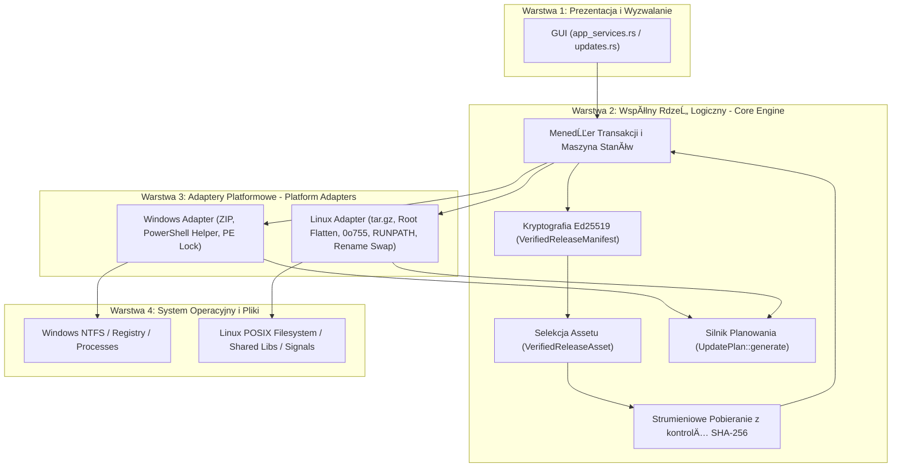
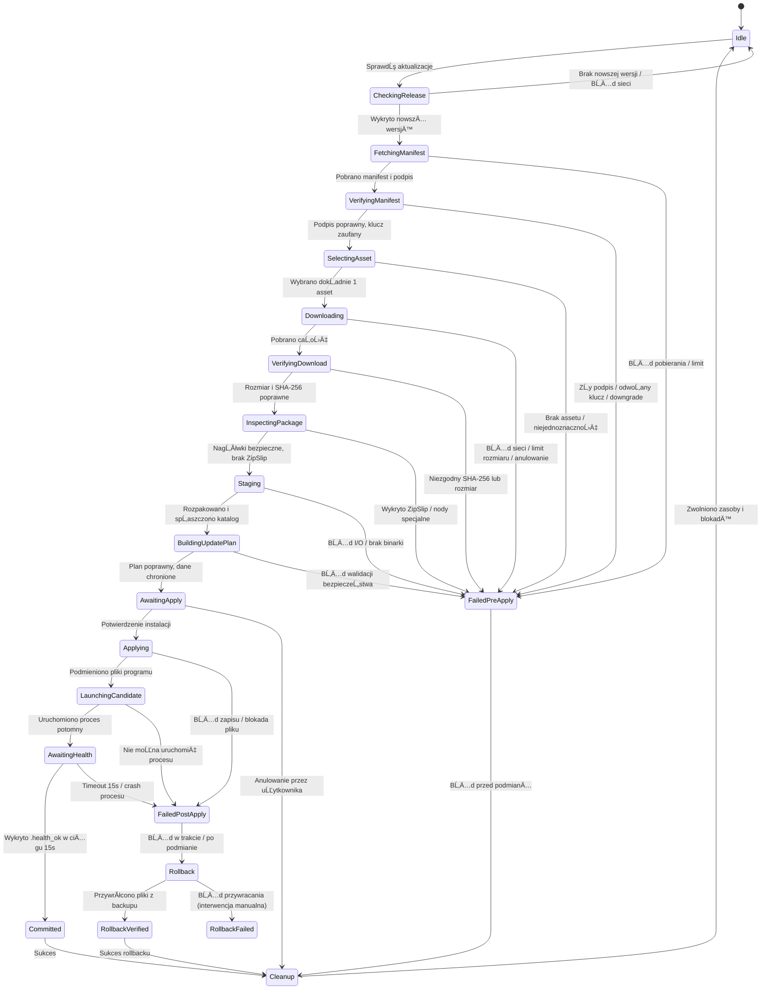

# PROJEKT ARCHITEKTONICZNY: WSPĂ“LNY INTERFEJS I RDZEŃ INSTALATORĂ“W PLATFORMOWYCH
# Dokument: DESIGN_3_0_C_PLATFORM_INSTALLERS.md

---

## 1. Status Dokumentu
- **Identyfikator:** `UPDATE-DESIGN-PLATFORM`
- **Etap:** `STAGE-M2-INSTALLER-DESIGN-GATE`
- **Status dokumentu:** `REVIEWED` (Oczekuje na formalne zatwierdzenie otwartych decyzji właściciela przez Właściciela repozytorium)
- **Gotowość wykonawcza M3:** `BLOCKED_BY_OWNER_DECISIONS` (Sekcja 39 i 54)
- **Data opracowania:** 2026-11-07 (Rzeczywista data wykonania M2)
- **Strefa czasowa:** `+01:00` (CET / Europe/Warsaw)
- **Autor / Rola:** GĹ‚Ăłwny Architekt Techniczny SPLogbook, Starszy Programista Rust 2024, Specjalista Bezpiecznych AktualizatorĂłw

---

## 2. Wersja i Historia Zmian
- **Wersja:** `2.0.0`
- **Historia:**
  - `v1.0.0` (2026-09-29): Wczesny szkic koncepcyjny podziału ról między rdzeń kryptograficzny a instalatory platformowe (historyczny commit pre-M1).
  - `v2.0.0` (2026-11-07): Kompletny projekt architektoniczny wspólnego rdzenia aktualizacji SPLogbook, formalizujący maszynę stanów, transakcyjny model instalacji (`UpdateAttemptId`), abstrakcję adapterów platformowych (`PlatformInstallerAdapter`), klasyfikację plików, model współbieżności, badanie pojemności dysku, procedury odzyskiwania po awarii (Crash Recovery) oraz ścisłą piramidę testów dla M3.

---

## 3. Baseline Git i Kontekst Techniczny
- **Baseline Git HEAD:** Commit po synchronizacji projektu Linux (`072f49e174d4e260ec9dfcfdca9b2f54190da831`).
- **Gałąź referencyjna:** `main` / `repair/full-system-remediation`
- **Wersja oprogramowania:** SPLogbook `v1.2.0` (kod źródłowy Rust 2024, MSRV 1.85+)
- **Relacja do dokumentów platformowych:** Niniejszy dokument stanowi specyfikację nadrzędną dla `DESIGN_3_0_A_WINDOWS_UPDATE.md` oraz `DESIGN_3_0_B_LINUX_UPDATE.md`.

---

## 4. Architektura Warstwowa (Layered Architecture)
Architektura aktualizatora SPLogbook dzieli się na cztery ściśle odizolowane warstwy:



### Granice odpowiedzialności warstw:
1. **Warstwa Prezentacji:** Odpowiada wyłącznie za asynchroniczne wyzwolenie operacji, odbiór zdarzeń postępu i prezentację statusu użytkownikowi. Nie podejmuje decyzji o zaufaniu ani nie dotyka plików na dysku.
2. **Wspólny Rdzeń Logiczny (Core Engine):** Odpowiada za weryfikację podpisu Ed25519, odrzucanie odwołanych kluczy, selekcję assetu, kontrolę limitów pobierania, weryfikację SHA-256, generowanie `UpdatePlan` oraz zarządzanie cyklem życia transakcji.
3. **Adaptery Platformowe:** Odpowiadają za specyficzne dla danego systemu operacyjnego operacje I/O: formaty archiwów (ZIP vs tar.gz), uprawnienia POSIX, procesy pomocnicze, radzenie sobie z blokadami plików i wywołania testów zdrowia.
4. **System Operacyjny:** ZarzÄ…dza fizycznym zapisem na dysku i procesami.

---

## 5. Maszyna StanĂłw Aktualizacji (Update State Machine)
Proces aktualizacji jest realizowany jako deterministyczny automat stanĂłw. KaĹĽda zmiana stanu jest jawna i rejestrowana w dzienniku transakcji.



---

## 6. WspĂłlne Typy Danych (Common Data Types)
Rdzeń aktualizatora operuje na ścisłych, niemutowalnych typach danych domenowych:

### 1. `UpdateAttemptId`
Unikalny identyfikator prĂłby aktualizacji (UUID v4), zapobiegajÄ…cy konfliktom i wiÄ…ĹĽÄ…cy wszystkie logi, pliki tymczasowe oraz znaczniki zdrowia.

### 2. `VerifiedReleaseManifest`
Manifest, którego sygnatura Ed25519 została matematycznie zweryfikowana względem listy `TRUSTED_KEYS` i który nie został podpisany odwołanym kluczem (`REVOKED_KEY_IDS`).

### 3. `VerifiedReleaseAsset`
Pojedynczy plik instalacyjny jednoznacznie wyselekcjonowany z manifestu na podstawie triady `(platform, arch, package_type)` z powiÄ…zanÄ… sumÄ… SHA-256 i zadeklarowanym rozmiarem.

### 4. `UpdatePlan`
Deterministyczny plan zmian na systemie plikĂłw:
- `replace_files`: pliki programu podlegajÄ…ce podmianie.
- `create_files`: nowe pliki programu lub ziarna instalacji.
- `preserve_files`: chronione dane uĹĽytkownika, bazy i konfiguracja.
- `rejected_files`: odrzucone pliki nierozpoznane (fail-closed).

### 5. `UpdateFileClass`
Klasyfikacja bezpieczeństwa pliku: `ProgramFile`, `RuntimeLibrary`, `FirstInstallSeed`, `UserData`, `UserConfiguration`, `ReferenceData`, `Cache`, `ReleaseMetadata`, `Unknown`.

---

## 7. Interfejs Adaptera Platformowego (Platform Adapter Trait)
Wszystkie specyficzne dla systemu operacyjnego operacje definiowane sÄ… przez wspĂłlny interfejs Rusta:

```rust
#[async_trait::async_trait]
pub trait PlatformInstallerAdapter: Send + Sync {
    /// Wykrywa typ bieĹĽÄ…cej instalacji i prawa zapisu.
    fn detect_installation_type(&self, base_dir: &Path) -> Result<InstallationType, UpdaterError>;

    /// Bada dostępność wolnego miejsca na dysku partycji docelowej i tymczasowej.
    fn check_disk_space(&self, base_dir: &Path, required_bytes: u64) -> Result<(), UpdaterError>;

    /// Dokonuje inspekcji nagłówków pobranego archiwum przed pełną ekstrakcją.
    fn inspect_archive(&self, archive_path: &Path, limits: &ArchiveLimits) -> Result<PackageInspection, UpdaterError>;

    /// Bezpiecznie rozpakowuje archiwum do wskazanego katalogu stagingu.
    fn extract_archive(&self, archive_path: &Path, staging_dir: &Path, limits: &ArchiveLimits) -> Result<(), UpdaterError>;

    /// Normalizuje układ katalogów stagingu (np. spłaszcza pojedynczy katalog nadrzędny).
    fn normalize_staging(&self, staging_dir: &Path) -> Result<(), UpdaterError>;

    /// Waliduje, czy w stagingu znajduje siÄ™ oczekiwany plik wykonywalny programu.
    fn validate_staging_executable(&self, staging_dir: &Path) -> Result<(), UpdaterError>;

    /// Tworzy kopiÄ™ zapasowÄ… podmienianych plikĂłw programu w katalogu rollback.
    fn prepare_backup(&self, base_dir: &Path, rollback_dir: &Path, plan: &UpdatePlan) -> Result<(), UpdaterError>;

    /// Aplikuje plan aktualizacji (podmienia pliki programu i tworzy nowe).
    fn apply_update(&self, base_dir: &Path, staging_dir: &Path, plan: &UpdatePlan, attempt_id: &UpdateAttemptId) -> Result<(), UpdaterError>;

    /// Uruchamia proces kandydata z flagÄ… diagnostycznÄ… --check-health-startup.
    fn launch_candidate(&self, exe_path: &Path, attempt_id: &UpdateAttemptId) -> Result<CandidateProcessHandle, UpdaterError>;

    /// Oczekuje na potwierdzenie zdrowia (.health_ok) kandydata.
    fn wait_for_health(&self, base_dir: &Path, handle: &mut CandidateProcessHandle, timeout: Duration) -> Result<bool, UpdaterError>;

    /// Wykonuje operacjÄ™ wycofania zmian (Rollback).
    fn execute_rollback(&self, base_dir: &Path, rollback_dir: &Path, plan: &UpdatePlan) -> Result<RollbackResult, UpdaterError>;

    /// SprzÄ…ta katalogi stagingu, kopii zapasowej i pliki tymczasowe.
    fn cleanup(&self, base_dir: &Path, staging_dir: &Path, rollback_dir: &Path) -> Result<(), UpdaterError>;
}
```

---

## 8. Wykrywanie Rodzaju Instalacji (Installation Detection)
Aktualizator wspiera ujednolicone rozpoznawanie instalacji:
- `PortableUserWritable`: pełne wsparcie automatycznej aktualizacji.
- `PortableReadOnly`: blokada aktualizacji z typowanym komunikatem błędu przed rozpoczęciem pobierania.
- `SystemManagedLocation`: kategoryczna odmowa automatycznej aktualizacji; odesłanie do menedżera pakietów dystrybucji lub ręcznej instalacji.
- `Unknown`: zachowanie fail-closed.

---

## 9. Granica Zaufania (Trust Boundary)
Zaufanie bazuje na asymetrycznej kryptografii Ed25519:
- **Elementy Zaufane:** Wkompilowane w kod aplikacji klucze publiczne `TRUSTED_KEYS` oraz logika weryfikatora.
- **Elementy Niezaufane:** GitHub API, nagłówki HTTP, serwery lustrzane CDN, lokalna konfiguracja użytkownika `station_config.json`, zmienne środowiskowe oraz zawartość pobranych archiwów.
- Zmiana w lokalnej konfiguracji nie może wymusić akceptacji nieznanego lub odwołanego klucza.

---

## 10. Abstrakcja Inspekcji PakietĂłw (Package Inspection)
Wynik inspekcji pakietu (`PackageInspection`) reprezentuje zbadane właściwości archiwum:
- Format kontenera (`Zip` / `TarGz`).
- Model korzenia (`Flat` / `SingleDirectory`).
- Liczba wpisów (musi być $\le 10\,000$).
- Łączny rozmiar po dekompresji (musi być $\le 200\text{ MB}$ dla Windows, $\le 250\text{ MB}$ dla Linux).
- Flaga wykrycia prób traversal (`..` lub ścieżek bezwzględnych).
- Flaga wykrycia niedozwolonych plików specjalnych (FIFO, nody urządzeń, hardlinki).
- Flaga bezpieczeństwa symlinków (dopuszczalne wyłącznie relatywne symlinki w `lib/` na Linuksie).

---

## 11. Izolowany Staging (Staging Contract)
1. Dekompresja odbywa siÄ™ zawsze do dedykowanego podkatalogu `.staging` wewnÄ…trz katalogu instalacji.
2. Katalog `.staging` przed rozpoczęciem nowej dekompresji jest czyszczony z wszelkich pozostałości po poprzednich próbach.
3. Wszelkie błędy dekompresji natychmiast usuwają katalog `.staging`.

---

## 12. Kontrakt Planu Aktualizacji (UpdatePlan Contract)
1. Plan generowany jest deterministycznie: lista plików wejściowych jest sortowana leksykograficznie przed przetwarzaniem.
2. Plan nie modyfikuje ĹĽadnych plikĂłw w trakcie generowania (pure function / dry-run).
3. Każda ścieżka podlega rygorystycznemu badaniu bezpieczeństwa (brak separatorów `..`, brak znaków wieloznacznych).

---

## 13. Polityka Klasyfikacji i Ochrony Danych
Wspólna zasada architektoniczna: **`UNKNOWN DATA CLASSIFICATION → DO NOT OVERWRITE`**.
- Pliki baz danych uĹĽytkownika (`default_log.db`), pliki logĂłw i kopii zapasowych QSO sÄ… traktowane jako nienaruszalne i wykluczone z podmiany.
- Plik konfiguracji `station_config.json` jest nienaruszalny.
- Pliki początkowych baz danych (`serviceLOG.db`, `callbook.db`) podlegają regule `FirstInstallSeed`: są kopiowane do instalacji wyłącznie wtedy, gdy dany plik docelowy **nie istnieje**. Jeśli plik istnieje, jest bezwzględnie zachowywany (`preserve_files`).
- Wszelkie nierozpoznane pliki w paczce aktualizacyjnej trafiajÄ… do `rejected_files` i nie sÄ… kopiowane.

---

## 14. Transakcyjny Model Aktualizacji (Transaction Model)
KaĹĽda operacja aktualizacji jest wiÄ…zana z transakcjÄ… o unikalnym identyfikatorze:
```rust
pub struct UpdateTransaction {
    pub attempt_id: UpdateAttemptId,
    pub target_version: String,
    pub target_commit: String,
    pub platform: ReleasePlatform,
    pub arch: ReleaseArchitecture,
    pub package_type: ReleasePackageType,
    pub manifest_sha256: String,
    pub asset_sha256: String,
    pub started_at: u64,
    pub current_phase: UpdatePhase,
    pub rollback_state: RollbackState,
}
```
Stan transakcji nie zawiera ĹĽadnych sekretĂłw, tokenĂłw ani danych QSO.

---

## 15. Kontrakt Kopii Zapasowej (Backup Contract)
- Kopia zapasowa w katalogu `.rollback` obejmuje **wyłącznie** pliki ze zbioru `replace_files` zdefiniowane w `UpdatePlan`.
- Kopia zapasowa nigdy nie dubluje plików użytkownika ani konfiguracji, co eliminuje ryzyko przywrócenia przestarzałej bazy podczas rollbacku.

---

## 16. Kontrakt Aplikowania Zmian (Apply Contract)
- Podmiana następuje bez użycia masek wieloznacznych (`*`).
- Każdy plik ze zbioru `replace_files` oraz `create_files` jest kopiowany/przenoszony z użyciem precyzyjnej, pojedynczej ścieżki literałowej.
- Na platformie Linux stosowane jest atomowe `rename()`; na Windows bezpieczne kopiowanie sterowane procesem pomocniczym po zamknięciu programu głównego.

---

## 17. Kontrakt Uruchomienia Kandydata (Launch Contract)
- Kandydat uruchamiany jest z flagÄ… diagnostycznÄ… `--check-health-startup`.
- Nowy proces otrzymuje identyfikator transakcji w środowisku lub parametrze wywołania.
- Czas oczekiwania na potwierdzenie wynosi maksymalnie 15 sekund.

---

## 18. Kontrakt Potwierdzenia Zdrowia (Health Contract)
- Potwierdzenie polega na utworzeniu przez proces kandydata pliku `.health_ok`.
- Plik `.health_ok` zawiera zserializowany rekord JSON: wersjÄ™, commit oraz `attempt_id`.
- Stary plik `.health_ok` jest usuwany przed uruchomieniem kandydata, co zapobiega akceptacji przestarzałego znacznika.

---

## 19. Kontrakt Wycofania Zmian (Rollback Contract)
W razie błędu testu zdrowia lub awarii kandydata:
1. Proces kandydata jest natychmiast zatrzymywany (`kill`).
2. Wszystkie nowo utworzone pliki (`create_files`) sÄ… usuwane.
3. Wszystkie pliki podmienione (`replace_files`) sÄ… przywracane z katalogu `.rollback`.
4. Poprzednia wersja programu jest ponownie uruchamiana.
5. Zwracany jest precyzyjny status: `RollbackResult::Success`, `RollbackResult::Partial` lub `RollbackResult::Failed`.

---

## 20. Kontrakt Czyszczenia (Cleanup Contract)
- Po pomyślnym potwierdzeniu zdrowia katalogi `.staging`, `.rollback` oraz znacznik `.health_ok` są bezwzględnie usuwane.
- Po udanym wycofaniu zmian (rollback) katalog `.staging` i znacznik sÄ… usuwane, a katalog `.rollback` jest zwalniany po przywrĂłceniu plikĂłw.

---

## 21. Odzyskiwanie po Awarii Zasilania (Crash Recovery)
- Przy każdym starcie aplikacji SPLogbook bada obecność pozostałości po przerwanych transakcjach.
- Jeśli wykryto porzucony katalog `.staging` lub `.rollback`, aplikacja weryfikuje spójność plików programu i usuwa niekompletne pozostałości.
- Przerwana transakcja nigdy nie jest wznawiana automatycznie w przĂłd.

---

## 22. Blokada Współbieżności (Concurrency Control)
- Plik blokady `$baseDir/.update.lock` gwarantuje, że w danym katalogu instalacji może toczyć się wyłącznie jedna operacja aktualizacji naraz.
- Blokada zawiera PID i czas rozpoczęcia; w przypadku wykrycia martwego procesu (Stale Lock) blokada jest bezpiecznie przejmowana po zalogowaniu ostrzeżenia.

---

## 23. Polityka Anulowania (Cancellation Policy)
- Anulowanie jest dozwolone w fazach: sprawdzania, pobierania, rozpakowywania i planowania.
- Po wejściu w fazę `Applying` (fizyczna podmiana plików) anulowanie przez użytkownika jest blokowane w interfejsie graficznym; ewentualny błąd wykonania wyzwala deterministyczny rollback.

---

## 24. Diagnostyka i Telemetria Lokalna
- Dziennik operacji zapisywany jest w pliku `update_audit.log`.
- Format wpisów: ISO 8601 UTC, poziom, `attempt_id`, faza, wynik, kod błędu.
- Bezwzględny zakaz umieszczania w logu kluczy prywatnych, danych QSO, poświadczeń i tokenów.

---

## 25. Hierarchia Błędów (Error Hierarchy)
Błędy aktualizatora są silnie typowane w enumie `UpdaterError`:
- **Błędy Zaufania i Kryptografii:** `MissingSignature`, `InvalidSignature`, `UntrustedKey`, `RevokedKeyRejected`, `DowngradeRejected`.
- **Błędy Manifestu i Assetu:** `ManifestParse`, `ManifestValidation`, `NoMatchingAssets`, `AmbiguousArtifact`, `SizeMismatch`, `HashMismatch`.
- **Błędy Archiwum i Stagingu:** `ZipSlip`, `UnsafeArchivePath`, `ArchiveLimitExceeded`, `InvalidStagingLayout`.
- **Błędy Wykonawcze i Systemowe:** `Io`, `SafetyGate`, `HealthCheckFailed`, `RollbackFailed`.

---

## 26. Macierz Zagrożeń Bezpieczeństwa Wspólnego Rdzenia

| ZagroĹĽenie | Wektor | Mitygacja Architektoniczna | Status |
|---|---|---|---|
| **Złośliwy manifest** | Podmiana odpowiedzi API | Weryfikacja podpisu Ed25519 z `TRUSTED_KEYS` | Wyeliminowane |
| **UĹĽycie skompromitowanego klucza** | Podpisanie starym kluczem 2026-01 | Rejestr `REVOKED_KEY_IDS` (fail-closed) | Wyeliminowane |
| **Atak Downgrade** | Wymuszenie starszej wersji | Weryfikacja SemVer (`verify_downgrade_protection`) | Wyeliminowane |
| **Podmiana pliku w locie (MITM)** | Modyfikacja strumienia pobierania | Strumieniowa weryfikacja SHA-256 z podpisanego manifestu | Wyeliminowane |
| **Uszkodzenie danych użytkownika** | Kopiowanie zawartości archiwum | Klasyfikacja `UpdateFileClass` + deterministyczny `UpdatePlan` | Wyeliminowane |
| **Równoległe aktualizacje** | Podwójne kliknięcie / dwa procesy | Wyłączna blokada plikowa `.update.lock` | Wyeliminowane |

---

## 27. Zgodność Formatu i Wersjonowanie
- Zgodność z SemVer 2.0.
- Schemat manifestu wydań pozostaje niezmieniony w fazie M2.
- Wsparcie dla wydań oficjalnych z archiwami `SPLogbook-Windows-x64.zip` oraz `SPLogbook-Linux-x86_64.tar.gz`.

---

## 28. Piramida TestĂłw dla Etapu M3 (Test Pyramid)
Architektura testowa M3 opiera siÄ™ na trzech poziomach:
1. **Testy Jednostkowe (Unit Tests):** Weryfikacja logiki czystej (klasyfikator ścieżek, planer `UpdatePlan`, walidacja limitów archiwów, detekcja ZipSlip) — szybkie, w 100% deterministyczne, wykonywane w pamięci i katalogach tymczasowych.
2. **Testy Integracyjne (Integration Tests):** Symulacja pełnego cyklu transakcji na makietach katalogów (tworzenie stagingu, generowanie backupu, podmiana, symulacja awarii kandydata, weryfikacja rollbacku).
3. **Natywne Testy Platformowe (CI Runners):** Wykonywanie testĂłw na fizycznych/wirtualnych runnerach Windows i Ubuntu w potoku GitHub Actions.

---

## 29. Wymagania DotyczÄ…ce RunnerĂłw Platformowych CI
- **Windows Runner:** `windows-latest` (Windows Server z PowerShell 5.1+).
- **Linux Runner:** `ubuntu-latest` (środowisko x86_64 z bibliotekami GLIBC).
- Testy nie mogą wymagać uprawnień administratora ani polecenia `sudo`.
- Testy HIL pozostają wyłączone (`#[ignore = "hardware-in-the-loop"]`).

---

## 30. Wpływ na Publiczne API
- Zmiany architektoniczne są hermetycznie zamknięte w module `src/cloud/updater.rs`.
- Interfejs wejściowy GUI w `src/gui/app_services.rs` (`trigger_update_install`) operuje na bezpiecznym, zweryfikowanym typie `VerifiedReleaseAsset`.

---

## 31. Wpływ na Formaty Danych i Bazy SQLite
- **Brak jakiegokolwiek wpływu:** Schematy baz SQLite (`serviceLOG.db`, `callbook.db`, `default_log.db`) pozostają nienaruszone.
- Struktura pliku konfiguracyjnego `station_config.json` pozostaje nienaruszona.

---

## 32. Wpływ na Zależności Cargo
- Projekt M2 nie dodaje ani nie modyfikuje żadnych zależności w `Cargo.toml` ani `Cargo.lock`.
- Wszelkie operacje bazujÄ… na istniejÄ…cych pakietach (`zip`, `tar`, `flate2`, `ed25519-dalek`, `sha2`, `walkdir`, `tempfile`).

---

## 33. Sekwencja Implementacji dla Etapu M3 (Implementation Sequence M3)
Wdrożenie M3 powinno nastąpić w następujących, ścisłych krokach inżynierskich:
1. **Krok M3-1 (Core Adapter Trait):** Zdefiniowanie cechy `PlatformInstallerAdapter` oraz unifikacja struktury `UpdateTransaction` w `src/cloud/updater.rs`.
2. **Krok M3-2 (Windows Hardening):** Utwardzenie generatora PowerShell w oparciu o precyzyjną listę plików z `UpdatePlan` oraz dodanie obsługi kodów powrotu health checku.
3. **Krok M3-3 (Linux In-Process / Rename):** Refaktoryzacja `install_via_tar_gz` do pełnej zgodności z `UpdatePlan` i atomowym `rename()`.
4. **Krok M3-4 (Health & Rollback Integration):** Zintegrowanie obsługi znacznika `.health_ok` z attempt ID w `main.rs`.
5. **Krok M3-5 (Crash Recovery & Lock):** Implementacja mechanizmu blokady współbieżności `.update.lock` oraz usuwania porzuconych stagingów przy starcie.
6. **Krok M3-6 (Platform CI Validation):** WĹ‚Ä…czenie natywnych testĂłw integracyjnych w potoku GitHub Actions.

---

## 34. Sekwencja CommitĂłw dla Etapu M3 (Commit Sequence M3)
- `feat(updater): introduce platform installer adapter and transaction state machine`
- `fix(updater): harden Windows update helper with strict UpdatePlan file lists`
- `fix(updater): implement atomic rename and rollback semantics for Linux tar.gz`
- `feat(updater): bind health confirmation marker with update attempt identity`
- `feat(updater): add update concurrency lock and crash recovery routines`
- `test(updater): add cross-platform integration test suite for update transactions`

---

## 35. Kryteria Ukończenia M3 (Definition of Done)
Etap M3 zostanie uznany za ukończony, gdy:
1. Kod źródłowy w `src/cloud/updater.rs` w pełni realizuje powyższą architekturę.
2. Wszystkie testy automatyczne przechodzą na Windows i Linux runnerach bez ostrzeżeń Clippy.
3. Bezpieczeństwo danych użytkownika i baz danych jest potwierdzone testami guard w `tests/security_guard.rs`.
4. W repozytorium nie ma żadnych wywołań `sudo`, `pkexec` ani niebezpiecznych masek wieloznacznych.

---

## 36. Zależności od Decyzji Właściciela (Owner Decision Dependencies)
Rozpoczęcie implementacji M3 jest zablokowane do czasu formalnego zatwierdzenia decyzji przez Właściciela repozytorium:
- `OWNER-M2-01` do `OWNER-M2-15` (szczegółowo opisane w rejestrze decyzji).
