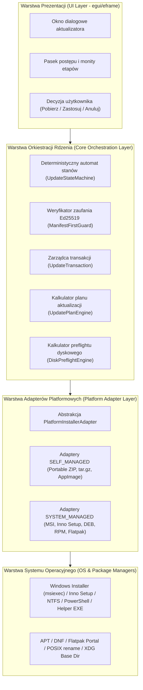
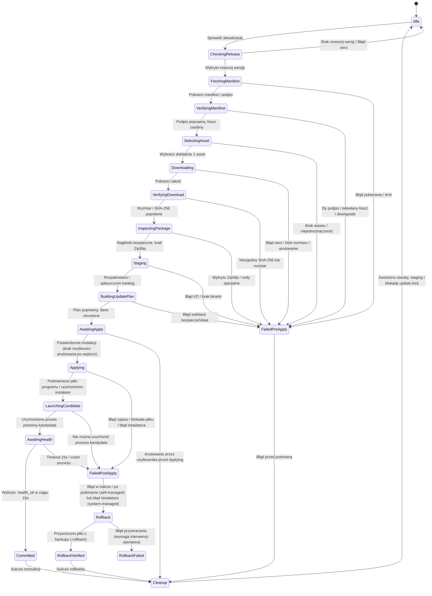

# PROJEKT ARCHITEKTONICZNY: WSPÓLNY KONTRAKT PLATFORMOWY INSTALATORÓW I MASZYNA STANÓW (ETAP M2)
# Dokument: DESIGN_3_0_C_PLATFORM_INSTALLERS.md

---

## 1. Status Dokumentu
- **Identyfikator:** `UPDATE-DESIGN-PLATFORM`
- **Etap:** `STAGE-M2-INSTALLER-DESIGN-GATE` / `STAGE-M2-OWNER-DECISIONS-APPROVAL-GATE`
- **Status dokumentu:** `APPROVED` (Formalnie zatwierdzony w bramce zatwierdzenia decyzji po formalnym przyjęciu 9 kluczowych decyzji Właściciela `OWNER-M2-01..07`, `13`, `15`)
- **Gotowość wykonawcza M3:** `READY_FOR_IMPLEMENTATION` (M3-BLOCKING DECISIONS: 0; prace implementacyjne M3 nierozpoczęte)
- **Data opracowania:** 2026-11-07 (Rzeczywista data wykonania bramki M2)
- **Strefa czasowa:** `+01:00` (CET / Central European Standard Time, UTC+01:00)
- **Autor / Rola:** Główny Architekt Techniczny SPLogbook, Starszy Programista Rust 2024, Specjalista Architektury Multi-Platform, Ed25519, Bezpiecznych Aktualizatorów i Zarządzania Roadmapą

---

## 2. Wersja i Historia Zmian
- **Wersja:** `2.1.0`
- **Historia:**
  - `v1.0.0` (2026-09-29): Szkic koncepcyjny ujednolicenia obsługi wydań na platformach Windows i Linux (pre-M1).
  - `v2.0.0` (2026-11-07): Kompletny projekt architektoniczny wspólnego rdzenia aktualizacji SPLogbook, formalizujący maszynę stanów, transakcyjny model instalacji (`UpdateAttemptId`), abstrakcję adapterów platformowych (`PlatformInstallerAdapter`), klasyfikację plików, model współbieżności, badanie pojemności dysku, procedury odzyskiwania po awarii (Crash Recovery) oraz piramidę testów dla M3 (`REVIEWED`).
  - `v2.1.0` (2026-11-07): Formalne zatwierdzenie rozszerzonego zakresu M3 przez Właściciela Projektu (`STAGE-M2-OWNER-DECISIONS-APPROVAL-GATE`). Uszczegółowienie automatu stanów (20 stanów łącznie: 14 stanów operacyjnych przepływu + 1 końcowy stan sukcesu `Committed` + 5 stanów obsługi błędów/rollbacku/odzyskiwania), formalne rozstrzygnięcie wpływu zależności na `UpdateAttemptId` (wykorzystanie istniejącej w `Cargo.toml` zależności `uuid = { version = "1", features = ["v4"] }`), wprowadzenie matematycznej formuły preflightu dyskowego (eliminacja arbitralnego 50 MB), podział adapterów na `SELF_MANAGED` i `SYSTEM_MANAGED`, formalizacja rozszerzeń typów manifestu wydań, rygorystyczny zakaz anulowania po wejściu w fazę `Applying` (`OWNER-M2-13`) oraz pełna macierz testów natywnych Windows i Linux (`OWNER-M2-15`) (`APPROVED`).

---

## 3. Baseline Git i Kontekst Techniczny
- **Baseline Git HEAD:** `8b425887838d3b1c2f67d7498e69163aceff5448`
- **Gałąź referencyjna:** `main` / `repair/full-system-remediation`
- **Wersja oprogramowania:** SPLogbook `v1.2.0` (kod źródłowy Rust 2024, MSRV 1.85+)
- **Relacja do dokumentów platformowych:** Niniejszy dokument stanowi specyfikację nadrzędną dla `DESIGN_3_0_A_WINDOWS_UPDATE.md` oraz `DESIGN_3_0_B_LINUX_UPDATE.md`.

---

## 4. Architektura Warstwowa (Layered Architecture)
Rdzeń aktualizatora SPLogbook zorganizowany jest w cztery ściśle odseparowane warstwy:



---

## 5. Maszyna Stanów Aktualizacji (Update State Machine)
Proces aktualizacji jest realizowany jako deterministyczny automat stanów. Każda zmiana stanu jest jawna, audytowana i rejestrowana w dzienniku transakcji.

### Spójna klasyfikacja i rozliczenie stanów automatu:
Automat stanów aktualizatora SPLogbook obejmuje łącznie **20 stanów**, sklasyfikowanych w dwóch równoważnych, komplementarnych ujęciach:

**Ujęcie A (Przepływ operacyjny vs Błędy i Wycofanie):**
1. **Stany operacyjne przepływu podstawowego (Operational Flow States): 14 stanów**
   - `Idle`, `CheckingRelease`, `FetchingManifest`, `VerifyingManifest`, `SelectingAsset`, `Downloading`, `VerifyingDownload`, `InspectingPackage`, `Staging`, `BuildingUpdatePlan`, `AwaitingApply`, `Applying`, `LaunchingCandidate`, `AwaitingHealth`.
2. **Końcowy stan sukcesu (Terminal Success State): 1 stan**
   - `Committed`.
3. **Stany obsługi błędów, wycofania i sprzątania (Error / Rollback / Cleanup Recovery States): 5 stanów**
   - `FailedPreApply`, `FailedPostApply`, `Rollback`, `RollbackVerified`, `Cleanup`.
- **Łączna liczba stanów (Total States): 14 + 1 + 5 = 20 stanów.**

**Ujęcie B (Stany główne i końcowe vs Stany odzyskiwania):**
1. **Stany główne i terminalne (Primary and Terminal States): 15 stanów** (14 stanów operacyjnych + 1 stan `Committed`).
2. **Stany błędów, rollbacku i odzyskiwania (Error/Rollback/Cleanup States): 5 stanów**.
- **Łączna liczba stanów (Total States): 15 + 5 = 20 stanów.**



---

## 6. Wspólne Typy Danych Domenowych (Common Data Types)
Rdzeń aktualizatora operuje na ścisłych, niemutowalnych typach danych domenowych:

### 1. `UpdateAttemptId` i Wykorzystanie UUID v4
- **Identyfikator próby aktualizacji:** `UpdateAttemptId(uuid::Uuid)`.
- **Weryfikacja zależności Cargo:** Zależność `uuid = { version = "1", features = ["v4"] }` znajduje się już bezpośrednio w `Cargo.toml:53`. W Etapie M3 **nie wprowadza się żadnych nowych zależności do Cargo** — kod bezpośrednio wykorzystuje `uuid::Uuid::new_v4()`.
- **Kontrakt logiczny `UpdateAttemptId`:**
  - **Unikalność:** Gwarancja braku kolizji w obrębie hosta i całego cyklu życia instalacji (122 bity losowości CSPRNG).
  - **Prywatność:** Bezwzględny zakaz kodowania danych osobowych, tożsamości stacji, znaków wywoławczych czy sekretów.
  - **Serializacja:** Bezpieczny format tekstowy UUID (36-znakowy hex-dash), implementujący cechy `Display`, `Serialize`, `Deserialize`.
  - **Użycie w systemie plików:** Bezpieczne stosowanie jako składowa nazw plików tymczasowych (`.health_ok_<attempt_id>`, `.update_probe_<attempt_id>.tmp`, `.update.lock`).
  - **Śledzenie audytowe:** Wiązanie logów audytowych, znaczników zdrowia oraz recovery porzuconych stagingów.

### 2. `VerifiedReleaseManifest`
Manifest, którego sygnatura Ed25519 została matematycznie zweryfikowana względem listy `TRUSTED_KEYS` i który nie został podpisany odwołanym kluczem (`REVOKED_KEY_IDS`).

### 3. `VerifiedReleaseAsset`
Pojedynczy plik instalacyjny jednoznacznie wyselekcjonowany z manifestu na podstawie triady `(platform, arch, package_type)` z powiązaną sumą SHA-256 i zadeklarowanym rozmiarem.

### 4. `UpdatePlan`
Deterministyczny plan zmian na systemie plików:
- `replace_files`: pliki programu podlegające podmianie.
- `create_files`: nowe pliki programu lub ziarna instalacji.
- `preserve_files`: chronione dane użytkownika, bazy i konfiguracja.
- `rejected_files`: odrzucone pliki nierozpoznane (fail-closed).

### 5. `UpdateFileClass`
Klasyfikacja bezpieczeństwa pliku: `ProgramFile`, `RuntimeLibrary`, `FirstInstallSeed`, `UserData`, `UserConfiguration`, `ReferenceData`, `Cache`, `ReleaseMetadata`, `Unknown`.

---

## 7. Podział Adapterów: SELF_MANAGED vs SYSTEM_MANAGED
W architekturze M3 adaptery platformowe dzielą się na dwie fundamentalne kategorie z zachowaniem zasady `Separation of Concerns`:

### Kategoria 1: Adaptery Zarządzane Własnoręcznie (SELF_MANAGED)
- **Formaty:** Windows Portable ZIP, Linux Portable tar.gz, Linux AppImage.
- **Odpowiedzialność SPLogbook:**
  - Pełna orkiestracja transakcji na poziomie systemu plików.
  - Inspekcja archiwum (ochrona przed Zip-Slip i bombami dekompresyjnymi).
  - Rozpakowanie do katalogu stagingu (`.staging`).
  - Budowa i egzekwowanie planu `UpdatePlan`.
  - Tworzenie kopii zapasowej w `.rollback`.
  - Atomowa podmiana plików (POSIX `rename`) lub delegacja do helpera Windows (`splogbook-updater.exe` / PowerShell).
  - Uruchomienie kandydata z flagą `--check-health-startup`.
  - Automatyczny rollback w razie awarii.
  - Czyszczenie zasobów tymczasowych.

### Kategoria 2: Adaptery Zarządzane Systemowo (SYSTEM_MANAGED)
- **Formaty:** Windows MSI (WiX), Windows Inno Setup (EXE), Linux DEB (APT), Linux RPM (DNF), Linux Flatpak.
- **Odpowiedzialność SPLogbook:**
  - Wykrycie typu instalacji systemowej.
  - Sprawdzenie dostępności nowej wersji w podpisanym manifeście wydań.
  - Pobranie i weryfikacja integralności instalatora (SHA-256 + Ed25519), o ile model wydania to przewiduje.
  - Prezentacja użytkownikowi informacji o ścieżce aktualizacji systemowej.
  - Delegacja wykonania do właściwego menedżera pakietów lub instalatora (`msiexec.exe`, `setup.exe`, `apt`, `dnf`, `flatpak`).
  - Monitorowanie kodu powrotu (jeśli instalator wywoływany jest interaktywnie z poziomu GUI).
  - **Bezwzględny zakaz bezpośredniej podmiany plików w katalogach systemowych (`Program Files`, `/usr`).**
  - **Bezwzględny zakaz wywoływania poleceń `sudo`, `doas` i `pkexec` oraz automatycznej eskalacji uprawnień.**

---

## 8. Interfejs Adaptera Platformowego (Platform Adapter Trait)
Wszystkie operacje instalatorów definiowane są przez wspólny interfejs Rusta, rozszerzony o obsługę delegacji systemowej:

```rust
#[async_trait::async_trait]
pub trait PlatformInstallerAdapter: Send + Sync {
    /// Wykrywa typ bieżącej instalacji i prawa zapisu.
    fn detect_installation_type(&self, base_dir: &Path) -> Result<InstallationType, UpdaterError>;

    /// Określa, czy dany typ instalacji jest zarządzany przez aplikację (SelfManaged), czy przez system (SystemManaged).
    fn management_mode(&self, inst_type: InstallationType) -> ManagementMode;

    /// Bada dostępność wolnego miejsca na dysku w oparciu o pełną formułę preflightu.
    fn check_disk_space(&self, base_dir: &Path, preflight: &DiskPreflightRequirements) -> Result<(), UpdaterError>;

    /// Dokonuje inspekcji nagłówków pobranego archiwum przed pełną ekstrakcją (dla formatów portable).
    fn inspect_archive(&self, archive_path: &Path, limits: &ArchiveLimits) -> Result<PackageInspection, UpdaterError>;

    /// Bezpiecznie rozpakowuje archiwum do wskazanego katalogu stagingu.
    fn extract_archive(&self, archive_path: &Path, staging_dir: &Path, limits: &ArchiveLimits) -> Result<(), UpdaterError>;

    /// Normalizuje układ katalogów stagingu (np. spłaszcza pojedynczy katalog nadrzędny).
    fn normalize_staging(&self, staging_dir: &Path) -> Result<(), UpdaterError>;

    /// Waliduje, czy w stagingu znajduje się oczekiwany plik wykonywalny programu.
    fn validate_staging_executable(&self, staging_dir: &Path) -> Result<(), UpdaterError>;

    /// Tworzy kopię zapasową podmienianych plików programu w katalogu rollback (dla SELF_MANAGED).
    fn prepare_backup(&self, base_dir: &Path, rollback_dir: &Path, plan: &UpdatePlan) -> Result<(), UpdaterError>;

    /// Aplikuje plan aktualizacji w trybie SELF_MANAGED (podmienia pliki programu i tworzy nowe).
    fn apply_self_managed_update(
        &self,
        base_dir: &Path,
        staging_dir: &Path,
        plan: &UpdatePlan,
        attempt_id: &UpdateAttemptId,
    ) -> Result<(), UpdaterError>;

    /// Deleguje wykonanie aktualizacji do instalatora systemowego lub menedżera pakietów (dla SYSTEM_MANAGED).
    fn delegate_system_managed_update(
        &self,
        installer_path: Option<&Path>,
        inst_type: InstallationType,
    ) -> Result<DelegationResult, UpdaterError>;

    /// Uruchamia proces kandydata z flagą diagnostyczną --check-health-startup.
    fn launch_candidate(&self, exe_path: &Path, attempt_id: &UpdateAttemptId) -> Result<CandidateProcessHandle, UpdaterError>;

    /// Wykonuje procedurę wycofania zmian (Rollback).
    fn perform_rollback(&self, base_dir: &Path, rollback_dir: &Path, plan: &UpdatePlan) -> Result<(), UpdaterError>;

    /// Dokonuje czyszczenia zasobów tymczasowych po pomyślnej aktualizacji lub rollbacku.
    fn cleanup_temporary_resources(&self, base_dir: &Path) -> Result<(), UpdaterError>;
}
```

---

## 9. Wykrywanie Rodzaju Instalacji (Installation Detection)
Aktualizator definiuje zunifikowany typ wyliczeniowy rodzajów instalacji dla wszystkich wspieranych platform:

```rust
#[derive(Debug, Clone, Copy, PartialEq, Eq, Hash)]
pub enum InstallationType {
    /// Windows: aplikacja przenośna w archiwum ZIP.
    WindowsPortableZip,
    /// Windows: pakiet instalacyjny Windows Installer (MSI) utworzony przez WiX.
    WindowsMsi,
    /// Windows: instalator interaktywny EXE utworzony przez Inno Setup.
    WindowsInnoSetup,
    /// Linux: archiwum przenośne tar.gz w katalogu domowym użytkownika.
    LinuxPortableTarGz,
    /// Linux: samodzielny obraz wykonywalny AppImage.
    LinuxAppImage,
    /// Linux: pakiet dystrybucyjny DEB (Debian/Ubuntu/Mint) zarządzany przez APT.
    LinuxDeb,
    /// Linux: pakiet dystrybucyjny RPM (Fedora/RHEL/openSUSE) zarządzany przez DNF.
    LinuxRpm,
    /// Linux: pakiet kontenerowy Flatpak uruchomiony w sandboxie.
    LinuxFlatpak,
    /// Instalacja nierozpoznana, ścieżka sieciowa lub system plików tylko do odczytu.
    UnknownInstallation,
}

#[derive(Debug, Clone, Copy, PartialEq, Eq)]
pub enum ManagementMode {
    SelfManaged,
    SystemManaged,
}
```

---

## 10. Formaty Manifestu Wydań (Package Types Evaluation)
W ramach Etapu M3 formalnie zidentyfikowano potrzebę obsługi następujących typów pakietów w manifeście:

| `package_type` | Platforma | Architektura | Konwencja nazewnicza assetu | Tryb zarządzania |
|---|---|---|---|---|
| `windows-portable-zip` | `windows` | `x86_64` | `SPLogbook-Windows-x64.zip` | `SelfManaged` |
| `windows-msi` | `windows` | `x86_64` | `SPLogbook-Windows-x64.msi` | `SystemManaged` |
| `windows-inno-exe` | `windows` | `x86_64` | `SPLogbook-Windows-x64-Setup.exe` | `SystemManaged` |
| `linux-portable-tar-gz` | `linux` | `x86_64` | `SPLogbook-Linux-x86_64.tar.gz` | `SelfManaged` |
| `linux-appimage` | `linux` | `x86_64` | `SPLogbook-Linux-x86_64.AppImage` | `SelfManaged` |
| `linux-deb` | `linux` | `x86_64` | `SPLogbook-Linux-x86_64.deb` | `SystemManaged` |
| `linux-rpm` | `linux` | `x86_64` | `SPLogbook-Linux-x86_64.rpm` | `SystemManaged` |
| `linux-flatpak` | `linux` | `x86_64` | `org.splogbook.SPLogbook.flatpak` | `SystemManaged` |

> [!IMPORTANT]
> **Adnotacja architektoniczna dot. schematu manifestu:**
> `MANIFEST SCHEMA EXTENSION REQUIRED IN M3 OR DEDICATED PRE-M3 TASK;`
> Obecny schemat JSON validatora oraz parser `ReleasePackageType` w kodzie `src/cloud/updater.rs` obsługują wyłącznie wartości `zip` oraz `tar.gz`. Rozszerzenie schematu manifestu i parsera o powyższe wartości zostanie zrealizowane w Etapie M3 w ramach dedykowanego kroku implementacyjnego. W niniejszej bramce projektowej schemat kodu źródłowego pozostaje nienaruszony.

---

## 11. Formuła Badania Pojemności Dysku (Disk Space Preflight)
Arbitralny margines 50 MB został kategorycznie zastąpiony ścisłą, parametryczną formułą preflightu dyskowego:

$$	ext{RequiredSpace} = 	ext{DeclaredDownloadSize} + 	ext{MaxExtractedSize} + 	ext{BackupSize} + 	ext{PackageManagerOverhead} + 	ext{TransactionMetadataSize} + 	ext{FilesystemSafetyMargin}$$

### Definicja składników:
1. **`DeclaredDownloadSize`:** Rozmiar assetu instalacyjnego zdeklarowany w podpisanym manifeście wydań (`size`).
2. **`MaxExtractedSize`:**
   - Dla formatów portable (ZIP, tar.gz) oraz AppImage: maksymalny rozmiar po rozpakowaniu wyliczony z nagłówków archiwum lub ograniczony przez `ArchiveLimits::MAX_TOTAL_BYTES` (~60–100 MB).
   - Dla formatów zarządzanych systemowo (MSI, Inno Setup, DEB, RPM, Flatpak): 0 bajtów (ekstrakcja odbywa się pod kontrolą menedżera pakietów).
3. **`BackupSize`:**
   - Dla formatów portable: łączny rozmiar plików podlegających podmianie (`replace_files`), kopiowanych do `.rollback` (~40–50 MB).
   - Dla formatów zarządzanych systemowo: szacunkowy narzut kopii zapasowej menedżera systemu (np. punkt przywracania systemu Windows Installer).
4. **`PackageManagerOverhead`:**
   - Dla formatów portable: 0 bajtów.
   - Dla Windows Installer (MSI): bufor pamięci podręcznej `%SystemRoot%\Installer` szacowany jako $1.5 	imes 	ext{Rozmiar MSI}$.
   - Dla Inno Setup: bufor deinstalatora i kopii zapasowej (~5 MB).
   - Dla APT (DEB): bufor `/var/cache/apt/archives` szacowany jako $2 	imes 	ext{Rozmiar DEB}$.
   - Dla DNF (RPM): bufor `/var/cache/dnf` szacowany jako $2 	imes 	ext{Rozmiar RPM}$.
   - Dla Flatpak: narzut magazynu ostree szacowany jako $1.2 	imes 	ext{Rozmiar pobierania}$.
5. **`TransactionMetadataSize`:** Narzut na pliki blokad współbieżności, logi audytowe JSON i metadane transakcji (~1 MB).
6. **`FilesystemSafetyMargin`:** Konfigurowalny bufor bezpieczeństwa systemu plików:
   - Wartość minimalna: **25 MB**.
   - Wartość maksymalna: **100 MB**.
   - Wartość domyślna: **32 MB**.
   - Rola: zapobieganie całkowitemu wyczerpaniu tablic alokacji i wolnych bloków systemu plików.

---

## 12. Polityka Anulowania Transakcji (`OWNER-M2-13`)
- **Faza bezpieczna (Przed wejściem w stan `Applying`):**
  - Anulowanie jest w pełni dozwolone w stanach: `CheckingRelease`, `FetchingManifest`, `VerifyingManifest`, `SelectingAsset`, `Downloading`, `VerifyingDownload`, `InspectingPackage`, `Staging`, `BuildingUpdatePlan`, `AwaitingApply`.
  - Skutek: Natychmiastowe przerwanie operacji, bezpieczne usunięcie plików tymczasowych, usunięcie stagingu, zwolnienie blokady `.update.lock`. Stan programu pozostaje w 100% nienaruszony.
- **Faza krytyczna (Po wejściu w stan `Applying`):**
  - Po rozpoczęciu podmiany plików programu (dla formatów portable) lub po uruchomieniu instalatora systemowego, **anulowanie przez użytkownika jest bezwzględnie zablokowane** (`OWNER-M2-13`).
  - Przycisk anulowania w interfejsie GUI zostaje zablokowany/ukryty.
  - Żądania anulowania nie przerywają operacji zapisu i podmiany plików.
  - W razie awarii operacji I/O proces przechodzi automatycznie do procedury Rollbacku (dla SELF_MANAGED) lub procedury recovery instalatora systemowego (dla SYSTEM_MANAGED).

---

## 13. Macierz Zagrożeń Bezpieczeństwa Wspólnego Rdzenia (Security Matrix)

| ID Zagrożenia | Wektor ataku / Błąd | Format / Obszar | Mechanizm mitygacji w projekcie | Ryzyko szczątkowe |
|---|---|---|---|---|
| **THR-CORE-01** | Podmiana manifestu / Man-in-the-Middle | Wszystkie | Weryfikacja sygnatury Ed25519 względem twardej listy zaufanych kluczy; blokada odwołanych kluczy | Wyeliminowane |
| **THR-CORE-02** | Downgrade ataku wersji programu | Wszystkie | Ścisła walidacja SemVer — odmowa aktualizacji do wersji równej lub niższej niż bieżąca | Wyeliminowane |
| **THR-CORE-03** | Nadpisanie baz danych użytkownika | Wszystkie | Bazy `default_log.db` kategorycznie chronione w `preserve_files`; seed baz kopiowany wyłącznie przy fresh install | Wyeliminowane |
| **THR-CORE-04** | Nadpisanie pliku konfiguracyjnego | Wszystkie | `station_config.json` wykluczony ze stagingu i rollbacku | Wyeliminowane |
| **THR-CORE-05** | Niezgodność sumy kontrolnej assetu | Wszystkie | Weryfikacja SHA-256 strumieniowo i lokalnie przed jakimkolwiek rozpakowaniem | Wyeliminowane |
| **THR-CORE-06** | Zip-Slip / Tar-Traversal | Portable ZIP/tar | `validate_archive_relative_path` + canonicalize prefix check | Wyeliminowane |
| **THR-CORE-07** | Decompression Bomb (DoS dysku) | Portable ZIP/tar | Limity `ArchiveLimits`: max 10 000 wpisów, max 150 MB pojedynczy plik, max 250 MB łącznie | Wyeliminowane |
| **THR-CORE-08** | Mieszanie instalacji (Cross-Format Confusion)| Windows/Linux | Ścisła klasyfikacja `InstallationType`; zakaz aplikowania MSI na Portable lub tar.gz na DEB | Wyeliminowane |
| **THR-CORE-09** | Eskalacja uprawnień przez `sudo`/`pkexec` | Linux | Kategoryczny zakaz wywoływania narzędzi eskalacji w kodzie aplikacji; delegacja do menedżera pakietów | Wyeliminowane |
| **THR-CORE-10** | Nieautoryzowane akcje skryptowe instalatora | MSI / Inno | Zakaz Custom Actions w WiX; weryfikacja sum i podpisów instalatorów przed uruchomieniem | Wyeliminowane |
| **THR-CORE-11** | Anulowanie w fazie krytycznej | Wszystkie | Bezwzględny zakaz anulowania po wejściu w stan `Applying` (`OWNER-M2-13`) | Wyeliminowane |
| **THR-CORE-12** | Crash kandydata po aktualizacji | Wszystkie | Health confirmation (`.health_ok`) + automatyczny, deterministyczny rollback | Wyeliminowane |
| **THR-CORE-13** | Przepełnienie dysku w trakcie aktualizacji | Wszystkie | Dynamiczna formuła preflightu dyskowego z konfigurowalnym buforem bezpieczeństwa | Wyeliminowane |
| **THR-CORE-14** | Wyciek sekretów w logach audytowych | Wszystkie | Ścisła redakcja logów audytowych: brak haseł, tokenów, kluczy prywatnych i danych łączności | Wyeliminowane |

---

## 14. Wymagania Dotyczące Testów Natywnych (`OWNER-M2-15`)
Zgodnie z formalnie zatwierdzoną decyzją `OWNER-M2-15`, Etap M3 bezwzględnie wymaga uruchomienia i weryfikacji pełnego zestawu testów natywnych na dedykowanych runnerach Windows i Linux w potoku CI:

### Macierz testów Windows x86_64:
- Portable ZIP: fresh install, update, locked EXE handling, PowerShell helper, native helper EXE, health success, health failure, rollback, zachowanie danych użytkownika.
- MSI: clean install, upgrade, repair, uninstall, rollback on failure, files in use, reboot-required result (3010), per-user/per-machine policy, zachowanie danych w `%APPDATA%`.
- Inno Setup: clean install, upgrade, uninstall, silent mode, failure recovery, zachowanie danych użytkownika, wykrywanie kolizji z MSI.

### Macierz testów Linux x86_64:
- Portable tar.gz: update, permissions `0o755`, RUNPATH `$ORIGIN/lib`, hermetyzacja Hamlib, atomowy rollback, zachowanie danych w `/home`.
- AppImage: executable bit `0o755`, clean launch, update, backup poprzedniego obrazu, rollback przy awarii, integracja desktopowa, zachowanie danych w XDG.
- DEB: budowa pakietu (`dpkg-deb`), walidacja `lintian`, clean install, upgrade, remove, purge behavior, zachowanie danych w katalogu domowym, delegacja do APT.
- RPM: budowa pakietu (`rpmbuild`), walidacja `rpmlint`, install, upgrade, remove, zachowanie baz użytkownika, delegacja do DNF.
- Flatpak: budowa manifestu (`flatpak-builder`), sandbox isolation, uprawnienia sprzętowe USB/TTY, portale XDG, zachowanie danych aplikacji.

---

## 15. CI i Przyszły Potok Wydań (Future Release Pipeline Design)
W Etapie M3 potok wydań `.github/workflows/build-and-release.yml` zostanie rozbudowany o następujące zadania:
1. **Windows Build & Packaging:**
   - Kompilacja `SPLogbook.exe` oraz natywnego helpera `splogbook-updater.exe`.
   - Pakowanie `SPLogbook-Windows-x64.zip`.
   - Budowanie pakietu MSI za pomocą WiX Toolset v4/v5.
   - Budowanie instalatora Setup EXE za pomocą Inno Setup 6+.
2. **Linux Build & Packaging:**
   - Kompilacja `splogbook` z hermetyzacją `libhamlib.so.4` i `RUNPATH`.
   - Pakowanie `SPLogbook-Linux-x86_64.tar.gz`.
   - Budowanie pakietu AppImage za pomocą `appimagetool`.
   - Budowanie pakietu DEB za pomocą `dpkg-deb`.
   - Budowanie pakietu RPM za pomocą `rpmbuild`.
   - Budowanie pakietu Flatpak za pomocą `flatpak-builder`.
3. **Wymagania infrastrukturalne i nierozstrzygnięte certyfikaty:**
   - Podpisywanie Authenticode dla Windows wymaga certyfikatu zaufanego przez Microsoft.
   - Podpisywanie repozytoriów DEB i RPM wymaga dedykowanego klucza GPG.
   - Dystrybucja Flatpak przez Flathub wymaga rejestracji App ID w rejestrze Flathub.
   - Powyższe elementy stanowią odrębne wymagania wdrożeniowe i nie blokują implementacji binariów w M3.

---

## 16. Rejestr Decyzji Właściciela i Status Formalny
W ramach bramki `STAGE-M2-OWNER-DECISIONS-APPROVAL-GATE` formalnie przyjęto i zatwierdzono 9 kluczowych decyzji Właściciela:

| ID Decyzji | Treść decyzji | Zatwierdzony wariant | Status formalny | Blokuje M3? |
|---|---|---|---|---|
| **`OWNER-M2-01`** | Formaty wydań Windows w M3 | **APPROVED — EXPANDED OPTION A** (Portable ZIP, WiX MSI, Inno Setup EXE) | **APPROVED** | **NIE (0)** |
| **`OWNER-M2-02`** | Wdrożenie MSI (WiX) i Inno Setup | **APPROVED — EXPANDED OPTION A** (Projekt i implementacja pełnego cyklu życia) | **APPROVED** | **NIE (0)** |
| **`OWNER-M2-03`** | Wybór procesu pomocniczego Windows | **APPROVED — DUAL HELPER MODEL** (Primary: `splogbook-updater.exe`, Fallback: PowerShell) | **APPROVED** | **NIE (0)** |
| **`OWNER-M2-04`** | Formaty wydań Linux w M3 | **APPROVED — EXPANDED OPTION A** (Portable tar.gz, pakiety DEB i RPM) | **APPROVED** | **NIE (0)** |
| **`OWNER-M2-05`** | Wdrożenie formatu AppImage | **APPROVED — APPIMAGE REQUIRED** (Dedykowany asset `SPLogbook-Linux-x86_64.AppImage`) | **APPROVED** | **NIE (0)** |
| **`OWNER-M2-06`** | Integracja DEB, RPM i Flatpak z updaterem | **APPROVED — MANAGED PACKAGE INTEGRATION** (Wykrywanie, monity, delegacja do APT/DNF/Flatpak) | **APPROVED** | **NIE (0)** |
| **`OWNER-M2-07`** | Granica menedżera pakietów i zakaz eskalacji | **APPROVED — SYSTEM PACKAGE MANAGER BOUNDARY** (Zakaz `sudo`/`doas`/`pkexec`; brak podmiany w `/usr`) | **APPROVED** | **NIE (0)** |
| **`OWNER-M2-08`** | Retencja katalogu kopii zapasowej `.rollback` | Opcja 1 (Usunięcie po pomyślnym potwierdzeniu zdrowia) | OPEN (Zalecane zatwierdzenie) | NIE |
| **`OWNER-M2-09`** | Natychmiastowe usuwanie backupu programu | Opcja 1 (Usuwać natychmiast w celu oszczędności miejsca) | OPEN (Zalecane zatwierdzenie) | NIE |
| **`OWNER-M2-10`** | Polityka aktualizacji bazy referencyjnej `serviceLOG.db` | Opcja 1 (FirstInstallSeed w M3, dedykowana migracja w M4) | OPEN (Zalecane zatwierdzenie) | NIE |
| **`OWNER-M2-11`** | Polityka aktualizacji bazy referencyjnej `callbook.db` | Opcja 1 (FirstInstallSeed w M3, dedykowana migracja w M4) | OPEN (Zalecane zatwierdzenie) | NIE |
| **`OWNER-M2-12`** | Retencja dziennika aktualizacji `update_audit.log` | Opcja 1 (Ostatnie 10 prób / 500 wpisów) | OPEN (Zalecane zatwierdzenie) | NIE |
| **`OWNER-M2-13`** | Polityka anulowania aktualizacji w locie | **APPROVED — NON-CANCELLABLE APPLY** (Zakaz anulowania po wejściu w stan `Applying`) | **APPROVED** | **NIE (0)** |
| **`OWNER-M2-14`** | Obsługa wznawiania pobierania (Range Resume) | Opcja 1 (Pobieranie całościowe z weryfikacją SHA-256) | OPEN (Zalecane zatwierdzenie) | NIE |
| **`OWNER-M2-15`** | Wymóg natywnych testów na Windows i Linux runnerach | **APPROVED — NATIVE PLATFORM TESTS REQUIRED** (Obowiązkowe testy natywne dla M3) | **APPROVED** | **NIE (0)** |

**Bilans decyzji blokujących Etap M3:**
- Liczba wszystkich zidentyfikowanych decyzji: **15**.
- Liczba decyzji blokujących M3 przed zatwierdzeniem: **9** (`OWNER-M2-01..07`, `13`, `15`).
- Liczba decyzji formalnie zatwierdzonych w niniejszej bramce: **9**.
- Liczba decyzji blokujących M3 po zatwierdzeniu: **0**.
- Pozostałe decyzje otwarte (nieblokujące M3): **6** (`OWNER-M2-08..12`, `14`).

---

## 17. Status Końcowy Etapu M2 i Gotowość Etapu M3
- **Status dokumentu `UPDATE-DESIGN-WIN`:** `APPROVED`.
- **Status dokumentu `UPDATE-DESIGN-LINUX`:** `APPROVED`.
- **Status dokumentu `UPDATE-DESIGN-PLATFORM`:** `APPROVED`.
- **Status Etapu M2:** `COMPLETED_DESIGN_VERIFIED`.
- **Status Etapu M3:** `READY_FOR_IMPLEMENTATION`.
- **Stan prac wykonawczych M3:** `NOT STARTED` (żadne zmiany implementacyjne M3 nie zostały podjęte w niniejszej bramce).
