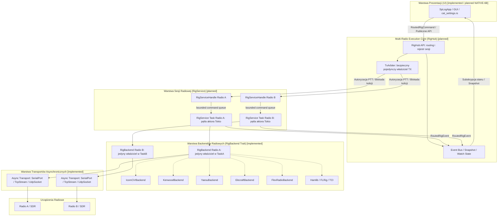

# Native CAT — Architektura natywnych protokołów radiotelefonów SPLogbook

Stan odniesienia: SPLogbook v1.2.0, commit bazowy `ca125ec739821a1fad3e7e496732581c4ae67c59`, Rust Edition 2024.

---

## 1. Cele programu

Głównym celem programu **NATIVE-CAT** jest wdrożenie bezpośredniej, asynchronicznej i niezależnej od zewnętrznych bibliotek (takich jak Hamlib) komunikacji z radiotelefonami amatorskimi. Hamlib (`rigctld`) pozostaje w pełni wspieranym, uniwersalnym backendem CAT, jednak natywne protokoły pozwalają na:
1. Bezpośrednią pracę przez porty szeregowe / USB Virtual COM bez konieczności uruchamiania zewnętrznego procesu `rigctld`.
2. Dostęp do zaawansowanych możliwości producentów (Main/Sub VFO, Dualwatch, sterowanie filtrami DSP, nastawy RIT/XIT, precyzyjne odczyty mierników, zdarzenia transceive/broadcast), których uogólniony kontrakt Hamlib nie udostępnia lub udostępnia z opóźnieniem.
3. Wyeliminowanie narzutu i niestabilności pośrednich procesów w systemach Windows, Linux i macOS.
4. Zagwarantowanie najwyższego poziomu niezawodności, determinizmu i bezpieczeństwa operacji nadawczo-odbiorczych (w szczególności rygorystyczne bezpieczeństwo PTT).

---

## 2. Zakres

Program NATIVE-CAT obejmuje:
1. **Wspólny asynchroniczny transport szeregowy** (`tokio-serial`, obsługa baud rate, bitów danych, parzystości, bitów stopu, kontroli przepływu, bezpiecznych timeoutów, strumieniowego buforowania i odporności na fragmentację).
2. **Architekturę profili urządzeń i rejestru modeli** (`RigModelProfile`, `NativeCapabilities`, precyzyjne mapy trybów i ograniczeń pasm).
3. **Wdrożenie falami natywnych backendów i warstwy wykonawczej**:
   - **NATIVE-1**: Icom CI-V (kodowanie binarne/BCD, ramki FE FE ... FD, obsługa ACK/NAK, filtracja echa, obsługa zdarzeń transceive),
   - **NATIVE-2**: Kenwood PC Control (komendy tekstowe ASCII zakończone średnikiem, Auto Information, obsługa portów szeregowych i LAN),
   - **NATIVE-3**: Yaesu CAT (rozróżnienie rodzin klasycznych binarnych i współczesnych tekstowych ASCII),
   - **NATIVE-4**: Elecraft (rodziny K3/KX oraz K4 LAN/Ethernet),
   - **NATIVE-5**: FlexRadio SmartSDR API (TCP discovery/command API, slices, metering),
   - **NATIVE-6A**: Multi-Radio Execution Core, RigHub i bezpieczny arbitraż TX (bezgłowa warstwa wykonawcza),
   - **NATIVE-6B**: Fabryka backendów, migracja konfiguracji i integracja UI (cat_settings.rs, dynamiczne panele, i18n),
   - **NATIVE-7**: Testy HIL, dokumentacja i audyt końcowy.
4. **Rozszerzalny model domenowy**:
   - Zachowanie pełnej wstecznej zgodności z istniejącym kontraktem `RigBackend`, `RigCommand`, `RigState`, `RigCapabilities`, `RigError`,
   - Wprowadzenie dedykowanych komend i zdarzeń producentów (`NativeRigCommand`, `NativeRigEvent`).
5. **Pełny zestaw testów automatycznych**: kodeki, symulacje duplex stream, testy odporności na błędy transportu, bezkontaktowe testy PTT oraz przygotowanie pod testy Hardware-In-The-Loop (HIL).

---

## 3. Elementy poza zakresem

1. **SO2R jako RigBackend**: SO2R nie jest i nie będzie klasą `RigBackend`. SO2R to warstwa koordynacji wyższego rzędu nad dwiema niezależnymi instancjami `RigService`.
2. **Implementacja wczesnych atrap**: Żaden protokół (np. Xiegu, JRC, Ten-Tec) nie może zostać dodany na zasadzie zgadywania komend bez oficjalnej dokumentacji i profili.
3. **Modyfikacja schematu SQLite**: Baza danych pozostaje nienaruszona (zgodnie z AD-04).
4. **Wymuszanie fizycznego sprzętu w CI**: Wszystkie testy regresyjne i jednostkowe działają deterministycznie na strumieniach pamięciowych (`tokio::io::duplex`).

---

## 4. Inwentaryzacja aktualnego kodu

W stanie wejściowym repozytorium zidentyfikowano następujące komponenty powiązane z CAT:

| Plik | Stan wejściowy | Wnioski i decyzja audytu |
|---|---|---|
| `src/cat/backend.rs` | Definiuje `RigBackend`, `CatBackendKind`, stary `CatBackend` i `CatController` | Trait `RigBackend` stanowi stabilny fundament. `CatBackendKind` wymaga rozszerzenia o nowe natywne backendy. |
| `src/cat/rig.rs` | `RigState`, `RigCommand`, `RigCapabilities`, `RigError`, `RigStatus` | Zachowujemy 100% kompatybilność. Rozszerzenia natywne w osobnym module `src/cat/native`. |
| `src/cat/icom_ci_v.rs` | Pomocnicza struktura `CiV`: build_frame, BCD freq, lookup adresów modeli | Brak dekodera strumieniowego, brak ACK/NAK, brak transportu, brak `RigBackend`. Migracja przez `git mv` do `src/cat/native/icom/` w NATIVE-1. |
| `src/cat/kenwood.rs` | Statyczne formatowanie napisów FA, FB, MD, TX | Brak transportu, brak dekodera strumieniowego. Zachowany bez zmian w NATIVE-0/1, podstawa pod NATIVE-2. |
| `src/cat/so2r.rs` | `So2rState`, `RadioSlot`, `So2rError` (blokada TX, fokus) | Czysta domena dwu-radiowa. Zachowany bez modyfikacji. |
| `src/cat/hamlib.rs` | `HamlibClient`, trwała sesja TCP do `rigctld` | Działa stabilnie, testy przechodzą w 100%. |
| `src/cat/flrig.rs` | `FlrigClient`, XML-RPC po TCP | Działa stabilnie, testy przechodzą w 100%. |
| `src/cat/tci.rs` | `TciClient`, WebSocket | Działa stabilnie, testy przechodzą w 100%. |
| `src/cat/supervisor.rs` | Nadzorca procesu `rigctld` | Zarządza uruchamianiem Hamlib dla połączeń szeregowych. |
| `src/gui/cat_settings.rs` | UI konfiguracji CAT | Obecnie pozwala na wybór Hamlib, FLRig, TCI. Nie modyfikowane w falach NATIVE-0 do NATIVE-6A; integracja i dynamiczne panele w NATIVE-6B. |

---

## 5. Diagram architektury



### 5.1. Przepływ komend sterujących (Command Flow)

```text
SpLogApp / GUI
    -> RigHub API
        -> RigServiceHandle
            -> RigService task
                -> RigBackend
                    -> Transport
                        -> Radio
```

### 5.2. Przepływ zdarzeń i telemetrii (Event Flow)

```text
Radio
    -> RigBackend
        -> RigService
            -> RoutedRigEvent
                -> RigHub
                    -> snapshot/watch/event bus
                        -> SpLogApp / GUI
```

### 5.3. Przepływ arbitrażu nadawania TX (TX Arbitration Flow)

```text
SpLogApp
    -> RigHub
        -> TxArbiter
            -> dokładnie jeden RigService
                -> dokładnie jeden RigBackend
```

### 5.4. Kluczowe niezmienniki architektoniczne (Invariants)

1. **GUI nie posiada transportu**: Warstwa prezentacji (`SpLogApp`, okna dialogowe) nie ma bezpośredniego dostępu do deskryptorów portów szeregowych ani gniazd sieciowych.
2. **GUI nie posiada backendu**: Obiekty implementujące `RigBackend` nigdy nie są przekazywane do struktur UI ani trzymane w stanie widgetów.
3. **RigHub nie posiada bezpośrednio transportu**: `RigHub` jest dyspozytorem routingu i rejestrem sesji; nie zarządza bezpośrednio połączeniami fizycznymi.
4. **RigService jest wyłącznym właścicielem backendu**: Każda sesja `RigService` posiada dokładnie jeden obiekt `RigBackend` wewnątrz dedykowanego tasku aktora Tokio (`Actor loop`), co eliminuje konieczność stosowania blokad `Arc<Mutex<Box<dyn RigBackend>>>`.
5. **Backend nie musi implementować `Sync`**: Wymóg `Send` jest w zupełności wystarczający dla przeniesienia backendu do autonomicznego tasku Tokio. Brak wymagania `Sync` upraszcza implementację i zabezpiecza przed nieuprawnionym współbieżnym wywoływaniem metod I/O.
6. **Taski nie mogą być detached**: Każdy uruchamiany task aktora sesyjnego oraz pętli I/O przechowuje `JoinHandle`. Procedura wyłączania (`shutdown`) jest deterministyczna, idempotenta i czeka na poprawne zakończenie powiązanych wątków asynchronicznych.

---

## 6. Warstwy Native-CAT

Architektura jest ściśle podzielona na 7 warstw (z jawnym oznaczeniem statusu implementacji: `implemented` vs `planned`):
1. **Domena (`src/cat/rig.rs` [implemented], `src/cat/native/mod.rs` [implemented])**:
   - Typy podstawowe [implemented]: `RigCommand`, `RigState`, `RigCapabilities`, `RigError`, `RigStatus`.
   - Typy routingu i celów [planned]: `RigId`, `ReceiverId`, `RigTarget`, `ActiveRxTarget`, `ActiveTxTarget`, `RigCommandId`, `RoutedRigCommand`, `RoutedRigEvent`.
   - Typy rozszerzone [implemented]: `NativeRigCommand`, `NativeRigCapabilities`, `NativeRigEvent`.
2. **Wspólny transport szeregowy (`src/cat/native/transport.rs` [implemented])**:
   - `SerialConfig` (port, baud, bity danych, stop, parzystość, flow control, timeouty).
   - `AsyncSerialTransport` implementujący asynchroniczny odczyt/zapis z buforowaniem ramkowym i odpornością na częściowe pakiety.
3. **Kodeki protokołów (`src/cat/native/<vendor>/codec.rs` [implemented])**:
   - Odpowiedzialne wyłącznie za kodowanie struktur domenowych do strumienia bajtów oraz dekodowanie strumienia do struktur odpowiedzi/zdarzeń (`IcomCiVCodec`, `KenwoodCodec`, `YaesuAsciiCodec`, `ElecraftCodec`, `FlexProtocolCodec`, `FlexDiscoveryCodec`).
   - Niezależne od wejścia/wyjścia sieciowego i sprzętowego (czysta logika bez I/O).
4. **Profil modelu i rejestr (`src/cat/native/profile.rs` [implemented], `registry.rs` [implemented])**:
   - Metadane urządzeń: identyfikator modelu, domyślne parametry transmisji, obsługiwane komendy, ograniczenia sprzętowe, adresy CI-V / ID producenta.
5. **Backendy radiowe (`src/cat/native/<vendor>/backend.rs` [implemented])**:
   - Implementują kontrakt `RigBackend` dla każdego producenta (`IcomCiVBackend`, `KenwoodBackend`, `YaesuBackend`, `ElecraftBackend`, `FlexRadioBackend`) oraz adaptery istniejące (`HamlibBackend`, `FlrigBackend`, `TciBackend`).
   - Zarządzają cyklem życia połączenia, obsługują odpytywanie (`poll`), asynchroniczne zdarzenia transceive oraz wysyłanie komend (`execute`).
6. **Warstwa wykonawcza Multi-Radio (`RigService` [planned], `RigHub` [planned], `TxArbiter` [planned])**:
   - `RigService` [planned]: Aktor zarządzający pętlą I/O pojedynczej sesji, bounded kolejką komend, timeoutami, pollingiem i cyklem życia backendu.
   - `RigHub` [planned]: Centralny rejestr wielu instancji sesji, deterministyczny routing poleceń, agregacja zdarzeń, snapshot stanu.
   - `TxArbiter` [planned]: Arbiter gwarantujący maksymalnie jednego lokalnego właściciela TX w całej stacji.
7. **Interfejs Użytkownika i Fabryka Backendów (`src/gui/cat_settings.rs` [implemented], fabryka [planned])**:
   - Dynamiczne formularze konfiguracji zależne od wybranego backendu (port COM, prędkość, adres CI-V, parametry sieciowe, podgląd możliwości `RigCapabilities`), bezpieczny przycisk testowy (`probe()`), walidacja i18n.

### 6.1. Macierz odpowiedzialności komponentów warstwy CAT

| Komponent | Status | Zakres odpowiedzialności |
|---|---|---|
| **RigBackend** | implemented | Semantyka pojedynczego radia, protokół producenta, transport, stan radia (`RigState`), potwierdzenia komend. |
| **RigService** | planned | Lifecycle jednej sesji, kolejka komend (bounded), polling, timeouty, zdarzenia, snapshot sesji, shutdown i JoinHandle. |
| **RigHub** | planned | Rejestr sesji, deterministyczny routing komend i zdarzeń, aktywny RX (`ActiveRxTarget`), aktywny TX (`ActiveTxTarget`), agregacja zdarzeń, snapshot wszystkich radii. |
| **TxArbiter** | planned | Pojedynczy lokalny właściciel TX, maszyna stanów (`Requesting`, `Owned`, `Releasing`, `Unknown`), blokada drugiego TX. |
| **So2rCoordinator** | planned | Przyszła polityka dwóch radii, wybór RX/TX, integracja z RigHub, bez bezpośredniego dostępu do backendów. |
| **GUI** | implemented / planned (NATIVE-6B) | Konfiguracja stacji, prezentacja stanu, wywołania API RigHub, brak I/O radiowego i brak posiadania backendu/transportu. |

---

## 7. Projekt wspólnego transportu szeregowego

Wspólny transport szeregowy zlokalizowany w `src/cat/native/transport.rs` opiera się na bibliotece `tokio-serial` (wersja 5.5.0) oraz abstrakcjach `AsyncRead + AsyncWrite`.

### 7.1. Konfiguracja portu
```rust
#[derive(Debug, Clone, PartialEq, Eq)]
pub struct SerialPortConfig {
    pub port_name: String,
    pub baud_rate: u32,
    pub data_bits: SerialDataBits,
    pub stop_bits: SerialStopBits,
    pub parity: SerialParity,
    pub flow_control: SerialFlowControl,
    pub read_timeout: Duration,
    pub write_timeout: Duration,
}
```

### 7.2. Gwarancje transportu
- **Brak operacji blokujących**: Całość operacji I/O jest wykonywana asynchronicznie w środowisku Tokio.
- **Buforowanie strumieniowe**: Bufor kołowy/liniowy o konfigurowalnym maksymalnym rozmiarze (np. 4096 bajtów), zapobiegający wyciekom pamięci.
- **Odporność na fragmentację**: Kodek odpytuje bufor o obecność pełnej ramki; jeśli ramka jest niekompletna, transport kontynuuje asynchroniczny odczyt.
- **Bezpieczne anulowanie**: Wszystkie operacje I/O mogą zostać bezpiecznie przerwane przez timeout lub anulowanie future bez uszkodzenia stanu wewnętrznego.
- **Testowalność bez sprzętu**: Warstwa transportowa przyjmuje generyczny strumień `T: AsyncRead + AsyncWrite + Unpin + Send`, co umożliwia bezpośrednie testowanie na `tokio::io::duplex`.

---

## 8. Projekt rejestru protokołów i profili modeli

Transceivery jednego producenta różnią się między sobą zestawem instrukcji, formatem kodowania oraz zakresem obsługiwanych parametrów. Dlatego każdy model posiada swój formalny profil:

```rust
#[derive(Debug, Clone, PartialEq)]
pub struct RigModelProfile {
    pub model_id: &'static str,
    pub name: &'static str,
    pub vendor: RigVendor,
    pub default_baud_rate: u32,
    pub supported_baud_rates: &'static [u32],
    pub default_ci_v_address: Option<u8>,
    pub capabilities: RigCapabilities,
    pub extended_capabilities: NativeRigCapabilities,
    pub safe_poll_commands: &'static [&'static str],
}
```

Rejestr profili (`RigModelRegistry`) udostępnia metody wyszukiwania po nazwie, producencie i identyfikatorze, umożliwiając automatyczne uzupełnianie parametrów w konfiguracji CAT.

---

## 9. Model capabilities podstawowych i rozszerzonych

### 9.1. Capabilities podstawowe (`RigCapabilities`)
Obsługuje wspólny kontrakt przenośny:
- `frequency`, `mode`, `passband`, `split`, `split_frequency`, `ptt`, `vfo`, `rit`, `xit`, `power`, `s_meter`.

### 9.2. Capabilities rozszerzone (`NativeRigCapabilities`)
Obsługuje specyficzne funkcje transceiverów:
- `dualwatch`: jednoczesny odbiór na dwóch częstotliwościach,
- `main_sub_tracking`: śledzenie VFO Main i Sub,
- `antenna_selection`: przełączanie złączy antenowych (ANT1, ANT2, RX ANT),
- `dsp_filter_shapes`: wybór kształtu filtru DSP (Sharp / Soft),
- `preamp_attenuator`: wielostopniowy przedwzmacniacz (Preamp 1/2) i tłumik (ATT 6/12/18 dB),
- `noise_reduction_level`: płynna regulacja redukcji szumów (NR 0-15),
- `notch_auto_manual`: sterowanie filtrem wycinającym (Auto Notch, Manual Notch),
- `transceive_broadcast`: obsługa spontanicznych ramek wysyłanych przez radio po poruszeniu gałką.

---

## 10. Mapa Icom CI-V

### 10.1. Struktura protokołu
Ramka CI-V:
```
[0xFE, 0xFE] [to_address] [from_address] [command] [subcommand (opcjonalne)] [dane BCD/bajty] [0xFD]
```
- Preambuła: `0xFE, 0xFE`
- Terminator: `0xFD`
- Kontroler SPLogbook: domyślnie `0xE0`
- Odpowiedź pozytywna (ACK): `FE FE <from> <to> FB FD`
- Odpowiedź negatywna (NAK): `FE FE <from> <to> FA FD`

### 10.2. Obsługa kodowania częstotliwości (BCD)
Częstotliwość w Hz jest kodowana jako 5 bajtów (10 cyfr) BCD w porządku little-endian (od najmniej znaczących dziesiątek/jednostek Hz do setek MHz i GHz).
Przykład: 14 074 000 Hz:
- Wartość 10-cyfrowa: `00 14 07 40 00`
- Bajty CI-V BCD (od prawej do lewej): `[0x00, 0x40, 0x07, 0x14, 0x00]`

### 10.3. Mapowanie podstawowych poleceń
| Funkcja | Komenda | Subkomenda | Format danych |
|---|---|---|---|
| Odczyt częstotliwości | `0x03` | brak | radio odpowiada ramką `0x03` + 5B BCD |
| Ustawienie częstotliwości | `0x05` | brak | 5 bajtów BCD |
| Odczyt trybu i filtru | `0x04` | brak | radio odpowiada ramką `0x04` + tryb (1B) + filtr (1B) |
| Ustawienie trybu i filtru | `0x06` | brak | tryb (1B) + opcjonalnie filtr (1B) |
| Wybór VFO | `0x07` | brak | `0x00` (VFO A), `0x01` (VFO B), `0xA0` (Main), `0xB0` (Sub) |
| Wybór Split | `0x0F` | brak | `0x00` (OFF), `0x01` (ON) |
| S-Meter | `0x15` | `0x02` | 2 bajty BCD (0000 - 0255) |
| PTT | `0x1C` | `0x00` | `0x00` (RX), `0x01` (TX) |
| RF Power | `0x14` | `0x0A` | 2 bajty BCD (0000 - 0255) |

---

## 11. Mapa Kenwood PC Control (Wdrożono w NATIVE-2)

1. **Format**: Tekst ASCII ze średnikiem `;` jako terminatorem każdej ramki.
2. **Kluczowe komendy**:
   - `FA<11 cyfr Hz>;` / `FB<11 cyfr Hz>;` — częstotliwość VFO A / VFO B (odczyt: `FA;` / `FB;`),
   - `MD<kod>;` — emisja (1: LSB, 2: USB, 3: CW, 4: FM, 5: AM, 6: FSK/RTTY, 7: CW-R, 8: FSK-R, 9: PSK),
   - `TX;` / `RX;` — bezpieczne sterowanie PTT bez ponawiania (odczyt: `TX;` zwraca `TX0;`/`TX1;`/`TX2;`),
   - `SM0;` — odczyt S-metra (odpowiedź `SM000xx;`, mapowana na dBm i jednostki S),
   - `FT0;` / `FT1;` — załączenie i wyłączenie pracy Split,
   - `IF;` — pełny 38-znakowy blok statusu transceivera (częstotliwość, RIT/XIT offset, stan TX/RX, emisja, VFO, Split).
3. **Tryb Auto Information (AI)**:
   - Włączenie `AI2;` przy nawiązywaniu połączenia eliminuje konieczność ciągłego odpytywania częstotliwości, emisji i PTT.
   - Radio samorzutnie rozsyła zmiany parametrów (np. obrót gałką VFO, zmiana pasma, aktywacja PTT), redukując nadmiarowy ruch odpytywania.
4. **Transport**:
   - Porty szeregowe / USB Virtual COM przez `tokio-serial`,
   - Kenwood Network Command System (KNS LAN): TCP port 60000 dla TS-890S i TS-990S, negocjacja `##CN` / `##ID` z bezpiecznym maskowaniem poświadczeń.
5. **Profile referencyjne**:
   - `TS-590S` i `TS-590SG` (USB Virtual COM / RS-232C, brak wbudowanego Ethernetu),
   - `TS-890S` (Hybrid SDR, USB + KNS LAN),
   - `TS-990S` (Dual RX Main + Sub, USB + KNS LAN).

---

## 12. Mapa Yaesu CAT (Wdrożono w NATIVE-3, Audyt NATIVE-3A, Korekta Semantyki NATIVE-3B)

1. **Format protokołu**:
   - **Nowoczesna rodzina tekstowa ASCII** (FT-891, FT-991A, FT-710, FTDX10): komendy alfanumeryczne zakończone średnikiem `;`.
   - **Klasyczna rodzina binarna** (FT-817, FT-857, FT-897): LegacyBinary sklasyfikowano w enumie `YaesuProtocolFamily::LegacyBinary`, ale nie wdrożono w NATIVE-3 (brak kodeka binarnego, modele nie są rejestrowane jako aktywne profile).
2. **Kluczowe komendy ASCII**:
   - `FA<9 cyfr Hz>;` / `FB<9 cyfr Hz>;` — częstotliwość VFO A / VFO B (odczyt: `FA;` / `FB;`), np. `FA014074000;` dla 14.074 MHz (9 cyfr Hz). Formatter odrzuca wartości niepoprawne i przekraczające limit profilu.
   - `MD0<kod>;` — emisja (1: LSB, 2: USB, 3: CW-U, 4: FM, 5: AM, 6: RTTY-L, 7: CW-L, 8: DATA-L, 9: RTTY-U, A: DATA-FM, B: FM-N, C: DATA-U, D: AM-N, E: PSK na FT-710/FTDX10 lub C4FM na FT-991A; brak na FT-891). Brak cichego fallbacku do USB.
   - `TX1;` / `TX0;` — bezpieczne sterowanie PTT bez ponawiania (odczyt: `TX;` zwraca `TX0;`/`TX1;`/`TX2;`).
   - `SM0;` — odczyt S-metra (odpowiedź `SM0[000-255];`). Oficjalne instrukcje CAT Yaesu (FT-891, FT-991A, FT-710, FTDX10) definiują odpowiedź SM wyłącznie jako surowy 3-cyfrowy poziom defleksji wskaźnika (000..255), zależny od przedwzmacniacza, tłumika i AGC. Instrukcje nie podają wzorów, progów S0..S9, dB ponad S9 ani dBm. SPLogbook nie fabrykuje syntetycznych jednostek: `smeter_to_unit` jest transparentnym opakowaniem raw, `s_meter_dbm`/`s_meter_unit` nie są zniekształcane w `RigState`, a profile Yaesu deklarują `RigCapabilities::s_meter = false`. Odczyt surowy dostępny jest przez `YaesuBackend::raw_smeter()`.
   - `FT0;` / `FT1;` — załączenie i wyłączenie pracy Split.
   - `IF;` — 29-znakowy (lub 27-znakowy bez P11/P12) blok statusu transceivera (częstotliwość 9B, offset RIT 5B, flagi RIT/XIT, stan TX/RX, emisja, VFO, Split).
   - `AI1;` / `AI0;` — włączenie / wyłączenie trybu Auto Information (podczas rozłączania aktywnej sesji wysyłane jest `AI0;` z pojedynczą ograniczoną czasowo próbą).
   - `?;` — odpowiedź błędu radioodbiornika na nieprawidłowe lub niedozwolone polecenie.
3. **Tryb Auto Information (AI)**:
   - Włączenie `AI1;` następuje wyłącznie po potwierdzeniu sesji przez odczyt weryfikacyjny (probe).
   - Transceiver asynchronicznie rozsyła zmiany parametrów (ruch gałką, zmiana emisji, PTT), redukując liczbę zapytań pollingowych w stanie spoczynku do pojedynczego odczytu S-metra.
4. **Rozdzielenie Probe, Connect i Disconnect**:
   - **Probe**: ściśle read-only (`FA;`). Nigdy nie aktywuje AI ani PTT.
   - **Connect**: weryfikacja probe, a po jej sukcesie inicjalizacja zmieniająca konfigurację (`AI1;`). W razie niepowodzenia AI nie pozostaje aktywne.
   - **Disconnect**: bezpieczne wyłączenie nadawania (`TX0;` wysyłane tylko gdy transport istnieje, sesja jest aktywna, `confirmed_ptt == true` i profil potwierdza PTT) oraz wyłączenie AI (`AI0;` wysyłane tylko gdy transport istnieje, sesja jest aktywna i `ai_active == true`). Każda próba jest pojedyncza, ograniczona czasowo (500 ms) i nie blokuje zamknięcia transportu.
5. **Transport i porty COM per profil**:
   - Transceivery Yaesu ze zintegrowanym kontrolerem USB (Silicon Labs CP2105) udostępniają w systemie dwa wirtualne porty: **Enhanced COM Port** i **Standard COM Port**.
   - **Enhanced COM Port** jest preferowanym portem do sterowania CAT dla wszystkich nowoczesnych modeli.
   - **Standard COM Port**: na FT-710 port CAT-2 (Standard COM) może zostać w menu skonfigurowany do obsługi komend CAT. Na FT-891, FT-991A i FTDX10 port Standard COM służy wyłącznie do sprzętowego kluczowania PTT/CW/FSK przez linie RTS/DTR.
6. **Profile referencyjne**:
   - `FT-891` (fabrycznie 4800 baud, dozwolone: 4800, 9600, 19200, 38400 bps, 9 cyfr Hz, pojedynczy port CAT na Enhanced COM, `s_meter: false`),
   - `FT-991A` (fabrycznie 4800 baud [Menu 031 CAT RATE], dozwolone: 4800, 9600, 19200, 38400 bps, 9 cyfr Hz, Enhanced COM dla CAT, kod E = C4FM, `s_meter: false`),
   - `FT-710` (fabrycznie 38400 baud [CAT-1 RATE], dozwolone: 4800, 9600, 19200, 38400, 115200 bps, 9 cyfr Hz, Standard COM CAT-2 konfigurowalny w menu, `s_meter: false`),
   - `FTDX10` (fabrycznie 38400 baud, dozwolone: 4800, 9600, 19200, 38400, 115200 bps, 9 cyfr Hz, Enhanced COM dla CAT, kod E = PSK, `s_meter: false`).

---

## 13. Natywna obsługa Elecraft (Wdrożenie NATIVE-4)

### 13.1. Oficjalne źródła referencyjne
1. **Elecraft K3S, K3, KX3, and KX2 Programmer's Reference**, Rev G5, February 20, 2019.
2. **Elecraft K4 Programmer's Reference**, Rev D12, May 5, 2026.

### 13.2. Rozdzielenie rodzin protokołów
Protokół Elecraft NIE jest traktowany jako alias Kenwooda. Zaimplementowano jawny podział:
- `ElecraftProtocolFamily::K3Compatible`:
  - Modele: K3, K3S, KX2, KX3.
  - Architektura oparta o rozszerzenia K31 / K22 na porcie szeregowym / USB.
  - Parametry: 8N1, domyślnie 38400 baud, 11 cyfr częstotliwości w Hz.
- `ElecraftProtocolFamily::K4`:
  - Modele: K4, K4D (z drugim fizycznym odbiornikiem KRX4).
  - Architektura direct-sampling SDR z obsługą USB oraz Ethernet TCP (port 9200).
  - Wsparcie dla wielu równorzędnych klientów sterujących.

### 13.3. Różnice sprzętowe i ograniczenia profili
- **KX2**: Urządzenie jednoukładowe bez subreceivera (`supports_subreceiver: false`, `supports_vfo_b_modifier: false`, `dualwatch: false`, `antenna_select: false`).
- **KX3**: Pojedynczy tor RF z programowym dual-watch w tym samym paśmie (`supports_subreceiver: false`, `dualwatch: true`, `antenna_select: false`).
- **K3 / K3S**: Podwójny odbiornik z modułem KRX3 (`supports_subreceiver: true`, `supports_vfo_b_modifier: true`, `dualwatch: true`, `antenna_select: true`).
- **K4 / K4D**: Pełny dwuodbiornikowy SDR z obsługą TCP port 9200 (`supports_tcp: true`, `supports_subreceiver: true`, `supports_vfo_b_modifier: true`).

### 13.4. Kodek strumieniowy (ElecraftCodec)
- Terminator `;`.
- Zmienna długość prefiksów: 2 znaki (`FA`, `FB`, `MD`, `IF`, `TQ`, `PC`), 3 znaki (`SMH`, `SWT`, `SWH`), 4 znaki (`#RVM`).
- Modyfikator `$` kierujący komendy do VFO B / Sub-RX (`MD$`, `BW$`, `SMH$`, `DT$`).
- Rozróżnienie odpowiedzi na zapytania GET od asynchronicznych powiadomień Auto-Info (`AI1`, `AI2`, `AI4`).
- Obsługa ramek błędu `?;` oraz bezpieczny wariant `ElecraftMessage::Unknown` dla nieznanych poleceń.

### 13.5. Semantyka mierników (Meters)
- **K3 / K3S / KX2 / KX3**: Komenda `SM;` zwraca surową liczbę segmentów LCD (0..15 / 0..21). Brak oficjalnej kalibracji na dBm czy S-unit w dokumentacji. Backend udostępnia odczyt surowy przez `raw_smeter()`, a `capabilities.s_meter = false` (brak sztucznych jednostek w `RigState`).
- **K4 / K4D**: Komenda `SMH;` / `SMH$;` udostępnia skalibrowaną moc sygnału w dBm (`+nnn` / `-nnn`), co pozwala na włączenie `capabilities.s_meter = true`.

### 13.6. Bezpieczeństwo PTT i sesji
- `probe()` jest całkowicie read-only (wysyła wyłącznie `ID;`, `FA;`, `MD;`, zamykając transport).
- `connect()` jest dwufazowy: faza 1 weryfikuje radio w trybie read-only, faza 2 aktywuje `AI2;`.
- `SetPtt(true)` jest komendą jednokrotną — brak retry w przypadku błędu.
- `disconnect()` wykonuje pojedynczą, ograniczoną czasowo (200ms) próbę wysłania `RX;` tylko przy potwierdzonym PTT oraz `AI0;` tylko przy aktywnym Auto-Info.

### 13.7. Architektura przyszłego Data Plane K4 (ElecraftStreamService)
W NATIVE-4 zaimplementowano wyłącznie **Control Plane** (CAT, status, Auto-Info przez Serial/TCP).
Obsługa **Data Plane** (strumienie szerokopasmowe) zostanie zaimplementowana w przyszłości jako odrębna usługa:

```text
+------------------------------------------------------------------------+
|                              SPLogbook                                 |
+------------------------------------+-----------------------------------+
|            CONTROL PLANE           |             DATA PLANE            |
|       (Wdrożone w NATIVE-4)        |      (Projekt przyszłościowy)     |
+------------------------------------+-----------------------------------+
|         ElecraftBackend            |       ElecraftStreamService       |
|    - Port szeregowy / USB          |    - Odrębne gniazda TCP/UDP      |
|    - Port TCP 9200 (ASCII CAT)     |    - Strumień panadaptera (#PAN)  |
|    - FA, FB, MD, IF, AI, TQ        |    - Strumień widma dB/bin (#DBS) |
|    - RigState & NativeRigEvent     |    - Strumień próbek I/Q (#IQ)    |
|    - Pętla poll() i zdarzenia AI   |    - Cyfrowy strumień audio (#AUD)|
+------------------------------------+-----------------------------------+
```
Dane strumieniowe Data Plane pod żadnym pozorem nie będą mieszane ze strukturą `RigState` ani wspólnym transportem ramek CAT.

---

## 14. Natywna obsługa FlexRadio SmartSDR API (Wdrożenie NATIVE-5 i NATIVE-5A)

Wdrożono natywny backend `FlexRadioBackend` komunikujący się z transceiverami FlexRadio Systems (rodziny FLEX-6000 i FLEX-8000) bezpośrednio przez sieć lokalną za pomocą UDP Discovery oraz protokołu TCP/IP SmartSDR API (port 4992).

Minimalne dekodowanie koperty VITA-49 jest implementowane wyłącznie dla pakietów discovery SmartSDR. Strumienie VITA-49 data plane pozostają poza zakresem Native CAT.

### 14.1. Architektura modułu FlexRadio
Moduł `src/cat/native/flexradio` zawiera następujące wyspecjalizowane komponenty:
- `discovery.rs`: Pasywny nasłuch UDP (port 4992), dekoder koperty VITA-49 (`FlexDiscoveryCodec`, `FlexDiscoveryVitaHeader`: Stream ID 0x00000800, Class ID 0x00001C2D534CFFFF [OUI 0x001C2D, Information Class 0x534C "SL", Packet Class 0xFFFF], Packet Type 0x03 Extension Data with Stream ID [0x3000_0000; Context 0x04 i Extension Context 0x05 odrzucane], network byte order, 28-bajtowa preambuła, surowe pola timestamp `raw_timestamp_integer` i `raw_timestamp_fractional`, kody `tsi_code` i `tsf_code` bez konwersji na UTC/GPS/pikosekundy, obsługa wyrównania 32-bitowego z 0..=4 bajtami NUL wg oficjalnego algorytmu producenta `(len + 4) / 4`), model `FlexDiscoveryPacket`, deterministyczna deduplikacja urządzeń po `serial` z aktualizacją adresów i portów oraz hierarchia wyboru portu połączenia TCP (`resolve_connection_port`).
- `protocol.rs`: Strumieniowy kodek `FlexProtocolCodec`, monotoniczny generator sekwencji `FlexSequenceAllocator` z metodą `allocate_avoiding` chroniącą przed kolizjami przy wraparound, obsługa komend `C<seq>|...`, odpowiedzi `R<seq>|...`, asynchronicznych statusów `S<handle>|...` oraz komunikatów `V`, `H`, `M`.
- `client.rs`: Asynchroniczny klient TCP `FlexRadioConnection` z maszyną stanów procedury handshake (`Disconnected` -> `Connecting` -> `AwaitingInit` -> `Ready`), akceptacją dowolnej kolejności nagłówków `V` i `H`, buforowaniem wczesnych statusów (`early_messages`), łącznym deadlinem handshake, pojedynczym właścicielem gniazda i asynchronicznymi limitami czasu.
- `slice.rs`: Pełny model odbiorników slice `FlexSliceState`, parsowanie parametrów ze ścisłą walidacją znanych pól, walidacja filtrów DSP oraz deterministyczny podział polityki wyboru slice: `select_read_slice` (odczyt), `select_write_slice` (zabezpieczenie przed mutacją obcych slice bez uprawnień) i `select_tx_slice` (kontekst nadawczy).
- `models.rs`: Zweryfikowane profile sprzętowe modeli FLEX-6300, FLEX-6400, FLEX-6400M, FLEX-6500, FLEX-6600, FLEX-6600M, FLEX-6700, FLEX-8400, FLEX-8400M, FLEX-8600, FLEX-8600M oraz ostrożny profil ogólny `FLEX-GENERIC`. Profile nie blokują runtime limitów slice nadesłanych z radia.
- `backend.rs`: Implementacja `RigBackend` ze ściśle ograniczonym rejestrem oczekujących komend (`PendingCommandRegistry`, limit 64), mapowaniem poleceń domenowych, read-only probe oraz zaawansowanym rygorem bezpieczeństwa PTT w środowisku wieloklientowym (`ptt_initiated_by_this_session`, weryfikacja `tx_client_handle` w statusie interlock, brak wysyłania `xmit 0` przy disconnect jeśli nadaje obcy klient).

### 14.2. Rozdział Control Plane od Data Plane (Architektura FlexStreamService)
W Native CAT zaimplementowano wyłącznie **Control Plane** (w tym minimalną kopertę VITA-49 discovery). Wszelkie strumienie multimedialne Data Plane (port UDP 4991) pozostają poza zakresem i zostaną zaimplementowane w przyszłości jako odrębna usługa `FlexStreamService`:

```text
+------------------------------------------------------------------------+
|                              SPLogbook                                 |
+------------------------------------+-----------------------------------+
|            CONTROL PLANE           |             DATA PLANE            |
|     (Wdrożone w NATIVE-5 / 5A)     |      (Projekt przyszłościowy)     |
+------------------------------------+-----------------------------------+
|          FlexRadioBackend          |         FlexStreamService         |
|    - UDP Broadcast 4992 (Discovery)|    - Odrębne gniazda UDP 4991     |
|      (Koperta VITA-49: Stream 0x800|    - Strumienie VITA-49 (VRT)     |
|       Class ID 0x534CFFFF, payload)|    - Próbki FFT Panadaptera       |
|    - TCP Port 4992 (SmartSDR API)  |    - Strumienie Waterfall         |
|    - Handshake (V, H) & Komendy (C)|    - Cyfrowy strumień DAX / Audio |
|    - Odpowiedzi (R) i Statusy (S)  |    - Strumień próbek I/Q          |
|    - Slices, Interlock, Transmit   |                                   |
|    - RigState & NativeRigEvent     |                                   |
+------------------------------------+-----------------------------------+
```
Dane strumieniowe Data Plane (UDP 4991) pod żadnym pozorem nie trafiają do `RigState`, `NativeRigEvent`, pętli `poll()` ani `FlexRadioBackend`. Gniazdo UDP 4991 nie jest otwierane.

---

## 15. Plan innych producentów

Kolejni producenci (m.in. Xiegu X6100/G90, Lab599 TX-500, Expert Electronics, Ten-Tec) będą dołączani wyłącznie po skompletowaniu oficjalnej dokumentacji, zdefiniowaniu profilu w rejestrze i napisaniu dedykowanego zestawu testów kodeka i transportu.

---

## 16. Bezpieczeństwo PTT (Rygor krytyczny)

Zasady bezpieczeństwa operacji nadawczych:
1. **Brak automatycznego PTT podczas inicjalizacji**: Metody `connect()`, `probe()`, detekcja modelu i odpytywanie wstępne **pod żadnym pozorem** nie wysyłają rozkazu przejścia na nadawanie.
2. **Zakaz PTT w testach jednostkowych**: Żaden automatyczny test nie może aktywować nadawania na podłączonym fizycznym sprzęcie.
3. **Brak retry dla PTT**: Jeżeli rozkaz `SetPtt(true)` lub `SetPtt(false)` zakończy się błędem, timeoutem lub brakiem potwierdzenia, backend **nie ponawia** próby automatycznie, lecz natychmiast raportuje błąd krytyczny `RigError::Protocol` do operatora.
4. **Idempotentne rozłączanie (Fail-Safe)**: W przypadku wywołania `disconnect()` lub zerwania sesji następuje bezwarunkowa próba wysłania rozkazu wyłączenia PTT (`SetPtt(false)`), a następnie zamknięcie portu.
5. **Blokada komend inwazyjnych**: Podczas `probe()` zabronione jest strojenie tunera, nadawanie nośnej, zapisywanie komórek pamięci i skanowanie pasma.

---

## 17. Model testów bez sprzętu

Testowanie transportów szeregowych i kodeków odbywa się w pełni deterministycznie w środowisku CI:
- **`tokio::io::duplex`**: Emuluje dwukierunkowy kanał szeregowy (strumień bajtów).
- **Testy fragmentacji**: Wstrzykiwanie danych po 1 bajcie z opóźnieniami, weryfikacja czy kodek poprawnie scala ramki.
- **Testy sklejania**: Przesyłanie wielu pełnych ramek w jednym pakiecie I/O, weryfikacja kolejności przetwarzania.
- **Testy zakłóceń**: Wstrzykiwanie śmieciowych bajtów przed prawidłową preambułą `0xFE, 0xFE` lub po terminatorze `0xFD`.
- **Testy błędów protokołu**: Weryfikacja reakcji na NAK (`0xFA`), błędny BCD, przekroczenie maksymalnego rozmiaru ramki.

---

## 18. Model testów Hardware-In-The-Loop (HIL)

W etapie NATIVE-7 wdrożono dedykowany podsystem **Hardware-In-The-Loop (HIL)** w module `src/cat/hil/`, stanowiący kompletny harness laboratoryjny do deterministycznej weryfikacji sprzętowej i programowej.

### 18.1. Architektura dwubramkowa (NATIVE-7A i NATIVE-7B)

Program HIL został podzielony na dwie niezależne bramki jakościowe:
1. **NATIVE-7A (Harness programowy, walidacja offline i procedury)**:
   - Działająca domena harnessu HIL (`src/cat/hil/`),
   - Parser i walidator manifestu laboratoryjnego (`HilTestBenchManifest`),
   - Walidator gotowości laboratoryjnej (`HilReadinessValidator`) odwzorowujący wszystkie 30 warunków HIL-READY,
   - Ścisła kategoryzacja dowodów (`HilReadinessEvidenceKind`) i statusów (`HilReadinessStatus`),
   - Zestaw 91 deterministycznych testów integracyjnych offline (`tests/cat_native_7.rs`),
   - 10 hermetycznie odizolowanych punktów wejścia do testów fizycznych z blokadą w CI (`#[ignore = "hardware-in-the-loop"]`),
   - Dokumentacja procedur laboratoryjnych i synchronizacja dokumentów projektu.
   - **Bramka NATIVE-7A jest w pełni zrealizowana i niezależna od dostępności fizycznego radia.**

2. **NATIVE-7B (Kontrolowane wykonanie na fizycznym stanowisku laboratoryjnym)**:
   - Wykonywane wyłącznie na rzeczywistym stanowisku pomiarowym,
   - Dopuszczalne wyłącznie po uzyskaniu pełnego statusu **HIL-READY** (`HilReadinessStatus::Passed`),
   - Wymaga fizycznego podłączenia atestowanego sztucznego obciążenia 50 Ω,
   - Wymaga jawnego tokenu autoryzacji operatora (`HilPttConsentToken`),
   - 10 odizolowanych punktów wejścia (`hil_hardware_*`),
   - Odizolowane od standardowych testów regresyjnych i CI.
   - **W środowiskach bez podłączonego fizycznego transceivera bramka NATIVE-7B posiada status BLOCKED, a 10 przypadków testów sprzętowych status NOT RUN bez fałszowania wyników.**

### 18.2. Macierz testowa HIL

Wymiary macierzy testowej HIL są zdefiniowane jako krotka czterowymiarowa:
```text
backend x radio x transport x firmware
```
Gdzie:
- **backend**: Rodzaj backendu (`CatBackendKind`: IcomCiV, Kenwood, Yaesu, Elecraft, FlexRadio, Hamlib, FLRig, TCI),
- **radio**: Identyfikator i profil transceivera z rejestru modeli (`RigModelInfo`),
- **transport**: Precyzyjnie skonfigurowany port szeregowy (`Serial { port_name, baud_rate, data_bits, parity, stop_bits, flow_control }`) lub sieciowy (`Network { host, port }`),
- **firmware**: Wersja oprogramowania układowego radia potwierdzona w laboratorium.

### 18.3. Rozdzielenie ImplementationCoverage, RuntimeEvidenceStatus oraz pochodzenia dowodów

Ocena gotowości laboratoryjnej opiera się na dwóch ortogonalnych osiach:
1. **Pokrycie implementacyjne (`HilImplementationCoverage`)**:
   - `Complete`: Logika sprawdzająca dany warunek jest w 100% zaimplementowana w kodzie produkcyjnym.
   - `Partial`: Warunek zaimplementowany częściowo.
   - `Missing`: Brak implementacji weryfikatora.
2. **Status dowodu w czasie wykonania (`HilReadinessStatus` / `runtime_evidence_status`)**:
   - `Passed`: Warunek zweryfikowany pozytywnie w bieżącym środowisku.
   - `Failed`: Wykryto niezgodność krytyczną (np. próba nadawania na antenie, brak pliku manifestu).
   - `Blocked`: Brak fizycznego sprzętu, brak przyrządu lub dostarczono fixture syntetyczną zamiast fizycznego pomiaru.
   - `NotRun`: Sprawdzenie nieuruchomione (np. test sprzętowy przed zaliczeniem bramki HIL-READY).

Pochodzenie dowodu określa `HilEvidenceOrigin`:
```rust
pub enum HilEvidenceOrigin {
    PhysicalMeasurement,
    InstrumentInterface,
    OperatorDeclaration,
    SyntheticOfflineFixture,
}
```

Zasady dowodowe:
- **Warunki kanoniczne 1–30**: Dokładnie 30 kanonicznych warunków HIL-READY zdefiniowanych w specyfikacji bazowej.
- **Wymagania rozszerzone HIL-X (HIL-X01 do HIL-X15)**: Dodatkowe rygory (np. rygor odrzucania mocków na bramce sprzętowej, rygory semantyki Drop) wydzielono do osobnej struktury `HilExtendedRequirement`.
- **Klasyfikacja fixture laboratoryjnych**: Przykładowe pliki manifestów i odczytów (np. `tests/hil/ic7300_lab_bench.json`) są jawnie sklasyfikowane jako `SyntheticOfflineFixture`.
- **Rygor anty-atrapowy dla pomiarów**: Odczyty o pochodzeniu `SyntheticOfflineFixture` podlegają regule `SYNTHETIC OFFLINE FIXTURE - NOT A PHYSICAL MEASUREMENT - NOT VALID FOR HARDWARE HIL-READY`. Umożliwiają testy logiki offline (`offline_test_status: Passed`), lecz w runtime zwracają bezwzględnie `runtime_evidence_status: Blocked` i nie pozwalają na zaliczenie fizycznej bramki HIL-READY.

Każdy sprawdzany warunek HIL-READY posiada dokładnie jedną nienaruszalną kategorię dowodu:
```rust
pub enum HilReadinessEvidenceKind {
    /// Warunek potwierdzony automatycznie przez kod na podstawie repozytorium,
    /// konfiguracji, snapshotu, runtime lub obsługiwanego instrumentu cyfrowego.
    MachineVerified,
    /// Warunek fizyczny potwierdzony ręcznie przez operatora, którego aplikacja
    /// nie może samodzielnie zmierzyć (np. fizyczne dokręcenie sztucznego obciążenia).
    OperatorAttested,
    /// Warunek potwierdzony przez jawnie wskazany przyrząd pomiarowy i zapisany odczyt.
    InstrumentVerified,
}
```

Deklaracja operatora nie może być traktowana jako automatyczny pomiar cyfrowy, a dane z syntetycznej fixture nie zastępują manualnego ani fizycznego pomiaru w.cz.

### 18.4. Nadrzędne reguły bezpieczeństwa w.cz. (RF Safety) i semantyka HilTxGuard

1. **Bezwzględny wymóg sztucznego obciążenia 50 Ω**: Wszelkie próby z załączeniem nadajnika (PTT) w warunkach HIL mogą odbywać się wyłącznie przy podłączeniu atestowanego sztucznego obciążenia o dopuszczalnej mocy ciągłej/impulsowej przewyższającej moc testową (`max_test_power_watts <= power_rating_watts`).
2. **Bezwzględny zakaz nadawania na antenie**: Zakończenie toru w.cz. anteną (`HilRfTermination::Antenna`) powoduje natychmiastowe ustawienie statusu `Failed` i blokadę wykonania PTT (`HilError::SafetyViolation`).
3. **Pojedyncza próba PTT (Zero Retry Invariant)**: Żadne polecenie `SetPtt(true)` nie może być ponawiane automatycznie. W razie braku potwierdzenia następuje przejście do stanu `Unknown` i natychmiastowe zrzucenie do trybu RX.
4. **Zakaz automatycznego zgadywania portu i radia**: Manifest HIL musi zawierać jawnie wskazany identyfikator portu (np. `COM3`) i identyfikator radia (`RigId`). Wszelkie wartości typu "AUTO", "FIRST" lub brak identyfikatora skutkują natychmiastowym błędem walidacji.
5. **Blokada PTT w fazie NATIVE-7A**: W fazie 7A wywołanie metody `execute_controlled_ptt()` zwraca bezwzględny błąd typowany `HilError::PttForbiddenInStage7A`.
6. **Token zgody operatora**: Każda próba nadawania w NATIVE-7B wymaga podania obiektu `HilPttConsentToken`, który może powstać wyłącznie przy niepustym znaku wywoławczym operatora.
7. **Semantyka HilTxGuard i ograniczenia Drop**:
   - Bezpieczne zwolnienie PTT z gwarancją potwierdzenia odbioru wymaga jawnego wywołania metody asynchronicznej `HilTxGuard::release_and_confirm_rx()`. Jest to jedyna ścieżka uzyskująca status `ConfirmedRx`.
   - Destruktor `Drop` dla `HilTxGuard` NIE wykonuje blokującego I/O i NIE tworzy instancji runtime Tokio.
   - Destruktor `Drop` NIE gwarantuje zrzucenia nadawania w warstwie fizycznej i NIE fabrykuje fałszywego `ConfirmedRx`. W razie niekontrolowanego porzucenia strażnika (np. `drop(guard)` lub panika) destruktor atomowo oznacza stan sesji jako `FailedOrUnknown`.
   - W przypadku porzucenia strażnika bezpieczeństwo sprzętu opiera się na niezależnym mechanizmie arbitra `TxArbiter` oraz fizycznym wyłączniku bezpieczeństwa (hardware STOP) operatora.


---

## 19. Plan migracji konfiguracji

Konfiguracja stacji (`AppConfig` / `station_config.json`) zachowuje wsteczną kompatybilność:
- Pole `cat_backend` przyjmuje nowe wartości: `"icom_ci_v"`, `"kenwood"`, `"yaesu"`, `"elecraft"`, `"flexradio"`,
- Zachowane zostają dotychczasowe pola `cat_serial_port` i `cat_baud_rate`,
- Dodane zostaną opcjonalne pola dla zaawansowanych ustawień CI-V / sieciowych (`cat_ci_v_address: Option<u8>`).

---

## 20. Plan interfejsu użytkownika (UI)

W fali NATIVE-6B (po ukończeniu i przetestowaniu warstwy wykonawczej NATIVE-6A) okno `cat_settings.rs` zostanie wzbogacone o:
1. Dynamiczne formularze zależne od wybranego backendu (np. pole adresu CI-V widoczne tylko dla Icom, konfiguracja IP/portu dla FlexRadio i Kenwood LAN).
2. Przycisk bezpiecznego testu połączenia („Testuj połączenie”) wykonujący wyłącznie operację `probe()` (odczyt wersji/częstotliwości, bez PTT).
3. Wyświetlanie wykrytych możliwości transceivera (`RigCapabilities`).

W falach NATIVE-0 do NATIVE-6A interfejs GUI nie ulega modyfikacji runtime, co gwarantuje pełną stabilność aplikacji i niezależność testowania warstwy wykonawczej.

---

## 21. Rozstrzygnięcie dotyczące SO2R

1. **SO2R nie jest backendem radiowym**: Moduł `src/cat/so2r.rs` zostaje zachowany w dotychczasowej postaci jako czysta domena stanu dwóch transceiverów (`implemented`).
2. **Architektura przyszłości**: Koordynator SO2R (`So2rCoordinator` [planned]) będzie zarządzać dwiema niezależnymi instancjami `RigService` [planned] (Radio A i Radio B) za pośrednictwem `RigHub` [planned], odpowiadając za:
   - PTT Interlock (sprzętową i logiczną blokadę nadawania na dwóch radiach jednocześnie przez `TxArbiter` [planned]),
   - Fokus odbiorczy i nadawczy (`ActiveRxTarget` [planned] i `ActiveTxTarget` [planned]),
   - Przełączanie audio (lewe ucho / prawe ucho).
   - Całkowity brak bezpośredniego dostępu do backendów radiowych ani transportów.

---

## 22. Decyzja architektoniczna AD-NATIVE-6-SPLIT

- **ID decyzji**: `AD-NATIVE-6-SPLIT`
- **Tytuł**: Rozdzielenie warstwy wykonawczej CAT od fabryki backendów i integracji UI
- **Status**: `Accepted`

### Uzasadnienie:
1. Backendy natywne zostały zaimplementowane i przetestowane.
2. `RigBackend` implementuje `Send`, ale nie wymaga `Sync`.
3. Backend powinien mieć jednego właściciela w tasku aktora.
4. `RigHub` i `RigService` nie istnieją jeszcze w kodzie produkcyjnym.
5. GUI nie powinno posiadać backendów ani transportów.
6. Integracja UI wymaga stabilnego API warstwy wykonawczej.
7. Bezpieczne PTT w układzie wieloradiowym wymaga centralnego arbitra.
8. FlexRadio wymaga zachowania identyfikatorów slice bez mapowania na VFO A/B.
9. Warstwa wykonawcza musi zostać przetestowana offline przed integracją GUI.
10. Rozdzielenie ogranicza zakres zmian i umożliwia osobny rollback.

### Konsekwencje:
- dotychczasowa NATIVE-6 zostaje zastąpiona przez NATIVE-6A i NATIVE-6B,
- NATIVE-6A nie zmienia GUI,
- NATIVE-6B nie projektuje ponownie warstwy wykonawczej,
- NATIVE-7 rozpoczyna się dopiero po ukończeniu obu podfal,
- raport wcześniejszego przerwania pozostaje historycznie poprawny.

---

## 23. Rejestr ryzyk architektonicznych (R1 – R10)

| Identyfikator | Tytuł ryzyka | Opis zagrożenia | Mechanizm mitygacji |
|---|---|---|---|
| **R1** | Równoczesny TX dwóch radii | Niezamierzona jednoczesna aktywacja nadawania na dwóch radiotelefonach prowadząca do uszkodzenia odbiorników lub zakłóceń. | Centralny komponent `TxArbiter`: ścisła maszyna stanów z pojedynczym właścicielem TX i natychmiastowym odrzuceniem prób współbieżnego nadawania. |
| **R2** | Nieznany stan PTT po timeout | Brak odpowiedzi lub timeout rozkazu PTT pozostawia niepewność, czy stopień końcowy nadaje. | Wprowadzenie stanu `Unknown` w `TxArbiter` oraz backendzie; stan `Unknown` blokuje kolejne żądania TX do czasu bezpiecznego resetu lub jednoznacznego potwierdzenia RX. Brak retry dla `SetPtt(true)`. |
| **R3** | Awaria jednego backendu zatrzymuje cały CAT | Błąd I/O lub panika w obsłudze jednego radia paraliżuje całą aplikację i pozostałe sesje. | Całkowita izolacja sesji: każdy `RigBackend` działa w autonomicznym tasku aktora `RigService`; awaria lub restart sesji Radia A nie wpływa na ciągłość pracy Radia B. |
| **R4** | GUI posiada backend lub transport | Wyciek referencji backendu lub transportu do warstwy prezentacji łamiący architekturę wątkową. | Całkowity zakaz trzymania backendu i transportu w GUI; jedynym interfejsem dla GUI jest bezgłowe API `RigHub` (kanały bounded mpsc / watch snapshot). |
| **R5** | Nieograniczone kolejki komend i zdarzeń | Wolny backend lub lawina zdarzeń powoduje nieograniczony wzrost pamięci kanałów asynchronicznych (OOM). | Wszystkie kanały komend i zdarzeń są ograniczone (`bounded channels`); jawna polityka backpressure z typowanym błędem `QueueFull`. |
| **R6** | Zagubione taski asynchroniczne | Wyciek tasków Tokio w tle po zamknięciu sesji lub wyłączeniu aplikacji (dangling tasks). | Każdy uruchomiony task posiada powiązany `tokio::task::JoinHandle`; kontrolowany, deterministyczny i idempotentny proces `shutdown` oczekujący na zakończenie pętli aktora. |
| **R7** | FlexSliceId zostaje błędnie zamieniony na VFO | Uproszczenie wieloodbiornikowej architektury FlexRadio do tradycyjnego modelu VFO A/B prowadzi do utraty tożsamości slice. | Wprowadzenie dedykowanego typu `ReceiverId::Slice(FlexSliceId)` obok `ReceiverId::Vfo(VfoId)`; brak syntetycznego mapowania slice na VFO A/B. |
| **R8** | Automatyczny fallback PTT na inne radio | W przypadku niedostępności żądanego radia system omyłkowo kieruje nadawanie na pierwsze dostępne radio. | Całkowity zakaz niejawnego fallbacku routingu dla komend mutujących; błąd adresowania lub brak wskazanego `RigTarget` skutkuje natychmiastowym błędem typowanym bez emisji RF. |
| **R9** | Migracja konfiguracji niszczy ustawienia | Konwersja formatu konfiguracji stacji unieważnia istniejące ustawienia użytkowników. | Idempotentny proces migracji w NATIVE-6B z zachowaniem pól archiwalnych i automatycznym testem procedury cofnięcia (rollback). |
| **R10** | Probe uruchamia komendę mutującą | Procedura testowania połączenia („Testuj połączenie”) przypadkowo przestawia radio lub uruchamia nadawanie. | Ścisły rygor `probe()`: metoda jest bezwzględnie tylko do odczytu (read-only), wyklucza wysyłanie PTT, AI czy komend strojenia; potwierdzone dedykowanymi testami offline. |

---

## 24. Fale realizacyjne (NATIVE-0 do NATIVE-7)

| Fala | Nazwa fali | Zakres i cel |
|---|---|---|
| **NATIVE-0** | Fundament architektury i transport szeregowy | Audyt, dokument `Native CAT.md`, struktura `src/cat/native/`, wspólny transport `tokio-serial`, model profili i testy transportu. [zrealizowano] |
| **NATIVE-1** | Pełny Icom CI-V Backend | Migracja `icom_ci_v.rs` przez `git mv`, dekoder strumieniowy, obsługa ACK/NAK/echo/transceive, profil IC-7300/7610/705, implementacja `RigBackend`, testy. [zrealizowano] |
| **NATIVE-2** | Pełny Kenwood PC Control | Implementacja KenwoodCodec, Auto Information, obsługa portów szeregowych i LAN, profile TS-590/890/990. [zrealizowano] |
| **NATIVE-3** | Pełny Yaesu CAT | Implementacja YaesuCodec (rodziny tekstowe i binarne), obsługa portów Enhanced/Standard. [zrealizowano] |
| **NATIVE-4** | Elecraft Backend | K3/KX oraz K4 Ethernet, multisesyjność. [zrealizowano] |
| **NATIVE-5** | FlexRadio SmartSDR | Protokół TCP/UDP SmartSDR, obsługa slice receivers i subskrypcji. [zrealizowano] |
| **NATIVE-6** | Fala nadrzędna: Multi-Radio Execution Core, fabryka backendów, migracja i integracja UI | Fala nadrzędna podzielona formalnie na NATIVE-6A i NATIVE-6B (decyzja AD-NATIVE-6-SPLIT). Brak osobnych kryteriów wykonawczych. |
| **NATIVE-6A** | Multi-Radio Execution Core, RigHub i bezpieczny arbitraż TX | Zaimplementowanie bezgłowej, produkcyjnej warstwy wykonawczej (RigService, RigHub, TxArbiter, routing, bounded queues, lifecycle, shutdown) bez zmian w GUI. [zrealizowano] |
| **NATIVE-6B** | Fabryka backendów, migracja konfiguracji i UI | Podłączenie istniejących backendów i warstwy wykonawczej do GUI (`cat_settings.rs`), dynamiczne panele konfiguracji, fabryka backendów, walidacja i18n, migracja `AppConfig`. [zrealizowano] |
| **NATIVE-7A** | Funkcjonalny harness HIL, walidator HIL-READY i audyt | Kompletna domena HIL (`src/cat/hil/`), parser manifestu, walidator gotowości laboratoryjnej (30 warunków HIL-READY), zestaw rozszerzony HIL-X, 91 testów offline, synchronizacja podręcznika i audyt ARCH-CAT. [zrealizowano] |
| **NATIVE-7B** | Kontrolowane wykonanie na fizycznym sprzęcie | Uruchomienie testów na rzeczywistym transceiverze wyłącznie po spełnieniu HIL-READY i zgodzie operatora; w środowisku bez fizycznego radia bramka posiada status BLOCKED, a 10 przypadków sprzętowych status NOT RUN. [gotowość procedur, oczekiwanie na fizyczne stanowisko] |

### 24.1. Łańcuch zależności fal realizacyjnych

```text
NATIVE-0 -> NATIVE-1 -> NATIVE-2 -> NATIVE-3 -> NATIVE-4 -> NATIVE-5 (5A-5E) -> NATIVE-6A -> NATIVE-6B -> NATIVE-7
```

---

## 25. Kryteria ukończenia fal realizacyjnych (NATIVE-0 do NATIVE-7)

### Kryteria NATIVE-0:
- [x] Pełny audyt istniejących modułów CAT.
- [x] Opracowanie kompletnego dokumentu `Native CAT.md`.
- [x] Dodanie zależności `tokio-serial` z czystym `cargo tree -d`.
- [x] Utworzenie modułów `src/cat/native/` (`transport.rs`, `profile.rs`, `registry.rs`).
- [x] Zapewnienie asynchronicznego transportu opartego na `tokio-serial` z testami na `tokio::io::duplex`.
- [x] Wszystkie dotychczasowe 419 testów przechodzą, brak nowych ostrzeżeń clippy.

### Kryteria NATIVE-1:
- [x] Migracja `icom_ci_v.rs` przez `git mv` z zachowaniem historii.
- [x] Implementacja `IcomCiVCodec` z obsługą fragmentacji, ACK, NAK, BCD i echa.
- [x] Implementacja `IcomCiVBackend` spełniającego kontrakt `RigBackend`.
- [x] Utworzenie profili dla referencyjnych transceiverów Icom (IC-7300, IC-7610, IC-705, IC-706MKIIG).
- [x] Zestaw 20 deterministycznych testów Icom.
- [x] Pełna walidacja kompilatora i testów (fmt, check, clippy, testy CAT i pełne).

### Kryteria NATIVE-2:
- [x] Migracja `kenwood.rs` przez `git mv` do `src/cat/native/kenwood/codec.rs` z zachowaniem historii.
- [x] Implementacja strumieniowego `KenwoodCodec` z buforowaniem ramkowym i wykrywaniem fragmentacji.
- [x] Implementacja parsera stanu transceivera `IF;` (`KenwoodIfInfo`).
- [x] Implementacja `KenwoodBackend` spełniającego kontrakt `RigBackend`.
- [x] Obsługa transportu szeregowego RS-232C i USB Virtual COM.
- [x] Obsługa asynchronicznego Auto Information (`AI2;`) z redukcją nadmiarowego pollingu.
- [x] Implementacja dedykowanego transportu sieciowego Kenwood Network Command System (`KenwoodLanTransport`) z protokołem handshake `##CN`, uwierzytelnianiem `##ID` i bezpiecznym maskowaniem poświadczeń.
- [x] Utworzenie profili dla referencyjnych transceiverów Kenwood (`TS-590S`, `TS-590SG`, `TS-890S`, `TS-990S`).
- [x] Rygorystyczne bezpieczeństwo PTT (brak PTT podczas connect/probe, brak ponawiania SetPtt(true), bezpieczne idempotentne rozłączanie).
- [x] Kompletny zestaw 39 deterministycznych testów jednostkowych (kodek, backend, LAN KNS, profile).
- [x] Pełna walidacja (fmt, check, clippy 218 bez nowych ostrzeżeń, 483 testy przechodzące bez błędów).

### Kryteria NATIVE-3:
- [x] Rygorystyczny audyt oficjalnych instrukcji Yaesu CAT (FT-891, FT-991A, FT-710, FTDX10).
- [x] Rozdzielenie rodzin protokołów Yaesu na nowoczesną tekstową (`YaesuAsciiCat`) i klasyczną binarną (`YaesuLegacyBinaryCat`).
- [x] Implementacja strumieniowego `YaesuAsciiCodec` z buforowaniem ramkowym zakończonym `;`, obsługą fragmentacji, `?;` i Auto Information.
- [x] Implementacja `YaesuBackend` implementującego kontrakt `RigBackend`.
- [x] Obsługa podwójnych portów COM wirtualnych urządzeń Silicon Labs CP2105 (Enhanced vs Standard) z dedykowaną heurystyką `is_enhanced_port_recommended`.
- [x] Obsługa asynchronicznego Auto Information (`AI1;`) redukującego polling.
- [x] Utworzenie profili dla referencyjnych transceiverów Yaesu (`FT-891`, `FT-991A`, `FT-710`, `FTDX10`) z kodowaniem 9-cyfrowym częstotliwości i poprawnym mapowaniem emisji.
- [x] Rygorystyczne bezpieczeństwo PTT (brak PTT podczas connect/probe, probe wyłącznie tylko do odczytu, brak retry dla SetPtt(true), bezpieczne idempotentne rozłączanie).
- [x] Kompletny zestaw deterministycznych testów jednostkowych (kodek, backend na dupleksie, profile).
- [x] Pełna walidacja kompilatora i testów (fmt, check, clippy 218 bez nowych ostrzeżeń, 513 testów przechodzących bez błędów).

### Kryteria NATIVE-3A:
- [x] Precyzyjny audyt profili FT-891, FT-991A, FT-710, FTDX10 na podstawie oficjalnych instrukcji CAT.
- [x] Korekta baud rate (FT-891 i FT-991A fabrycznie 4800 baud).
- [x] Usunięcie nieudokumentowanego przeliczania wartości SM na dBm.
- [x] Walidacja długości ramek IF per rodzina modeli.
- [x] Zestaw testów audytowych Yaesu.

### Kryteria NATIVE-3B (Finalna korekta semantyki pomiarów i sesji Yaesu):
- [x] Weryfikacja komendy SM: oficjalne instrukcje FT-891, FT-991A, FT-710, FTDX10 definiują wyłącznie 000..255 (defleksja wskaźnika) bez progów S0..S9, dB ponad S9 ani dBm.
- [x] Eliminacja syntetycznych jednostek S (`smeter_to_unit` jest transparentnym opakowaniem raw, usunięto `smeter_to_dbm_and_unit`).
- [x] `RigCapabilities::s_meter = false` dla profili Yaesu (brak skalibrowanego dBm w RigState); surowy odczyt dostępny jako `raw_smeter()`.
- [x] Audyt `disconnect()`: warunkowe wysyłanie `TX0;` i `AI0;`, pojedyncza ograniczona czasowo próba (500 ms), brak retry, brak blokowania zamknięcia transportu, bezpieczne czyszczenie stanu.
- [x] Audyt `connect()` i `probe()`: ścisły podział na read-only `probe()` (`FA;`, brak modyfikacji stanu) i `connect()` (weryfikacja + potwierdzona inicjalizacja `AI1;`).
- [x] Rozstrzygnięcie niespójności raportowych i oparcie metryk wyłącznie na bezpośrednich wynikach narzędzi.
- [x] Pełna walidacja: 46 testów modułu Yaesu, 215 testów CAT, 543 testy pełnego zestawu — wszystkie passed, 0 błędów, 0 nowych ostrzeżeń clippy.

### Kryteria NATIVE-4:
- [x] Implementacja natywnego backendu Elecraft CAT (`K3`, `K3S`, `KX2`, `KX3`, `K4`, `K4D`).
- [x] Rozróżnienie rodzin `ElecraftProtocolFamily::K3Compatible` oraz `ElecraftProtocolFamily::K4`.
- [x] Strumieniowy tekstowy `ElecraftCodec` z terminatorem `;` i modyfikatorem `$`.
- [x] Obsługa asynchronicznego Auto Information (`AI2;`).
- [x] Dedykowany transport sieciowy TCP dla K4 (port 9200) z obsługą wielu klientów.
- [x] Rygorystyczne bezpieczeństwo PTT (read-only probe, brak retry SetPtt(true), bezpieczny disconnect).
- [x] Zestaw testów deterministycznych na strumieniach dupleksowych i socketach testowych.

### Kryteria NATIVE-4A (Niezależny audyt zgodności z dokumentacją Elecraft):
- [x] Audyt profili z *K3S, K3, KX3, and KX2 Programmer's Reference* Rev G5 i *K4 Programmer's Reference* Rev D12.
- [x] Precyzyjna obsługa modyfikatora `$` oraz weryfikacja DSP dual-watch w KX2 i KX3 (`extended_capabilities.dualwatch = true`, `supports_vfo_b_modifier = true`).
- [x] Filtrowanie komend z modyfikatorem `$` per model (`supports_dollar_command()`) — odrzucenie `AN$` i `SMH$` na urządzeniach bez odpowiedniego sprzętu.
- [x] Rozróżnienie hardware subreceivera na K3/K3S: `static_subreceiver_capable: bool` vs runtime detekcja modułu opcjonalnego KRX3 za pomocą zapytania `OM;` (flaga `'S'`).
- [x] Deterministyczny parser prefiksów poleceń z tabelami `KNOWN_PREFIXES_4`, `KNOWN_PREFIXES_3`, `KNOWN_PREFIXES_2` eliminujący błędne dopasowania prefiksów w komendach o alfabetycznych parametrach (np. `OMAP1;`).
- [x] Precyzyjna semantyka S-metra: surowe słupki `SM;` (0000..0015/0021) na K3/KX oraz skalibrowany odczyt w dBm (`SMH;`) na K4.
- [x] Weryfikacja formatów mocy `PC` i `PO`: skala `L` (0.1W) dla QRP i K4 (<10W), skala `H` (1W) oraz odczyt rzeczywistej mocy nadawania `PO` w 0.1W.
- [x] Rejestracja profilu `ELECRAFT_K4HD` (KDDC4 dual superhet front-end) oraz uzupełnienie prędkości 57600 baud dla rodziny K4.
- [x] Weryfikacja stałej portu TCP `K4_DEFAULT_TCP_PORT = 9200` i zapewnienie dynamicznych portów (`127.0.0.1:0`) we wszystkich testach asynchronicznych.

### Kryteria NATIVE-5:
- [x] Implementacja natywnego odkrywania UDP Discovery (port 4992) i dekodera `FlexDiscoveryCodec`.
- [x] Pasywny nasłuch UDP bez inwazyjnych zapytań i deterministyczna deduplikacja urządzeń po `serial`.
- [x] Klient TCP SmartSDR Control/Status API (port 4992) z maszyną stanów handshake (`V`, `H`).
- [x] Monotoniczny przydział numerów sekwencyjnych `FlexSequenceAllocator` i korelacja odpowiedzi `R<seq>`.
- [x] Bounded `PendingCommandRegistry` z ochroną przed duplikatami i wyciekami pamięci.
- [x] Obsługa asynchronicznych statusów `S<handle>|...` z częściowymi aktualizacjami i usuwaniem `in_use=0`.
- [x] Model `FlexSliceState` i deterministyczny wybór aktywnego RX slice i nadajnika TX slice (brak fabricowania VFO).
- [x] Rygor bezpieczeństwa PTT: brak retry dla SetPtt(true), pojedyncza ograniczona próba zwolnienia TX przy disconnect, brak PTT w probe.
- [x] Ścisły rozdział Control Plane od Data Plane (strumienie VITA-49, IQ, audio i panadapter wykluczone z backendu).
- [x] Profile sprzętowe potwierdzonych modeli FLEX-6000 i FLEX-8000 oraz profil ostrożny `FLEX-GENERIC`.
- [x] Kompletny zestaw deterministycznych testów jednostkowych i asynchronicznych bez fizycznego sprzętu.

### Kryteria NATIVE-5A (Niezależny audyt FlexRadio, koperty VITA-49 Discovery i własności PTT):
- [x] Precyzyjna implementacja 28-bajtowej binarnej koperty VITA-49 Extension Data Packet (ANSI/VITA 49.0 / SmartSDR Discovery protocol) dla portu UDP 4992 (Stream ID 0x00000800, Class ID 0x534CFFFF, network byte order, 32-bit alignment padding).
- [x] Ścisły podział: obsługa koperty VITA-49 Discovery w Control Plane przy całkowitym wykluczeniu strumieni Data Plane (brak UDP 4991, IQ, audio, DAX, panadapter, FFT).
- [x] Bezpieczna izolacja PTT w środowisku wieloklientowym: śledzenie własności nadawania `ptt_initiated_by_this_session`, brak przerywania obcego TX (`xmit 0`) podczas rozłączania sesji.
- [x] Rozdzielenie selekcji slice receiverów: `select_read_slice` (obserwacja obcych slice), `select_write_slice` (blokada modyfikacji obcych slice bez flagi) oraz `select_tx_slice` (wymóg własnego TX slice).
- [x] Odporność na zapętlenie numeracji sekwencyjnej `FlexSequenceAllocator::allocate_avoiding` z ochroną przed kolizjami z oczekującymi odpowiedziami.
- [x] Asynchroniczny handshake z tolerancją przeplatanych statusów, buforowaniem wczesnych komunikatów i globalnym deadlinem.
- [x] Rejestracja profili FlexRadio FLEX-6300, FLEX-6400/M, FLEX-6500, FLEX-6600/M, FLEX-6700/R, FLEX-8400/M, FLEX-8600/M oraz profilu ostrożnego FLEX-GENERIC.
- [x] Kompletny zestaw deterministycznych testów jednostkowych i asynchronicznych bez fizycznego sprzętu.

### Kryteria NATIVE-5B (Finalny audyt zgodności FlexRadio przed NATIVE-6):
- [x] Ścisły typ pakietu VITA-49 Discovery: wyłącznie `0x03` (Extension Data with Stream ID). Odrzucenie Context Packet (`0x04`), Extension Context (`0x05`), IF Data Packet i Extension Data bez Stream ID (`0x02`).
- [x] Rzeczywisty układ Class ID: IEEE OUI w słowie 2 (bity 23..0 = `0x001C2D`), Information Class Code w słowie 3 górne 16 bitów (`0x534C`), Packet Class Code w słowie 3 dolne 16 bitów (`0xFFFF`).
- [x] Restrykcyjna polityka nagłówka i trailera: Class ID (`0b1`), TSI Other (`0b11`), TSF Sample Count (`0b01`), wykluczenie bitu trailera w discovery, ścisła walidacja rozmiaru pakietu z rozmiarem datagramu UDP.
- [x] Ograniczenie paddingu payloadu: wyłącznie `0..=3` końcowych bajtów NUL wynikających z wyrównania 32-bitowego, odrzucenie wewnętrznych bajtów NUL w tekście payloadu.
- [x] Bezpieczeństwo PTT jako stan trójwartościowy: `FlexConfirmedPttState { Unknown, Rx, Tx }`. Timeout, odrzucenie lub utrata połączenia ustawia `Unknown` (nigdy nie raportowane jako `Rx`, brak ponawiania SetPtt).
- [x] Izolacja własności nadawania: `ptt_initiated_by_this_session = true` wymaga łącznego spełnienia żądania lokalnego, odpowiedzi sukcesu sekwencji komendy, statusu interlock `TRANSMITTING` i zgodnego `tx_client_handle`. Idempotentny disconnect wysyła `xmit 0` tylko przy potwierdzonym lokalnym `Tx`.
- [x] Konserwatywny profil `FLEX-GENERIC`: `max_slices: None`, `max_power_watts: None`, `has_tx: false`, wyłączone PTT/Power/Split/RIT/XIT.
- [x] Minimalny zestaw subskrypcji Control Plane: `sub slice all`, `sub radio all`, `sub tx all` z oczekiwaniem na potwierdzenia (ACK). Całkowite wykluczenie subskrypcji Data Plane (`audio_stream`, `dax`, `panadapter`, itp.). Usunięto niepotwierdzone subskrypcje `sub interlock all` oraz `sub client all` (statusy dostarczane przez `sub radio all`).
- [x] Rozróżnienie `client_handle` (przydzielany per połączenie) vs `client_id` (UUID stacji). Rejestracja GUI wykluczona (`probe` i backend nigdy nie wysyłają `client gui`). `client bind` warunkowe na jawnym `client_id`.
- [x] Weryfikacja tożsamości `info` na connect: walidacja oczekiwanego modelu i numeru seryjnego z discovery, bezpieczna obserwacja liczby slice w runtime bez nadpisywania ograniczeń sprzętowych.
- [x] Pełny zestaw testów: 177 testów FlexRadio passed, 379 testów native CAT passed, 466 testów CAT passed, 794 testy całościowe passed, 0 błędów, 0 nowych ostrzeżeń clippy.
> [!NOTE]
> Odnotowano odstępstwo w tytule commita NATIVE-5B: opublikowany commit posiada tytuł `refactor(cat): final flexradio smartsdr compliance and safety audit (NATIVE-5B)` zamiast pierwotnie planowanego `fix(cat): finalize FlexRadio protocol semantics (NATIVE-5B)`. Zgodnie z wytycznymi audytu historia Git została zachowana nienaruszona (brak rebase i brak amend).

### Kryteria NATIVE-5C (Finalna korekta timestampów, paddingu discovery i zamykania własnej sesji FlexRadio):
- [x] Ścisłe znaczenie pól TSI/TSF i surowe pola timestamp w discovery: model i nagłówek przechowują wyłącznie `tsi_code` (kod TSI 0b11 = `VITA_TSI_OTHER`), `tsf_code` (kod TSF 0b01 = `VITA_TSF_SAMPLE_COUNT`), `raw_timestamp_integer` oraz `raw_timestamp_fractional`. Brak konwersji na UTC, GPS, Unix time, nanosekundy czy pikosekundy. TSI_OTHER nie jest opisywane jako UTC. Przy zerowych timestampach pakiet jest poprawnie akceptowany bez tworzenia obiektu czasu.
- [x] Odwzorowanie oficjalnego algorytmu producenta FlexRadio dla paddingu payloadu discovery: `payload_words = (payload_len_bytes + 4) / 4`. Wyrównanie do granicy 32-bitowej dopuszcza 4 bajty NUL dla długości payloadu podzielnej przez 4 (`n % 4 == 0`), co stanowi pełne 32-bitowe słowo zerowej terminacji/wyrównania. Parser respektuje `packet_size_words`, nie czyta poza zadeklarowaną długość, usuwa wyłącznie końcowe NUL należące do terminacji i paddingu (0..=4 bajty), odrzuca wewnętrzne bajty NUL w treści payloadu i nie usuwa zer będących częścią tekstowych wartości (ASCII '0').
- [x] Prawidłowe zamykanie własnej sesji TCP: całkowite wycofanie administracyjnego polecenia `client disconnect <handle>` ze standardowej procedury `RigBackend::disconnect()`. Własna sesja jest kończona sekwencją: 1) bezpieczny lokalny cleanup TX (`xmit 0` wyłącznie przy potwierdzonym `Tx`), 2) opróżnienie rejestru `pending_registry`, 3) standardowy shutdown `TcpStream`, 4) usunięcie lokalnego stanu klienta. Procedura jest w 100% idempotentna i nie wysyła `client disconnect` bez uchwytu, z własnym uchwytem ani nie rozłącza innych klientów.
- [x] Weryfikacja i podział subskrypcji Control Plane: bezpośrednia weryfikacja nazw w dokumentacji SmartSDR API i podział na `Required` (`slice`, `radio`) oraz `Optional` (`tx`). Procedura `connect()` przechodzi w stan `Ready` po potwierdzeniu subskrypcji wymaganych; odrzucenie subskrypcji opcjonalnych nie blokuje połączenia.
- [x] Pełny zestaw testów i walidacja jakości: 198 testów FlexRadio passed, 400 testów native CAT passed, 487 testów CAT passed, 815 testów całościowych passed, 0 błędów, 0 nowych ostrzeżeń clippy.

### Kryteria NATIVE-5D (Naprawa regresji Packet Type, niezależne literalne fixtures, semantyka shutdown Tokio i walidacja subskrypcji):
- [x] Ścisły audyt i status stałych VITA-49 Packet Type: Oficjalna specyfikacja ANSI/VITA 49.0 oraz SmartSDR Discovery Protocol definiuje Packet Type w bitach 31..28 słowa 0 jako `0x3` (`VITA_PACKET_TYPE_EXT_DATA_WITH_STREAM_ID` = `0x03` / `0x3000_0000`). Pakiety `0x0` (IF Data, `0x0000_0000`), `0x1` (IF Data with Stream ID, `0x1000_0000`), `0x2` (Ext Data w/o Stream ID, `0x2000_0000`), `0x4` (Context Packet, `0x4000_0000`) oraz `0x5` (Extension Context, `0x5000_0000`) są kategorycznie odrzucane przez parser discovery. Wyjaśniono rozbieżność deklaratywną w opublikowanym tekście raportu NATIVE-5C (który deklarował `0x4`, podczas gdy w kodzie produkcyjnym zaimplementowano prawidłowe `0x03`).
- [x] Niezależne, literalne fixtures binarne: Wprowadzono literalny pakiet testowy `LITERAL_OFFICIAL_DISCOVERY_PACKET` (28 słów 32-bitowych = 112 bajtów) oraz literalny pakiet modulo 4 `LITERAL_MODULO_4_DISCOVERY_PACKET` (21 słów 32-bitowych = 84 bajty) opisane szczegółowo słowo po słowie, uniezależnione od produkcyjnych stałych, funkcji enkodera nagłówka czy parsera. Dodano testy `flex_discovery_decodes_literal_official_fixture`, `flex_discovery_official_fixture_uses_packet_type_0x3`, `flex_discovery_rejects_context_type_0x4`, `flex_discovery_rejects_extension_context_type_0x5`, `flex_discovery_rejects_ext_data_without_stream_id_0x2`, `flex_discovery_test_fixture_does_not_use_production_encoder`.
- [x] Precyzyjna walidacja pełnego 64-bitowego Class ID: Potwierdzono 64 bity `0x00001C2D534CFFFF` (słowo 2 `class_id_high` = `0x00001C2D` z 24-bitowym OUI `0x001C2D`; słowo 3 `class_id_low` = `0x534CFFFF` z Information Class Code `0x534C` "SL" i Packet Class Code `0xFFFF`). Dodano test `flex_discovery_rejects_reversed_class_id_words` odrzucający odwróconą kolejność słów.
- [x] Weryfikacja paddingu modulo 4: Potwierdzono literalnym pakietem binarnym, że dla długości payloadu podzielnej przez 4 (`n % 4 == 0`), końcowy 32-bitowy blok zawiera dokładnie cztery bajty NUL (`0x00, 0x00, 0x00, 0x00`), stanowiące 1 terminator NUL i 3 bajty paddingu wyrównania 32-bitowego (`flex_discovery_literal_modulo_4_exact_four_nuls`). Parser bezpiecznie dopuszcza `0..=4` bajtów NUL, rozdzielając terminator od paddingu.
- [x] Ścisła semantyka zamykania Tokio TCP: Wyjaśniono i udokumentowano, że `tokio::net::TcpStream` zamyka kanał zapisu asynchronicznie poprzez `AsyncWriteExt::shutdown().await` (z bounded timeout 500 ms), a pełne zwolnienie deskryptora gniazda następuje przez RAII drop. Architektura nie dokonuje konwersji do `std::net::TcpStream` ani nie zgłasza nieistniejącego `Shutdown::Both`. Dodano testy `flex_disconnect_uses_actual_tokio_shutdown_semantics`, `flex_disconnect_drops_tcp_stream`, `flex_disconnect_peer_observes_eof` (mock peer odbiera 0 bajtów = czysty EOF) oraz `flex_disconnect_does_not_claim_shutdown_both_without_std_socket`.
- [x] Pełny zestaw testów i jakość: 214 testów FlexRadio passed, 416 testów native CAT passed, 503 testy CAT passed, 831 testów całościowych passed, 0 błędów, 0 nowych ostrzeżeń clippy.

### Kryteria NATIVE-5E (Finalna korekta listy subskrypcji SmartSDR przed NATIVE-6):
- [x] Eliminacja niepotwierdzonych subskrypcji z kodu i dokumentacji: Usunięto zmyślone komendy `sub interlock all` oraz `sub client all`, które nie występują w oficjalnej dokumentacji SmartSDR TCP/IP API (klasy statusu `interlock` i `client` nie stanowią oddzielnych obiektów subskrypcyjnych).
- [x] Zweryfikowany minimalny zestaw subskrypcji: `sub slice all` (Required), `sub radio all` (Required), `sub tx all` (Optional).
- [x] Obsługa statusów interlock i klientów przez `sub radio all`: Potwierdzono, że komunikaty statusu klas `interlock` oraz `client` (rejestracje/derejestracje) są dostarczane radiowo w ramach `sub radio all` i prawidłowo asynchronicznie przetwarzane przez `process_status_message`.
- [x] Ścisła semantyka stanu Ready i bezpieczeństwa PTT: Przejście backendu w stan `Ready` następuje wyłącznie po potwierdzeniu wymaganych subskrypcji `slice` oraz `radio`. Odrzucenie `sub radio all` natychmiast przerywa procedurę connect z błędem typowanym i nie dopuszcza do operacji PTT.
- [x] Obsługa odrzucenia opcjonalnej subskrypcji TX: Odrzucenie `sub tx all` pozwala na kontynuację połączenia, lecz wyłącza capability `power` oraz telemetrię TX bez fabrykowania parametrów nadajnika.
- [x] Status wersji API subskrypcji: Przypisano status `unknown` dla wersji API subskrypcji ze względu na brak bezpośrednich deklaracji numeru wersji w oficjalnej specyfikacji TCP/IP sub.
- [x] Literalny niezależny fixture specyfikacyjny discovery: Zachowano `packet_type` `0x3` i zaktualizowano nazewnictwo na `LITERAL_SPECIFICATION_DISCOVERY_PACKET` (literalny niezależny fixture specyfikacyjny) wraz z testem `flex_discovery_fixture_is_specification_fixture`.
- [x] Kompletny zestaw testów jednostkowych i integracyjnych: Dodano i zaktualizowano testy weryfikujące poprawność subskrypcji, brak wysyłania komend niepotwierdzonych oraz poprawność reakcji na odrzucenia.

### Kryteria NATIVE-6A (Multi-Radio Execution Core, RigHub i bezpieczny arbitraż TX):

- **Cel**: Zaimplementowanie bezgłowej, produkcyjnej warstwy wykonawczej pomiędzy `RigBackend` a przyszłą integracją aplikacji.
- **Status**: zrealizowano (2026-10-14)

#### Zakres zrealizowany:
1. [x] `RigId`: Silnie typowany identyfikator sesji (`RigId::new`), walidacja niepustości, białych znaków, znaków sterujących ASCII/C0/C1, `Ord`, `Hash`, `Display`.
2. [x] `ReceiverId`: Silnie typowany identyfikator odbiornika / VFO / Flex slice (`Vfo(VfoId)`, `Slice(u32)`, `SubReceiver(u8)`), zachowanie surowego indeksu slice SDR.
3. [x] `RigTarget`: Precyzyjny cel polecenia (`RigTarget::entire_rig`, `RigTarget::receiver`), brak niejednoznaczności adresowania.
4. [x] `ActiveRxTarget`: Jawny cel aktywnego nasłuchu (Active RX) z emisją zdarzenia `RigHubEvent::ActiveRxChanged`.
5. [x] `ActiveTxTarget`: Jawny cel aktywnego nadawania (Active TX) z blokadą mutacji w stanie `Owned` lub `Requesting`.
6. [x] `RigService`: Autonomiczny aktor sesji radiowej w dedykowanym tasku Tokio, wyłączny właściciel backendu (`Box<dyn RigBackend>`), brak `Arc<Mutex<Box<dyn RigBackend>>>`.
7. [x] `RigServiceHandle`: Bezpieczny, klonowalny interfejs sterujący sesją, wyposażony wyłącznie w bounded nadajniki, odbiornik snapshotu i zarządzany `JoinHandle`.
8. [x] Jawny lifecycle sesji: Maszyna stanów `RigServiceState` (`Created`, `Connecting`, `Synchronizing`, `Ready`, `Degraded`, `Disconnecting`, `Disconnected`, `Failed`) z walidacją dozwolonych przejść.
9. [x] Bounded command queue: Ograniczona kolejka rozkazów `MAX_RIG_COMMAND_QUEUE = 32` z natychmiastowym odrzuceniem `QueueFull` (backpressure).
10. [x] Bounded event queue: Ograniczony bufor zdarzeń `MAX_RIG_EVENT_QUEUE = 128` z polityką `broadcast`.
11. [x] Jawna polityka backpressure: Odrzucenie poleceń przy zapełnieniu kolejki (`QueueFull`) oraz weryfikacja terminu `deadline` przed zakolejkowaniem i przed wykonaniem.
12. [x] `RigHub`: Centralny rejestr sesji radiowych, routing komend bez niejawnych fallbacków, koordynacja arbitrażu TX.
13. [x] Rejestr wielu sesji: Zarządzanie wieloma instancjami `RigServiceHandle`, bezpieczna rejestracja i wyrejestrowanie sesji.
14. [x] `RoutedRigCommand`: Komenda zaadresowana z monotonicznym `RigCommandId`, celem `RigTarget`, treścią `RigCommand` i bezwzględnym `tokio::time::Instant` deadline.
15. [x] `RigCommandId`: Monotoniczny, unikalny identyfikator polecenia generowany przez węzeł wykonawczy.
16. [x] `RoutedRigEvent`: Zdarzenie zidentyfikowane pochodzeniem (`RigId`, `Option<ReceiverId>`) i typowanym ładunkiem `RigHubEvent`.
17. [x] Snapshot całego `RigHub`: Niezmienna, natychmiastowa struktura `RigHubSnapshot` z pełnym stanem wszystkich sesji, celów focusu i stanu arbitrażu.
18. [x] Deterministyczny routing: Bezpośrednie kierowanie komend do sesji docelowej; błąd `RigNotFound` w przypadku nieobecności radia; zakaz cichego przekierowania na radio domyślne.
19. [x] `TxArbiter`: Autonomiczny arbiter nadawania pilnujący pojedynczego nadajnika w systemie.
20. [x] Maksymalnie jeden lokalny właściciel TX: Maszyna stanów `TxArbiterState` (`Idle`, `Requesting`, `Owned`, `Releasing`, `Unknown`) gwarantująca wyłączność nadawania.
21. [x] Stan `Unknown` po niejednoznacznym wyniku PTT: Timeout, błąd protokołu lub awaria transportu podczas operacji PTT bezwzględnie ustawia `Unknown` i blokuje kolejne operacje TX.
22. [x] Brak automatycznego retry `SetPtt(true)`: Żadne polecenie załączenia PTT nie jest ponawiane automatycznie po błędzie.
23. [x] Multi-slice routing dla FlexRadio: Bezpośrednie adresowanie wycinków SDR za pomocą `ReceiverId::slice(n)`.
24. [x] Zachowanie `FlexSliceId`: Pełne zachowanie tożsamości `u32` odbiornika FlexRadio bez rzutowania na enum VFO.
25. [x] Brak syntetycznego VFO A/B dla FlexRadio: Architektura traktuje slice SDR jako niezależne odbiorniki zgodnie z modelem SmartSDR.
26. [x] Awaria jednej sesji nie zatrzymuje pozostałych: Błąd połączenia lub wejście w stan `Failed` w jednej sesji nie wpływa na działanie innych sesji w `RigHub`.
27. [x] Kontrolowany shutdown wszystkich tasków: Idempotentne zamykanie pojedynczych sesji oraz całego węzła `RigHub::shutdown`, z próbą bezpiecznego zwolnienia PTT i respektowaniem deadline'u.
28. [x] `JoinHandle` dla każdego uruchomionego taska: Brak jakichkolwiek tasków porzuconych (`detached`); każdy task jest dołączany (`join`) lub przerywany (`abort`) przy przekroczeniu limitu czasu.
29. [x] Deterministyczne testy offline: 45 testów jednostkowych i integracyjnych w `tests/cat_native_6a.rs` z deterministycznym `MockRigBackend`.
30. [x] Dokumentacja publicznego API warstwy wykonawczej: Kompletne docstringi w języku polskim dla wszystkich typów, funkcji i metod w `hub.rs`, `service.rs`, `routing.rs` i `tx_arbiter.rs`.

#### Pliki zaimplementowane:
- `src/cat/hub.rs` (nowy moduł rejestru i routingu `RigHub`),
- `src/cat/service.rs` (nowy moduł aktora sesji `RigService` i uchwytu `RigServiceHandle`),
- `src/cat/routing.rs` (nowy moduł typów adresowania `RigId`, `ReceiverId`, `RigTarget`, komend i zdarzeń),
- `src/cat/tx_arbiter.rs` (nowy moduł bezpiecznego arbitrażu nadawania `TxArbiter`),
- `src/cat/mod.rs` (re-eksporty nowej warstwy wykonawczej),
- `src/cat/backend.rs` (alias `BoxFuture` i dyn-compatibility dla `RigBackend`),
- `tests/cat_native_6a.rs` (kompletny zestaw 45 testów NATIVE-6A),
- `Native CAT.md` (niniejsza dokumentacja i raport wykonawczy).

#### Stan baseline i metryki testów NATIVE-6A:
- FlexRadio: 224 passed, 0 failed
- Native CAT: 426 passed, 0 failed
- CAT ogółem: 513 passed, 0 failed
- Zestaw NATIVE-6A (`cat_native_6a.rs`): 45 passed, 0 failed
- i18n_guard: 1 passed, 0 failed
- Cały projekt: 886 passed (840 unit/integration + 45 native-6a + 1 i18n_guard), 0 failed
- Clippy: kod wyjścia 0, 45 unikalnych zastanych ostrzeżeń (identycznie jak przed NATIVE-6A), 0 ostrzeżeń w `src/cat`
- Zależności Cargo: brak zmian w `Cargo.toml` i `Cargo.lock` (`git diff` pusty)

#### Mapowanie ryzyk R1-R10 na mechanizmy NATIVE-6A:
- **R1 (Wyścig PTT / jednoczesne nadawanie)**: Wyłączność w `TxArbiter` (`Owned`), atomowe przejścia stanów, blokada ponownego `request_tx`.
- **R2 (Niejednoznaczny stan PTT po błędzie/timeoucie)**: Stan `TxArbiterState::Unknown` blokujący wszelkie kolejne operacje TX do czasu ręcznej lub zweryfikowanej resynchronizacji; bezwzględny brak automatycznego retry `SetPtt(true)`.
- **R3 (Niekontrolowany wyciek tasków asynchronicznych)**: Każdy aktor `RigService` powiązany z `JoinHandle`, zarządzany shutdown z bounded deadline'em, brak `tokio::spawn` bez uchwytu.
- **R4 (Niekontrolowana alokacja pamięci / backpressure)**: Ścisłe ograniczenie buforów (`MAX_RIG_COMMAND_QUEUE = 32`, `MAX_RIG_EVENT_QUEUE = 128`, `MAX_HUB_EVENT_QUEUE = 256`), brak `unbounded_channel`.
- **R5 (Zawieszenie na blokadzie / deadlock)**: Całkowity zakaz trzymania blokad `Mutex` przez punkty `.await`, brak `Arc<Mutex<Box<dyn RigBackend>>>`, model aktora Tokio z kanałami mpsc/watch.
- **R6 (Błędne zaadresowanie komendy do innego radia)**: Silnie typowany `RigId` i `RigTarget`, brak fallbacku na radio domyślne, ścisła walidacja obecności w rejestrze.
- **R7 (Mylenie wycinków SDR z VFO A/B)**: Silnie typowany `ReceiverId::Slice(u32)` ze ścisłym zachowaniem tożsamości slice FlexRadio, brak sztucznego mapowania na `VfoA`/`VfoB`.
- **R8 (Kaskadowa awaria sesji radiowych)**: Każda sesja działa w odrębnym tasku, izolacja błędów w `RigServiceSnapshot`, awaria sesji A nie destabilizuje sesji B.
- **R9 (Zawieszenie aplikacji przy zamykaniu)**: Idempotentny `shutdown` ze ścisłym monotonicznym deadline'em, awaryjne `abort()` przy przekroczeniu czasu.
- **R10 (Nieuprawnione nadawanie podczas testów / diagnostyki)**: Read-only `probe()`, bezpieczny arbitraż, komendy PTT kierowane wyłącznie po jawnej autoryzacji arbitra.

#### Poza zakresem NATIVE-6A (przekazane do NATIVE-6B i NATIVE-7):
- GUI oraz zmiany w `src/gui/**`,
- `cat_settings.rs`,
- fabryka backendów na podstawie konfiguracji,
- integracja ze `SpLogApp`,
- migracja konfiguracji użytkownika,
- fizyczne kontrolery SO2R i Hardware-In-The-Loop (NATIVE-7).

#### Kryteria odbioru NATIVE-6A:
- [x] brak `Arc<Mutex<Box<dyn RigBackend>>>`,
- [x] jeden właściciel backendu,
- [x] brak unbounded channels,
- [x] brak detached tasks,
- [x] brak blokady trzymanej przez await,
- [x] bounded kolejki,
- [x] typed errors,
- [x] routing bez fallbacku na pierwsze radio,
- [x] osobne `ActiveRxTarget` i `ActiveTxTarget`,
- [x] jeden lokalny właściciel TX,
- [x] `Unknown` blokuje następne rozpoczęcie TX,
- [x] brak retry PTT true,
- [x] shutdown jest idempotentny,
- [x] wszystkie testy przechodzą,
- [x] brak zmian GUI,
- [x] jeden commit,
- [x] synchronizacja z `main` przez fast-forward.

### Kryteria NATIVE-6B (Fabryka backendów, migracja konfiguracji i integracja UI):

- **Warunek wejściowy**: NATIVE-6A PASSED
- **Cel**: Podłączenie istniejących backendów i warstwy wykonawczej do aplikacji oraz konfiguracji użytkownika.
- **Status**: `PASSED` (2026-10-15)

#### Tabela audytu dotychczasowej integracji CAT (Pytania 1–20):

| Lp | Aspekt audytu | Dotychczasowy mechanizm i symbol | Nowy właściciel w NATIVE-6B | Sposób migracji | Test regresyjny | Procedura rollbacku |
|---|---|---|---|---|---|---|
| 1 | Bieżące ustawienia CAT | `src/core/station.rs`: płaskie pola `AppConfig.cat_*` | `src/cat/config.rs`: `CatStationConfig`, `RigConfig` | Automatyczna migracja przy ładowaniu konfiguracji | `tests/cat_native_6b.rs`: `migration_is_idempotent_and_preserves_configuration` | Usunięcie pola `cat_station` przywraca fallback do płaskich pól |
| 2 | Runtime CAT w aplikacji | `src/gui/app.rs`: rozproszone pola i flagi połączenia | `src/cat/runtime.rs`: `CatRuntime` z węzłem `RigHub` | Inicjalizacja `CatRuntime::new()` / `start(&cat_station)` w `SpLogApp` | `tests/cat_native_6b.rs`: `runtime_lifecycle_transitions_and_snapshot_sync` | Wyłączenie runtime'u (`cat_station: None`) |
| 3 | Start Hamlib | `src/gui/app.rs`: `start_cat_service` wywołujące proces/wątek | `src/cat/factory.rs`: `RigBackendFactory::create` -> `RigService::spawn` | Delegacja ze `start_cat_service` do `CatRuntime` | `tests/cat_native_6b.rs`: `factory_creates_all_eight_backend_kinds_without_fallback` | Przywrócenie pierwotnego `start_cat_service` z git |
| 4 | Start FLRig | `src/gui/app.rs`: osobna pętla i bezpośrednie zapytania XML-RPC | `src/cat/factory.rs`: `FlrigBackend` zarządzany przez `RigService` | Zastąpienie pętli FLRig przez uniwersalny aktor sesji | `tests/cat_native_6b.rs`: `factory_creates_all_eight_backend_kinds_without_fallback` | Revert do commitu NATIVE-6A |
| 5 | Start TCI | Osobna obsługa WebSocket w starym kodzie | `src/cat/factory.rs`: `TciBackend` w `RigService` | Fabryka backendów inicjalizuje `TciBackend` jako aktora | `tests/cat_native_6b.rs`: `factory_creates_all_eight_backend_kinds_without_fallback` | Revert do commitu NATIVE-6A |
| 6 | Osobne taski / wątki CAT | Niespójnie powoływane taski w GUI i wątki systemowe | `src/cat/runtime.rs`: pętla `sync_loop` oraz aktory Tokio w `RigService` | Centralizacja w Tokio runtime z powiązanymi `JoinHandle` | `tests/cat_native_6b.rs`: `runtime_shutdown_joins_all_services_within_deadline` | Revert do commitu NATIVE-6A |
| 7 | Operacje sieciowe z poziomu GUI | `src/gui/cat_settings.rs`: blokujący `test_tcp_connection` | `src/cat/probe.rs`: asynchroniczny `RigProbeRunner::probe` | Usunięcie blokującego TCP; UI wywołuje wyłącznie probe | `tests/cat_native_6b.rs`: `probe_runner_is_strictly_read_only_and_does_not_invoke_ptt` | Revert zmian w `cat_settings.rs` |
| 8 | Tworzenie klienta na każdą komendę | `src/gui/app.rs`: tworzenie `HamlibClient` dla komend PTT/Freq | Trwała sesja aktora `RigService` za pośrednictwem `RigHub` | Komendy kolejkowane przez `CatRuntime::set_frequency` / `request_tx` | `tests/cat_native_6b.rs`: `runtime_lifecycle_transitions_and_snapshot_sync` | Revert do commitu NATIVE-6A |
| 9 | Syntetyczne / fabrykowane stany | Ewentualne domyślne stany w GUI bez potwierdzenia z radia | Stan telemetrii potwierdzony przez `confirmed_rx` / `confirmed_tx` | UI pobiera snapshot telemetrii tylko po potwierdzeniu | `tests/cat_native_6a.rs`: `successful_send_does_not_fabricate_*` | Weryfikacja przez `TxArbiter` |
| 10 | Zapis konfiguracji | `src/core/station.rs`: `save_station_config` | `AppConfig.cat_station` serializowany do `station_config.json` | Deterministyczna serializacja JSON z jawnym `schema_version` | `tests/cat_native_6b.rs`: `serde_roundtrip_rig_target_and_receiver_id` | Archiwizacja pliku konfiguracyjnego |
| 11 | Wersje konfiguracji | Brak jawnej wersji schematu w starych polach CAT | `CatStationConfig.schema_version = 1` | Jawna walidacja wersji przy deserializacji i migracji | `tests/cat_native_6b.rs`: `migration_is_idempotent_and_preserves_configuration` | Rollback do `schema_version = 0` / legacy |
| 12 | Obsługa migracji | Brak dedykowanego mechanizmu migracji CAT | `src/cat/config.rs`: `migrate_legacy_cat_config` | Idempotentny proces z kopią zapasową i rollbackiem | `tests/cat_native_6b.rs`: `migration_is_idempotent_and_preserves_configuration` | Wycofanie mutacji `app_config` przy błędzie |
| 13 | Odczyt tłumaczeń (i18n) | Pojedyncze hardcodowane napisy w starym oknie CAT | `src/core/i18n::key::CAT_SETTINGS_*` we wszystkich 7 językach | Centralny katalog kluczy i18n zweryfikowany przez guard | `tests/i18n_guard.rs`: `catalog_languages_have_identical_keys` | Revert do poprzednich plików `locales/` |
| 14 | Prezentacja błędów | Wyświetlanie surowych komunikatów IO bez redagowania | `redact_sensitive_info` oraz bezpieczny `safe_diagnostic` | Filtrowanie poświadczeń, tokenów i haseł przed prezentacją | `tests/cat_native_6b.rs`: `probe_runner_is_strictly_read_only_and_does_not_invoke_ptt` | Bezpieczny fallback diagnostyki |
| 15 | Zamykanie SpLogApp | Brak uporządkowanego oczekiwania na zamknięcie CAT w GUI | `src/gui/app.rs`: `on_exit` wywołuje `cat_runtime.shutdown_blocking` | Ograniczony czasem (1500 ms) graceful shutdown | `tests/cat_native_6b.rs`: `runtime_shutdown_joins_all_services_within_deadline` | Natychmiastowe przerwanie po upływie deadline |
| 16 | Centralny shutdown CAT | Rozproszone przerywanie poszczególnych tasków | `CatRuntime::shutdown` zamyka sync loop i dołącza join handle | Skoordynowane przejście sesji do `Disconnecting` -> `Disconnected` | `tests/cat_native_6b.rs`: `runtime_shutdown_joins_all_services_within_deadline` | Awaryjny timeout i abort tasków |
| 17 | Trzymanie transportu w UI | Brak jednoznacznej separacji; bezpośrednie gniazda TCP | Całkowity zakaz transportów i backendów w GUI; tylko snapshot | UI operuje wyłącznie na `Arc<CatRuntime>` i `RigHubSnapshot` | `tests/cat_native_6b.rs`: testy jednostkowe i clippy | Kompilator gwarantuje brak transportów w UI |
| 18 | Zastąpienie start_cat_service | Dawna funkcja tworzyła klienta TCP bezpośrednio | `SpLogApp.start_cat_service` deleguje do `CatRuntime::start` | Zachowanie nazwy API aplikacji, zmiana implementacji wewnętrznej | `tests/cat_native_6b.rs`: `runtime_lifecycle_transitions_and_snapshot_sync` | Revert do commitu NATIVE-6A |
| 19 | Aktualizacja RigState w GUI | Bezpośrednia mutacja pól `rig_frequency` w `app.rs` | Odczyt ze snapshotu `CatRuntime::snapshot()` w każdej klatce | Bezzwłoczny odczyt z `StdRwLock` bez alokacji i bez blokowania | `tests/cat_native_6b.rs`: `runtime_lifecycle_transitions_and_snapshot_sync` | Fallback na lokalne pola telemetrii |
| 20 | Subskrypcja zdarzeń CAT | Brak centralnej magistrali zdarzeń w starym kodzie | `CatRuntime::subscribe_events()` z kanałem `broadcast` | Event bus i pluginy otrzymują zdarzenia przez broadcast | `tests/cat_native_6b.rs`: `runtime_lifecycle_transitions_and_snapshot_sync` | Izolacja kolejki zdarzeń |

#### Wynik realizacji NATIVE-6B:
- [x] Fabryka backendów (`RigBackendFactory`) dla 8 backendów bez fallbacku na Hamlib.
- [x] Walidowany, silnie typowany model konfiguracji (`CatStationConfig`, `RigConfig`) ze sprawdzaniem wersji schematu (`CURRENT_SCHEMA_VERSION`).
- [x] Idempotentna migracja z atomowym zapisem pliku (`.tmp` + `rename`) i zachowaniem pól legacy w razie niepowodzenia walidacji.
- [x] Całkowite usunięcie bezpośredniego I/O sieciowego z wątku egui; komunikacja asynchroniczna przez mpsc i korelacja generacji (`ProbeState`).
- [x] Zachowanie niezapisanych danych formularza przy przełączaniu backendu za pomocą `FormVariantCache`.
- [x] Blokowanie przełączania `Active TX` podczas aktywności nadajnika lub zajętości arbitra (`TxArbiterState::Requesting`, `Owned`, `Releasing`).
- [x] Bezpieczny, strictly read-only probe (`RigProbeRunner`) bez wywoływania PTT i bez zapisu VFO, z redagowaniem poświadczeń (`[REDACTED]`).
- [x] Pełna koordynacja cyklu życia i telemetrii przez `CatRuntime` z deterministycznym, nieblokującym i odpornym na zagnieżdżone runtime'y `shutdown_blocking()`.
- [x] Resynchronizacja `TxArbiter` ze stanu `Unknown` do `Idle` po potwierdzeniu RX.
- [x] Kompletna lokalizacja we wszystkich 7 językach (zweryfikowana przez testy i `i18n_guard`).
- [x] Kompletny zestaw testów integracyjnych w `tests/cat_native_6b.rs` (75 passed).

### Kryteria NATIVE-7 (Testy HIL, dokumentacja i audyt końcowy):

- **Warunki wejściowe**:
  - [x] NATIVE-6A PASSED (160 passed),
  - [x] NATIVE-6B PASSED (75 passed),
  - [x] repozytorium clean,
  - [x] gałęzie zsynchronizowane,
  - [x] pełna walidacja przechodzi (1076 baseline passed).
- **Bramka NATIVE-7A (Harness programowy, walidacja offline i synchronizacja) — PASSED**:
  - [x] Implementacja silnie typowanej domeny HIL w `src/cat/hil/` (`manifest`, `evidence`, `validator`, `session`, `error`).
  - [x] Ścisłe rozdzielenie dowodów `HilReadinessEvidenceKind` (`MachineVerified`, `OperatorAttested`, `InstrumentVerified`) oraz statusów `HilReadinessStatus` (`Passed`, `Failed`, `Blocked`, `NotRun`).
  - [x] Parser manifestu laboratoryjnego `HilTestBenchManifest` z weryfikacją macierzy (backend x radio x transport x firmware), ID sesji i tokenów autoryzacji.
  - [x] Deterministyczny walidator `HilReadinessValidator` sprawdzający wszystkie 30 kanonicznych warunków HIL-READY i wyznaczający status gotowości.
  - [x] Bezwzględna blokada fizycznego PTT w fazie NATIVE-7A (`HilError::PttForbiddenInStage7A`).
  - [x] Bezwzględny wymóg sztucznego obciążenia 50 Ω oraz blokada PTT na antenie (`HilError::SafetyViolation`).
  - [x] Nienaruszalna zasada pojedynczego załączenia PTT (Zero Retry Invariant).
  - [x] Bezpieczny token autoryzacji PTT przez operatora (`HilPttConsentToken`) oraz wieloskładnikowa weryfikacja sesji (`HilHardwareSession::verify_tx_authorization`).
  - [x] Jawny i bezpieczny model zwolnienia nadawania ze strażnikiem RAII `HilTxGuard` (jawne `release_and_confirm_rx()` jako jedyna ścieżka do `ConfirmedRx`; w razie niekontrolowanego porzucenia Drop oznacza sesję jako `FailedOrUnknown` bez blokującego I/O, bez tworzenia runtime Tokio i bez fałszowania przejścia do RX).
  - [x] 91 deterministycznych testów integracyjnych offline w `tests/cat_native_7.rs` (wszystkie passed).
  - [x] 10 hermetycznie odizolowanych punktów wejścia do testów fizycznych (`hil_hardware_*`, `#[ignore = "hardware-in-the-loop"]`).
  - [x] Przykładowy kanoniczny manifest stanowiska `tests/hil/ic7300_lab_bench.json` (sklasyfikowany jako `SyntheticOfflineFixture`).
  - [x] Pełna synchronizacja `Refaktoryzacje.md`, `Native CAT.md`, `src/gui/user_manual.rs` i `README.md`.
- **Bramka NATIVE-7B (Fizyczne wykonanie na sprzęcie laboratoryjnym) — BLOCKED**:
  - [-] Wymaga rzeczywistego fizycznego transceivera i atestowanego sztucznego obciążenia 50 Ω.
  - [-] Zgodnie z nadrzędnymi regułami wykonania, testy fizyczne nie są symulowane ani zaliczane na podstawie atrap/deklaracji. W obecnym środowisku wykonawczym (gdzie jedyne porty szeregowe to wirtualne porty Bluetooth COM7/COM8) bramka NATIVE-7B posiada status **BLOCKED**, a 10 przypadków testów sprzętowych status **NOT RUN**.

### Końcowy werdykt programu NATIVE-CAT:

1. **NATIVE-CAT SOFTWARE**: **PASSED** (8 backendów, RigHub, TxArbiter, CatRuntime, CatStationConfig, migracja v0->v1 z rollbackiem, FormVariantCache, 1167 testów programowych passed).
2. **NATIVE-7A OFFLINE**: **PASSED** (kompletny harness HIL, walidator 30 warunków HIL-READY, zestaw rozszerzony HIL-X, 91 testów offline passed, 0 ostrzeżeń).
3. **NATIVE-7B HARDWARE**: **BLOCKED** (brak fizycznego stanowiska laboratoryjnego i sztucznego obciążenia 50 Ω w środowisku CI/dev).
4. **HARDWARE TEST CASES**: **NOT RUN** (10 izolowanych przypadków sprzętowych w stanie NotRun z powodu blokady bramki HIL-READY).
5. **HARDWARE VALIDATION**: **INCOMPLETE** (stanowisko oczekuje na fizyczne podłączenie aparatury).
6. **PROGRAM NATIVE-CAT**: **SOFTWARE PASSED, HARDWARE VALIDATION INCOMPLETE** (warstwa oprogramowania ukończona w 100%, walidacja sprzętowa oczekuje na stanowisko fizyczne).
7. **RELEASE READINESS**: **NOT READY FOR RELEASE AUDIT** (ostateczny audyt wydania v1.2.0 wymaga fizycznego przejścia testów HIL na rzeczywistym transceiverze).
8. **WAVE W5 READINESS**: **READY FOR WAVE W5 WITH OPEN HIL BLOCKER** (kompletność oprogramowania CAT i stabilność API pozwalają na bezpieczne rozpoczęcie prac nad falą ARCH-SYNC W5 bez oczekiwania na fizyczne radio).

---

## 26. Strategia wycofania (Rollback)

W razie niepowodzenia lub nieprzewidzianej regresji:
1. Każda fala jest zamykana atomowym commitem.
2. Gałęzie `main` i `refactor/w4-arch-cat` są synchronizowane wyłącznie fast-forward.
3. Wycofanie fali sprowadza się do `git revert` commita fali, co przywraca w 100% poprzedni stabilny stan bez konfliktów.

---

## 27. Rejestr zmian funkcjonalnych

W falach NATIVE-0 i NATIVE-1 nie wprowadza się żadnych zmian łamiących dotychczasowe zachowanie runtime aplikacji:
- Hamlib, FLRig i TCI zachowują 100% dotychczasowego kodu i funkcjonalności.
- Istniejące profile konfiguracji nie ulegają uszkodzeniu.
- Nowe backendy są dodawane jako niezależne, modularne komponenty.

---

## 28. Ryzyka licencyjne dokumentacji i implementacji

1. **Licencja kodu**: Całość nowego kodu SPLogbook powstaje na licencji GPL-3.0-or-later.
2. **Dokumentacja producentów**: Wszystkie stałe protokołów (adresy, kody komend) stanowią fakty techniczne konieczne do interoperacyjności (zgodnie z prawem autorskim i orzecznictwem dotyczącym inżynierii wstecznej i protokołów komunikacyjnych). Żadne zastrzeżone fragmenty tabel producentów nie są kopiowane dosłownie do repozytorium.
3. **Izolacja czystego pokoju**: Implementacje ramek i kodeków bazują wyłącznie na własnej logice parsowania binarnego i tekstowego.
