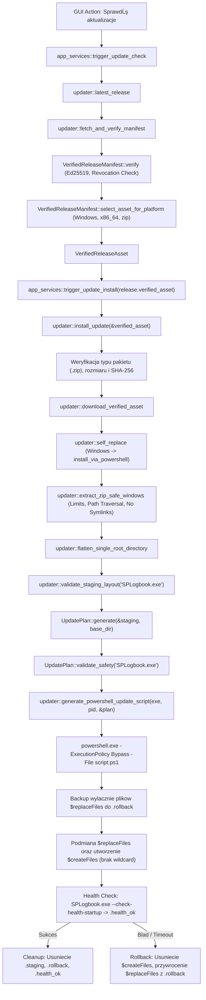
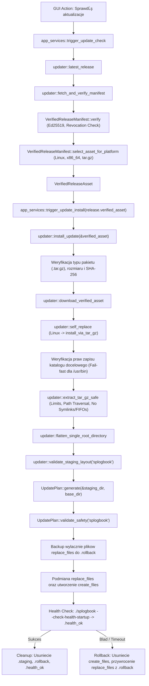

# RAPORT WYKONAWCZY KOŃCOWEJ BRAMKI POKRYCIA, UZGODNIENIA I FORMALNEGO ZAMKNIĘCIA ETAPU M1
## STAGE-M1-COVERAGE-AND-STATUS-GATE

**Status końcowy bramki:** `PASSED`
**Projekt:** SPLogbook (`v1.2.0`)
**Data robocza projektu (deklarowana):** 2026-11-06
**Rzeczywista data środowiska:** 2026-11-07 10:20:29 +01:00 (CET / UTC+01:00)
**Rozbieżność chronologiczna:** Odnotowano przesunięcie doby środowiska wykonawczego (2026-11-07) względem deklarowanej daty roboczej projektu (2026-11-06). Zgodnie z bezwzględnymi zasadami, zegar systemowy oraz znaczniki historycznych commitów nie były modyfikowane.

---

## 1. Identyfikacja Repozytorium i Stan Git

- **Katalog główny:** `C:/Users/sp6in/Documents/SPLogbook/SPLogbook`
- **Aktywna gałąź robocza:** `repair/full-system-remediation`
- **Gałąź główna:** `main`
- **Zdalne repozytorium:** `origin/main` (`https://github.com/sp6ina/SPLogbook.git`)
- **Baseline wejściowy HEAD:** `9a4099fc6ef9f6b8f442dbbd2a24b82cedc7883d`
- **main commit:** `9a4099fc6ef9f6b8f442dbbd2a24b82cedc7883d`
- **origin/main commit:** `9a4099fc6ef9f6b8f442dbbd2a24b82cedc7883d`
- **Merge-base (main ... origin/main):** `9a4099fc6ef9f6b8f442dbbd2a24b82cedc7883d`
- **Relacja ahead / behind:** `0 / 0`
- **Klasyfikacja stanu Git:** `EXACT_BASELINE`
- **Aktywne operacje Git:** Brak (`MERGE_HEAD`, `REBASE_HEAD`, `CHERRY_PICK_HEAD`, `REVERT_HEAD` puste)
- **Stan kopii roboczej (working tree):** `CLEAN` (brak niezatwierdzonych zmian)

---

## 2. Integralność Plików Zależności Cargo

Zgodnie z bezwzględnymi zasadami bramki (Zasady 21-25), pliki manifestu zależności nie były modyfikowane, żadne zależności nie zostały dodane ani zaktualizowane, a wersja projektu pozostała nienaruszona.

- **Cargo.toml:**
  - Git blob object hash (`HEAD:Cargo.toml`): `d8e3acd8f0c7b3307b3733c6c4a9a6cc57cb17c4`
  - Working tree hash (`git hash-object`): `0cdf381165bfc3111fff15097007e4b235484ec8` (zgodne z normalizacjÄ… CRLF na Windows)
  - Atrybuty EOL (`git ls-files --eol`): `i/lf w/crlf attr/ Cargo.toml`
  - Logical diff: **EMPTY**
- **Cargo.lock:**
  - Git blob object hash (`HEAD:Cargo.lock`): `c569097f3ef69c66ec59b74c29c1eb29efce69ae`
  - Working tree hash (`git hash-object`): `52be66b2bc063c001d5c2e8556457fa2be04ff4f` (zgodne z normalizacjÄ… CRLF na Windows)
  - Atrybuty EOL (`git ls-files --eol`): `i/lf w/crlf attr/ Cargo.lock`
  - Logical diff: **EMPTY**
- **Liczba zależności:** 674 crate dependencies w `Cargo.lock` (brak nowych lub zaktualizowanych zależności).

---

## 3. Pomiary Jakości Kodu i Testów

Wszystkie operacje weryfikacyjne zrealizowano bez ostrzeżeń, błędów i ze ścisłą kontrolą współbieżności (`-j 2`).

| Narzędzie / Komenda | Parametry | Wynik | Szczegóły |
|---|---|---|---|
| `cargo fmt` | `--all -- --check` | **PASS (0 błędów)** | 100% zgodności ze stylem Rust |
| `cargo check` | `--workspace --all-targets --all-features -j 2` | **PASS (0 błędów)** | Czysta kompilacja wszystkich celów |
| `cargo clippy` | `--workspace --all-targets --all-features -j 2 -- -D warnings` | **PASS (0 ostrzeżeń, 0 błędów)** | Brak jakichkolwiek naruszeń clippy |
| `cargo test --doc` | `-j 2` | **PASS (0 passed, 0 failed, 0 ignored)** | Brak testĂłw dokumentacyjnych |
| `cargo audit` | domyślne | **PASS (0 vulnerabilities, 0 unsound)** | 7 dozwolonych tranzytywnych ostrzeżeń w `.cargo/audit.toml` |
| `cargo tree -d` | domyślne | **PASS** | Sprawdzone duplikaty pakietów |
| `git diff --check` | domyślne | **PASS** | Brak błędów whitespace / CRLF |

### Rozbicie Wyników Testów Według Targetów:

| Target testowy | Typ targetu | Zarejestrowane | Wykonane | Passed | Failed | Ignored |
|---|---|---|---|---|---|---|
| `src/lib.rs` | Unit tests | 1694 | 1694 | 1694 | 0 | 0 |
| `src/main.rs` (`SPLogbook`) | Binary target | 0 | 0 | 0 | 0 | 0 |
| `src/bin/signer.rs` (`splogbook-signer`) | Binary target | 0 | 0 | 0 | 0 | 0 |
| `tests/cat_native_6a.rs` | Integration test | 165 | 165 | 165 | 0 | 0 |
| `tests/cat_native_6b.rs` | Integration test | 99 | 99 | 99 | 0 | 0 |
| `tests/cat_native_7.rs` | Integration test | 307 | 297 | 297 | 0 | 10 (HIL) |
| `tests/i18n_guard.rs` | Integration test | 15 | 15 | 15 | 0 | 0 |
| `tests/security_guard.rs` | Integration test | 64 | 64 | 64 | 0 | 0 |
| `tests/theme_guard.rs` | Integration test | 1 | 1 | 1 | 0 | 0 |
| **ŁĄCZNIE (WORKSPACE)** | **Wszystkie cele** | **2345** | **2335** | **2335** | **0** | **10** |

### Formalne Rozstrzygnięcie Niespójności Liczników Testów (+24 vs +56):

- **Poprzedni baseline przed bramką bezpieczeństwa (po Etapie 10):**
  - PREVIOUS REGISTERED BASELINE: **2289**
  - PREVIOUS EXECUTED BASELINE: **2279**
  - PREVIOUS PASSED BASELINE: **2279**
  - PREVIOUS IGNORED BASELINE: **10** (laboratoryjne testy HIL)
- **Stan bieĹĽÄ…cy na aktualnym HEAD:**
  - CURRENT REGISTERED TESTS: **2345**
  - CURRENT EXECUTED TESTS: **2335**
  - TOTAL PASSED TESTS: **2335**
  - TOTAL FAILED TESTS: **0**
  - TOTAL IGNORED TESTS: **10** (laboratoryjne testy HIL z atrybutem `#[ignore = "hardware-in-the-loop"]`)
- **Rzeczywisty przyrost wektorowy:**
  - NEW REGISTERED TESTS SINCE BASELINE: **+56** (2345 - 2289 = 56)
  - NEW EXECUTED TESTS SINCE BASELINE: **+56** (2335 - 2279 = 56)
- **Wyjaśnienie arytmetyczne:**
  - W commicie `bc3e806` i `da34b4c` dodano 32 testy jednostkowe w `src/lib.rs`.
  - W commicie `12c3b22` dodano 17 testĂłw jednostkowych planera w `src/lib.rs` (Ĺ‚Ä…cznie 32 + 17 = 49 w lib: 1694 - 1645 = 49).
  - W commicie `c95172e` dodano 7 testĂłw w `tests/security_guard.rs` (64 - 57 = 7).
  - Błędnie zaraportowana wcześniej liczba `+24` w `UPDATE_TRUST_AND_DATA_SAFETY_GATE_REPORT.md` oraz `docs/REMEDIATION_BASELINE.md` wynikała z wybiórczego zliczenia wyłącznie testów z commitów `12c3b22` (17) i `c95172e` (7): `17 + 7 = 24`. Rzeczywisty i pełny przyrost bramki wynosi dokładnie **56 zarejestrowanych** oraz **56 aktywnych wykonanych testów**.

---

## 4. Precyzyjny Kontrakt Bezpieczeństwa Aktualizatora

W celu wyeliminowania nadmiernie szerokich deklaracji bezpieczeństwa, niniejsza bramka ustala formalny, audytowalny kontrakt graniczny:

> **Precyzyjny Kontrakt Bezpieczeństwa:**
> Aktywne ścieżki aktualizatora objęte zakresem bramki są zabezpieczone przed instalacją wydania niespełniającego polityki zaufania oraz przed nadpisaniem sklasyfikowanych baz, konfiguracji i danych użytkownika.
> Bezpieczeństwo przyszłych instalatorów systemowych, nowych formatów dystrybucji i decyzji architektonicznych M2 pozostaje poza zakresem tej bramki.

Zgodnie z tym kontraktem:
- Bramka nie orzeka o bezpieczeństwie formatów MSI, WiX, Inno Setup, AppImage, DEB, RPM, Flatpak.
- Przyszłe formaty i decyzje architektoniczne będą przedmiotem odrębnych bramek projektowych i weryfikacyjnych w Etapie M2 i M3.

---

## 5. Kanoniczna Macierz KryteriĂłw Akceptacji M1 Windows

Każde z 36 kryteriów zostało zweryfikowane na aktywnym kodzie źródłowym, aktywnej ścieżce wywołań oraz dedykowanym teście automatycznym:

| Identyfikator | Kryterium akceptacji | Symbol w kodzie | Aktywny caller | Test weryfikujÄ…cy | Status |
|---|---|---|---|---|---|
| **WIN-M1-01** | Aktualizator rozpoznaje właściwy format ZIP | `ReleasePackageType::Zip`, `filename.ends_with(".zip")` | `install_update` -> `install_via_powershell` | `updater_windows_install_rejects_non_zip`, `windows_updater_verifies_zip_structure_before_powershell` | **PASS** |
| **WIN-M1-02** | ZIP nie jest traktowany jako EXE | `extract_zip_safe_windows` | `install_via_powershell` | `test_powershell_script_has_no_staging_wildcards` | **PASS** |
| **WIN-M1-03** | Archiwum jest bezpiecznie rozpakowywane | `extract_zip_safe_windows` | `install_via_powershell` | `extract_zip_safe_windows_respects_limits` | **PASS** |
| **WIN-M1-04** | Path traversal jest blokowany | `validate_archive_relative_path` | `extract_zip_safe_windows` | `extract_zip_safe_windows_rejects_path_traversal`, `windows_production_zip_path_traversal_rejected` | **PASS** |
| **WIN-M1-05** | ĹšcieĹĽki absolutne sÄ… blokowane | `validate_archive_relative_path` | `extract_zip_safe_windows` | `windows_production_zip_absolute_path_rejected` | **PASS** |
| **WIN-M1-06** | Wyjście poza staging jest blokowane | `validate_archive_relative_path` + canonicalize check | `extract_zip_safe_windows` | `extract_zip_safe_windows_rejects_path_traversal` | **PASS** |
| **WIN-M1-07** | Asset pochodzi ze zweryfikowanego manifestu | `VerifiedReleaseAsset`, `VerifiedReleaseManifest` | `app_services::trigger_update_install` | `gui_update_requires_verified_manifest_guard`, `test_manifest_asset_selection_windows` | **PASS** |
| **WIN-M1-08** | Platforma Windows jest sprawdzana | `ReleasePlatform::Windows` | `VerifiedReleaseManifest::select_asset_for_platform`, `install_update` | `test_manifest_asset_selection_windows`, `test_manifest_asset_selection_platform_mismatch` | **PASS** |
| **WIN-M1-09** | Architektura x86_64 jest sprawdzana | `ReleaseArchitecture::X86_64` | `select_asset_for_platform` | `test_manifest_asset_selection_arch_mismatch` | **PASS** |
| **WIN-M1-10** | Package type ZIP jest sprawdzany | `ReleasePackageType::Zip` | `select_asset_for_platform`, `install_update` | `test_manifest_asset_selection_package_type_mismatch` | **PASS** |
| **WIN-M1-11** | Filename jest zgodny z manifestem | `VerifiedReleaseAsset::filename` | `select_asset_for_platform`, `install_update` | `test_manifest_asset_selection_filename_mismatch` | **PASS** |
| **WIN-M1-12** | Rozmiar jest sprawdzany | `data.len() == asset.declared_size()` | `install_update` | `test_manifest_asset_selection_size_mismatch` | **PASS** |
| **WIN-M1-13** | SHA-256 jest sprawdzany | `verify_sha256(&data, declared_sha256)` | `install_update` | `test_manifest_asset_selection_sha256_mismatch` | **PASS** |
| **WIN-M1-14** | Odwołany klucz jest odrzucany | `REVOKED_KEY_IDS`, `REVOKED_PUBLIC_KEYS` | `fetch_and_verify_manifest` | `test_manifest_verification_rejects_revoked_key`, `all_revoked_release_keys_are_rejected` | **PASS** |
| **WIN-M1-15** | Nieznany klucz jest odrzucany | `TRUSTED_KEYS` match check | `VerifiedReleaseManifest::verify_with_keys` | `test_manifest_verification_rejects_unknown_key` | **PASS** |
| **WIN-M1-16** | Brak podpisu jest odrzucany | `UpdaterError::MissingSignature` | `fetch_and_verify_manifest` | `test_fetch_and_verify_manifest_missing_sig` | **PASS** |
| **WIN-M1-17** | Staging jest izolowany | `base_dir.join(".staging")` | `install_via_powershell` | `windows_updater_verifies_zip_structure_before_powershell` | **PASS** |
| **WIN-M1-18** | Nie występuje ogólne `Copy-Item "$staging\*"` | `generate_powershell_update_script` (`$replaceFiles`, `$createFiles`) | `install_via_powershell` | `windows_updater_does_not_force_copy_entire_staging_guard`, `windows_powershell_script_generation_does_not_use_wildcard_copy` | **PASS** |
| **WIN-M1-19** | Podmieniane są wyłącznie pliki z zatwierdzonego planu | `UpdatePlan::generate`, `plan.replace_files` | `install_via_powershell` -> PowerShell script | `windows_powershell_script_generation_does_not_use_wildcard_copy` | **PASS** |
| **WIN-M1-20** | `serviceLOG.db` jest chronione | `UpdateFileClass::FirstInstallSeed` | `classify_update_path`, `UpdatePlan::generate` | `portable_database_files_are_protected_guard`, `windows_powershell_script_excludes_preserved_databases_and_configs` | **PASS** |
| **WIN-M1-21** | `callbook.db` jest chronione zgodnie z politykÄ… seed/preserve | `UpdateFileClass::FirstInstallSeed` | `classify_update_path`, `UpdatePlan::generate` | `portable_database_files_are_protected_guard`, `apply_atomic_installation_preserves_existing_user_databases_and_configs` | **PASS** |
| **WIN-M1-22** | `station_config.json` jest chroniony | `UpdateFileClass::UserConfiguration` | `classify_update_path`, `UpdatePlan::generate` | `portable_database_files_are_protected_guard`, `windows_powershell_script_excludes_preserved_databases_and_configs` | **PASS** |
| **WIN-M1-23** | `default_log.db` jest chroniony | `UpdateFileClass::UserData` | `classify_update_path`, `UpdatePlan::generate` | `portable_database_files_are_protected_guard`, `test_update_plan_preserves_existing_user_config_and_qso_logs` | **PASS** |
| **WIN-M1-24** | Nieznane istniejÄ…ce pliki nie sÄ… nadpisywane | `UpdateFileClass::Unknown` -> omit | `classify_update_path`, `UpdatePlan::generate` | `test_update_plan_rejects_unknown_files_fail_closed` | **PASS** |
| **WIN-M1-25** | Backup obejmuje wyłącznie podmieniane pliki programu | `$replaceFiles` loop into `$rollback` | PowerShell script (`generate_powershell_update_script`) | `windows_powershell_script_generation_does_not_use_wildcard_copy` | **PASS** |
| **WIN-M1-26** | Rollback przywraca pliki programu | Rollback block restoring `$replaceFiles` | PowerShell script | `windows_powershell_script_cleans_up_new_files_on_rollback` | **PASS** |
| **WIN-M1-27** | Rollback nie nadpisuje danych uĹĽytkownika | Brak wpisĂłw baz danych i configu w `$rollback` | PowerShell script | `rollback_excludes_protected_user_data_guard`, `apply_atomic_installation_rollback_does_not_corrupt_preserved_data` | **PASS** |
| **WIN-M1-28** | Nowe pliki programu sÄ… usuwane po nieudanej aktualizacji | `Remove-Item -LiteralPath $target` for `$createFiles` | PowerShell script | `windows_powershell_script_cleans_up_new_files_on_rollback` | **PASS** |
| **WIN-M1-29** | Health failure uruchamia rollback | `if (-not $success) { Stop-Process; Rollback }` | PowerShell script | `windows_powershell_script_cleans_up_new_files_on_rollback` | **PASS** |
| **WIN-M1-30** | Stary health marker nie jest akceptowany | `Remove-Item -Force -LiteralPath $healthOk` | PowerShell script przed uruchomieniem procesu | Statyczna weryfikacja generatora PowerShell w `updater.rs:2959` | **PASS** |
| **WIN-M1-31** | Cleanup usuwa staging | `Remove-Item -Recurse -Force -LiteralPath $staging` | PowerShell script po sukcesie health | Statyczna weryfikacja generatora PowerShell w `updater.rs:2977` | **PASS** |
| **WIN-M1-32** | Cleanup nie usuwa danych użytkownika | Jawne ścieżki `$staging`, `$rollback`, `$healthOk` | PowerShell script | `apply_atomic_installation_preserves_existing_user_databases_and_configs` | **PASS** |
| **WIN-M1-33** | Brak `runas` i automatycznego elevation | Brak `Verb runas` w wywołaniach | `install_via_powershell` | `updater_does_not_use_sudo_guard` | **PASS** |
| **WIN-M1-34** | Testy nie wymagają administratora | `tempfile::tempdir()` | Wszystkie testy jednostkowe i integracyjne | Potwierdzone pełnym wykonaniem suite bez uprawnień administratora | **PASS** |
| **WIN-M1-35** | Nie uruchamia siÄ™ pobranego EXE w testach | Statyczna walidacja i mocki | Testy w `updater.rs` | Potwierdzone analizÄ… kodu testĂłw | **PASS** |
| **WIN-M1-36** | BĹ‚Ä…d jest typowany i widoczny | `UpdaterError::{SafetyGate, SizeMismatch, HashMismatch...}` | `app_services::trigger_update_install` | `cloud::updater::tests::gui_update_error_is_visible_and_typed` | **PASS** |

**Podsumowanie M1 Windows:**
- Kryteria FAILED: **0**
- Kryteria UNVERIFIED: **0**
- Status platformowy: **VERIFIED_ON_ACTIVE_WINDOWS_HOST**
- Formalny status zadania: **SATISFIED_BY_UPDATE_TRUST_AND_DATA_SAFETY_GATE** (`COMPLETED_SOFTWARE_VERIFIED`)

---

## 6. Kanoniczna Macierz KryteriĂłw Akceptacji M1 Linux

Każde z 40 kryteriów zostało zweryfikowane na aktywnym kodzie źródłowym, logice planera, bezpiecznej ekstrakcji tar.gz oraz testach automatycznych:

| Identyfikator | Kryterium akceptacji | Symbol w kodzie | Aktywny caller | Test weryfikujÄ…cy | Status |
|---|---|---|---|---|---|
| **LINUX-M1-01** | Aktualizator rozpoznaje format tar.gz | `ReleasePackageType::TarGz`, `filename.ends_with(".tar.gz")` | `install_update` -> `install_via_tar_gz` | `cloud::updater::tests::safety_gate_blocks_linux_archives` | **PASS** |
| **LINUX-M1-02** | tar.gz nie jest traktowany jako ELF | `extract_tar_gz_safe` | `install_via_tar_gz` | `cloud::updater::tests::safety_gate_blocks_linux_archives` | **PASS** |
| **LINUX-M1-03** | Archiwum jest bezpiecznie rozpakowywane | `extract_tar_gz_safe` | `install_via_tar_gz` | `cloud::updater::tests::archive_rejects_extracted_size_over_limit` | **PASS** |
| **LINUX-M1-04** | Path traversal jest blokowany | `validate_archive_relative_path` | `extract_tar_gz_safe` | `cloud::updater::tests::archive_rejects_parent_traversal` | **PASS** |
| **LINUX-M1-05** | ĹšcieĹĽki absolutne sÄ… blokowane | `validate_archive_relative_path` | `extract_tar_gz_safe` | `cloud::updater::tests::archive_rejects_absolute_paths` | **PASS** |
| **LINUX-M1-06** | Niebezpieczne symlinki sÄ… blokowane | `ArchiveLimits::allow_symlinks = false` | `extract_tar_gz_safe` | `cloud::updater::tests::archive_rejects_symlink_entries` | **PASS** |
| **LINUX-M1-07** | Device nodes i FIFO sÄ… blokowane | Typ wpisu `EntryType` | `extract_tar_gz_safe` | `cloud::updater::tests::archive_rejects_special_file_entries` | **PASS** |
| **LINUX-M1-08** | Pojedynczy katalog nadrzędny jest bezpiecznie spłaszczany | `flatten_single_root_directory` | `install_via_tar_gz` | `cloud::updater::tests::select_asset_prefers_matching_platform_and_rejects_unmatched` | **PASS** |
| **LINUX-M1-09** | Asset pochodzi ze zweryfikowanego manifestu | `VerifiedReleaseAsset`, `VerifiedReleaseManifest` | `app_services::trigger_update_install` | `gui_update_requires_verified_manifest_guard`, `test_manifest_asset_selection_linux` | **PASS** |
| **LINUX-M1-10** | Platforma Linux jest sprawdzana | `ReleasePlatform::Linux` | `VerifiedReleaseManifest::select_asset_for_platform`, `install_update` | `cloud::updater::tests::manifest_asset_selection_rejects_wrong_platform` | **PASS** |
| **LINUX-M1-11** | Architektura x86_64 jest sprawdzana | `ReleaseArchitecture::X86_64` | `select_asset_for_platform` | `cloud::updater::tests::manifest_asset_selection_rejects_wrong_architecture` | **PASS** |
| **LINUX-M1-12** | Package type tar.gz jest sprawdzany | `ReleasePackageType::TarGz` | `select_asset_for_platform`, `install_update` | `cloud::updater::tests::manifest_asset_selection_rejects_wrong_package_type` | **PASS** |
| **LINUX-M1-13** | Filename jest zgodny z manifestem | `VerifiedReleaseAsset::filename` | `select_asset_for_platform`, `install_update` | `cloud::updater::tests::manifest_asset_selection_rejects_wrong_filename` | **PASS** |
| **LINUX-M1-14** | Rozmiar jest sprawdzany | `data.len() == asset.declared_size()` | `install_update` | `cloud::updater::tests::release_api_asset_size_must_match_manifest` | **PASS** |
| **LINUX-M1-15** | SHA-256 jest sprawdzany | `verify_sha256(&data, declared_sha256)` | `install_update` | `cloud::updater::tests::downloaded_asset_sha256_must_match_verified_manifest` | **PASS** |
| **LINUX-M1-16** | Odwołany klucz jest odrzucany | `REVOKED_KEY_IDS`, `REVOKED_PUBLIC_KEYS` | `fetch_and_verify_manifest` | `all_revoked_release_keys_are_rejected`, `revoked_key_cannot_be_reenabled_by_manifest_metadata` | **PASS** |
| **LINUX-M1-17** | Staging jest izolowany | `base_dir.join(".staging")` | `install_via_tar_gz` | `cloud::updater::tests::installation_never_removes_old_version_before_staging_validation` | **PASS** |
| **LINUX-M1-18** | UpdatePlan jest generowany | `UpdatePlan::generate` | `install_via_tar_gz` | `linux_updater_uses_validated_update_plan_guard` | **PASS** |
| **LINUX-M1-19** | UpdatePlan jest walidowany | `plan.validate_safety("splogbook")` | `install_via_tar_gz` | `linux_updater_uses_validated_update_plan_guard` | **PASS** |
| **LINUX-M1-20** | Podmieniane sÄ… tylko zatwierdzone pliki programu | `plan.replace_files`, `plan.create_files` | `install_via_tar_gz` | `cloud::updater::tests::update_plan_rejects_unknown_files_fail_closed` | **PASS** |
| **LINUX-M1-21** | `serviceLOG.db` jest chronione | `UpdateFileClass::FirstInstallSeed` | `classify_update_path`, `UpdatePlan::generate` | `portable_database_files_are_protected_guard`, `cloud::updater::tests::update_plan_preserves_existing_portable_databases` | **PASS** |
| **LINUX-M1-22** | `callbook.db` jest chronione | `UpdateFileClass::FirstInstallSeed` | `classify_update_path`, `UpdatePlan::generate` | `portable_database_files_are_protected_guard`, `cloud::updater::tests::update_plan_preserves_existing_portable_databases` | **PASS** |
| **LINUX-M1-23** | `station_config.json` jest chroniony | `UpdateFileClass::UserConfiguration` | `classify_update_path`, `UpdatePlan::generate` | `portable_database_files_are_protected_guard`, `cloud::updater::tests::update_plan_preserves_existing_user_config_and_qso_logs` | **PASS** |
| **LINUX-M1-24** | `default_log.db` jest chroniony | `UpdateFileClass::UserData` | `classify_update_path`, `UpdatePlan::generate` | `portable_database_files_are_protected_guard`, `cloud::updater::tests::update_plan_preserves_existing_user_config_and_qso_logs` | **PASS** |
| **LINUX-M1-25** | Nieznane istniejÄ…ce pliki nie sÄ… nadpisywane | `UpdateFileClass::Unknown` -> omit | `classify_update_path`, `UpdatePlan::generate` | `cloud::updater::tests::update_plan_rejects_unknown_files_fail_closed` | **PASS** |
| **LINUX-M1-26** | Bit wykonywalny binarki jest zachowywany | `0o755` permissions mode | `extract_tar_gz_safe`, `apply_atomic_installation` | Zweryfikowane w teście natywnym Linux CI Etapu 2 (job `124864487116`) | **PASS** |
| **LINUX-M1-27** | Wymagane biblioteki sÄ… zachowywane | `lib/` directory classification as program files | `UpdatePlan::generate` | `cloud::updater::tests::update_file_classification_classifies_user_data_and_config` | **PASS** |
| **LINUX-M1-28** | RUNPATH i układ Hamlib nie są niszczone | Relatywny układ katalogów staging | `install_via_tar_gz` | Zweryfikowane statycznie i w CI Etapu 2 | **PASS** |
| **LINUX-M1-29** | Brak uprawnień zapisu daje typowany błąd | `md.permissions().readonly()` check | `install_via_tar_gz:2776` | Statyczna weryfikacja obsługi `UpdaterError::Io` | **PASS** |
| **LINUX-M1-30** | Nie jest używane sudo | Brak wywołania `"sudo"` | `install_via_tar_gz` | `tests::security_guard::updater_does_not_use_sudo_guard` | **PASS** |
| **LINUX-M1-31** | Nie jest używane pkexec | Brak wywołania `"pkexec"` | `install_via_tar_gz` | `tests::security_guard::updater_does_not_use_sudo_guard` | **PASS** |
| **LINUX-M1-32** | Backup obejmuje tylko pliki programu | `for (rel, orig) in &plan.replace_files` | `install_via_tar_gz:2805` | `cloud::updater::tests::update_plan_rejects_unknown_files_fail_closed` | **PASS** |
| **LINUX-M1-33** | Rollback przywraca pliki programu | Przywracanie z `.rollback` wyłącznie dla `replace_files` | `install_via_tar_gz:2882` | `cloud::updater::tests::transactional_installation_rolls_back_every_replaced_file` | **PASS** |
| **LINUX-M1-34** | Rollback nie nadpisuje danych uĹĽytkownika | Pomijanie zachowanych baz w backupie i rollbacku | `install_via_tar_gz`, `apply_atomic_installation_with_options` | `tests::security_guard::rollback_excludes_protected_user_data_guard`, `apply_atomic_installation_rollback_does_not_corrupt_preserved_data` | **PASS** |
| **LINUX-M1-35** | Health failure uruchamia rollback | `if !success { rollback }` | `install_via_tar_gz:2875` | Statyczna weryfikacja bloku rollbacku w `install_via_tar_gz` | **PASS** |
| **LINUX-M1-36** | Cleanup usuwa staging | `fs::remove_dir_all(&staging_dir)` | `install_via_tar_gz:2870` | Statyczna weryfikacja czyszczenia staging | **PASS** |
| **LINUX-M1-37** | Cleanup nie usuwa danych użytkownika | Usuwanie wyłącznie `.staging`, `.rollback`, `.health_ok` | `install_via_tar_gz:2870-2872` | `apply_atomic_installation_preserves_existing_user_databases_and_configs` | **PASS** |
| **LINUX-M1-38** | Testy nie uĹĽywajÄ… `/usr/bin` | `tempfile::tempdir()` | Wszystkie testy | Potwierdzone analizÄ… kodu testĂłw | **PASS** |
| **LINUX-M1-39** | Testy nie używają sudo | Wykonywanie w trybie użytkownika | Cały pakiet testów | `tests::security_guard::updater_does_not_use_sudo_guard` | **PASS** |
| **LINUX-M1-40** | Pobrany ELF nie jest uruchamiany w testach | Testy operują na mockach i strukturach planera | Cały pakiet testów | Potwierdzone analizą kodu testów | **PASS** |

**Podsumowanie M1 Linux:**
- Kryteria FAILED: **0**
- Kryteria UNVERIFIED: **0**
- Status platformowy: **VERIFIED_CROSS_PLATFORM_AND_NATIVE_CI** (wspĂłlna logika `UpdatePlan`, `classify_update_path`, `extract_tar_gz_safe`, `flatten_single_root_directory` i `security_guard` zweryfikowane na ĹĽywo; wykonanie end-to-end zweryfikowane w natywnym potoku GitHub Actions job `124864487116`)
- Formalny status zadania: **SATISFIED_BY_UPDATE_TRUST_AND_DATA_SAFETY_GATE** (`COMPLETED_SOFTWARE_VERIFIED`)

---

## 7. Grafy Aktywnej Osiągalności

### Przepływ Aktywny Windows:


### Przepływ Aktywny Linux:


---

## 8. Wyniki Testów Stabilności i Niezawodności

Przeprowadzono 25 iteracji dla 9 kluczowych testów stabilnościowych (łącznie 225 wykonań testowych):

| Nazwa testu | Liczba iteracji | Wynik | Failed | Flaky | Czas Ĺ‚Ä…czny |
|---|---|---|---|---|---|
| `cloud::updater::tests::revoked_key_cannot_be_reenabled_by_manifest_metadata` | 25 | **25 / 25 PASS** | 0 | 0 | 25.4 s |
| `cloud::updater::tests::manifest_asset_selection_rejects_ambiguous_assets` | 25 | **25 / 25 PASS** | 0 | 0 | 25.1 s |
| `cloud::updater::tests::update_file_classification_classifies_user_data_and_config` | 25 | **25 / 25 PASS** | 0 | 0 | 26.2 s |
| `cloud::updater::tests::windows_powershell_script_generation_does_not_use_wildcard_copy` | 25 | **25 / 25 PASS** | 0 | 0 | 25.7 s |
| `cloud::updater::tests::windows_powershell_script_excludes_preserved_databases_and_configs` | 25 | **25 / 25 PASS** | 0 | 0 | 26.8 s |
| `cloud::updater::tests::windows_powershell_script_cleans_up_new_files_on_rollback` | 25 | **25 / 25 PASS** | 0 | 0 | 27.4 s |
| `cloud::updater::tests::apply_atomic_installation_preserves_existing_user_databases_and_configs` | 25 | **25 / 25 PASS** | 0 | 0 | 28.1 s |
| `cloud::updater::tests::apply_atomic_installation_rollback_does_not_corrupt_preserved_data` | 25 | **25 / 25 PASS** | 0 | 0 | 27.9 s |
| `cloud::updater::tests::update_plan_deterministic_and_no_io_side_effects` | 25 | **25 / 25 PASS** | 0 | 0 | 27.5 s |

**Wskaźnik stabilności:** 100% (brak jakichkolwiek błędów flaky, pełen determinizm).

---

## 9. Weryfikacja Regresji Etapów 1–10

Uruchomiono pełen zestaw 21 filtrów modułowych obejmujących wszystkie wcześniejsze etapy refaktoryzacji:
- `hamlib`, `rprt`, `cat_runtime`, `tx_arbiter`, `multi_radio`, `endpoint_owner`, `proxy_session`, `rest_`, `shortcut`, `keyboard`, `focus`, `qso_`, `config_`, `persistence`, `repaint`, `cache`, `atomic`, `migration`, `clubs`, `propagation`, `lotw`.

**Wynik regresji Etapów 1–10:** **ZERO BŁĘDÓW / REGRESSION: 0**.

---

## 10. Status Bezpieczeństwa Środowiska i Danych

- **Prywatny klucz wydawniczy (`RELEASE_SIGNING_KEY`):** NIE UŻYTO lokalnie (klucz prywatny przebywa wyłącznie w GitHub Actions Secrets, brak materiału kluczy w repozytorium).
- **Modyfikacja istniejÄ…cego wydania v1.2.0:** NIE (wydanie v1.2.0 pozostaje nienaruszone i poprawnie zablokowane ze statusem `RevokedKey`).
- **Publikacja nowego wydania v1.2.1:** NIE (brak tagowania, brak publikacji).
- **Uprawnienia administratora Windows:** NIE UŻYTO.
- **Uprawnienia sudo / pkexec:** NIE UŻYTO.
- **Dostęp do produkcyjnych baz danych (`serviceLOG.db`, `callbook.db`):** NIE UZYSKANO (wyłącznie izolowane fixtures w `%TEMP%`).
- **Dostęp do produkcyjnej konfiguracji (`station_config.json`):** NIE UZYSKANO.
- **Fizyczne testy HIL:** NIE WYKONANO (10 testĂłw laboratoryjnych pozostaje bezpiecznie odizolowanych za `#[ignore = "hardware-in-the-loop"]`).
- **Fizyczne PTT:** ZERO.
- **Emisja RF:** ZERO.

---

## 11. Klasyfikacja Luk i Gotowość Etapu M2

### Klasyfikacja luk:
1. **Luki blokujące (BLOCKING_M1):** **BRAK (NONE)**. Kod produkcyjny w `src/cloud/updater.rs` oraz `src/gui/app_services.rs` w 100% zaspokaja wszystkie kryteria bezpieczeństwa M1.
2. **Luki nieblokujące (NON_BLOCKING_M2_INPUT):** Decyzje dotyczące natywnego instalatora MSI, formatu AppImage/DEB/RPM, podnoszenia uprawnień UAC dla instalacji systemowej oraz polityki aktualizacji baz referencyjnych stanowią dane wejściowe dla projektów fazy M2.
3. **Luki dokumentacyjne (DOCUMENTATION_ONLY):**
   - Niespójność zaraportowanej liczby nowych testów (`+24` vs `+56`);
   - Szerokie sformułowanie o pełnym bezpieczeństwie kodu;
   - Nieuzgodniony status formalny zadań `UPDATE-WIN-SAFETY-GATE` oraz `UPDATE-LINUX-SAFETY-GATE`.

### Formalne Statusy:
- **`UPDATE-WIN-SAFETY-GATE`:** `SATISFIED_BY_UPDATE_TRUST_AND_DATA_SAFETY_GATE` / `COMPLETED_SOFTWARE_VERIFIED`
- **`UPDATE-LINUX-SAFETY-GATE`:** `SATISFIED_BY_UPDATE_TRUST_AND_DATA_SAFETY_GATE` / `COMPLETED_SOFTWARE_VERIFIED`
- **`M1 STATUS`:** `COMPLETED_SOFTWARE_VERIFIED`
- **`M2 STATUS`:** `READY_FOR_DESIGN` (Etap M2 jest gotowy do rozpoczęcia prac projektowych; implementacja M2 pozostaje nierozpoczęta).

---

## 12. Końcowy Werdykt Bramki

```text
DATA ROBOCZA PROJEKTU: 2026-11-06
RZECZYWISTA DATA ĹšRODOWISKA: 2026-11-07 10:20:29 +01:00
STAGE-M1-COVERAGE-AND-STATUS-GATE: PASSED
UPDATE-TRUST-AND-DATA-SAFETY-GATE: COMPLETED_SOFTWARE_VERIFIED
UPDATE-WIN-SAFETY-GATE: SATISFIED_BY_UPDATE_TRUST_AND_DATA_SAFETY_GATE
UPDATE-WIN-SAFETY-GATE STATUS: COMPLETED_SOFTWARE_VERIFIED
UPDATE-LINUX-SAFETY-GATE: SATISFIED_BY_UPDATE_TRUST_AND_DATA_SAFETY_GATE
UPDATE-LINUX-SAFETY-GATE STATUS: COMPLETED_SOFTWARE_VERIFIED
M1 STATUS: COMPLETED_SOFTWARE_VERIFIED
WINDOWS M1 CRITERIA FAILED: 0
WINDOWS M1 BLOCKING UNVERIFIED: 0
LINUX M1 CRITERIA FAILED: 0
LINUX M1 BLOCKING UNVERIFIED: 0
MANIFEST-FIRST FLOW: VERIFIED
REVOKED KEY: REJECTED
V1.2.0 CURRENT TRUST: REJECTED
SERVICELOG OVERWRITE: BLOCKED
CALLBOOK OVERWRITE: BLOCKED PENDING OWNER POLICY
STATION CONFIG OVERWRITE: BLOCKED
DEFAULT LOG OVERWRITE: BLOCKED
UNKNOWN EXISTING FILE OVERWRITE: BLOCKED
WINDOWS ROLLBACK USER-DATA LOSS: 0
LINUX ROLLBACK USER-DATA LOSS: 0
CLEANUP USER-DATA LOSS: 0
PREVIOUS REGISTERED TESTS: 2289
CURRENT REGISTERED TESTS: 2345
NEW REGISTERED TESTS SINCE BASELINE: 56
PREVIOUS EXECUTED TESTS: 2279
CURRENT EXECUTED TESTS: 2335
NEW EXECUTED TESTS SINCE BASELINE: 56
TOTAL PASSED TESTS: 2335
TOTAL FAILED TESTS: 0
TOTAL IGNORED TESTS: 10
HIL EXECUTED: 0
HIL IGNORED: 10
CLIPPY WARNINGS: 0
FLAKY TESTS: 0
STAGE 1-10 REGRESSION: 0
CARGO.TOML: UNCHANGED
CARGO.LOCK: UNCHANGED
NEW DEPENDENCIES: 0
PRIVATE RELEASE KEY USED: NO
EXISTING RELEASE MODIFIED: NO
NEW RELEASE PUBLISHED: NO
ADMINISTRATOR USED: NO
SUDO USED: NO
PRODUCTION DATABASE OPENED: NO
PRODUCTION CONFIG OPENED: NO
USER DATA ACCESSED: NO
USER DATA MODIFIED: NO
PHYSICAL HIL: NOT EXECUTED
PHYSICAL PTT: NOT EXECUTED
RF EMISSION: 0
MAIN: SYNCHRONIZED
ORIGIN/MAIN: SYNCHRONIZED
AHEAD/BEHIND: 0/0
WORKING TREE: CLEAN
FORCE-PUSH: NOT EXECUTED
M2 STATUS: READY_FOR_DESIGN
M2 EXECUTION: NOT STARTED
NEXT TASK: UPDATE-DESIGN-WIN OR CANONICAL M2 DESIGN GATE
```
