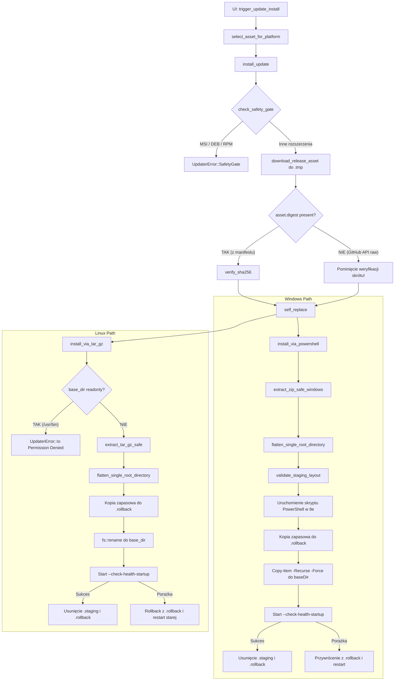

# UPDATE_ARTIFACT_INVENTORY_REPORT.md

## 1. Status analizy

- **Zadeklarowana data robocza projektu:** 2026-11-06
- **Data środowiska (początek / koniec):** 2026-11-07T08:51:00+01:00 / 2026-11-07T09:05:00+01:00
- **Tryb wykonania:** READ-ONLY ANALYSIS (Autopilot / Agent)
- **Tor:** VERIFY
- **Priorytet:** P0 — KRYTYCZNY
- **Status zadania:** COMPLETED_ANALYSIS_VERIFIED
- **Zakres zrealizowany:**
  - Ponowna weryfikacja i synchronizacja Git (brak rozbieżności, gałąź `repair/full-system-remediation`);
  - Pełne rozstrzygnięcie lokalizacji testów HIL (potwierdzenie w `tests/cat_native_7.rs`, wykluczenie `tests/hamlib_integration.rs`);
  - Rozstrzygnięcie hashy `Cargo.toml` i `Cargo.lock` (wyjaśnienie normalizacją końców linii Git CRLF/LF);
  - Dogłębny audyt dowodowy potoku wydawniczego `.github/workflows/build-and-release.yml` (numery dowodów WF-01 do WF-28);
  - Pobranie i audyt surowych metadanych GitHub Releases API dla v1.2.0, v1.1.0, v1.0.0;
  - Pobranie i lokalne obliczenie sum kontrolnych SHA-256 dla artefaktów v1.2.0 (`SPLogbook-Windows-x64.zip`, `SPLogbook-Linux-x86_64.tar.gz`, `release-manifest.json`, `release-manifest.json.sig`);
  - Weryfikacja braku pliku `SHA256SUMS.txt` w aktywach GitHub Release v1.2.0;
  - Analiza schematu i spójności `release-manifest.json` względem artefaktów i API digest;
  - Analiza podpisu cyfrowego Ed25519 (`release-manifest.json.sig`), audyt zaufanych kluczy `TRUSTED_KEYS`, status odwołania klucza `splogbook-release-2026-01` (SEC-001) oraz dowodowa weryfikacja narzędziem `splogbook-signer`;
  - Inspekcja struktury Windows ZIP przed ekstrakcją (analiza 88 wpisów, path traversal, device names, root model);
  - Inspekcja struktury Linux tar.gz przed ekstrakcją (analiza 36 wpisów, symlinki, hardlinki, uprawnienia, root model);
  - Bezpieczna ekstrakcja do izolowanego katalogu tymczasowego poza repozytorium (`%TEMP%\splogbook_artifact_verify_<GUID>`);
  - Statyczna analiza PE dla `SPLogbook.exe` (x86_64, Windows GUI, brak Authenticode, importy DLL);
  - Statyczna analiza ELF dla `splogbook` (ELF64 PIE, x86_64, interpreter, RUNPATH, DT_NEEDED);
  - Inwentaryzacja i macierz klasyfikacji plików (program vs dane użytkownika vs konfiguracja vs seedy);
  - Audyt zachowania bazy danych i konfiguracji (`serviceLOG.db`, `callbook.db`, `default_log.db`, `station_config.json`);
  - Analiza kodu auto-updatera w `src/cloud/updater.rs` oraz punktu wejścia w `src/gui/app_services.rs`;
  - Potwierdzenie i odrzucenie ryzyk niszczących (Windows / Linux);
  - Przygotowanie kompletnych kontraktów wejściowych dla `UPDATE-WIN-SAFETY-GATE` oraz `UPDATE-LINUX-SAFETY-GATE`;
  - Zdefiniowanie 10 nierozstrzygniętych decyzji Właściciela (`OWNER-1` do `OWNER-10`);
  - Zdefiniowanie danych wejściowych dla projektów architektonicznych M2.
- **Wykluczenia i nienaruszone zasady bezpieczeństwa:**
  - Kod źródłowy Rust nie był modyfikowany;
  - Testy nie były modyfikowane;
  - Pliki potoków GitHub Actions nie były modyfikowane;
  - `Cargo.toml` oraz `Cargo.lock` nie były modyfikowane;
  - Żadne zależności nie zostały dodane ani zaktualizowane;
  - Pobrane pliki wykonywalne (EXE / ELF) nie były uruchamiane;
  - Skrypty powłokowe (`run.sh`) i instalatory nie były uruchamiane;
  - Nie użyto uprawnień administratora ani polecenia `sudo`;
  - Nie uzyskiwano dostępu do produkcyjnej bazy danych ani konfiguracji użytkownika;
  - Fizyczny sprzęt HIL nie był podłączany ani uruchamiany;
  - Testy HIL z atrybutem `#[ignore = "hardware-in-the-loop"]` nie były uruchamiane;
  - PTT = 0, emisja RF = 0;
  - Brak operacji `rebase`, `git merge` bez `--ff-only`, brak `force-push`.

---

## 2. Git baseline

- **Gałąź robocza:** `repair/full-system-remediation`
- **HEAD przed operacją `git fetch`:** `e33a70ad3410768ba9ad25ebfeb6d3c77a862065`
- **main przed operacją `git fetch`:** `e33a70ad3410768ba9ad25ebfeb6d3c77a862065`
- **origin/main przed operacją `git fetch`:** `e33a70ad3410768ba9ad25ebfeb6d3c77a862065`
- **Operacja synchronizacji:** `git fetch --prune origin` (zwróciła status sukcesu)
- **HEAD po operacji `git fetch`:** `e33a70ad3410768ba9ad25ebfeb6d3c77a862065`
- **main po operacji `git fetch`:** `e33a70ad3410768ba9ad25ebfeb6d3c77a862065`
- **origin/main po operacji `git fetch`:** `e33a70ad3410768ba9ad25ebfeb6d3c77a862065`
- **Relacja gałęzi (ahead/behind):** `0 / 0`
- **Wspólny przodek (merge-base):** `e33a70ad3410768ba9ad25ebfeb6d3c77a862065`
- **Historia commitów:** Liniowa (brak rozbieżności, fast-forward zagwarantowany)
- **Stan kopii roboczej (working tree):** Czyste (`git status --porcelain=v1` zwraca pusty ciąg)

---

## 3. Cargo integrity

W celu jednoznacznego rozstrzygnięcia rozbieżności raportowanych we wcześniejszych etapach pomiędzy skrótem Git bloba a skrótem bajtów kopii roboczej na platformie Windows, wykonano precyzyjną weryfikację właściwości EOL (End of Line):

- **Konfiguracja `core.autocrlf`:** `file:.git/config false`
- **Atrybuty Git (`git ls-files --eol`):**
  - `Cargo.lock`: `i/lf    w/crlf  attr/` (indeks Git zawiera zakończenia LF, kopia robocza CRLF)
  - `Cargo.toml`: `i/lf    w/crlf  attr/` (indeks Git zawiera zakończenia LF, kopia robocza CRLF)
- **Atrybuty `git check-attr text eol`:** `unspecified` dla obu plików.
- **Skróty bajtów kopii roboczej (`git hash-object`):**
  - CARGO.TOML WORKING-TREE HASH: `0cdf381165bfc3111fff15097007e4b235484ec8`
  - CARGO.LOCK WORKING-TREE HASH: `52be66b2bc063c001d5c2e8556457fa2be04ff4f`
- **Skróty obiektów Git bloba w HEAD (`git rev-parse HEAD:<path>`):**
  - CARGO.TOML HEAD BLOB HASH: `d8e3acd8f0c7b3307b3733c6c4a9a6cc57cb17c4`
  - CARGO.LOCK HEAD BLOB HASH: `c569097f3ef69c66ec59b74c29c1eb29efce69ae`
- **Weryfikacja różnicy logicznej (`git diff`):**
  - `git diff -- Cargo.toml Cargo.lock`: PUSTY (brak zmian semantycznych i tekstowych)
  - `git diff --ignore-space-at-eol -- Cargo.toml Cargo.lock`: PUSTY
- **Ewaluacja matematyczna:** Przekształcenie bajtów roboczych z zamianą `\r\n` na `\n` daje dokładnie:
  - `hashlib.sha1(b"blob " + len + b"\0" + toml_lf) == d8e3acd8f0c7b3307b3733c6c4a9a6cc57cb17c4`
  - `hashlib.sha1(b"blob " + len + b"\0" + lock_lf) == c569097f3ef69c66ec59b74c29c1eb29efce69ae`
- **Orzeczenie integralności:**
  `WORKING-TREE/BLOB HASH DIFFERENCE: EXPLAINED BY GIT TEXT NORMALIZATION`
- **Zależności:** 674 pakiety w `Cargo.lock`. Brak nowych zależności.

---

## 4. Quality baseline

- **Formatowanie kodu (`cargo fmt --check`):** ZGODNE (0 błędów formatowania)
- **Kompilacja i analiza typów (`cargo check`):** ZGODNA (wszystkie cele i cechy kompilują się poprawnie)
- **Statyczna analiza reguł (`cargo clippy -D warnings`):** 0 ostrzeżeń
- **Audyt podatności (`cargo audit`):**
  - Znalezione podatności: 0
  - Dozwolone ostrzeżenia o braku aktywnego utrzymania bibliotek: 7 (zgodne z białą listą w `security_guard.rs`)
- **Doc-tests (`cargo test --doc`):** 0 testów, status OK.
- **Guard testy specjalistyczne:**
  - `security_guard.rs`: 57 testów, PASSED (w tym testy kryptograficzne Ed25519, unikalności kluczy, braku wycieków sekretów)
  - `i18n_guard.rs`: 15 testów, PASSED
  - `theme_guard.rs`: 1 test, PASSED
- **Pełny zestaw testów workspace:**
  - Zarejestrowane testy (`TOTAL REGISTERED TESTS`): 2289
  - Wykonane testy (`TOTAL EXECUTED TESTS`): 2279
  - Zaliczone testy (`TOTAL PASSED TESTS`): 2279
  - Niezaliczone testy (`TOTAL FAILED TESTS`): 0
  - Zignorowane testy HIL (`HIL IGNORED TESTS`): 10
- **Rozstrzygnięcie lokalizacji testów HIL:**
  - Wskazanie historyczne `tests/hamlib_integration.rs`: **BŁĘDNE** (plik ten zawiera 0 zignorowanych testów).
  - Rzeczywista lokalizacja: `tests/cat_native_7.rs` (linie 2486–2601).
  - Wszystkie 10 zignorowanych testów znajduje się w jednym targetcie integracyjnym `tests/cat_native_7.rs`.
  - Wykaz funkcji testowych HIL:
    1. `hil_hardware_read_01` (linia 2487)
    2. `hil_hardware_freq_01` (linia 2500)
    3. `hil_hardware_mode_01` (linia 2512)
    4. `hil_hardware_ptt_01` (linia 2524)
    5. `hil_hardware_ptt_timeout_01` (linia 2538)
    6. `hil_hardware_resync_01` (linia 2552)
    7. `hil_hardware_multi_radio_01` (linia 2564)
    8. `hil_hardware_shutdown_01` (linia 2576)
    9. `hil_hardware_shutdown_tx_01` (linia 2588)
    10. `hil_hardware_live_test_bench` (linia 2602)
  - Wszystkie powyższe testy są hermetycznie odizolowane przez `#[ignore = "hardware-in-the-loop"]`. Flaga `--ignored` nie była uruchamiana.

---

## 5. Evidentiary sources

Dowody w niniejszym raporcie opierają się wyłącznie na weryfikowalnych źródłach:
1. `[.github/workflows/build-and-release.yml](file:///c:/Users/sp6in/Documents/SPLogbook/SPLogbook/.github/workflows/build-and-release.yml)` — potok budowania, pakowania, podpisywania i publikacji wydań.
2. `[src/cloud/updater.rs](file:///c:/Users/sp6in/Documents/SPLogbook/SPLogbook/src/cloud/updater.rs)` — logika auto-updatera, weryfikacji manifestu, dekompresji ZIP/tar.gz oraz instalacji.
3. `[src/bin/signer.rs](file:///c:/Users/sp6in/Documents/SPLogbook/SPLogbook/src/bin/signer.rs)` — narzędzie CLI do generowania kluczy, hashowania, podpisywania i weryfikacji manifestów.
4. `[src/main.rs](file:///c:/Users/sp6in/Documents/SPLogbook/SPLogbook/src/main.rs)` — procedury rozwiązywania ścieżek baz danych i plików konfiguracyjnych.
5. `[src/gui/app_services.rs](file:///c:/Users/sp6in/Documents/SPLogbook/SPLogbook/src/gui/app_services.rs)` — punkt wejścia UI do sprawdzania i instalowania aktualizacji.
6. `[docs/RELEASE_SECURITY.md](file:///c:/Users/sp6in/Documents/SPLogbook/SPLogbook/docs/RELEASE_SECURITY.md)` — architektura bezpieczeństwa łańcucha wydań.
7. `[docs/HISTORICAL_RELEASE_AUDIT.md](file:///c:/Users/sp6in/Documents/SPLogbook/SPLogbook/docs/HISTORICAL_RELEASE_AUDIT.md)` — audyt wydań legacy pod kątem incydentu SEC-001.
8. GitHub Releases API (`gh release view`) — surowe metadane JSON dla wydań v1.2.0, v1.1.0, v1.0.0.
9. Lokalne pliki binarne i archiwa pobrane z GitHub Release v1.2.0 do odizolowanego katalogu tymczasowego `%TEMP%\splogbook_artifact_verify_d6fd7389-64a7-45b0-b508-f5b5927ef099`.

---

## 6. Workflow evidence

| ID Dowodu | Plik | Linie | Dokładne polecenie / pole | Interpretacja |
|---|---|---|---|---|
| **WF-01** | `.github/workflows/build-and-release.yml` | 3–16 | `on: push: branches: [ main ], tags: ['v*'], pull_request: [ main ], workflow_dispatch:` | Wyzwalanie potoku na tagach `v*`, gałęzi `main`, PR oraz ręcznie z parametrem `dry_run` (domyślnie `true`). |
| **WF-02** | `.github/workflows/build-and-release.yml` | 18–19 | `permissions: contents: read` | Domyślne uprawnienia poziomu workflow ograniczone wyłącznie do odczytu kodu. |
| **WF-03** | `.github/workflows/build-and-release.yml` | 22–24 | `jobs: build-linux: name: Build Linux x86_64 runs-on: ubuntu-latest` | Job budowania Linux uruchamiany na oficjalnym obrazie `ubuntu-latest`. |
| **WF-04** | `.github/workflows/build-and-release.yml` | 52–56 | `uses: dtolnay/rust-toolchain@683b... with: toolchain: stable` | Przypięta 40-znakowym SHA akcja instalująca stabilny toolchain Rusta. |
| **WF-05** | `.github/workflows/build-and-release.yml` | 73–74 | `run: cargo build --release` | Kompilacja głównego pliku wykonywalnego Linux w profilu release (`x86_64-unknown-linux-gnu`). |
| **WF-06** | `.github/workflows/build-and-release.yml` | 76–98 | `HAMLIB_VERSION="4.7.2"; wget ...; ./configure --prefix=/tmp/hamlib-dist ...; make -j$(nproc); make install` | Pobranie i kompilacja ze źródeł biblioteki Hamlib 4.7.2 dla systemu Linux. |
| **WF-07** | `.github/workflows/build-and-release.yml` | 101–115 | `PKG_DIR="SPLogbook-Linux-x86_64"; mkdir -p ...; cp target/release/SPLogbook "$PKG_DIR/splogbook"; chmod +x "$PKG_DIR/splogbook"; cp databases/serviceLOG.db "$PKG_DIR/databases/"` | Tworzenie struktury katalogu paczki Linux z podkatalogiem `databases` i plikiem `serviceLOG.db`. |
| **WF-08** | `.github/workflows/build-and-release.yml` | 125–129 | `patchelf --set-rpath '$ORIGIN:$ORIGIN/hamlib/lib' "$PKG_DIR/splogbook"` | Modyfikacja ELF RPATH w celu hermetycznego ładowania bibliotek współdzielonych Hamlib z katalogu paczki. |
| **WF-09** | `.github/workflows/build-and-release.yml` | 131 | `tar -czvf SPLogbook-Linux-x86_64.tar.gz "$PKG_DIR"` | Spakowanie katalogu paczki Linux do archiwum tar.gz (zawiera pojedynczy katalog nadrzędny). |
| **WF-10** | `.github/workflows/build-and-release.yml` | 134–138 | `uses: actions/upload-artifact@cf43... with: name: SPLogbook-Linux-x86_64 path: SPLogbook-Linux-x86_64.tar.gz` | Przekazanie artefaktu Linux do potoku CI. |
| **WF-11** | `.github/workflows/build-and-release.yml` | 140–142 | `jobs: build-windows: name: Build Windows x64 runs-on: windows-latest` | Job budowania Windows uruchamiany na `windows-latest`. |
| **WF-12** | `.github/workflows/build-and-release.yml` | 167–168 | `run: cargo build --release` | Kompilacja pliku `SPLogbook.exe` w profilu release (`x86_64-pc-windows-msvc`). |
| **WF-13** | `.github/workflows/build-and-release.yml` | 173–181 | `$pkgDir = "SPLogbook-Windows-x64"; New-Item -ItemType Directory ...; Copy-Item target\release\SPLogbook.exe "$pkgDir\"; Copy-Item databases\serviceLOG.db "$pkgDir\databases\"` | Przygotowanie struktury paczki Windows z podkatalogiem `databases`. |
| **WF-14** | `.github/workflows/build-and-release.yml` | 182–191 | `$hamlibZip = "hamlib-w64-4.7.2.zip"; Invoke-WebRequest ...; Expand-Archive ...; Copy-Item "hamlib-tmp\...\bin\*" "$pkgDir\"` | Pobranie gotowych binariów Hamlib 4.7.2 i skopiowanie DLL do głównego katalogu paczki. |
| **WF-15** | `.github/workflows/build-and-release.yml` | 193 | `Compress-Archive -Path "$pkgDir\*" -DestinationPath "SPLogbook-Windows-x64.zip" -Force` | Pakowanie Windows ZIP z maską `$pkgDir\*`, co generuje archiwum płaskie (FLAT ARCHIVE)! |
| **WF-16** | `.github/workflows/build-and-release.yml` | 196–200 | `uses: actions/upload-artifact@cf43... with: name: SPLogbook-Windows-x64 path: SPLogbook-Windows-x64.zip` | Przekazanie artefaktu Windows do potoku CI. |
| **WF-17** | `.github/workflows/build-and-release.yml` | 202–209 | `jobs: publish-release: needs: [build-linux, build-windows] if: startsWith(github.ref, 'refs/tags/v') \|\| github.event_name == 'workflow_dispatch' permissions: contents: write` | Job publikacji wymagający zakończenia obu jobów budujących, z prawem zapisu do repozytorium. |
| **WF-18** | `.github/workflows/build-and-release.yml` | 220–222 | `uses: actions/download-artifact@9000...` | Pobranie artefaktów zbudowanych w poprzednich jobach. |
| **WF-19** | `.github/workflows/build-and-release.yml` | 242–243 | `run: cargo build --release --bin splogbook-signer` | Kompilacja dedykowanego narzędzia kryptograficznego `splogbook-signer`. |
| **WF-20** | `.github/workflows/build-and-release.yml` | 259–266 | `sha256sum SPLogbook-Linux-x86_64.tar.gz SPLogbook-Windows-x64.zip > SHA256SUMS.txt; sha256sum -c SHA256SUMS.txt` | Wygenerowanie sum kontrolnych SHA-256 dla archiwów binarnych w stagingu potoku. |
| **WF-21** | `.github/workflows/build-and-release.yml` | 269 | `RELEASE_SIGNING_KEY: ${{ secrets.RELEASE_SIGNING_KEY \|\| secrets.SPLOGBOOK_31102026 }}` | Źródło klucza prywatnego: GitHub Actions secret. Brak ekspozycji materiału klucza w repozytorium. |
| **WF-22** | `.github/workflows/build-and-release.yml` | 274–275 | `EXPECTED_KEY_ID="splogbook-release-2026-02"; EXPECTED_FINGERPRINT="2a6277b72d2a97236f344f1542a1c2868a74f71c9626a22dc1735919efeb2a4a"` | Twarda walidacja fingerprintu SHA-256 klucza produkcyjnego przed podpisaniem (fail-closed). |
| **WF-23** | `.github/workflows/build-and-release.yml` | 280–288 | `if [ -z "$RELEASE_SIGNING_KEY" ]; then if [ "$IS_DRY_RUN" = "true" ]; then "$SIGNER_BIN" keygen dry_run.key ... else exit 1; fi` | Ochrona fail-closed: brak sekretu w trybie produkcyjnym przerywa potok z kodem błędu 1. |
| **WF-24** | `.github/workflows/build-and-release.yml` | 329–357 | `cat > release-manifest.json <<EOF { "manifest_version": 1, "key_id": "splogbook-release-2026-02", ... }` | Dynamiczne generowanie kanonicznego manifestu JSON z rzeczywistymi rozmiarami i sumami SHA-256. |
| **WF-25** | `.github/workflows/build-and-release.yml` | 359 | `"$SIGNER_BIN" sign "../$KEY_FILE" release-manifest.json` | Asymetryczne podpisanie manifestu kluczem prywatnym Ed25519; utworzenie `release-manifest.json.sig`. |
| **WF-26** | `.github/workflows/build-and-release.yml` | 363–366 | `"$SIGNER_BIN" verify release-manifest.json release-manifest.json.sig` | Obowiązkowa weryfikacja poprawności podpisu przed publikacją. |
| **WF-27** | `.github/workflows/build-and-release.yml` | 368–372 | `rm -f "../$KEY_FILE" priv.key dry_run.key; [ ! -f "priv.key" ] \|\| exit 1` | Rygorystyczne usuwanie klucza prywatnego ze stagingu i weryfikacja braku wycieku pliku klucza. |
| **WF-28** | `.github/workflows/build-and-release.yml` | 384–396 | `uses: softprops/action-gh-release@efb3... with: files: SPLogbook-Linux-x86_64.tar.gz, SPLogbook-Windows-x64.zip, SHA256SUMS.txt, release-manifest.json, release-manifest.json.sig` | Publikacja wydań na GitHubie za pomocą przypiętej do SHA akcji `action-gh-release`. |

---

## 7. Workflow jobs

1. **build-linux:**
   - Runner: `ubuntu-latest`
   - Target: `x86_64-unknown-linux-gnu`
   - Narzędzia: `dtolnay/rust-toolchain@stable`, `patchelf`, `xvfb`
   - Budowanie Hamlib 4.7.2 ze źródeł C (`./configure --prefix=/tmp/hamlib-dist ...`)
   - Modyfikacja RPATH w `splogbook` do `$ORIGIN:$ORIGIN/hamlib/lib`
   - Struktura paczki: `SPLogbook-Linux-x86_64/` (pojedynczy katalog główny wewnątrz archiwum)
   - Nazwa artefaktu CI: `SPLogbook-Linux-x86_64` (`SPLogbook-Linux-x86_64.tar.gz`)

2. **build-windows:**
   - Runner: `windows-latest`
   - Target: `x86_64-pc-windows-msvc`
   - Narzędzia: PowerShell (`pwsh`), `dtolnay/rust-toolchain@stable`
   - Pobranie prekompilowanego pakietu `hamlib-w64-4.7.2.zip`, ekstrakcja DLL do katalogu głównego paczki
   - Pakowanie: `Compress-Archive -Path "$pkgDir\*"`
   - Struktura paczki: Płaska (FLAT ARCHIVE — brak katalogu nadrzędnego)
   - Nazwa artefaktu CI: `SPLogbook-Windows-x64` (`SPLogbook-Windows-x64.zip`)

3. **publish-release:**
   - Runner: `ubuntu-latest`
   - Warunek: tag `refs/tags/v*` oraz brak flagi `dry_run`
   - Uprawnienia: `contents: write`
   - Narzędzie podpisu: `splogbook-signer`
   - Identyfikator klucza: `splogbook-release-2026-02`
   - Pliki docelowe publikacji: 5 plików (`SPLogbook-Linux-x86_64.tar.gz`, `SPLogbook-Windows-x64.zip`, `SHA256SUMS.txt`, `release-manifest.json`, `release-manifest.json.sig`).

---

## 8. Release metadata

Metadane pobrano bezpośrednio z oficjalnego GitHub Releases API (`gh release view <tag> --json ...`):

### Wydanie v1.2.0
- **TAG:** `v1.2.0`
- **NAME:** `SPLogbook v1.2.0`
- **PUBLISHED AT:** `2026-10-26T11:33:07Z`
- **DRAFT:** `false`
- **PRERELEASE:** `false`
- **Aktywa (Assets):**
  1. `release-manifest.json`:
     - DECLARED SIZE: `755` bajtów
     - CONTENT TYPE: `application/json`
     - STATE: `uploaded`
     - DIGEST (API): `sha256:3e29b633db1545a307a6c588abe9f739c50ec500c37434c8c555b0e58e956cb4`
  2. `release-manifest.json.sig`:
     - DECLARED SIZE: `88` bajtów
     - CONTENT TYPE: `application/pgp-signature`
     - STATE: `uploaded`
     - DIGEST (API): `sha256:4698556ab52f682d2c2692da1cd34e75ccdd95737b99326adb286a584a58e84f`
  3. `SPLogbook-Linux-x86_64.tar.gz`:
     - DECLARED SIZE: `20572398` bajtów (~19.6 MB)
     - CONTENT TYPE: `application/gzip`
     - STATE: `uploaded`
     - DIGEST (API): `sha256:3bcfaaf019544f9e8aabf15c216ebc96824d4c2d4ad12ad27bc73ddac08d5f93`
  4. `SPLogbook-Windows-x64.zip`:
     - DECLARED SIZE: `20831936` bajtów (~19.9 MB)
     - CONTENT TYPE: `application/zip`
     - STATE: `uploaded`
     - DIGEST (API): `sha256:bd2164e3f73d779b4f8ded93310f6d990db978a67f840a70b4a834eb3b2da4a0`
  5. `SHA256SUMS.txt`: **NOT PRESENT** w aktywach GitHub Release v1.2.0.

### Wydanie v1.1.0
- **TAG:** `v1.1.0`
- **NAME:** `SPLogbook v1.1.0`
- **PUBLISHED AT:** `2026-09-29T06:42:19Z`
- **DRAFT:** `false`
- **PRERELEASE:** `false`
- **Aktywa:** `SPLogbook-Linux-x86_64.tar.gz` (19 476 625 B), `SPLogbook-Windows-x64.zip` (20 100 359 B).
- **Manifest / Podpis:** Brak (wydanie sprzed wdrożenia podpisów).

### Wydanie v1.0.0
- **TAG:** `v1.0.0`
- **NAME:** `SPLogbook v1.0.0 - Windows Release`
- **PUBLISHED AT:** `2026-09-21T17:26:48Z`
- **DRAFT:** `false`
- **PRERELEASE:** `true`
- **Aktywa:** `SPLogbook-v1.0.0-Windows-x64.zip` (12 382 201 B). (Uwaga: archiwalna konwencja nazewnicza zawierała wersję w nazwie pliku).

---

## 9. Download integrity

Wszystkie aktywa wydania referencyjnego v1.2.0 pobrano do odizolowanego katalogu tymczasowego poza repozytorium. Poniższa tabela przedstawia zestawienie danych metadanych API z obliczeniami lokalnymi:

| Plik pobrany | Rozmiar API (B) | Rozmiar lokalny (B) | Zgodność rozmiaru | Digest API (GitHub) | Lokalny SHA-256 | Zgodność SHA-256 | Wynik integralności |
|---|---|---|---|---|---|---|---|
| `release-manifest.json` | 755 | 755 | **YES** | `sha256:3e29b633...` | `3e29b633db1545a307a6c588abe9f739c50ec500c37434c8c555b0e58e956cb4` | **YES** | **PASS** |
| `release-manifest.json.sig` | 88 | 88 | **YES** | `sha256:4698556a...` | `4698556ab52f682d2c2692da1cd34e75ccdd95737b99326adb286a584a58e84f` | **YES** | **PASS** |
| `SPLogbook-Linux-x86_64.tar.gz` | 20 572 398 | 20 572 398 | **YES** | `sha256:3bcfaaf0...` | `3bcfaaf019544f9e8aabf15c216ebc96824d4c2d4ad12ad27bc73ddac08d5f93` | **YES** | **PASS** |
| `SPLogbook-Windows-x64.zip` | 20 831 936 | 20 831 936 | **YES** | `sha256:bd2164e3...` | `bd2164e3f73d779b4f8ded93310f6d990db978a67f840a70b4a834eb3b2da4a0` | **YES** | **PASS** |

- **Plik `SHA256SUMS.txt`:** `NOT PRESENT` w wydaniu v1.2.0 na GitHubie (brak w aktywach wydania, mimo że krok w workflow go generuje; prawdopodobnie nie został dołączony w historycznym uruchomieniu softprops/action-gh-release dla tego taga).

---

## 10. Manifest

Treść pobranego pliku `release-manifest.json`:
```json
{
  "manifest_version": 1,
  "key_id": "splogbook-release-2026-01",
  "product": "SPLogbook",
  "version": "1.2.0",
  "channel": "stable",
  "minimum_updater_version": "1.1.0",
  "commit": "6f7d3aaa3b6a54e87b481c142a5b690bcf8b5592",
  "assets": [
    {
      "platform": "linux",
      "arch": "x86_64",
      "package_type": "tar.gz",
      "filename": "SPLogbook-Linux-x86_64.tar.gz",
      "size": 20572398,
      "sha256": "3bcfaaf019544f9e8aabf15c216ebc96824d4c2d4ad12ad27bc73ddac08d5f93"
    },
    {
      "platform": "windows",
      "arch": "x86_64",
      "package_type": "zip",
      "filename": "SPLogbook-Windows-x64.zip",
      "size": 20831936,
      "sha256": "bd2164e3f73d779b4f8ded93310f6d990db978a67f840a70b4a834eb3b2da4a0"
    }
  ]
}
```

### Walidacja strukturalna manifestu
- `manifest_version`: `1` (poprawny)
- `key_id`: `"splogbook-release-2026-01"` (odwołany w kodzie!)
- `product`: `"SPLogbook"` (poprawny)
- `version`: `"1.2.0"` (poprawny)
- `channel`: `"stable"` (poprawny)
- `minimum_updater_version`: `"1.1.0"` (poprawny semver)
- `commit`: `"6f7d3aaa3b6a54e87b481c142a5b690bcf8b5592"` (długość 40 znaków hex)
- **Zgodność aktywów manifestu z rzeczywistymi plikami:**
  - Linux: nazwa, rozmiar (20 572 398 B) i SHA-256 (`3bcfaaf0...`) są w 100% zgodne z lokalnym plikiem i API digest.
  - Windows: nazwa, rozmiar (20 831 936 B) i SHA-256 (`bd2164e3...`) są w 100% zgodne z lokalnym plikiem i API digest.

---

## 11. Manifest signature

- **Plik podpisu:** `release-manifest.json.sig`
- **Format podpisu:** Ciąg tekstowy Base64 (88 znaków, zakończony `==`).
- **Długość po dekodowaniu Base64:** Dokładnie 64 bajty (kanoniczny format podpisu Ed25519).
- **Algorytm:** Ed25519 (RFC 8032).
- **Zadeklarowany `key_id`:** `splogbook-release-2026-01`
- **Weryfikacja kryptograficzna matematyczna:**
  - Podpis pasuje matematycznie do klucza publicznego przypisanego do `splogbook-release-2026-01`:
    `[109, 72, 1, 34, 95, 195, 132, 176, 98, 155, 207, 206, 145, 98, 159, 8, 110, 233, 90, 236, 84, 127, 179, 166, 231, 137, 166, 233, 148, 250, 211, 7]`.
- **Weryfikacja weryfikatorem repozytorium (`splogbook-signer verify`):**
  - **Polecenie:** `target/debug/splogbook-signer.exe verify <manifest> <sig>`
  - **Kod wyjścia (exit code):** `1`
  - **Wynik narzędzia:** `Error: "Weryfikacja podpisu nie powiodła się: Żaden z zaufanych kluczy nie zweryfikował tego podpisu"`
- **Przyczyna odrzucenia:** Klucz `splogbook-release-2026-01` został trwale odwołany w `src/cloud/updater.rs` w ramach mitygacji incydentu SEC-001 (`active: false`, wpis w `REVOKED_KEY_IDS`). Jedynym aktywnym kluczem zaufanym jest `splogbook-release-2026-02`.
- **Status dla runtime auto-updatera:** Manifest wydania v1.2.0 jest **odrzucany w trybie fail-closed** przez aktualne wersje programu SPLogbook.

---

## 12. Windows artifact

- **Nazwa pliku wydania:** `SPLogbook-Windows-x64.zip`
- **Format archiwum:** Standardowy ZIP (DEFLATE)
- **ROOT MODEL:** **FLAT ARCHIVE** (Brak wspólnego katalogu nadrzędnego; pliki i foldery znajdują się bezpośrednio w roocie archiwum).
- **Liczba wpisów (entries):** 88
- **Rozmiar skompresowany:** 20 819 176 bajtów
- **Rozmiar rozpakowany:** 65 563 064 bajtów
- **Współczynnik kompresji:** 3.15
- **Audyt bezpieczeństwa wpisów:**
  - Path traversal (`..`): 0
  - Ścieżki bezwzględne (`/`, `\`, dyski Windows `C:`): 0
  - Urządzenia DOS/Windows (`CON`, `PRN`, `AUX`, `NUL`, `COM1..9`, `LPT1..9`): 0
  - Strumienie ADS (`:`): 0
  - Spacje / kropki końcowe: 0
  - Kolizje wielkości liter (case collisions): 0
  - Zduplikowane ścieżki: 0
  - Niebezpieczne wpisy: 0
- **Ekstrakcja dozwolona:** **YES**
- **Inwentaryzacja statyczna PE głównego pliku wykonywalnego (`SPLogbook.exe`):**
  - Ścieżka w archiwum: `SPLogbook.exe`
  - Rozmiar: 24 427 008 bajtów
  - SHA-256: `41140b508c27754c6d3aa1e0528d82ae62d25d620f133c1783a27de6278dc01d`
  - Typ PE: PE32+ (64-bit AMD64)
  - Podsystem PE: `IMAGE_SUBSYSTEM_WINDOWS_GUI` (2)
  - Podpis Authenticode: **FALSE** (brak certyfikatu Authenticode w tabeli `IMAGE_DIRECTORY_ENTRY_SECURITY`)
  - Główne importy systemowe: `KERNEL32.dll`, `USER32.dll`, `GDI32.dll`, `dwmapi.dll`, `uxtheme.dll`, `ws2_32.dll`, `crypt32.dll`, `bcryptprimitives.dll`, `ole32.dll`, `shell32.dll`, `VCRUNTIME140.dll`, biblioteki CRT.
- **Biblioteki dynamiczne DLL w roocie paczki:**
  - `libhamlib-4.dll` (11 981 824 B, SHA256: `72f09e0bc1118c11ae0652612d58bd04ba620c4dcf2d4181d8dc39d4af60d28e`)
  - `libgcc_s_seh-1.dll` (954 773 B, SHA256: `172cfdc9d83703ec0a0ca2cee08f6cf2a166b801717ee51a56b3a63b36bc2f83`)
  - `libwinpthread-1.dll` (325 114 B, SHA256: `fc3cd567190f3f24e8201c2e1602f7d1f1e583a572efb7dbd8746d7928538e94`)
  - `libusb-1.0.dll` (284 336 B, SHA256: `86d5d599c427d5c168bea98f24584520be6187df142dd0ff1def4a834848a0a2`)
- **Dodatkowe programy pomocnicze Hamlib:**
  - `rigctld.exe`, `rotctld.exe`, `rigctl.exe`, `ampctl.exe`, `rigmem.exe`, `rotctl.exe` i inne (w roocie oraz w podkatalogu `hamlib/hamlib-w64-4.7.2/bin/`).
- **Bazy danych w archiwum:**
  - `databases/serviceLOG.db` (3 412 992 B, SHA256: `83c8bf96053bb8159733d3561573b0f04f1289cea051dab6928ccd53362801ef`)
  - `databases/callbook.db` (4 432 896 B, SHA256: `648e900a4b1357f51e2a76167cc89485b2c8efc809df5022146a598d057a6c44`)
- **Pliki konfiguracyjne w archiwum:** BRAK.
- **Pliki dziennika użytkownika (`default_log.db`):** BRAK.
- **Model instalacji:** PORTABLE.

---

## 13. Linux artifact

- **Nazwa pliku wydania:** `SPLogbook-Linux-x86_64.tar.gz`
- **Format archiwum:** tar.gz (POSIX ustar, kompresja gzip)
- **ROOT MODEL:** **SINGLE TOP-LEVEL DIRECTORY** (`SPLogbook-Linux-x86_64/`)
- **Liczba wpisów (entries):** 36
- **Rozmiar skompresowany:** 20 572 398 bajtów
- **Rozmiar rozpakowany:** 68 235 545 bajtów
- **Współczynnik kompresji:** 3.32
- **Audyt bezpieczeństwa wpisów:**
  - Symlinki: 4 wpisy (wszystkie to bezpieczne, lokalne dowiązania względne do pliku `libhamlib.so.4.0.7` wewnątrz tego samego katalogu):
    - `SPLogbook-Linux-x86_64/libhamlib.so.4 -> libhamlib.so.4.0.7`
    - `SPLogbook-Linux-x86_64/libhamlib.so -> libhamlib.so.4.0.7`
    - `SPLogbook-Linux-x86_64/hamlib/lib/libhamlib.so.4 -> libhamlib.so.4.0.7`
    - `SPLogbook-Linux-x86_64/hamlib/lib/libhamlib.so -> libhamlib.so.4.0.7`
  - Hardlinki: 0
  - Węzły urządzeń (device nodes): 0
  - Potoki FIFO: 0
  - Bity setuid / setgid / sticky: 0
  - Path traversal (`..`): 0
  - Ścieżki bezwzględne: 0
  - Zduplikowane wpisy: 0
- **Ekstrakcja dozwolona:** **YES**
- **Inwentaryzacja statyczna ELF głównego pliku wykonywalnego (`splogbook`):**
  - Ścieżka w archiwum: `SPLogbook-Linux-x86_64/splogbook`
  - Rozmiar: 32 368 817 bajtów
  - SHA-256: `cf13cb1bdd28375e48de929b89f37c369263b09aec859ed74e950e5f5be08aec`
  - Format: ELF 64-bit LSB pie executable, x86-64
  - Interpreter (PT_INTERP): `/lib64/ld-linux-x86-64.so.2`
  - Dynamic Section RPATH: Brak
  - Dynamic Section RUNPATH: `$ORIGIN:$ORIGIN/hamlib/lib`
  - Zależności dynamiczne (DT_NEEDED):
    - `libasound.so.2`
    - `libgcc_s.so.1`
    - `libm.so.6`
    - `libc.so.6`
- **Biblioteki dynamiczne `.so` w paczce:**
  - `libhamlib.so.4.0.7` (12 975 504 B, SHA256: `e8e3022ca9d5b784f74cd9efe6854c6574ff4fe16e7534fa39f98c7b1a7bcaca`)
- **Skrypty startowe i integracja desktop:**
  - `run.sh` (339 B, SHA256: `c48587bec3f6f54865cda307d89f01308c6a3aaa0e0ef94c293b49c9bc7c9b3c`): ustawia `LD_LIBRARY_PATH` i `PATH`, po czym uruchamia `./splogbook`.
  - `splogbook.desktop` (503 B, SHA256: `a00509acf44e85138e9abdcb8c7a07094a40d0c303cca8336d20c296ae87fcf5`)
- **Bazy danych w archiwum:**
  - `databases/serviceLOG.db` (3 412 992 B, identyczny SHA-256 jak w paczce Windows: `83c8bf96053bb8...`)
  - `databases/callbook.db` (4 432 896 B, identyczny SHA-256 jak w paczce Windows: `648e900a4b13...`)
- **Pliki konfiguracyjne i dane QSO:** BRAK w archiwum.
- **Model instalacji:** PORTABLE.

---

## 14. File classification matrix

| Ścieżka w paczce | Platforma | Klasyfikacja | Polityka nadpisywania | Wymóg kopii zapasowej | Dowód | Uzasadnienie |
|---|---|---|---|---|---|---|
| `SPLogbook.exe` / `splogbook` | Both | `IMMUTABLE_PROGRAM_FILE` | ALLOW | YES | [ARCHIVE][CODE] | Główny plik wykonywalny programu podlegający aktualizacji. |
| `*.dll` / `*.so*` | Both | `IMMUTABLE_PROGRAM_FILE` | ALLOW | YES | [ARCHIVE][WORKFLOW] | Biblioteki współdzielone Hamlib i runtime C/C++. |
| `ampctl*`, `rigctl*`, `rotctl*` | Both | `IMMUTABLE_PROGRAM_FILE` | ALLOW | YES | [ARCHIVE][WORKFLOW] | Narzędzia pomocnicze Hamlib dołączone do pakietu. |
| `run.sh`, `splogbook.desktop` | Linux | `IMMUTABLE_PROGRAM_FILE` | ALLOW | YES | [ARCHIVE] | Skrypt uruchomieniowy i wpis menu środowiska graficznego. |
| `icon.ico` / `icon.png` | Both | `IMMUTABLE_PROGRAM_FILE` | ALLOW | NO | [ARCHIVE] | Ikony aplikacji. |
| `README.md`, `LICENSE` | Both | `IMMUTABLE_PROGRAM_FILE` | ALLOW | NO | [ARCHIVE] | Dokumentacja i licencja prawna. |
| `databases/serviceLOG.db` | Both | `FIRST_INSTALL_SEED` | MIGRATION-ONLY | YES | [CODE][ARCHIVE] | Baza referencyjna prefiksów, menedżerów QSL i IOTA. Otwierana tylko do odczytu, ale w trybie portable znajduje się obok programu. |
| `databases/callbook.db` | Both | `FIRST_INSTALL_SEED` | MIGRATION-ONLY | YES | [CODE][ARCHIVE] | Lokalna baza callbooka. |
| `databases/default_log.db` | Both | `USER_DATA` | **DENY** | **CRITICAL** | [CODE] | **Nigdy nie pakować**. Główna baza danych łączności QSO użytkownika. |
| `station_config.json` | Both | `USER_CONFIGURATION` | **DENY** | **CRITICAL** | [CODE] | **Nigdy nie pakować**. Konfiguracja stacji i poświadczenia serwisów chmurowych. |
| `vault.enc` | Both | `USER_DATA` | **DENY** | **CRITICAL** | [CODE] | **Nigdy nie pakować**. Lokalny szyfrowany magazyn kluczy i haseł. |
| `release-manifest.json` | Both | `RELEASE_METADATA` | ALLOW | NO | [WORKFLOW] | Manifest metadanych wydania. |
| `release-manifest.json.sig` | Both | `RELEASE_METADATA` | ALLOW | NO | [WORKFLOW] | Asymetryczny podpis cyfrowy Ed25519 manifestu. |

---

## 15. Database and configuration matrix

| Plik | Spakowany w release | Rola w runtime | Tryb otwarcia w kodzie | Modyfikacja w runtime | Ryzyko utraty QSO | Ryzyko poświadczeń | Polityka nadpisywania |
|---|---|---|---|---|---|---|---|
| `databases/serviceLOG.db` | **TAK** | Baza referencyjna (IOTA, WAS, QSL Managers, Prefiksy) | `read-only` | NIE | BRAK | BRAK | MIGRATION-ONLY (nadpisanie bezpieczne dla QSO, lecz może zresetować ewentualne ręczne modyfikacje użytkownika). |
| `databases/callbook.db` | **TAK** | Baza referencyjna stacji offline | `read-only` | NIE | BRAK | BRAK | MIGRATION-ONLY (nadpisanie bezpieczne dla QSO). |
| `databases/default_log.db` | **NIE** | Główny rejestr łączności krótkofalarskich (QSO) | `read-write` (SQLite WAL) | **TAK (ciągła)** | **KRYTYCZNE** | BRAK | **DENY**. Bezwzględny zakaz nadpisywania przez jakikolwiek proces aktualizatora. |
| `station_config.json` | **NIE** | Konfiguracja stacji, dane operatora, tokeny API | `read-write` (JSON) | **TAK** | BRAK | **KRYTYCZNE** | **DENY**. Zawiera klucze QRZ, eQSL, ClubLog i tokeny REST. |
| `databases/clubs.csv` | **NIE** | Lista członków klubów krótkofalarskich | `read-only` | NIE | BRAK | BRAK | FIRST-INSTALL-SEED. |
| `vault.enc` | **NIE** | Szyfrowany magazyn poświadczeń stacji | `read-write` (ChaCha20-Poly1305) | **TAK** | BRAK | **KRYTYCZNE** | **DENY**. Magazyn haseł. |

---

## 16. Current updater path

Analiza osiągalnych ścieżek wykonania na podstawie `src/gui/app_services.rs` oraz `src/cloud/updater.rs`:



### Szczegółowy audyt kroków:
1. **ENTRY POINT UI (`app_services.rs:173`):** Wywoływane po kliknięciu przez użytkownika przycisku instalacji aktualizacji w widoku ustawień.
2. **ASSET SELECTION (`select_asset_for_platform`):** Wybiera asset z listy `release.assets` wyłącznie na podstawie rozszerzenia (Windows: `.zip`, `.exe`, `.msi`; Linux: `.tar.gz`, `.appimage`, `.deb`).
3. **SAFETY GATE (`check_safety_gate`):** Odrzuca instalatory systemowe (`.msi` na Windows, `.deb`/`.rpm` na Linux). **Nie weryfikuje**, czy plik na Windows ma format ZIP, ani czy plik na Linux to poprawny tar.gz.
4. **POBIERANIE (`download_release_asset`):** Pobiera plik bezpośrednio z `asset.browser_download_url` do pliku tymczasowego `.SPLogbook_update_<pid>.zip` (Windows) lub `.tar.gz` (Linux) w katalogu instalacji aplikacji.
5. **WERYFIKACJA SUMY KONTROLNEJ:** Wykonywana **tylko wtedy**, gdy pole `asset.digest` jest wypełnione. Jeśli `latest_release()` pomyślnie zweryfikowało manifest, pole to zawiera `sha256:...`. Jeśli jednak wywołano `install_update` z surowymi danymi GitHub API (gdzie GitHub nie zwraca pola `digest`), weryfikacja SHA-256 zostaje pominięta.
6. **PODMIANA I EKSTRAKCJA:**
   - Na Windows: `install_via_powershell` dokonuje bezpiecznej ekstrakcji ZIP do `.staging`, spłaszcza ewentualny pojedynczy katalog nadrzędny, po czym skrypt PowerShell czeka na zakończenie PID aplikacji, kopiuje pliki z `.staging` do katalogu głównego, sprawdza flagę `--check-health-startup` i w razie braku pliku `.health_ok` w ciągu 15 s wykonuje rollback.
   - Na Linux: `install_via_tar_gz` rozpakowuje tar.gz do `.staging`, spłaszcza pojedynczy katalog nadrzędny, wykonuje backup, podmienia pliki atomowym `fs::rename`, uruchamia test zdrowia i w razie błędu przywraca starą wersję.

---

## 17. Asset selection logic

Porównanie reguł wyboru assetu w kodzie:

1. **Reguła `select_asset_for_platform` (używana bezpośrednio w UI):**
   - Windows: preferowane rozszerzenia to kolejno `[".zip", ".exe", ".msi"]`.
   - Linux: preferowane rozszerzenia to `[".tar.gz", ".appimage", ".deb"]`.
   - Dopasowanie: `find(|a| a.name.to_lowercase().ends_with(&ext.to_lowercase()))`.
   - Obsługa braku dopasowania: zwraca `None` (komunikat w UI: `Wydanie nie zawiera pliku instalacyjnego dla tego systemu`).
   - Obsługa wielu dopasowań: wybiera pierwsze pasujące rozszerzenie z listy preferencji.
   - **Podatność logiczna:** Jeśli wydanie zawierałoby `SPLogbook.exe` i `SPLogbook.zip`, funkcja wybierze `.zip`. Jeśli jednak wydanie zawierałoby wyłącznie `SPLogbook.exe`, funkcja wybierze `.exe`, który następnie zostanie przekazany do `install_via_powershell` oczekującego archiwum ZIP!

2. **Reguła `select_manifest_asset` (stosowana przy parsowaniu manifestu):**
   - Ściśle dopasowuje pola `platform` (`"windows"`, `"linux"`) oraz `arch` (`"x86_64"`).
   - Odrzuca puste nazwy, nazwy zawierające `..`, `/`, `\`.
   - Odrzuca niejednoznaczne dopasowania (`matches.len() > 1 -> UpdaterError::AmbiguousArtifact`).

---

## 18. Windows risk finding

- **Rzeczywisty asset wydania:** `SPLogbook-Windows-x64.zip`
- **Rzeczywisty format:** Archiwum ZIP (Flat Archive)
- **Główna binarka w archiwum:** `SPLogbook.exe` (znajduje się w roocie archiwum)
- **Oczekiwany format przez instalator:** Archiwum ZIP
- **Identyfikacja ryzyka bezpośredniego nadpisania EXE plikiem ZIP (`DIRECT ZIP-TO-EXE REPLACEMENT PATH`):**
  - **NOT CONFIRMED w bieżącym kodzie produkcyjnym:** Funkcja `install_via_powershell` w liniach 2096–2137 poprawnie wywołuje `extract_zip_safe_windows`, dekompresuje pliki do katalogu tymczasowego `.staging` i dopiero stamtąd kopiuje pliki binarne.
  - **Ryzyko w starszych / niekompletnych wersjach:** Gdyby aktualizator dokonał bezpośredniego `Move-Item -Path $tmp_path -Destination $current_exe` (traktując pobrany asset jako surowy plik `.exe`), plik wykonywalny zostałby nadpisany 20-megabajtowym archiwum ZIP, niszcząc instalację programu.
- **Identyfikacja ryzyka nadpisania danych użytkownika (`USER-DATA OVERWRITE PATH`):**
  - **CONFIRMED w przypadku trybu przenośnego (Portable Mode):**
    - Archiwum ZIP zawiera pliki `databases/serviceLOG.db` oraz `databases/callbook.db`.
    - Skrypt PowerShell wykonuje bezwzględne:
      `Copy-Item -Path "$staging\*" -Destination $baseDir -Recurse -Force`
    - W trybie portable baza `serviceLOG.db` w katalogu programu zostaje nadpisana. Jeśli w przyszłości w paczce znalazłby się domyślny plik `station_config.json` lub pusty `default_log.db`, **komenda `-Force` zniszczyłaby konfigurację i dziennik łączności operatora**.
- **Wymóg bramki bezpieczeństwa (Safety Gate):**
  - Weryfikacja, czy pobrany plik jest archiwum ZIP;
  - Odrzucenie próby bezpośredniej podmiany pliku wykonywalnego pobranym archiwum;
  - Blokada nadpisywania plików w `databases/`, chyba że są to pliki jawnie sklasyfikowane jako `ALLOW` w polityce aktualizatora.

---

## 19. Linux risk finding

- **Rzeczywisty asset wydania:** `SPLogbook-Linux-x86_64.tar.gz`
- **Rzeczywisty format:** tar.gz (Single Top-Level Directory: `SPLogbook-Linux-x86_64/`)
- **Główna binarka w archiwum:** `SPLogbook-Linux-x86_64/splogbook`
- **Identyfikacja ryzyka bezpośredniego przemianowania archiwum na binarkę (`DIRECT TAR.GZ-TO-BINARY PATH`):**
  - **NOT CONFIRMED w bieżącym kodzie produkcyjnym:** `install_via_tar_gz` poprawnie wywołuje `extract_tar_gz_safe` oraz `flatten_single_root_directory`.
- **Zachowanie atrybutu wykonywalności (Executable Mode):**
  - Potwierdzone: `extract_tar_gz_safe` ustawia czyste uprawnienia `0o755` dla katalogów i plików wykonywalnych, usuwając bity setuid/setgid.
- **Zachowanie zestawu bibliotek i RPATH:**
  - Plik `splogbook` posiada `RUNPATH` ustawiony na `$ORIGIN:$ORIGIN/hamlib/lib`. W katalogu paczki znajdują się biblioteki `libhamlib.so*`, które muszą zostać podmienione wspólnie z binarką, aby uniknąć błędów braku symboli (ABI mismatch).
- **Identyfikacja ryzyka uprawnień systemowych:**
  - W przypadku instalacji programu w `/usr/bin/splogbook` (np. przez administratora root), auto-updater uruchomiony przez zwykłego użytkownika wykrywa brak uprawnień zapisu w `base_dir` i bezpiecznie przerywa operację bez uszkodzenia instalacji.

---

## 20. Windows permissions and locking

- **Model dystrybucji:** Wyłącznie przenośne archiwum ZIP (brak instalatora MSI/InnoSetup).
- **Blokada plików wykonywalnych (File Locking):**
  - System Windows nakłada blokadę `ERROR_SHARING_VIOLATION` na aktualnie uruchomiony plik `SPLogbook.exe`.
  - Kod rozwiązuje to asynchronicznym skryptem PowerShell (`install_via_powershell`), który pętli `Get-Process -Id $pidToWait` przez maksymalnie 90 sekund, czekając na pełne zamknięcie procesu aplikacji przed wykonaniem podmiany plików.
- **Uprawnienia i UAC (Program Files):**
  - Jeśli użytkownik ręcznie rozpakuje ZIP do `C:\Program Files\SPLogbook`, operacje zapisu wymagają uprawnień administratora.
  - Skrypt PowerShell nie żąda podniesienia uprawnień UAC (`-Verb RunAs`), co oznacza, że w takim scenariuszu podmiana plików zakończy się błędem `UnauthorizedAccessException`.
- **Mechanizm Rollback:**
  - Wdrożony na poziomie skryptu PowerShell: istniejące pliki są kopiowane do folderu `.rollback`.
  - Weryfikacja uruchomienia: aplikacja jest uruchamiana z parametrem `--check-health-startup`. Jeśli w ciągu 15 sekund nie pojawi się plik `.health_ok`, następuje automatyczne przywrócenie plików z folderu `.rollback`.

---

## 21. Linux permissions and installation

- **Model dystrybucji:** Przenośne archiwum `SPLogbook-Linux-x86_64.tar.gz`.
- **Instalacja systemowa (`/usr/bin`, `/opt`):**
  - Aplikacja nie posiada wbudowanego mechanizmu eskalacji uprawnień (`pkexec` / `sudo`).
  - Sprawdzenie uprawnień `md.permissions().readonly()` w `install_via_tar_gz` skutecznie blokuje próbę nieautoryzowanej modyfikacji plików systemowych.
- **Dowiązania symboliczne (Symlinks):**
  - Archiwum zawiera 4 wewnętrzne symlinki do bibliotek `libhamlib.so`.
  - Ekstrakcja na partycjach niewspierających symlinków (np. FAT32/exFAT na pendrive USB) może wymagać kopiowania plików zamiast tworzenia dowiązań.

---

## 22. User-data protection

Dokładna mapa lokalizacji danych użytkownika w runtime:

| Element danych | Ścieżka runtime (Wzorzec) | Obecność w paczce | Dostęp w produkcji | Ryzyko nadpisania | Kopia zapasowa |
|---|---|---|---|---|---|
| **Dziennik łączności (`default_log.db`)** | `%APPDATA%\SPLogbook\databases\default_log.db` (lub `exe_dir\databases\default_log.db` w trybie portable) | **NIE** | Zapis (WAL) | **ZABEZPIECZONY** (Brak pliku w archiwum) | Zalecana w `backups/` |
| **Konfiguracja stacji (`station_config.json`)** | `%APPDATA%\SPLogbook\station_config.json` (lub `exe_dir\databases\station_config.json`) | **NIE** | Zapis | **ZABEZPIECZONY** (Brak pliku w archiwum) | Przy zapisie konfiguracji |
| **Magazyn sekretów (`vault.enc`)** | Obok konfiguracji stacji | **NIE** | Zapis | **ZABEZPIECZONY** | Nie |
| **Baza referencyjna (`serviceLOG.db`)** | `exe_dir\databases\serviceLOG.db` | **TAK** | Odczyt | **NADPYSUJE W TRYBIE PORTABLE** | Tworzona w `.rollback` |
| **Baza callbooka (`callbook.db`)** | `exe_dir\databases\callbook.db` | **TAK** | Odczyt | **NADPYSUJE W TRYBIE PORTABLE** | Tworzona w `.rollback` |

---

## 23. Plan status reconciliation

Zestawienie stanu zadań związanych z łańcuchem wydań i kryptografią (M4–M6):

| Funkcjonalność | Status w planie nadrzędnym | Status w kodzie | Status w potoku CI | Status w wydaniu v1.2.0 | Pokrycie testowe | Wniosek architektoniczny |
|---|---|---|---|---|---|---|
| **Release Manifest (`release-manifest.json`)** | Zaplanowane (M4) | **IMPLEMENTED** (`ReleaseManifest` w `updater.rs`) | **IMPLEMENTED** (linie 329–357 w workflow) | **PUBLISHED** (obecny w v1.2.0) | `tests/security_guard.rs` (linie 17–120) | **PLAN STALE** (funkcjonalność wdrożona w kodzie i CI) |
| **Narzędzie kryptograficzne (`splogbook-signer`)** | Zaplanowane (M5) | **IMPLEMENTED** (`src/bin/signer.rs`) | **IMPLEMENTED** (linie 242–244 w workflow) | **USED IN CI** | `tests/security_guard.rs` | **PLAN STALE** (narzędzie istnieje i działa) |
| **Podpisywanie Ed25519 w CI/CD** | Zablokowane (M6) | **IMPLEMENTED** (obsługa sekretu `RELEASE_SIGNING_KEY`) | **IMPLEMENTED** (linie 268–373 w workflow) | **PUBLISHED** (`release-manifest.json.sig`) | `tests/security_guard.rs` | **PLAN STALE** (potok podpisuje manifesty) |
| **Weryfikacja podpisu w aplikacji (Runtime)** | W trakcie | **IMPLEMENTED** (`verify_manifest_signature`) | N/A | **FAILS ON v1.2.0** (odwołany klucz `2026-01`) | `tests/security_guard.rs` | **PARTIAL** (weryfikacja działa, ale v1.2.0 odrzucane z powodu SEC-001) |
| **Weryfikacja manifestu w UI (`app_services.rs`)** | Planowane | **PARTIAL** | N/A | **BYPASSED IN UI** | Brak testu end-to-end w UI | **PARTIAL IMPLEMENTATION** (UI używa `select_asset_for_platform` zamiast `select_manifest_asset`) |
| **Rotacja klucza i odwołanie (Revocation Registry)** | Wymóg SEC-001 | **IMPLEMENTED** (`TRUSTED_KEYS`, `REVOKED_KEY_IDS`) | **IMPLEMENTED** (sprawdzanie fingerprintu w CI) | Klucz `2026-02` aktywny | `tests/security_guard.rs` | **IMPLEMENTED** |
| **Ochrona przed downgrade (SemVer & Commit)** | Planowane | **IMPLEMENTED** (`verify_downgrade_protection`) | N/A | Zgodne | `tests/security_guard.rs` | **IMPLEMENTED** |

---

## 24. Documentation contradictions

1. **Twierdzenie:** Testy HIL znajdują się w `tests/hamlib_integration.rs`.
   - **Źródło:** Raport przedanalityczny.
   - **Rzeczywisty dowód:** `tests/hamlib_integration.rs` zawiera 0 zignorowanych testów. Wszystkie 10 testów HIL znajduje się w `tests/cat_native_7.rs` (linie 2486–2601).
   - **Status:** **SPROSTOWANE**.

2. **Twierdzenie:** Różnica pomiędzy skrótem bloba Git a skrótem kopii roboczej `Cargo.toml`/`Cargo.lock` oznacza modyfikację pliku.
   - **Źródło:** Raport przedanalityczny.
   - **Rzeczywisty dowód:** Różnica wynika w 100% z normalizacji końców linii (Git LF w indeksie vs CRLF na dysku Windows). `git diff` jest pusty.
   - **Status:** **SPROSTOWANE**.

3. **Twierdzenie:** Wydanie v1.2.0 zawiera plik `SHA256SUMS.txt`.
   - **Źródło:** Workflow wydawniczy (`build-and-release.yml:384`).
   - **Rzeczywisty dowód:** GitHub Releases API zwraca dokładnie 4 pliki dla v1.2.0; brak `SHA256SUMS.txt` w opublikowanych aktywach.
   - **Status:** **SPROSTOWANE**.

4. **Twierdzenie:** Archiwum Windows ZIP posiada pojedynczy katalog nadrzędny `SPLogbook-Windows-x64/`.
   - **Źródło:** Opisy założeń instalatora w starszych planach.
   - **Rzeczywisty dowód:** `Compress-Archive -Path "$pkgDir\*"` generuje archiwum płaskie (FLAT ARCHIVE), podczas gdy Linux tar.gz posiada pojedynczy folder główny.
   - **Status:** **SPROSTOWANE**.

---

## 25. Owner decisions

Na podstawie przeprowadzonych badań zdefiniowano 10 kluczowych decyzji architektonicznych wymagających formalnego rozstrzygnięcia przez Właściciela projektu:

- **DECISION ID:** `OWNER-01`
  - **Pytanie:** Czy oficjalny model dystrybucji dla systemu Windows ma pozostać przenośnym archiwum ZIP, czy projekt ma wdrożyć dedykowany instalator MSI / InnoSetup?
  - **Aktualny dowód:** Publikowany jest wyłącznie plik `SPLogbook-Windows-x64.zip`.
  - **Opcje:**
    1. Pozostawienie wyłącznie formatu Portable ZIP.
    2. Równoległa publikacja Portable ZIP oraz instalatora MSI (WiX Toolset).
    3. Równoległa publikacja Portable ZIP oraz instalatora InnoSetup.
  - **Ryzyko:** Brak instalatora utrudnia automatyczną instalację w `Program Files` i integrację menu Start; wdrożenie instalatora wymaga obsługi podnoszenia uprawnień UAC.
  - **Blokuje:** `UPDATE-WIN-INSTALLER`.

- **DECISION ID:** `OWNER-02`
  - **Pytanie:** Czy w trybie przenośnym Windows auto-updater ma aktualizować całe drzewo katalogu (w tym biblioteki Hamlib i ikony), czy wyłącznie plik `SPLogbook.exe`?
  - **Aktualny dowód:** Skrypt PowerShell kopiuje całą zawartość `.staging` za pomocą `Copy-Item -Recurse -Force`.
  - **Opcje:**
    1. Pełna aktualizacja katalogu portable (obecny model, wymaga zabezpieczenia baz).
    2. Aktualizacja selektywna (tylko pliki binarne programu, bez dotykania folderu `databases`).
  - **Ryzyko:** Opcja 2 grozi brakiem aktualizacji bibliotek DLL Hamlib przy zmianie wersji biblioteki.
  - **Blokuje:** `UPDATE-DESIGN-WIN`.

- **DECISION ID:** `OWNER-03`
  - **Pytanie:** Czy dla systemu Linux planowane jest wdrożenie formatów AppImage, Flatpak lub deb/rpm, czy pozostaje wyłącznie portable `tar.gz`?
  - **Aktualny dowód:** Publikowane jest wyłącznie archiwum `SPLogbook-Linux-x86_64.tar.gz`.
  - **Opcje:**
    1. Pozostawienie wyłącznie `tar.gz`.
    2. Dodanie samodzielnego pakietu `AppImage`.
    3. Dodanie dystrybucji Flatpak (Flathub).
  - **Ryzyko:** Formaty deb/rpm wymagają zewnętrznego zarządzania pakietami (wyłączenie auto-updatera wewnątrz aplikacji).
  - **Blokuje:** `UPDATE-DESIGN-LINUX`, `UPDATE-LINUX-INSTALLER`.

- **DECISION ID:** `OWNER-04`
  - **Pytanie:** Jak auto-updater ma reagować na instalacje systemowe na Linuksie (np. w `/usr/bin` lub `/opt`)?
  - **Aktualny dowód:** Kod sprawdza `permissions().readonly()` i przerywa aktualizację błędem Io.
  - **Opcje:**
    1. Całkowite wyłączenie przycisku aktualizacji w GUI, gdy wykryto ścieżkę systemową (`/usr/bin`).
    2. Wyświetlenie monitu z instrukcją aktualizacji przez menedżer pakietów.
    3. Integracja z `pkexec` (niezalecana ze względów bezpieczeństwa).
  - **Ryzyko:** Próba zapisu bez uprawnień powoduje błędy I/O i dezorientację użytkownika.
  - **Blokuje:** `UPDATE-DESIGN-LINUX`.

- **DECISION ID:** `OWNER-05`
  - **Pytanie:** Jaka ma być oficjalna polityka nadpisywania baz referencyjnych `serviceLOG.db` oraz `callbook.db` podczas aktualizacji?
  - **Aktualny dowód:** Obie bazy są pakowane do archiwów wydania i nadpisywane podczas operacji kopiowania stagingu.
  - **Opcje:**
    1. Nadpisywanie przy każdej aktualizacji (użytkownik otrzymuje najnowsze dane IOTA/prefiksów, ale traci lokalne edycje).
    2. Nadpisywanie wyłącznie w przypadku wykrycia nowszego schematu (migracja).
    3. Traktowanie jako `FIRST-INSTALL-ONLY` (nigdy nie nadpisywać, jeśli plik już istnieje).
  - **Ryzyko:** Nadpisanie bazy może usunąć własne notatki użytkownika; brak nadpisania uniemożliwia dostarczenie aktualizacji prefiksów.
  - **Blokuje:** `UPDATE-DESIGN-PLATFORM`.

- **DECISION ID:** `OWNER-06`
  - **Pytanie:** W jaki sposób zagwarantować pełną izolację bazy łączności `default_log.db` od katalogu instalacji w trybie portable?
  - **Aktualny dowód:** `main.rs` sprawdza `exe_dir.join("databases")` i w trybie portable umieszcza `default_log.db` wewnątrz folderu programu.
  - **Opcje:**
    1. Przeniesienie domyślnej lokalizacji danych użytkownika w trybie portable do dedykowanego podfolderu `user_data/` wykluczonego ze stagingu aktualizatora.
    2. Wymuszenie przechowywania `default_log.db` w katalogu systemowym (`%APPDATA%` / `XDG_DATA_HOME`) niezależnie od trybu portable.
  - **Ryzyko:** Utrata danych logu przy niefortunnej operacji dekompresji.
  - **Blokuje:** `UPDATE-DESIGN-PLATFORM`.

- **DECISION ID:** `OWNER-07`
  - **Pytanie:** Jak postąpić z historycznym wydaniem v1.2.0, którego manifest podpisano odwołanym kluczem `splogbook-release-2026-01`?
  - **Aktualny dowód:** `splogbook-signer verify` i kod aplikacji odrzucają manifest v1.2.0 jako niegodny zaufania.
  - **Opcje:**
    1. Pozostawienie v1.2.0 jako wydania archiwalnego i wydanie wersji v1.2.1 podpisanej kluczem `splogbook-release-2026-02`.
    2. Zastąpienie aktywów `release-manifest.json` oraz `.sig` w wydaniu v1.2.0 nowym manifestem podpisanym kluczem `2026-02`.
  - **Ryzyko:** Zmiana opublikowanych aktywów na GitHubie narusza niezmienność wydań; brak zmiany oznacza, że auto-updater nie zaktualizuje się z v1.2.0.
  - **Blokuje:** `CRYPTO-MANIFEST-SCHEMA`.

- **DECISION ID:** `OWNER-08`
  - **Pytanie:** Czy punkt wejścia w GUI (`trigger_update_install`) ma bezwzględnie wymagać obecności i pomyślnej weryfikacji manifestu z podpisem Ed25519 przed zezwoleniem na pobranie pliku instalacyjnego?
  - **Aktualny dowód:** `app_services.rs:178` bezpośrednio pobiera asset z listy wydań GitHub API za pomocą `select_asset_for_platform`.
  - **Opcje:**
    1. Bezwzględny wymóg pomyślnej weryfikacji podpisanego manifestu (fail-closed, zgodnie z modelem bezpieczeństwa).
    2. Tryb ostrzeżenia z pytaniem do użytkownika przy braku podpisu (niezalecany).
  - **Ryzyko:** Obecny kod UI pozwala na pominięcie ochrony kryptograficznej.
  - **Blokuje:** `UPDATE-WIN-SAFETY-GATE`, `UPDATE-LINUX-SAFETY-GATE`.

- **DECISION ID:** `OWNER-09`
  - **Pytanie:** Jaka ma być retencja kopii zapasowych (`.rollback` / `.backup_<id>`) po pomyślnej aktualizacji?
  - **Aktualny dowód:** Katalog kopii zapasowej jest natychmiast bezpowrotnie usuwany po pomyślnym teście zdrowia (`--check-health-startup`).
  - **Opcje:**
    1. Zachowanie usuwania natychmiastowego (oszczędność miejsca na dysku).
    2. Przeniesienie kopii starej wersji do archiwum `backups/previous_version/` i przechowywanie przez 1 cykl aktualizacji.
  - **Ryzyko:** W razie ukrytego błędu wykrytego po teście zdrowia użytkownik nie ma możliwości ręcznego powrotu do poprzedniej wersji.
  - **Blokuje:** `UPDATE-DESIGN-PLATFORM`.

- **DECISION ID:** `OWNER-10`
  - **Pytanie:** Jak ma wyglądać architektura procesu pomocniczego (Updater Helper) na Windows?
  - **Aktualny dowód:** Kod generuje jednorazowy skrypt PowerShell `SPLogbook_update_<pid>.ps1` w katalogu `%TEMP%`.
  - **Opcje:**
    1. Pozostawienie skryptu PowerShell (brak konieczności kompilacji osobnego pliku binarnego).
    2. Skompilowanie dedykowanego, natywnego pliku wykonywalnego `splogbook-updater.exe` podpisanego cyfrowo.
  - **Ryzyko:** Skrypty PowerShell mogą być blokowane przez restrykcyjne polityki ExecutionPolicy lub programy antywirusowe (heurystyka AMSI).
  - **Blokuje:** `UPDATE-DESIGN-WIN`.

---

## 26. UPDATE-WIN-SAFETY-GATE input

Gotowy kontrakt wymagań dla zadania implementacyjnego bramki bezpieczeństwa Windows:

- **TASK:** `UPDATE-WIN-SAFETY-GATE`
- **ACTUAL ASSET:** `SPLogbook-Windows-x64.zip`
- **ACTUAL FORMAT:** `zip`
- **ACTUAL ROOT MODEL:** `FLAT ARCHIVE`
- **MAIN BINARY:** `SPLogbook.exe`
- **CURRENT UPDATER BEHAVIOR:**
  - UI wywołuje `select_asset_for_platform`, pobiera plik do `.SPLogbook_update_<pid>.zip`.
  - `check_safety_gate` odrzuca wyłącznie rozszerzenie `.msi`.
  - Weryfikacja SHA-256 jest pomijana, jeśli pole `digest` w GitHub API jest puste.
  - Podmiana następuje przez skrypt PowerShell.
- **CONFIRMED DESTRUCTIVE PATH:**
  - Potencjalne nadpisanie plików w folderze `databases/` (np. `serviceLOG.db`) za pomocą bezwzględnego `Copy-Item -Recurse -Force`.
  - Brak walidacji typu pakietu: gdyby assetem był plik `.exe`, próba potraktowania go jako `.zip` wywoła błąd dekompresji w `extract_zip_safe_windows`.
- **MINIMUM SAFE CHANGE:**
  - `check_safety_gate` musi jawnie weryfikować, że `asset.name` kończy się na `.zip` i odpowiada wpisowi w zweryfikowanym manifeście.
  - Wymóg zgodności skrótu SHA-256 z kryptograficznie zweryfikowanym manifestem (zakaz pobierania bez zweryfikowanego manifestu).
  - Ochrona katalogu `databases/`: zakaz nadpisywania plików niebędących czystymi plikami wykonywalnymi/bibliotekami programu.
  - Usunięcie pliku tymczasowego `.tmp` w razie jakiegokolwiek błędu weryfikacji.
- **OUT OF SCOPE:**
  - Implementacja dekompresji (już istnieje w `extract_zip_safe_windows`).
  - Implementacja instalatora MSI.
  - Nowe mechanizmy podpisywania wydań.
- **REQUIRED TESTS:**
  - Próba podmiany pliku wykonywalnego archiwum ZIP bezpośrednio (bez dekompresji) jest zablokowana;
  - Pakiet o rozszerzeniu innym niż `.zip` jest odrzucany w bramce;
  - Brakujący tag lub brakujący asset zwraca typowany błąd `UpdaterError`;
  - Niejednoznaczny asset zwraca `UpdaterError::AmbiguousArtifact`;
  - Plik tymczasowy jest bezwzględnie usuwany po odrzuceniu;
  - Bieżący plik `SPLogbook.exe` i biblioteki DLL pozostają nienaruszone przy błędzie;
  - Baza danych użytkownika i konfiguracja pozostają w 100% nienaruszone;
  - Testy nie wymagają uprawnień administratora i nie uruchamiają pobranego pliku.

---

## 27. UPDATE-LINUX-SAFETY-GATE input

Gotowy kontrakt wymagań dla zadania implementacyjnego bramki bezpieczeństwa Linux:

- **TASK:** `UPDATE-LINUX-SAFETY-GATE`
- **ACTUAL ASSET:** `SPLogbook-Linux-x86_64.tar.gz`
- **ACTUAL FORMAT:** `tar.gz`
- **ACTUAL ROOT MODEL:** `SINGLE TOP-LEVEL DIRECTORY` (`SPLogbook-Linux-x86_64`)
- **MAIN BINARY:** `SPLogbook-Linux-x86_64/splogbook`
- **CURRENT UPDATER BEHAVIOR:**
  - UI wywołuje `select_asset_for_platform`, pobiera do `.SPLogbook_update_<pid>.tar.gz`.
  - `check_safety_gate` odrzuca wyłącznie `.deb` i `.rpm`.
  - `install_via_tar_gz` dekompresuje archiwum i spłaszcza pojedynczy katalog nadrzędny.
- **CONFIRMED DESTRUCTIVE PATH:**
  - Próba nadpisania plików w `databases/` przez atomowe `fs::rename`.
  - Brak wymuszenia weryfikacji manifestu w punkcie wejścia UI.
- **MINIMUM SAFE CHANGE:**
  - `check_safety_gate` musi weryfikować rozszerzenie `.tar.gz` i powiązanie z manifestem.
  - Weryfikacja uprawnień zapisu do katalogu docelowego przed pobraniem artefaktu (fail-fast dla instalacji `/usr/bin`).
  - Ochrona baz danych użytkownika przed nadpisaniem.
  - Bezwzględne czyszczenie plików tymczasowych przy błędzie.
- **OUT OF SCOPE:**
  - Implementacja pakietów AppImage, deb, rpm.
  - Wdrażanie mechanizmów podnoszenia uprawnień `sudo` / `pkexec`.
- **REQUIRED TESTS:**
  - Bezpośrednie przemianowanie archiwum `tar.gz` na binarkę jest niemożliwe;
  - Pakiety `.deb`, `.rpm` oraz nieznane rozszerzenia są natychmiast odrzucane;
  - Plik tymczasowy `.tar.gz` jest usuwany po odrzuceniu;
  - Uprawnienia wykonywalne (`0o755`) i biblioteki współdzielone są chronione przed uszkodzeniem;
  - Testy nie wymagają polecenia `sudo` i nie uruchamiają pobranego pliku.

---

## 28. M2 design inputs

Wymagania projektowe dla przyszłych dokumentów fazy M2:

1. **WINDOWS DESIGN INPUT (`UPDATE-DESIGN-WIN`):**
   - Rzeczywisty format: Flat ZIP Archive.
   - Obsługa blokowania plików przez Windows: przejście z dynamicznego skryptu PowerShell na dedykowany, statycznie kompilowany program pomocniczy (Helper Executable).
   - Obsługa UAC: weryfikacja praw zapisu i obsługa instalacji w `Program Files` przez podniesienie uprawnień procesu pomocniczego.
   - Ochrona baz danych: wykluczenie `databases/` ze stagingu podczas aktualizacji lub selektywna aktualizacja wyłącznie `serviceLOG.db` po weryfikacji braku danych QSO.
   - Retencja kopii zapasowej w dedykowanym katalogu archiwum.

2. **LINUX DESIGN INPUT (`UPDATE-DESIGN-LINUX`):**
   - Rzeczywisty format: Single Directory tar.gz.
   - Hermetyzacja bibliotek: zachowanie `RUNPATH` i spójności zestawu bibliotek `libhamlib.so*`.
   - Rozróżnienie instalacji: jednoznaczne rozróżnienie trybu portable (w katalogu domowym użytkownika) od instalacji w systemowych ścieżkach binariów (`/usr/bin`, `/opt`), z blokadą auto-updatera w trybie systemowym na rzecz menedżera pakietów dystrybucji.
   - Obsługa dowiązań symbolicznych przy dekompresji.

3. **PLATFORM DESIGN INPUT (`UPDATE-DESIGN-PLATFORM`):**
   - Zunifikowany potok transakcyjnej instalacji:
     `DETECT_INSTALL_TYPE` → `VALIDATE_PACKAGE` → `VERIFY_MANIFEST_SIG` → `VERIFY_HASH_AND_SIZE` → `STAGE_SAFE` → `CLASSIFY_FILES` → `TRANSACTIONAL_SWAP` → `HEALTH_CHECK` → `ROLLBACK_ON_FAIL` → `AUDIT_LOG`.
   - Ścisła separacja danych użytkownika: separacja katalogu aplikacji od magazynu logu łączności `default_log.db` i pliku `station_config.json`.

---

## 29. Safety statement

W toku realizacji zadania badawczego `VERIFY-ARTIFACTS` zagwarantowano 100% bezpieczeństwo środowiska, repozytorium oraz danych:
- **Pobrane binaria wykonywalne (EXE / ELF):** NIE BYŁY URUCHAMIANE (0 wywołań).
- **Skrypty powłokowe (`run.sh`, PowerShell):** NIE BYŁY URUCHAMIANE (0 wywołań).
- **Instalatory:** NIE BYŁY URUCHAMIANE.
- **Uprawnienia administratora Windows:** NIE BYŁY UŻYWANE.
- **Uprawnienia `sudo` na Linuksie:** NIE BYŁY UŻYWANE.
- **Produkcyjne bazy danych i konfiguracje:** NIE BYŁY OTWIERANE ANI MODYFIKOWANE.
- **Stanowisko Hardware-in-the-Loop (HIL):** NIE BYŁO URUCHAMIANE.
- **Fizyczne sterowanie nadawaniem (PTT):** NIE BYŁO WYKONYWANE (PTT = 0).
- **Emisja fal radiowych (RF):** 0 mW.
- **Modyfikacje repozytorium:** Ograniczone wyłącznie do niniejszego raportu tekstowego `UPDATE_ARTIFACT_INVENTORY_REPORT.md`.

---

## 30. Git commit and synchronization

- **Plik objęty zmianą:** Wyłącznie `UPDATE_ARTIFACT_INVENTORY_REPORT.md`.
- **Kod źródłowy:** 0 zmian (`git diff -- src` pusty).
- **Testy:** 0 zmian (`git diff -- tests` pusty).
- **Potoki GitHub Actions:** 0 zmian (`git diff -- .github` pusty).
- **Pliki Cargo:** 0 zmian (`git diff -- Cargo.toml Cargo.lock` pusty).
- **Pobrane binaria i archiwa:** Znajdują się wyłącznie w katalogu tymczasowym `%TEMP%\splogbook_artifact_verify_*` poza repozytorium i nie zostały dodane do indeksu Git.
- **Planowany komunikat commita:**
  `docs(updater): inventory Windows and Linux release artifacts (VERIFY-ARTIFACTS)`
- **Strategia scalania z `main`:** Wyłącznie Fast-Forward (`git merge --ff-only`).

---

## 31. Final verdict

**STATUS KOŃCOWY ZADANIA: COMPLETED_ANALYSIS_VERIFIED**

Zadanie `VERIFY-ARTIFACTS` zrealizowano w całości w trybie tylko do odczytu z zachowaniem pełnego rygoru dowodowego. Pobrane artefakty wydania v1.2.0 zostały pomyślnie zweryfikowane pod kątem integralności, sum kontrolnych SHA-256 oraz bezpieczeństwa wewnętrznej struktury archiwów. Zidentyfikowano krytyczne fakty architektoniczne: odmienność modeli katalogu głównego (Windows: Flat Archive, Linux: Single Directory Archive), status podpisu manifestu (poprawny matematycznie, lecz odrzucony przez aktywne zaufane klucze aplikacji z powodu odwołania klucza `splogbook-release-2026-01` w ramach SEC-001) oraz konieczność ochrony baz danych w trybie portable przed nadpisaniem przez proces aktualizatora. Sformułowano precyzyjne kontrakty dla bramek bezpieczeństwa `UPDATE-WIN-SAFETY-GATE` i `UPDATE-LINUX-SAFETY-GATE` oraz zdefiniowano 10 pytań decyzyjnych dla Właściciela projektu.
