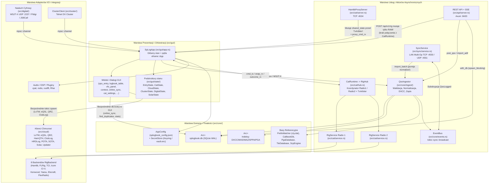

# Architektura Systemu SPLogbook — Stan Bieżący (As-Is)

**Dokument audytowy:** `docs/ARCHITECTURE_CURRENT_STATE.md`  
**Projekt:** SPLogbook (`v1.2.0`)  
**Gałąź referencyjna:** `main` (punkt startowy audytu: `6f7d3aaa3b6a54e87b481c142a5b690bcf8b5592`)  
**Charakter dokumentu:** Faktyczna mapa stanu bieżącego wynikająca wyłącznie z analizy kodu źródłowego (bez elementów architektury docelowej).

---

## 1. Crate’y i Główne Moduły

Projekt jest pojedynczym pakietem Cargo (single-crate package, bez sekcji `[workspace]` w [`Cargo.toml`](file:///c:/Users/sp6in/Documents/SPLogbook/SPLogbook/Cargo.toml#L1-L97)), kompilowanym do dwóch celów głównych oraz zestawu 8 testów integracyjnych:

- **Biblioteka (`lib`)**: [`src/lib.rs`](file:///c:/Users/sp6in/Documents/SPLogbook/SPLogbook/src/lib.rs#L1-L14) — eksportuje 11 modułów najwyższego poziomu:
  1. [`src/api/`](file:///c:/Users/sp6in/Documents/SPLogbook/SPLogbook/src/api/mod.rs) — lokalny serwer HTTP/REST (Axum) i strumień zdarzeń SSE (`server.rs`).
  2. [`src/cat/`](file:///c:/Users/sp6in/Documents/SPLogbook/SPLogbook/src/cat/mod.rs) — podsystem sterowania transceiverami i akcesoriami:
     - rdzeń wieloradiowy: `rig.rs`, `backend.rs`, `config.rs`, `factory.rs`, `service.rs`, `hub.rs`, `tx_arbiter.rs`, `probe.rs`;
     - adaptery pośrednie i SDR: `hamlib.rs`, `flrig.rs`, `tci.rs`, `tcp.rs`;
     - protokoły natywne (`src/cat/native/`): `transport.rs`, `serial.rs`, `profile.rs`, `registry.rs`, `icom/`, `kenwood/`, `yaesu/`, `elecraft/`, `flexradio/`;
     - warstwa HIL (`src/cat/hil/`): `manifest.rs`, `execution.rs`, `session.rs`, `checklist.rs`, `report.rs`, `evidence.rs`;
     - usługi towarzyszące: `supervisor.rs` (`rigctld`), `server.rs` (Hamlib TCP Proxy), `rotor.rs` (`rotctld`), `winkeyer.rs` (protokół K1EL), `so2r.rs` (izolowana domena SO2R).
  3. [`src/cloud/`](file:///c:/Users/sp6in/Documents/SPLogbook/SPLogbook/src/cloud/mod.rs) — integracje zewnętrzne i chmurowe: `lotw.rs`, `eqsl.rs`, `qrz.rs`, `hamqth.rs`, `clublog.rs`, `hrdlog.rs`, `pota.rs`, `sota.rs`, `solar.rs`, `aprs.rs`, `webhook.rs`, `updater.rs`.
  4. [`src/cluster/`](file:///c:/Users/sp6in/Documents/SPLogbook/SPLogbook/src/cluster/mod.rs) — klient Telnet DX Cluster (`telnet.rs`), pamięć spotów i alertów (`spot.rs`), skimmer (`skimmer.rs`), czat i ogłoszenia (`chat.rs`).
  5. [`src/core/`](file:///c:/Users/sp6in/Documents/SPLogbook/SPLogbook/src/core/mod.rs) — model domenowy, trwałość SQLite, parsery i silniki obliczeniowe:
     - `database/` (`mod.rs`, `schema.rs`, `qso_store.rs`, `search.rs`, `qsl.rs`, `journals.rs`, `stats.rs`, `contest_dupes.rs`);
     - `ingest/` (`mod.rs`, `normalize.rs`, `enrich.rs`, `import.rs`);
     - formaty i referencje: `qso.rs`, `adif.rs`, `cabrillo.rs`, `edi.rs`, `csv_export.rs`, `cty.rs`, `prefix.rs`, `callbook.rs`, `pga.rs`, `scp.rs`, `bandplan.rs`, `clubs.rs`;
     - silniki domenowe: `awards.rs`, `awards_rules.rs`, `contest.rs`, `contest_rules.rs`, `locator.rs`, `propagation.rs`, `propagation_history.rs`, `astronomy.rs`, `satellites.rs`, `rotator_Path.rs`, `Grayline.rs`, `ntm.rs`, `spots_map.rs`, `qsl_print.rs`;
     - infrastruktura bazowa: `station.rs` (`AppConfig`, `SecretStore`), `backup.rs`, `events.rs`, `logging.rs`, `i18n.rs`, `i18n_msg.rs`.
  6. [`src/digital/`](file:///c:/Users/sp6in/Documents/SPLogbook/SPLogbook/src/digital/mod.rs) — integracje z dekoderami emisji cyfrowych: `wsjtx.rs` (binarny protokół UDP WSJT-X/JTDX), `js8call.rs` (JSON-over-UDP), `fldigi.rs` (XML-RPC).
  7. [`src/dsp/`](file:///c:/Users/sp6in/Documents/SPLogbook/SPLogbook/src/dsp/mod.rs) — potok FFT i wodospadu audio (`waterfall.rs`).
  8. [`src/gui/`](file:///c:/Users/sp6in/Documents/SPLogbook/SPLogbook/src/gui/mod.rs) — interfejs graficzny `eframe`/`egui` z głównym typem [`SpLogApp`](file:///c:/Users/sp6in/Documents/SPLogbook/SPLogbook/src/gui/app.rs#L65-L115), podmodułem stanu [`src/gui/state/`](file:///c:/Users/sp6in/Documents/SPLogbook/SPLogbook/src/gui/state/mod.rs) oraz 50 modułami widoków, okien modalnych i kontrolerów.
  9. [`src/media/`](file:///c:/Users/sp6in/Documents/SPLogbook/SPLogbook/src/media/mod.rs) — obsługa audio (`audio.rs` przez `cpal`/`rodio`/`hound`) oraz lokalnej galerii zdjęć QSL (`gallery.rs`).
  10. [`src/plugins/`](file:///c:/Users/sp6in/Documents/SPLogbook/SPLogbook/src/plugins/mod.rs) — silnik skryptowy Rhai (`engine.rs`).
  11. [`src/sync/`](file:///c:/Users/sp6in/Documents/SPLogbook/SPLogbook/src/sync/mod.rs) — synchronizacja LAN Multi-Op TCP (`protocol.rs`, `crypto.rs`, `auth.rs`, `store.rs`, `host.rs`, `client.rs`, `discovery.rs`, `engine.rs`, `service.rs`).
- **Cel wykonywalny (`bin`)**: [`src/main.rs`](file:///c:/Users/sp6in/Documents/SPLogbook/SPLogbook/src/main.rs#L1-L263) — inicjalizacja środowiska, runtime Tokio, migracji konfiguracji, bazy SQLite i okna `eframe`.
- **Plik pomocniczy (niepodłączony do `lib.rs`)**: [`src/scratch.rs`](file:///c:/Users/sp6in/Documents/SPLogbook/SPLogbook/src/scratch.rs#L1-L11) — śledzony w Git skrypt pomocniczy z kluczem prywatnym Ed25519 (zob. `SEC-001`).

---

## 2. Warstwy Logiczne

W kodzie występują 4 warstwy logiczne o częściowo rozmytych granicach:

1. **Warstwa Prezentacji i Orkiestracji (`src/gui/**`)**:
   - Renderuje natywne okna i dokowalne panele `egui` / `egui_dock`.
   - Równocześnie pełni funkcję głównego orkiestratora aplikacji (`SpLogApp`), przechowując uchwyty do bazy danych, runtime'u Tokio, kanałów komunikacyjnych oraz bezpośrednio spawnując zadania sieciowe w [`src/gui/online_sync.rs`](file:///c:/Users/sp6in/Documents/SPLogbook/SPLogbook/src/gui/online_sync.rs) i [`src/gui/app_cat.rs`](file:///c:/Users/sp6in/Documents/SPLogbook/SPLogbook/src/gui/app_cat.rs).
2. **Warstwa Usług Aplikacyjnych i Aktorów Asynchronicznych (`src/cat/hub.rs`, `src/cat/service.rs`, `src/sync/service.rs`, `src/api/server.rs`, `src/core/ingest/**`)**:
   - Zapewnia potok zapisu QSO (`QsoIngestor`), koordynację wieloradiową (`CatRuntime` / `RigHub` / `RigService`), synchronizację LAN (`SyncService`) oraz serwer REST API.
3. **Warstwa Domeny Krótkofalarskiej (`src/core/**`, `src/cat/tx_arbiter.rs`, `src/cat/so2r.rs`)**:
   - Walidacja rekordu `QsoRecord`, obliczenia lokatorów Maidenhead, azymutów, szarej strefy, propagacji HF, reguł zawodów (`ContestEngine`) i dyplomów (`AwardsEngine`), automat bezpieczeństwa `TxArbiter`.
4. **Warstwa Infrastruktury i Adapterów I/O (`src/core/database/**`, `src/cat/native/**`, `src/cloud/**`, `src/cluster/**`, `src/digital/**`, `src/media/**`, `src/dsp/**`)**:
   - Dostęp do SQLite (`rusqlite`), portów szeregowych (`tokio-serial`), gniazd TCP/UDP/WebSocket (`tokio`, `tokio-tungstenite`), klientów HTTP (`reqwest`) i urządzeń audio (`cpal`, `rodio`).

---

## 3. Punkty Wejścia

1. **Główny punkt wejścia programu**: [`fn main() -> eframe::Result`](file:///c:/Users/sp6in/Documents/SPLogbook/SPLogbook/src/main.rs#L17-L234):
   - Inicjalizuje `Logger::init()` (`SPLogbook.log`) i panik-hook zapisujący zrzut awaryjny do `crash_report.log` ([`src/main.rs:20-38`](file:///c:/Users/sp6in/Documents/SPLogbook/SPLogbook/src/main.rs#L20-L38)).
   - Tworzy wielowątkowy runtime Tokio (`tokio::runtime::Runtime::new()`) i wchodzi w jego kontekst (`_guard = rt.enter()`, [`src/main.rs:41-47`](file:///c:/Users/sp6in/Documents/SPLogbook/SPLogbook/src/main.rs#L41-L47)).
   - Ładuje `AppConfig::load()`, wykonuje migrację `config.ensure_station_cat_migrated()` ([`src/main.rs:51-68`](file:///c:/Users/sp6in/Documents/SPLogbook/SPLogbook/src/main.rs#L51-L68)).
   - Otwiera bazę `splogbook.db` (`Database::new`), wykonuje automatyczną kopię zapasową (`BackupManager::create_auto_backup`) oraz ładuje `PrefixMatcher`, `CallbookDb`, `PgaDatabase`, `TleDatabase`, `ScpEngine` i `AwardsEngine` ([`src/main.rs:71-178`](file:///c:/Users/sp6in/Documents/SPLogbook/SPLogbook/src/main.rs#L71-L178)).
   - Buduje `SpLogApp::build(init)` ([`src/gui/app.rs:197-446`](file:///c:/Users/sp6in/Documents/SPLogbook/SPLogbook/src/gui/app.rs#L197-L446)), uruchamia zadania tła `app.start_background()` ([`src/gui/app.rs:451-579`](file:///c:/Users/sp6in/Documents/SPLogbook/SPLogbook/src/gui/app.rs#L451-L579)) i przekazuje sterowanie do pętli `eframe::run_native` ([`src/main.rs:189-233`](file:///c:/Users/sp6in/Documents/SPLogbook/SPLogbook/src/main.rs#L189-L233)).
2. **Punkt wejścia pętli klatek GUI**: [`impl eframe::App for SpLogApp::update`](file:///c:/Users/sp6in/Documents/SPLogbook/SPLogbook/src/gui/app.rs#L583-L664).
3. **Zewnętrzne sieciowe punkty wejścia (serwery lokalne)**:
   - **REST API + SSE**: `http://127.0.0.1:<rest_api_port>` (domyślnie `8420`, [`src/api/server.rs:384-439`](file:///c:/Users/sp6in/Documents/SPLogbook/SPLogbook/src/api/server.rs#L384-L439)).
   - **Hamlib TCP Proxy (`rigctld` emulation)**: `127.0.0.1:<cat_proxy_port>` (domyślnie `4534`, [`src/cat/server.rs:367-459`](file:///c:/Users/sp6in/Documents/SPLogbook/SPLogbook/src/cat/server.rs#L367-L459)).
   - **WSJT-X / JTDX UDP Listener**: `127.0.0.1:<wsjtx_port>` (domyślnie `2237`, [`src/digital/wsjtx.rs:287-395`](file:///c:/Users/sp6in/Documents/SPLogbook/SPLogbook/src/digital/wsjtx.rs#L287-L395)).
   - **JS8Call UDP Listener**: `127.0.0.1:<js8call_port>` (domyślnie `2242`, [`src/digital/js8call.rs:110-169`](file:///c:/Users/sp6in/Documents/SPLogbook/SPLogbook/src/digital/js8call.rs#L110-L169) — nieosiągalny produkcyjnie, zob. `FUNC-004`).
   - **LAN Sync Host TCP**: `0.0.0.0:<port>` lub `127.0.0.1:<port>` (domyślnie `4550`, [`src/sync/host.rs:249-330`](file:///c:/Users/sp6in/Documents/SPLogbook/SPLogbook/src/sync/host.rs#L249-L330)) + UDP Discovery (`4551`, [`src/sync/discovery.rs`](file:///c:/Users/sp6in/Documents/SPLogbook/SPLogbook/src/sync/discovery.rs)).

---

## 4. Główne Typy Domenowe

- [`QsoRecord`](file:///c:/Users/sp6in/Documents/SPLogbook/SPLogbook/src/core/qso.rs#L22-L120) — centralna encja łączności (51 pól odpowiadających specyfikacji ADIF 3.1.4 + rozszerzenia SP/POTA/SOTA/WWFF/satelitarne/konkursowe).
- [`JournalProfile`](file:///c:/Users/sp6in/Documents/SPLogbook/SPLogbook/src/core/database/journals.rs#L7-L16) — profil dziennika (`DEFAULT`, POTA, SOTA, Contest itp.).
- [`AppConfig`](file:///c:/Users/sp6in/Documents/SPLogbook/SPLogbook/src/core/station.rs#L276-L384) — zagregowana konfiguracja programu z zagnieżdżonymi podstrukturami (`StationProfileConfig`, `CatLegacyConfig`, `OnlineServicesConfig`, `UiWorkspaceConfig`, `SolarAlertsConfig`, `SatellitesConfig`, `CwKeyerConfig`, `RuntimeServicesConfig`, `StationRigConfig`).
- [`RigState`](file:///c:/Users/sp6in/Documents/SPLogbook/SPLogbook/src/cat/rig.rs#L11-L48), [`RigCapabilities`](file:///c:/Users/sp6in/Documents/SPLogbook/SPLogbook/src/cat/rig.rs#L71-L97), [`RigCommand`](file:///c:/Users/sp6in/Documents/SPLogbook/SPLogbook/src/cat/rig.rs#L140-L176), [`RigId`](file:///c:/Users/sp6in/Documents/SPLogbook/SPLogbook/src/cat/config.rs#L15-L53) — model stanu, możliwości i rozkazów sterowania transceiverem.
- [`TxArbiter`](file:///c:/Users/sp6in/Documents/SPLogbook/SPLogbook/src/cat/tx_arbiter.rs#L84-L115) oraz [`TxArbiterState`](file:///c:/Users/sp6in/Documents/SPLogbook/SPLogbook/src/cat/tx_arbiter.rs#L48-L65) (`Idle`, `Claiming`, `Owned`, `Releasing`, `Unknown`) — automat bezpieczeństwa blokady jednoczesnego nadawania.
- [`AwardsEngine`](file:///c:/Users/sp6in/Documents/SPLogbook/SPLogbook/src/core/awards.rs#L99-L130) i [`AwardStatus`](file:///c:/Users/sp6in/Documents/SPLogbook/SPLogbook/src/core/awards.rs#L18-L41) — indeksy przepracowanych i potwierdzonych podmiotów dyplomowych (DXCC, WAZ, WAS, WAC, WPX, SPPA, PGA, SOTA, POTA, IOTA, Grids).
- [`ContestEngine`](file:///c:/Users/sp6in/Documents/SPLogbook/SPLogbook/src/core/contest.rs#L91-L118) — silnik punktacji i mnożników dla 10 wspieranych zawodów.
- [`DxSpot`](file:///c:/Users/sp6in/Documents/SPLogbook/SPLogbook/src/cluster/spot.rs#L10-L32) i [`SpotStore`](file:///c:/Users/sp6in/Documents/SPLogbook/SPLogbook/src/cluster/spot.rs#L65-L78) — reprezentacja spotów DX Cluster / WSJT-X.
- [`AppEvent`](file:///c:/Users/sp6in/Documents/SPLogbook/SPLogbook/src/core/events.rs#L13-L61) — wyliczenie zdarzeń szyny `EventBus`.

---

## 5. Główne Usługi

- [`Database`](file:///c:/Users/sp6in/Documents/SPLogbook/SPLogbook/src/core/database/mod.rs#L35-L38) — warstwa repozytorium SQLite (`Arc<Mutex<Database>>`).
- [`QsoIngestor`](file:///c:/Users/sp6in/Documents/SPLogbook/SPLogbook/src/core/ingest/mod.rs#L95-L100) — ujednolicona usługa walidacji, normalizacji, wzbogacania DXCC, deduplikacji, zapisu do SQLite, aktualizacji `AwardsEngine` oraz publikacji `AppEvent::QsoLogged`.
- [`CatRuntime`](file:///c:/Users/sp6in/Documents/SPLogbook/SPLogbook/src/gui/state/cat.rs#L120-L134) / [`RigHub`](file:///c:/Users/sp6in/Documents/SPLogbook/SPLogbook/src/cat/hub.rs#L223-L246) / [`RigService`](file:///c:/Users/sp6in/Documents/SPLogbook/SPLogbook/src/cat/service.rs#L223-L250) — wieloradiowy podsystem CAT z aktorem na każdy skonfigurowany transceiver (`Radio 1`, `Radio 2`).
- [`RigctldSupervisor`](file:///c:/Users/sp6in/Documents/SPLogbook/SPLogbook/src/cat/supervisor.rs#L120-L129) — nadzorca procesu potomnego `rigctld`.
- [`HamlibProxyServer`](file:///c:/Users/sp6in/Documents/SPLogbook/SPLogbook/src/cat/server.rs#L352-L365) — lokalny serwer TCP emulujący protokół `rigctld` dla aplikacji zewnętrznych.
- [`SyncService`](file:///c:/Users/sp6in/Documents/SPLogbook/SPLogbook/src/sync/service.rs#L48-L62) / [`SyncEngine`](file:///c:/Users/sp6in/Documents/SPLogbook/SPLogbook/src/sync/engine.rs) — usługa synchronizacji łączności i obecności operatorów w sieci LAN (Host / Client).
- [`ApiState` + `start_api_server`](file:///c:/Users/sp6in/Documents/SPLogbook/SPLogbook/src/api/server.rs#L35-L45) — serwer REST API / SSE.
- [`PluginEngine`](file:///c:/Users/sp6in/Documents/SPLogbook/SPLogbook/src/plugins/engine.rs#L46-L52) — środowisko uruchomieniowe skryptów Rhai.

---

## 6. Przepływy Danych

### 6.1. Przepływ zapisu QSO (Ingest Pipeline)
1. **Źródła wejściowe**:
   - Formularz GUI (`SpLogApp::save_qso` w [`src/gui/app_qso.rs:28-235`](file:///c:/Users/sp6in/Documents/SPLogbook/SPLogbook/src/gui/app_qso.rs#L28-L235)) -> `QsoOrigin::GuiManual` / `GuiContest`.
   - Pakiet UDP `QSO Logged` z WSJT-X ([`src/gui/app_async.rs:141-193`](file:///c:/Users/sp6in/Documents/SPLogbook/SPLogbook/src/gui/app_async.rs#L141-L193)) -> `QsoOrigin::WsjtxUdp`.
   - Pakiet UDP z JS8Call ([`src/gui/app_async.rs:195-210`](file:///c:/Users/sp6in/Documents/SPLogbook/SPLogbook/src/gui/app_async.rs#L195-L210)) -> `QsoOrigin::Js8CallUdp`.
   - Endpoint `POST /api/v1/qsos` ([`src/api/server.rs:778-809`](file:///c:/Users/sp6in/Documents/SPLogbook/SPLogbook/src/api/server.rs#L778-L809)) -> `QsoOrigin::RestApi`.
   - Synchronizacja LAN (`SyncStore::apply_remote_qso` w [`src/sync/store.rs:34-67`](file:///c:/Users/sp6in/Documents/SPLogbook/SPLogbook/src/sync/store.rs#L34-L67)) -> `QsoIngestor::import_batch`.
   - Import pliku ADIF (GUI w [`src/gui/adif_dialog.rs:163-214`](file:///c:/Users/sp6in/Documents/SPLogbook/SPLogbook/src/gui/adif_dialog.rs#L163-L214) lub `POST /api/v1/adif/import` w [`src/api/server.rs:998-1062`](file:///c:/Users/sp6in/Documents/SPLogbook/SPLogbook/src/api/server.rs#L998-L1062)) -> `QsoIngestor::import_batch`.
2. **Przetwarzanie w `QsoIngestor::ingest`** ([`src/core/ingest/mod.rs:116-184`](file:///c:/Users/sp6in/Documents/SPLogbook/SPLogbook/src/core/ingest/mod.rs#L116-L184)):
   - `normalize_qso_fields(&mut qso)` -> `qso.validate()` -> `enrich_with_dxcc(&mut qso, &self.prefix_matcher)` -> `db.has_identity(...)` -> `db.insert_qso(&qso)` -> `awards.ingest_qso(&qso)` -> `events.publish(AppEvent::QsoLogged { .. })`.
   - **Uwaga audytowa (`DATA-002`)**: Ścieżka wsadowa `QsoIngestor::import_batch` ([`src/core/ingest/import.rs:63-88`](file:///c:/Users/sp6in/Documents/SPLogbook/SPLogbook/src/core/ingest/import.rs#L63-L88)) pomija wywołanie `normalize_qso_fields(&mut qso)`.

### 6.2. Przepływ telemetrii i sterowania CAT
1. **Odczyt (Polling / Unsolicited Push)**:
   - Fizyczne radio / emulator -> `RigBackend::poll()` -> `RigService::run_loop` ([`src/cat/service.rs:378-478`](file:///c:/Users/sp6in/Documents/SPLogbook/SPLogbook/src/cat/service.rs#L378-L478)) -> `watch::Sender<RigStateSnapshot>` -> `RigHub` -> `CatRuntime` (`watch::Sender<CatRuntimeSnapshot>`) -> `SpLogApp::poll_cat_outcomes` ([`src/gui/app_async.rs:212-256`](file:///c:/Users/sp6in/Documents/SPLogbook/SPLogbook/src/gui/app_async.rs#L212-L256)) -> `self.cat.rig_state` + `shared_rig_state` (dla Hamlib Proxy i REST API).
2. **Sterowanie (Komendy i PTT)**:
   - GUI (`SpLogApp`) -> `CatRuntime::send_command` / `request_tx` / `release_tx` -> zadanie koordynatora w [`src/gui/state/cat.rs:150-241`](file:///c:/Users/sp6in/Documents/SPLogbook/SPLogbook/src/gui/state/cat.rs#L150-L241) -> `RigHub` (weryfikacja `TxArbiter`) -> `RigServiceHandle` (`mpsc::Sender<ServiceRequest>`) -> `RigBackend::execute`.

---

## 7. Przepływy Zdarzeń (`EventBus`)

Szyna [`EventBus`](file:///c:/Users/sp6in/Documents/SPLogbook/SPLogbook/src/core/events.rs#L64-L98) oparta jest na `tokio::sync::broadcast::Sender<AppEvent>` (pojemność bufora: `256`).
- **Publikujący**:
  - `QsoIngestor` (`AppEvent::QsoLogged`),
  - `SpLogApp` (`AppEvent::RigState`, `AppEvent::ClusterSpot`, `AppEvent::WsjtxDecode`, `AppEvent::SolarUpdated`, `AppEvent::Shutdown`),
  - `ApiState` (`AppEvent::RigState` w `post_rig_control`).
- **Subskrybenci**:
  - Strumień SSE `/api/v1/events` ([`src/api/server.rs:1164-1188`](file:///c:/Users/sp6in/Documents/SPLogbook/SPLogbook/src/api/server.rs#L1164-L1188)),
  - `SyncService` ([`src/sync/service.rs:111-162`](file:///c:/Users/sp6in/Documents/SPLogbook/SPLogbook/src/sync/service.rs#L111-L162) — nasłuchuje `AppEvent::QsoLogged`, aby rozesłać nowe QSO do stacji LAN).

---

## 8. Kanały Komunikacji Wewnętrznej

W aplikacji funkcjonuje równolegle kilkanaście kanałów `std::sync::mpsc` oraz `tokio::sync::{mpsc, watch, broadcast, oneshot}`:

| Kanał | Typ | Nadawca | Odbiorca | Lokalizacja |
|---|---|---|---|---|
| `CatRuntime.cmd_tx` | `tokio::sync::mpsc::UnboundedSender<CatRuntimeAction>` | `SpLogApp` | Pętla `CatRuntime` (`RigHub`) | [`src/gui/state/cat.rs:122`](file:///c:/Users/sp6in/Documents/SPLogbook/SPLogbook/src/gui/state/cat.rs#L122) |
| `CatRuntime.snap_rx` | `tokio::sync::watch::Receiver<CatRuntimeSnapshot>` | Pętla `CatRuntime` | `SpLogApp::poll_cat_outcomes` | [`src/gui/state/cat.rs:123`](file:///c:/Users/sp6in/Documents/SPLogbook/SPLogbook/src/gui/state/cat.rs#L123) |
| `CatRuntime.outcome_rx` | `std::sync::mpsc::Receiver<CatRuntimeOutcome>` | Pętla `CatRuntime` | `SpLogApp::poll_cat_outcomes` | [`src/gui/state/cat.rs:124`](file:///c:/Users/sp6in/Documents/SPLogbook/SPLogbook/src/gui/state/cat.rs#L124) |
| `RigService.req_tx` | `tokio::sync::mpsc::Sender<ServiceRequest>` (poj. 32) | `RigHub` | `RigService::run_loop` | [`src/cat/service.rs:255`](file:///c:/Users/sp6in/Documents/SPLogbook/SPLogbook/src/cat/service.rs#L255) |
| `RigService.state_rx` | `tokio::sync::watch::Receiver<RigStateSnapshot>` | `RigService` | `RigHub` | [`src/cat/service.rs:256`](file:///c:/Users/sp6in/Documents/SPLogbook/SPLogbook/src/cat/service.rs#L256) |
| `cat.proxy_cmd_rx` | `tokio::sync::mpsc::Receiver<RigServerCommand>` (poj. 64) | `HamlibProxyServer` | `SpLogApp::poll_cat_proxy_commands` | [`src/gui/state/cat.rs:58`](file:///c:/Users/sp6in/Documents/SPLogbook/SPLogbook/src/gui/state/cat.rs#L58) |
| `cat.probe_rx` | `std::sync::mpsc::Receiver<Result<RigProbeResult, String>>` | Task `RigProbeRunner` | `cat_settings.rs` | [`src/gui/state/cat.rs:69`](file:///c:/Users/sp6in/Documents/SPLogbook/SPLogbook/src/gui/state/cat.rs#L69) |
| `cluster.event_rx` | `tokio::sync::mpsc::Receiver<ClusterEvent>` (poj. 256) | `ClusterClient` | `SpLogApp::poll_cluster_events` | [`src/gui/state/cluster.rs:25`](file:///c:/Users/sp6in/Documents/SPLogbook/SPLogbook/src/gui/state/cluster.rs#L25) |
| `digital.wsjtx_rx` | `tokio::sync::mpsc::Receiver<WsjtxMessage>` (poj. 256) | `WsjtxListener` | `SpLogApp::poll_wsjtx_events` | [`src/gui/state/digital.rs:21`](file:///c:/Users/sp6in/Documents/SPLogbook/SPLogbook/src/gui/state/digital.rs#L21) |
| `digital.js8_rx` | `tokio::sync::mpsc::Receiver<Js8Message>` (poj. 100) | `Js8CallListener` | `SpLogApp::poll_js8call_events` | [`src/gui/state/digital.rs:29`](file:///c:/Users/sp6in/Documents/SPLogbook/SPLogbook/src/gui/state/digital.rs#L29) |
| `solar.update_rx` | `tokio::sync::mpsc::Receiver<SolarConditions>` (poj. 8) | Poller `SolarClient` | `SpLogApp::poll_solar_updates` | [`src/gui/state/solar.rs:19`](file:///c:/Users/sp6in/Documents/SPLogbook/SPLogbook/src/gui/state/solar.rs#L19) |
| `cloud.online_sync_rx` | `tokio::sync::mpsc::Receiver<String>` (poj. 100) | Zadania `online_sync.rs` | `SpLogApp::poll_online_sync` | [`src/gui/state/cloud.rs:26`](file:///c:/Users/sp6in/Documents/SPLogbook/SPLogbook/src/gui/state/cloud.rs#L26) |
| `cloud.callbook_rx` | `tokio::sync::mpsc::Receiver<CallbookResult>` (poj. 16) | Task QRZ/HamQTH | `SpLogApp::poll_callbook_results` | [`src/gui/state/cloud.rs:38`](file:///c:/Users/sp6in/Documents/SPLogbook/SPLogbook/src/gui/state/cloud.rs#L38) |
| `cloud.pota_rx` / `sota_rx` | `tokio::sync::mpsc::Receiver<Result<Vec<...>, String>>` | Taski POTA / SOTA | `pota_dialog.rs` / `sota_dialog.rs` | [`src/gui/state/cloud.rs:42-49`](file:///c:/Users/sp6in/Documents/SPLogbook/SPLogbook/src/gui/state/cloud.rs#L42-L49) |
| `cloud.update_rx` | `tokio::sync::mpsc::Receiver<UpdateEvent>` (poj. 8) | `UpdaterClient` | `SpLogApp::poll_updater` | [`src/gui/state/cloud.rs:53`](file:///c:/Users/sp6in/Documents/SPLogbook/SPLogbook/src/gui/state/cloud.rs#L53) |
| `sync.cmd_tx` / `evt_rx` | `mpsc::UnboundedSender<SyncServiceCommand>` / `Receiver<SyncEngineEvent>` | `SpLogApp` <-> `SyncService` | `SpLogApp::poll_lan_sync` | [`src/sync/service.rs:54-61`](file:///c:/Users/sp6in/Documents/SPLogbook/SPLogbook/src/sync/service.rs#L54-L61) |

---

## 9. Zadania Asynchroniczne i Wątki

1. **Wątek główny (Main / GUI Thread)**:
   - Pętla `eframe::run_native` wywołująca `SpLogApp::update`.
2. **Pula wątków roboczych Tokio (`Runtime::new()`)**:
   - Zadanie koordynatora `CatRuntime` ([`src/gui/state/cat.rs:150`](file:///c:/Users/sp6in/Documents/SPLogbook/SPLogbook/src/gui/state/cat.rs#L150)) oraz po jednym zadaniu `RigService::run_loop` na każde skonfigurowane radio ([`src/cat/service.rs:280`](file:///c:/Users/sp6in/Documents/SPLogbook/SPLogbook/src/cat/service.rs#L280)).
   - Zadanie `HamlibProxyServer::start` ([`src/cat/server.rs:367`](file:///c:/Users/sp6in/Documents/SPLogbook/SPLogbook/src/cat/server.rs#L367)) + osobne zadania dla podłączonych klientów TCP.
   - Zadanie `WsjtxListener::start` ([`src/digital/wsjtx.rs:287`](file:///c:/Users/sp6in/Documents/SPLogbook/SPLogbook/src/digital/wsjtx.rs#L287)).
   - Zadanie cyklicznego pobierania propagacji słonecznej co 15 min ([`src/gui/app.rs:514-534`](file:///c:/Users/sp6in/Documents/SPLogbook/SPLogbook/src/gui/app.rs#L514-L534)).
   - Zadanie serwera Axum `start_api_server` ([`src/gui/app.rs:559-564`](file:///c:/Users/sp6in/Documents/SPLogbook/SPLogbook/src/gui/app.rs#L559-L564)).
   - Zadanie sprawdzenia aktualizacji przy starcie ([`src/gui/app.rs:571-575`](file:///c:/Users/sp6in/Documents/SPLogbook/SPLogbook/src/gui/app.rs#L571-L575)).
   - Zadanie `ClusterClient::start_loop` ([`src/cluster/telnet.rs:88`](file:///c:/Users/sp6in/Documents/SPLogbook/SPLogbook/src/cluster/telnet.rs#L88)).
   - Zadania `SyncService` (`HostServer`, `ClientWorker`, `DiscoveryService` w [`src/sync/service.rs`](file:///c:/Users/sp6in/Documents/SPLogbook/SPLogbook/src/sync/service.rs)).
   - Zadania ad-hoc spawnowane przez `tokio::spawn` przy zapytaniach Callbooka, synchronizacji chmurowej (LoTW/eQSL/QRZ/ClubLog/HRDLog), webhookach, APRS i rotorze.
3. **Dedykowane wątki OS (`std::thread`)**:
   - Wątki strumieni audio `cpal` (przechwytywanie próbek dla wodospadu DSP w [`src/gui/waterfall_panel.rs`](file:///c:/Users/sp6in/Documents/SPLogbook/SPLogbook/src/gui/waterfall_panel.rs) oraz nagrywanie WAV w [`src/media/audio.rs`](file:///c:/Users/sp6in/Documents/SPLogbook/SPLogbook/src/media/audio.rs)).
   - Wątek miksera audio `rodio::OutputStream` (odtwarzanie nagrań i Voice Keyera w [`src/media/audio.rs`](file:///c:/Users/sp6in/Documents/SPLogbook/SPLogbook/src/media/audio.rs)).

---

## 10. Zasoby Współdzielone, Blokady i Mechanizmy Synchronizacji

| Zasób współdzielony | Typ synchronizacji | Współdzielony pomiędzy | Ryzyka / uwagi |
|---|---|---|---|
| Połączenie SQLite (`Database`) | `Arc<std::sync::Mutex<Database>>` | Wątek GUI (`SpLogApp`), REST API (`spawn_blocking`), `QsoIngestor`, zadania `online_sync.rs`, `SyncStore` | W `online_sync.rs` blokada `db.lock()` bywa trzymana w kontekście async lub wielokrotnie w pętli (`CONC-001`). |
| Silnik dyplomowy (`AwardsEngine`) | `Arc<std::sync::Mutex<AwardsEngine>>` | Wątek GUI, `QsoIngestor`, REST API (`lookup_callsign`, `get_awards_summary`) | Szybkie operacje w pamięci (`HashSet`/`HashMap`), brak I/O pod blokadą. |
| Stan radia dla API/Proxy | `Arc<std::sync::RwLock<RigState>>` | Wątek GUI (`poll_cat_outcomes`), `HamlibProxyServer`, `ApiState` | Mutowany z 3 miejsc bez arbitrażu (`post_rig_control` i `HamlibProxyServer` nadpisują go optymistycznie). |
| Flaga przeładowania bazy (`api_reload_flag`) | `Arc<AtomicBool>` (`Acquire`/`Release`) | REST API (`post_qso`/`put`/`delete`/`import`), `SyncService`, Wątek GUI | Poprawny wzorzec bezblokadowego powiadamiania GUI o zmianach z tła. |
| Flaga nagrywania audio | `Arc<AtomicBool>` (`SeqCst`) | Wątek GUI (`AudioRecorder`), callback `cpal` | Poprawna synchronizacja zamknięcia pliku WAV. |
| Semafor handshake LAN Sync | `Arc<tokio::sync::Semaphore>` (`MAX_HANDSHAKES = 5`) | `HostServer::run` ([`src/sync/host.rs:254`](file:///c:/Users/sp6in/Documents/SPLogbook/SPLogbook/src/sync/host.rs#L254)) | Brak timeoutu na `host_handshake` grozi wyczerpaniem wszystkich 5 permitów (`SEC-003`). |

---

## 11. Granice Odpowiedzialności Modułów i Zależności Między Warstwami

- Moduł `src/core/` **nie zależy** od `src/gui/` (poprawny kierunek zależności na poziomie kompilacji).
- Moduł `src/cat/` **nie zależy** od `src/gui/`.
- Moduł `src/gui/` zależy bezpośrednio od wszystkich pozostałych 10 modułów (`api`, `cat`, `cloud`, `cluster`, `core`, `digital`, `dsp`, `media`, `plugins`, `sync`).
- **Główne naruszenie granic odpowiedzialności (`ARCH-001`)**:
  - `SpLogApp` ([`src/gui/app.rs`](file:///c:/Users/sp6in/Documents/SPLogbook/SPLogbook/src/gui/app.rs)) oraz moduły widoków (`src/gui/online_sync.rs`, `src/gui/find_duplicates.rs`, `src/gui/statistics.rs`, `src/gui/qsl_designer.rs`, `src/gui/awards_dialog.rs`) bezpośrednio wywołują metody SQLite (`self.db.lock()`) i konstruują klienty HTTP (`LoTWClient`, `EqslClient`, `QrzClient`, `ClubLogClient`, `HrdLogClient`) wewnątrz kodu warstwy GUI.

---

## 12. Granice Dostępu do Systemu Plików i Sieci

### 12.1. Dostęp do systemu plików
- Katalog roboczy (bieżący katalog uruchomienia aplikacji):
  - `splogbook.db` (+ `splogbook.db-wal`, `splogbook.db-shm`) — główna baza SQLite ([`src/main.rs:71`](file:///c:/Users/sp6in/Documents/SPLogbook/SPLogbook/src/main.rs#L71)).
  - `splogbook_config.json` (+ `.bak`) — plik konfiguracyjny ([`src/core/station.rs:514`](file:///c:/Users/sp6in/Documents/SPLogbook/SPLogbook/src/core/station.rs#L514)).
  - `SPLogbook.log` — dziennik zdarzeń aplikacji ([`src/core/logging.rs:28`](file:///c:/Users/sp6in/Documents/SPLogbook/SPLogbook/src/core/logging.rs#L28)).
  - `crash_report.log` — zrzut awaryjny `panic!` ([`src/main.rs:34`](file:///c:/Users/sp6in/Documents/SPLogbook/SPLogbook/src/main.rs#L34)).
  - `SPLogbook_auto_backup.adi` — kopia ADIF zapisywana w `Drop for SpLogApp` ([`src/gui/app.rs:672`](file:///c:/Users/sp6in/Documents/SPLogbook/SPLogbook/src/gui/app.rs#L672)).
  - `backups/` — automatyczne i ręczne kopie bazy SQLite ([`src/core/backup.rs`](file:///c:/Users/sp6in/Documents/SPLogbook/SPLogbook/src/core/backup.rs)).
  - `recordings/` — nagrania audio QSO WAV ([`src/media/audio.rs`](file:///c:/Users/sp6in/Documents/SPLogbook/SPLogbook/src/media/audio.rs)).
  - `voice_keyer/` — komunikaty głosowe `F1.wav`..`F8.wav` ([`src/gui/voice_keyer.rs`](file:///c:/Users/sp6in/Documents/SPLogbook/SPLogbook/src/gui/voice_keyer.rs)).
  - `gallery/` — zdjęcia kart QSL ([`src/media/gallery.rs`](file:///c:/Users/sp6in/Documents/SPLogbook/SPLogbook/src/media/gallery.rs)).
  - `plugins/` — skrypty `.rhai` ([`src/plugins/engine.rs`](file:///c:/Users/sp6in/Documents/SPLogbook/SPLogbook/src/plugins/engine.rs)).
  - `databases/` — bazy referencyjne `cty.dat`, `callbook.db`, `pga.txt`, `tle.txt`, `MASTER.SCP`.
- Katalog profilu użytkownika (`dirs::data_local_dir()/SPLogbook/`):
  - `security/vault.enc`, `security/vault.salt` — zaszyfrowany fallback sekretów ([`src/core/station.rs:101-108`](file:///c:/Users/sp6in/Documents/SPLogbook/SPLogbook/src/core/station.rs#L101-L108)).
  - `lan_sync/` — tożsamość węzła LAN Sync i stan sparowanych stacji ([`src/sync/auth.rs`](file:///c:/Users/sp6in/Documents/SPLogbook/SPLogbook/src/sync/auth.rs)).

### 12.2. Dostęp do sieci i portów sprzętowych
- **Sieć lokalna / Loopback**: REST API (`127.0.0.1:8420`), Hamlib Proxy (`127.0.0.1:4534`), `rigctld` (`127.0.0.1:4532`), `rotctld` (`127.0.0.1:4533`), FLRig (`127.0.0.1:12345`), TCI WebSocket (`ws://localhost:40001`), FlexRadio SmartSDR TCP (`4992`), WSJT-X UDP (`2237`), Fldigi XML-RPC (`127.0.0.1:7362`), LAN Sync TCP (`4550`) i UDP (`4551`).
- **Sieć publiczna (Internet)**: LoTW (`lotw.arrl.org`), eQSL (`www.eqsl.cc`), QRZ (`xmldata.qrz.com`, `logbook.qrz.com`), HamQTH (`www.hamqth.com`), ClubLog (`clublog.org`), HRDLog (`robot.hrdlog.net`), POTA (`api.pota.app`), SOTA (`api-db2.sota.org.uk`), HamQSL Solar (`www.hamqsl.com`), GitHub Releases (`api.github.com`), serwery Telnet DX Cluster oraz APRS-IS (`rotate.aprs2.net:14580`).
- **Porty szeregowe (`tokio-serial`)**: Natywne backendy Icom CI-V, Kenwood, Yaesu, Elecraft.

---

## 13. Trwałe Formaty Danych i Zewnętrzne Protokoły

- **Baza danych**: SQLite 3 w trybie `WAL` (`splogbook.db`, 3 tabele: `qsos`, `journals`, `upload_queue` + `callbook.db`).
- **Formaty importu/eksportu krótkofalarskiego**: ADIF 3.1.4 (`.adi` / `.adif`), Cabrillo 3.0 (`.log` / `.cbr`), EDI REG1TEST (`.edi`), CSV (`.csv`), GPX 1.1 (`.gpx`), SVG (`.svg` dla kart/naklejek QSL).
- **Formaty referencyjne**: `CTY.DAT`, `MASTER.SCP`, `TLE` (3-liniowy NORAD), `pga.txt`, JSON (`locales/*.json`, `splogbook_config.json`).
- **Protokoły radiowe i sieciowe**: Icom CI-V (binarny `0xFE 0xFE ... 0xFD`), Kenwood PC Control (ASCII `;`), Yaesu CAT (ASCII `;`), Elecraft K3/K4/KX (ASCII `;`), FlexRadio SmartSDR TCP (`C<seq>|...`), ExpertSDR/Thetis TCI (WebSocket), Hamlib `rigctld`/`rotctld` (TCP ASCII), FLRig/Fldigi (XML-RPC over HTTP), WSJT-X (binarny big-endian QDataStream UDP), LAN Sync (własny protokół ramkowany długością 4B BE + X25519 + ChaCha20-Poly1305).

---

## 14. Feature Flags, Ścieżki Platformowe, Konfiguracja i Logowanie

1. **Feature Flags ([`Cargo.toml`](file:///c:/Users/sp6in/Documents/SPLogbook/SPLogbook/Cargo.toml#L13-L97))**:
   - Projekt **nie definiuje żadnych własnych sekcji `[features]`** w `Cargo.toml`. Wszystkie moduły są zawsze kompilowane.
   - Zależność platformowa: `[target.'cfg(target_os = "linux")'.dependencies]` dołącza `libudev-sys = "0.1"`.
2. **Ścieżki specyficzne dla platformy (`#[cfg(...)]`)**:
   - [`src/cloud/updater.rs:716-771`](file:///c:/Users/sp6in/Documents/SPLogbook/SPLogbook/src/cloud/updater.rs#L716-L771): oddzielne instalatory aktualizacji dla `target_os = "windows"` (skrypt PowerShell) oraz `unix` (archiwum `.tar.gz`).
   - [`src/cat/supervisor.rs:285-290`](file:///c:/Users/sp6in/Documents/SPLogbook/SPLogbook/src/cat/supervisor.rs#L285-L290): flaga `CREATE_NO_WINDOW` (`0x08000000`) przy uruchamianiu `rigctld.exe` na Windows.
   - [`src/core/station.rs:141-155`](file:///c:/Users/sp6in/Documents/SPLogbook/SPLogbook/src/core/station.rs#L141-L155): ustawianie uprawnień `0o600` (`PermissionsExt::from_mode`) dla plików sejfu na systemach `unix`.
   - [`build.rs`](file:///c:/Users/sp6in/Documents/SPLogbook/SPLogbook/build.rs#L1-L14): osadzanie zasobów ikony `.rc` przez `embed-resource` wyłącznie na Windows (`CARGO_CFG_TARGET_OS == "windows"`).
3. **Mechanizm konfiguracji**:
   - Plik `splogbook_config.json` serializowany przez `serde_json` z atomowym zapisem przez plik `.tmp` i kopią `.bak` ([`src/core/station.rs:581-634`](file:///c:/Users/sp6in/Documents/SPLogbook/SPLogbook/src/core/station.rs#L581-L634)).
   - Sekrety (11 kluczy API/haseł) są przenoszone do systemowego sejfu (`keyring::Entry`) lub zaszyfrowanego pliku `vault.enc` (Argon2id + ChaCha20-Poly1305) i zastępowane pustymi ciągami w pliku JSON.
4. **Logowanie i raportowanie błędów**:
   - Własna implementacja `log::Log` w [`src/core/logging.rs`](file:///c:/Users/sp6in/Documents/SPLogbook/SPLogbook/src/core/logging.rs#L1-L162) zapisująca do pliku `SPLogbook.log` (z rotacją powyżej 5 MB) oraz bufora kołowego w pamięci (`VecDeque` o pojemności 500 wpisów, widocznego w oknie diagnostycznym GUI).

---

## 15. Diagram Architektury Stanu Bieżącego (As-Is)

