# Architektura Systemu SPLogbook — Proponowany Stan Docelowy (To-Be)

**Dokument audytowy:** `docs/ARCHITECTURE_TARGET_STATE.md`  
**Projekt:** SPLogbook  
**Gałąź referencyjna:** `main`  
**Charakter dokumentu:** **PROPOZYCJA ARCHITEKTURY DOCELOWEJ (Target State Proposal)** — oddzielona od opisu stanu bieżącego (`docs/ARCHITECTURE_CURRENT_STATE.md`).

> [!IMPORTANT]
> Architektura docelowa nie wprowadza sztucznego podziału na dziesiątki mikro-crate'ów ani nadmiarowych warstw abstrakcji. Zachowuje zwinność natywnej aplikacji desktopowej w Rust (`eframe`/`egui` + `tokio` + `rusqlite`), eliminując faktyczne defekty architektoniczne wykryte podczas audytu: bezpośrednie wywołania SQLite z wątków i widoków GUI, brak izolacji `journal_id`, ominięcie `TxArbiter` przez REST API i Hamlib Proxy, nieograniczone ładowanie wszystkich QSO do pamięci GUI oraz rozproszenie zapisu konfiguracji.

---

## 1. Główne Założenia Architektury Docelowej

### 1.1. Ścisłe oddzielenie warstwy widoków GUI od trwałości i I/O (`JournalService` & `CloudSyncService`)
- **Stan obecny (problem `ARCH-001`, `CONC-001`, `DATA-005`)**: Widoki GUI (`online_sync.rs`, `find_duplicates.rs`, `statistics.rs`, `qsl_designer.rs`, `awards_dialog.rs`) bezpośrednio blokują `self.db.lock()` (często w wątkach Tokio bez `spawn_blocking` lub bezpośrednio w pętli renderowania 60 FPS) i pomijają filtr `journal_id`.
- **Stan docelowy**:
  1. Wprowadzenie jawnego kontekstu **`JournalContext { journal_id: String }`** wymaganego przez wszystkie zapytania domenowe (statystyki, duplikaty, eksporty chmurowe, potwierdzenia QSL, kopie ADIF).
  2. Zastąpienie bezpośrednich wywołań `db.lock()` w widokach GUI usługą **`LogbookQueryService` / `CloudSyncCoordinator`**, która wykonuje operacje dyskowe i bazodanowe na puli `tokio::task::spawn_blocking` i dostarcza do GUI gotowe, stronicowane migawki (`PaginatedLogView`, `JournalStatsSnapshot`, `DuplicateScanReport`).
  3. Ujednolicenie `QsoIngestor::ingest` oraz `QsoIngestor::import_batch` tak, aby **każda** ścieżka wejściowa (w tym `import_batch` z `enrich: false` używana przez LAN Sync) przechodziła przez `normalize_qso_fields(&mut qso)` przed walidacją i zapisem do bazy.

### 1.2. Jednolity Tor Sterowania Radiem i Arbitrażu Nadawania (`CatRuntime` / `RigHub` jako Jedyna Brama RF)
- **Stan obecny (problem `FUNC-003`, `CAT-001`..`CAT-014`)**:
  - `POST /api/v1/rig` mutuje wyłącznie pamięć RAM (`ApiState::rig_state`), nigdy nie docierając do `CatRuntime` ani `TxArbiter`.
  - `HamlibProxyServer` (`:4534`) optymistycznie mutuje `shared_state` i odsyła `RPRT 0` przed sprawdzeniem `TxArbiter`, a rozkazy przekazuje okrężnie przez pętlę klatek GUI (`poll_cat_proxy_commands`).
  - `VoiceKeyer` i `PluginCommand::SendVoice` odtwarzają audio bez potwierdzenia `TxArbiterState::Owned`.
  - 5 z 8 backendów posiada metodę `probe()` jako metodę inherentną zamiast implementacji traitu `RigBackend::probe`, przez co polimorficzne sondowanie wywołuje pełne `connect()` mutujące stan radia (`AI1;`, `AI2;`, `sub slice all`).
- **Stan docelowy**:
  1. **`CatRuntime` (współdzielony uchwyt `Clone + Send + Sync`)** jest przekazywany bezpośrednio do:
     - `SpLogApp` (GUI),
     - `ApiState` (REST API `GET/POST /api/v1/rig`),
     - `HamlibProxyServer` (serwer TCP `:4534`),
     - `VoiceKeyer` oraz `PluginEngine`.
  2. Żaden komponent poza `RigHub` nie przechowuje ani nie mutuje własnej kopii `Arc<RwLock<RigState>>` — odczyt stanu odbywa się z `watch::Receiver<CatRuntimeSnapshot>`, a każde żądanie `SetPtt(true)` zwraca `oneshot::Receiver<Result<(), RigError>>` po rzeczywistym potwierdzeniu nadawania z transceivera i autoryzacji `TxArbiter`.
  3. `RigService::run_loop` zawiera deterministyczną maszynę stanów automatycznego wznawiania połączenia (**Exponential Backoff Reconnect**: `500 ms -> 1 s -> 2 s -> 5 s`) po przejściu w `RigServiceState::Degraded` lub błędzie początkowego `connect()`, oraz oznacza przestarzałą telemetrię jako `StateFreshness::Stale`.
  4. Wszystkie 8 backendów implementuje read-only `RigBackend::probe(&mut self)` bezpośrednio w `impl RigBackend for ...`, a `RigService` obsługuje natywne rozszerzenia (`NativeRigCommand` / `NativeRigEvent`) dla panelu VFO i SO2R.

### 1.3. Stronicowanie i Indeksowane Bufory Widoków w GUI (Eliminacja pracy $O(N)$ na klatkę)
- **Stan obecny (problem `PERF-001`, `GUI-002`)**: `reload_qsos()` ładuje 100% bazy do `recent_qsos`, a `logbook_table.rs` i `contest.rs` wykonują pełne skanowanie, alokacje `to_lowercase()` i sortowanie wszystkich łączności w każdej klatce (60 razy na sekundę).
- **Stan docelowy**:
  1. `LogViewState` przechowuje wersjonowany bufor przefiltrowanych/posortowanych indeksów (`filtered_indices: Vec<usize>`, `data_generation: u64`, `filter_hash: u64`), przeliczany **wyłącznie** przy zmianie `data_generation` (nowe/zaktualizowane QSO) lub zmianie kryteriów filtra/sortowania.
  2. `ContestEngine` utrzymuje inkrementalny stan sesji zawodów (`worked_keys: HashSet<(String, String, String)>`, `callsign_counts: HashMap<String, usize>`, liczniki QSO/punktów/mnożników), aktualizowany w czasie $O(1)$ przy zalogowaniu lub usunięciu QSO, zamiast pięciokrotnego skanowania `recent_qsos` w każdej klatce.

### 1.4. Kompletna, Deklaratywna Trwałość Konfiguracji
- **Stan obecny (problem `FUNC-005`)**: `SpLogApp::snapshot_config()` ręcznie przepisuje wybrane pola z podstruktur GUI do `AppConfig`, gubiąc m.in. `cw.*`, `runtime.rest_api_*`, `solar.band_alert_*`, `satellites.*`, `active_journal` i `theme_preset`.
- **Stan docelowy**: Jedno źródło prawdy dla ustawień trwałych albo kompletna funkcja synchronizująca objęta testem round-trip (`test_snapshot_config_preserves_all_mutated_substructures`), gwarantująca, że żadna zmiana dokonana w oknach ustawień lub kreatorze nie zostanie utracona przy zamknięciu aplikacji.

---

## 2. Diagram Architektury Docelowej (To-Be)

```mermaid
flowchart TD
    subgraph Clients["Warstwa Prezentacji i Interfejsów Zewnętrznych"]
        GuiViews["Widoki GUI (src/gui/)\n(Stronicowane i wersjonowane bufory widoków\nbez bezpośredniego db.lock() i bez O(N)/klatkę)"]
        RestApi["REST API + SSE (src/api/server.rs)\nAxum :8420"]
        HamlibSrv["HamlibProxyServer (src/cat/server.rs)\nTCP :4534"]
        DigitalListeners["Nasłuch Cyfrowy (src/digital/)\nWSJT-X (:2237), JS8Call (:2242), Fldigi"]
        VoiceCw["VoiceKeyer / CwKeyerService\n(Winkeyer Serial + Audio)"]
    end

    subgraph AppServices["Warstwa Koordynacji i Usług Domenowych"]
        IngestSvc["QsoIngestor (src/core/ingest/)\nZawsze: Normalize -> Validate -> Enrich\n-> Dedup -> Insert -> Awards -> EventBus"]
        QuerySvc["LogbookQueryService (JournalContext)\nIzolacja journal_id, paginacja, statystyki,\nduplikaty i Undo na spawn_blocking"]
        CloudCoord["CloudSyncCoordinator\nLoTW, eQSL, QRZ, ClubLog, HRDLog\n(batch SQLite + redakcja sekretów)"]
        CatRuntimeHub["CatRuntime & RigHub (src/cat/hub.rs)\nJedyna brama sterowania RF + TxArbiter\n(Potwierdzone request_tx -> Result<(), RigError>)"]
        SyncSvc["SyncService (src/sync/)\nLAN Multi-Op (z timeoutem handshake)"]
        EventBus["EventBus (src/core/events.rs)"]
    end

    subgraph RadioActors["Aktorzy Sprzętowi CAT (Auto-Reconnect + Stale Tracking)"]
        RigSvc1["RigService Radio 1\n(Read-Only Probe + NativeRigCommand)"]
        RigSvc2["RigService Radio 2\n(Read-Only Probe + NativeRigCommand)"]
        RotorSvc["RotorService\n(Cykliczny odczyt rotctld)"]
        WinkeyerSvc["WinkeyerSerialDriver\n(tokio-serial K1EL WK2/WK3)"]
    end

    subgraph Storage["Warstwa Trwałości i Kryptografii"]
        SqliteDb["SQLite WAL (splogbook.db)\nZnormalizowane indeksy YYYYMMDD / HHMMSS\n+ Bezpieczny Online Backup API"]
        AwardsEngine["AwardsEngine + ContestSessionCache\n(Przebudowywane przy zmianie dziennika)"]
        UpdaterVerify["UpdaterClient\n(Weryfikacja podpisu Ed25519 z kluczem\noddzielonym od repozytorium + .zip/.tar.gz)"]
    end

    GuiViews -->|"Zapis QSO / Import ADIF"| IngestSvc
    GuiViews -->|"Zapytania z JournalContext"| QuerySvc
    GuiViews -->|"Synchronizacja QSL"| CloudCoord
    GuiViews <-->|"Sterowanie i telemetria R1/R2"| CatRuntimeHub
    RestApi -->|"POST/PUT/DELETE QSO"| IngestSvc
    RestApi -->|"GET QSO / Stats"| QuerySvc
    RestApi <-->|"GET/POST /api/v1/rig (przez TxArbiter)"| CatRuntimeHub
    HamlibSrv <-->|"Bezpośredni most do CatRuntime\n(RPRT po potwierdzeniu TxArbiter)"| CatRuntimeHub
    VoiceCw -->|"Czeka na potwierdzone PTT Owned"| CatRuntimeHub
    VoiceCw --> WinkeyerSvc
    DigitalListeners -->|"Zapis QSO"| IngestSvc
    SyncSvc -->|"import_batch (z normalize)"| IngestSvc
    CatRuntimeHub --> RigSvc1
    CatRuntimeHub --> RigSvc2
    GuiViews --> RotorSvc
    IngestSvc --> SqliteDb
    IngestSvc --> AwardsEngine
    IngestSvc --> EventBus
    QuerySvc --> SqliteDb
    QuerySvc --> AwardsEngine
    CloudCoord --> SqliteDb
    GuiViews --> UpdaterVerify
```



---

## 3. Sekwencja Bezpiecznego Nadawania (PTT / `TxArbiter`) w Architekturze Docelowej

```mermaid
sequenceDiagram
    autonumber
    participant Caller as "Wywołujący (GUI / VoiceKeyer / REST API / HamlibProxy)"
    participant Runtime as "CatRuntime / RigHub"
    participant Arbiter as "TxArbiter"
    participant Service as "RigService (Radio N)"
    participant Backend as "RigBackend (Transceiver)"

    Caller->>Runtime: request_tx(rig_id, timeout) -> oneshot::Receiver
    Runtime->>Arbiter: begin_claim(rig_id, last_state_update)
    alt Stan przestarzały (Stale) lub inne radio nadaje
        Arbiter-->>Runtime: Err(RigError::SafetyInterlock)
        Runtime-->>Caller: Err(RigError::SafetyInterlock)
    else Autoryzacja wstępna przyznana (Claiming)
        Runtime->>Service: Execute(RigCommand::SetPtt(true))
        Service->>Backend: execute(SetPtt(true)) + wymuszony odczyt stanu PTT (TX;/TQ;/interlock/trx)
        alt Transceiver potwierdził przejście w TX
            Backend-->>Service: Ok(RigState { ptt: true, freshness: Fresh })
            Service-->>Runtime: Ok(Snapshot { last_state_update: now })
            Runtime->>Arbiter: confirm_claim(&rig_id, true) -> Owned
            Runtime-->>Caller: Ok(()) (np. VoiceKeyer rozpoczyna odtwarzanie audio)
        else Timeout / NAK / brak potwierdzenia TX
            Backend-->>Service: Err / ptt == false
            Runtime->>Arbiter: fail_to_unknown(UnconfirmedState)
            Runtime->>Service: Best-effort SetPtt(false) (Emergency Fallback)
            Runtime-->>Caller: Err(RigError::SafetyInterlock)
        end
    end
```
