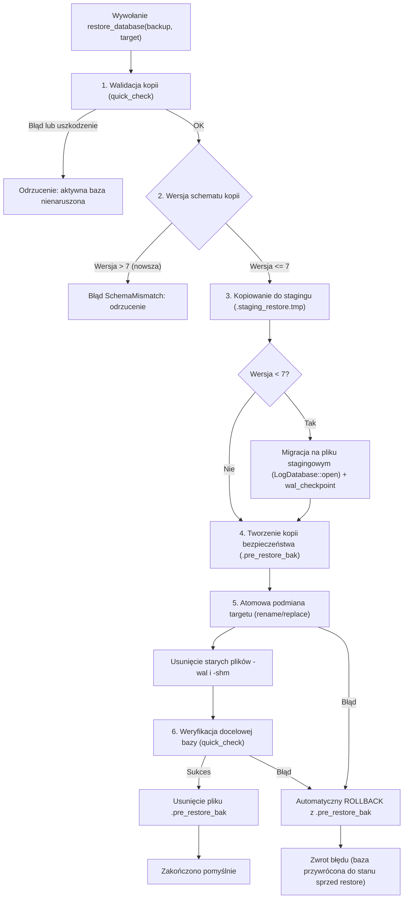

# Procedura kopii zapasowej, odzyskiwania i weryfikacji bazy danych SQLite (SPLogbook)

Dokument opisuje architekturę bezpieczeństwa danych, proces tworzenia spójnych kopii zapasowych, weryfikację integralności, procedurę przywracania (restore) ze stagingiem i automatycznym rollbackiem oraz procedury odzyskiwania awaryjnego po awarii zasilania lub uszkodzeniu plików bazy.

---

## 1. Architektura kopii zapasowej (Backup)

### 1.1. Spójny snapshot online (`rusqlite::backup::Backup`)
W SPLogbook baza danych SQLite pracuje domyślnie w trybie `PRAGMA journal_mode = WAL` (Write-Ahead Logging) z `PRAGMA synchronous = NORMAL`.
- **Zasada absolutna:** Kopia zapasowa bazy danych **nie może** być tworzona za pomocą zwykłego kopiowania pliku (`fs::copy`) na żywej bazie WAL, ponieważ grozi to utworzeniem niespójnego, rozdartego (torn) obrazu bazy bez zsynchronizowanych stron z plików `-wal` i `-shm` (`DATA-006`).
- Kopia bazy jest wykonywana wyłącznie za pośrednictwem transakcyjnego mechanizmu **SQLite Online Backup API** (`rusqlite::backup::Backup`), który bezpiecznie blokuje i kopiuje spójny stan bazy nawet podczas współbieżnych zapisów przez inne wątki (`test_backup_database_concurrent_writer`).
- Połączenie źródłowe i docelowe mają skonfigurowany `busy_timeout` (5 sekund), aby zapobiec deadlockom i błędom blokady.

### 1.2. Atomowość zapisu i precyzja czasowa
- Nazwy plików kopii zapasowej generowane są z milisekundową precyzją:  
  `{file_stem}_backup_%Y%m%d_%H%M%S%.3f.db`  
  (np. `log_backup_20261103_170530.123.db`), co wyklucza nadpisywanie kopii utworzonych w tej samej sekundzie.
- Kopia zapasowa jest najpierw zapisywana do pliku tymczasowego:  
  `.{dest_filename}.tmp` w katalogu docelowym kopii.
- Przed zatwierdzeniem plik tymczasowy przechodzi walidację integralności.
- Po pomyślnej walidacji następuje atomowe przeniesienie (`fs::rename`) do ostatecznej nazwy. Żadne przerwane lub częściowe pliki nie są widoczne jako poprawne kopie zapasowe.

### 1.3. Rotacja kopii (Pruning)
- Funkcja `prune_old_backups` filtruje pliki ściśle według prefiksu nazwy bazowej:  
  `{stem}_backup_*.db`  
  dzięki czemu nie dotyka kopii innych profili dzienników ani żadnych obcych plików w katalogu kopii zapasowych (`DATA-006`).
- Domyślnie zachowywanych jest 10 ostatnich prawidłowych kopii zapasowych bazy danych oraz 10 ostatnich kopii ADIF.

---

## 2. Walidacja integralności bazy i kopii zapasowych

Funkcja `BackupManager::validate_backup_internal(path)` realizuje kontrolę:
1. **Fizyczne istnienie i rozmiar:** plik musi istnieć i mieć rozmiar większy niż 0 bajtów.
2. **Integralność stron SQLite:** wykonanie `PRAGMA quick_check(1);`. Wynik inny niż `"ok"` oznacza uszkodzenie pliku i odrzucenie kopii.
3. **Spójność wersji schematu:** odczytanie najwyższej zarejestrowanej wersji z tabeli `schema_version`.

---

## 3. Procedura bezpiecznego przywracania (Restore)

Metoda `BackupManager::restore_database(backup_path, target_db_path)` zapewnia przywrócenie danych bez ryzyka uszkodzenia bazy działającej:



### Kroki procedury:
1. **Weryfikacja wejściowa:** plik kopii zapasowej jest sprawdzany przed wykonaniem jakiejkolwiek operacji na aktywnej bazie. Jeżeli kopia jest uszkodzona, operacja kończy się błędem `BackupError::Validation`, a aktywna baza pozostaje nietknięta (`test_restore_rejects_corrupted_backup_without_touching_target`).
2. **Ochrona wersji:** jeżeli kopia pochodzi z nowszej wersji programu (np. schemat 8 przy obsługiwanym schemacie 7), program odrzuca restore z błędem `BackupError::SchemaMismatch` (`test_restore_rejects_newer_schema_version`).
3. **Izolowany staging i automatyczna migracja:** plik kopii jest kopiowany do `.staging_restore.tmp`. Jeżeli kopia pochodzi ze starszej wersji (np. schemat 1..6), migracje schematu uruchamiane są wyłącznie na pliku stagingowym (`test_restore_older_schema_migrates_to_current`).
4. **Kopia bezpieczeństwa (Rollback Snapshot):** jeżeli aktywna baza istnieje, zostaje skopiowana do pliku `.{active_filename}.pre_restore_bak`.
5. **Atomowa podmiana:** plik stagingowy zastępuje plik docelowy. Stare pliki `-wal` i `-shm` są bezwzględnie usuwane, zapobiegając próbom replayu starego dziennika WAL na nowej bazie.
6. **Automatyczny rollback:** w razie niepowodzenia podmiany lub weryfikacji docelowej, baza aktywna jest natychmiast odtwarzana ze snapshotu `.pre_restore_bak`.

---

## 4. Procedura manualnego odzyskiwania bazy przez operatora

W przypadku nagłego wyłączenia zasilania systemu operacyjnego, awarii nośnika lub uszkodzenia procesu:

### Krok 1: Weryfikacja stanu katalogu danych
Domyślny katalog danych aplikacji znajduje się w profilu użytkownika:
- Linux / macOS: `~/.local/share/splogbook/` lub `~/.config/splogbook/`
- Windows: `%APPDATA%\SPLogbook\` lub katalog wskazywany przez `--data-dir`

Sprawdź obecność plików:
- `default_log.db` (baza główna)
- `default_log.db-wal` (dziennik transakcyjny WAL)
- `default_log.db-shm` (pamięć współdzielona indeksu WAL)
- `backups/*.db` (katalog automatycznych kopii zapasowych)

### Krok 2: Odzyskiwanie przy nienaruszonej bazie WAL
Jeżeli program został przerwany w trakcie zapisu, SQLite automatycznie odtworzy stan transakcyjny przy kolejnym otwarciu bazy dzięki nagłówkom WAL.
1. Uruchom program: `SPLogbook`.
2. Przy otwarciu `LogDatabase::open` sprawdzana jest poprawność schematu i następuje checkpoint WAL.

### Krok 3: Przywracanie z kopii zapasowej w przypadku uszkodzenia pliku głównego
Jeżeli `default_log.db` uległ uszkodzeniu fizycznemu (np. błędy I/O, `PRAGMA quick_check` zwraca błędy):
1. Zakończ działanie programu SPLogbook.
2. Zlokalizuj najnowszą poprawną kopię zapasową w podkatalogu `backups/`:
   ```bash
   # Przykład w PowerShell:
   Get-ChildItem .\backups\*_backup_*.db | Sort-Object LastWriteTime -Descending | Select-Object -First 1
   ```
3. Przetestuj integralność wybranego pliku kopii:
   ```bash
   sqlite3.exe .\backups\default_log_backup_YYYYMMDD_HHMMSS.db "PRAGMA quick_check;"
   ```
   (Wynik musi brzmieć `ok`).
4. Zabezpiecz uszkodzony plik:
   ```bash
   Move-Item default_log.db default_log.db.corrupt
   Remove-Item default_log.db-wal, default_log.db-shm -ErrorAction SilentlyContinue
   ```
5. Skopiuj zweryfikowany plik kopii na miejsce `default_log.db`:
   ```bash
   Copy-Item .\backups\default_log_backup_YYYYMMDD_HHMMSS.db .\default_log.db
   ```
6. Uruchom SPLogbook — program automatycznie otworzy odzyskaną bazę i zweryfikuje integralność.

---

## 5. Podsumowanie zabezpieczeń Etapu 6

| Obszar | Ryzyko pierwotne | Mechanizm zabezpieczający | Test weryfikacyjny |
|---|---|---|---|
| **Izolacja dzienników** | Przeciek rekordów i duplikatów między dziennikami (`DATA-004`, `DATA-005`) | Obowiązkowe zakresowanie wszystkich zapytań i mutacji przez `journal_id`, filtrowanie statystyk, SCP i dyplomów | `journal_a_list_never_returns_journal_b_qsos`, `test_restore_qso_scoped_prevents_cross_journal_restoration` |
| **Undo / Redo** | Niekontrolowane trwałe usuwanie bez możliwości cofnięcia (`DATA-004`) | Typowany `UndoAction`, zapamiętywanie usuniętych rekordów, modalne potwierdzenie, atomowy batch restore | `test_restore_qso_scoped_and_batch` |
| **Backup SQLite** | Uszkodzona kopia przez `fs::copy` na żywym WAL (`DATA-006`) | Wyłącznie transakcyjny `Backup::run_to_completion`, `busy_timeout` 5s, walidacja `PRAGMA quick_check`, atomowy rename | `test_backup_database_consistent`, `test_backup_database_concurrent_writer` |
| **Rotacja kopii** | Przypadkowe usunięcie kopii innych baz (`DATA-006`) | Ścisłe filtrowanie po stemie `{stem}_backup_*.db` | `test_prune_old_backups_only_removes_matching_database_stem` |
| **Restore bazy** | Nadpisanie bazy uszkodzonym plikiem, brak rollbacku | Staging w `.staging_restore.tmp`, automatyczna migracja, snapshot `.pre_restore_bak`, rollback w razie błędu | `test_restore_valid_backup_success`, `test_restore_rejects_corrupted_backup_without_touching_target`, `test_restore_older_schema_migrates_to_current` |
