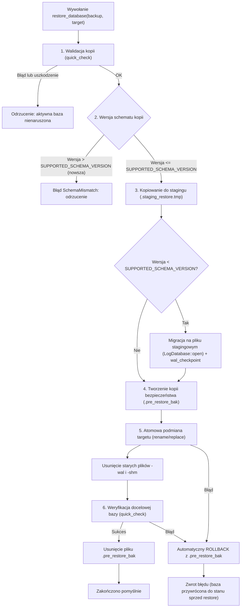

# Procedura kopii zapasowej, odzyskiwania i weryfikacji bazy danych SQLite (SPLogbook)

Dokument opisuje architekturę bezpieczeństwa danych, proces tworzenia spójnych kopii zapasowych, weryfikację integralności, procedurę przywracania (restore) ze stagingiem i automatycznym rollbackiem oraz procedury odzyskiwania awaryjnego po awarii zasilania lub uszkodzeniu plików bazy.

---

## 1. Architektura kopii zapasowej (Backup)

### 1.1. Spójny snapshot online (`rusqlite::backup::Backup`)
W SPLogbook baza danych SQLite pracuje domyślnie w trybie `PRAGMA journal_mode = WAL` (Write-Ahead Logging) z `PRAGMA synchronous = NORMAL`.
- **Zasada absolutna:** Kopia zapasowa bazy danych **nie może** być tworzona za pomocą zwykłego kopiowania pliku (`fs::copy`) na żywej bazie WAL, ponieważ grozi to utworzeniem niespójnego, rozdartego (torn) obrazu bazy bez zsynchronizowanych stron z plików `-wal` i `-shm` (`DATA-006`).
- Kopia bazy jest wykonywana wyłącznie za pośrednictwem transakcyjnego mechanizmu **SQLite Online Backup API** (`rusqlite::backup::Backup`), który bezpiecznie blokuje i kopiuje spójny stan bazy nawet podczas współbieżnych zapisów przez inne wątki (`test_backup_database_concurrent_writer`).
- Połączenie źródłowe i docelowe mają skonfigurowany `busy_timeout` (5 sekund), aby zapobiec deadlockom i błędom blokady.

### 1.2. Atomowość zapisu i precyzja czasowa
- Nazwy plików kopii zapasowej generowane są z milisekundową precyzją:  
  `{file_stem}_backup_%Y%m%d_%H%M%S%.3f.db`  
  (np. `log_backup_20261103_170530.123.db`), co wyklucza nadpisywanie kopii utworzonych w tej samej sekundzie.
- Kopia zapasowa jest najpierw zapisywana do pliku tymczasowego:  
  `.{dest_filename}.tmp` w katalogu docelowym kopii.
- Przed zatwierdzeniem plik tymczasowy przechodzi walidację integralności.
- Po pomyślnej walidacji następuje atomowe przeniesienie (`fs::rename`) do ostatecznej nazwy. Żadne przerwane lub częściowe pliki nie są widoczne jako poprawne kopie zapasowe.

### 1.3. Rotacja kopii (Pruning)
- Funkcja `prune_old_backups` filtruje pliki ściśle według prefiksu nazwy bazowej:  
  `{stem}_backup_*.db`  
  dzięki czemu nie dotyka kopii innych profili dzienników ani żadnych obcych plików w katalogu kopii zapasowych (`DATA-006`).
- Domyślnie zachowywanych jest 10 ostatnich prawidłowych kopii zapasowych bazy danych oraz 10 ostatnich kopii ADIF
  (ustawienie „Liczba zachowywanych kopii”, zakres 1–500, wspólne dla kopii bazy i ADIF).

### 1.4. Kopia przedmigracyjna (STAGE-V140-S1, fail-closed)
- Wersja schematu ma **jedno źródło prawdy**: tablicę `MIGRATIONS` w `src/core/database/migrations.rs`.
  `LATEST_SCHEMA_VERSION` jest wyprowadzana z jej ostatniego wpisu, a `BackupManager::SUPPORTED_SCHEMA_VERSION`
  i walidacja schematu używają tej samej stałej.
- `LogDatabase::open` na bazie plikowej sprawdza (bez modyfikowania pliku, także przed przełączeniem
  `journal_mode`), czy są zaległe migracje. Jeżeli wersja schematu jest niższa niż `LATEST_SCHEMA_VERSION`
  **i** baza zawiera co najmniej jedno QSO, najpierw powstaje kopia:
  `<katalog bazy>/backups/pre-migration/{stem}_pre_migration_v{from}_to_v{to}_%Y%m%d_%H%M%S%.3f.db`.
- Kopia przedmigracyjna korzysta z tego samego rdzenia co zwykła kopia (online backup SQLite, `quick_check`,
  plik `.tmp`, atomowy `rename`), ale **nie podlega rotacji** 10 ostatnich kopii.
- **Fail-closed:** jeżeli kopii nie da się utworzyć (np. brak miejsca, katalog niedostępny), otwarcie bazy kończy
  się błędem `pre-migration backup failed (schema vX -> vY); the migration was not started and the database is
  unchanged: …`, migracja nie jest uruchamiana, a plik bazy pozostaje nietknięty.
- Jeżeli kopia powstała, a migracja się nie powiedzie, transakcja `BEGIN IMMEDIATE` jest wycofywana: baza zostaje
  w poprzedniej wersji schematu, a kopia przedmigracyjna zawiera stan sprzed próby.
- Baza pusta, nowa lub w pamięci nie wymaga kopii. Plik stagingowy przywracania (`restore_database`) jest otwierany
  bez kopii przedmigracyjnej, ponieważ jest kopią pliku kopii zapasowej, który pozostaje nienaruszony.
- Testy: `s1_pre_migration_backup_is_taken_before_migration_10_and_keeps_rows`,
  `s1_failed_migration_10_keeps_schema_9_rows_and_a_valid_pre_migration_backup`,
  `s1_pre_migration_backup_failure_blocks_the_migration`, `s1_migrations_table_is_contiguous_and_defines_latest_version`.

### 1.5. Kiedy powstają kopie
Ustawienia: menu **Ustawienia → Kopie zapasowe** (`AppConfig.backup`, `BackupSettings`). Wszystkie kopie trafiają
do katalogu `backups/` obok pliku bazy (`backup_dir_for`).

| Kopia | Kiedy | Domyślnie | Retencja |
|---|---|---|---|
| Okresowa | co `interval_minutes` minut, w osobnym wątku i na własnym połączeniu SQLite; pomijana, gdy baza nie zmieniła się od poprzedniej udanej kopii (`DbFingerprint`); `0` wyłącza | 30 min (maks. 24 h) | `keep` |
| Przy zamknięciu | przy wyjściu z programu (`on_exit`); błędy trafiają do logu | włączona | `keep` |
| ADIF | razem z kopią ręczną i kopią przy zamknięciu (`with_adif`) | włączona | `keep` |
| Ręczna | **Dziennik → Kopia zapasowa bazy danych**; każdy błąd jest pokazywany operatorowi | — | `keep` |
| Po niepoprawnym zamknięciu | przy starcie, gdy został znacznik poprzedniej sesji (patrz 1.6) | zawsze | 5 ostatnich, osobno |
| Przedmigracyjna | przed migracją schematu (patrz 1.4) | zawsze | bez rotacji |
| Bezpieczeństwa przed przywróceniem | przed każdym przywróceniem z interfejsu (patrz 3.1) | zawsze | `keep` |

### 1.6. Znacznik sesji i niepoprawne zamknięcie
- Przy starcie program zakłada znacznik sesji `<baza>.session` (np. `default_log.session`) obok pliku bazy
  (`SessionMarker`), a przy normalnym zamknięciu go usuwa.
- Jeżeli znacznik poprzedniej sesji pozostał na dysku (awaria, zanik zasilania, zabicie procesu), program w tle
  wykonuje `PRAGMA quick_check` i zapisuje kopię `{stem}_unclean_shutdown_%Y%m%d_%H%M%S%.3f.db`
  (`BackupManager::backup_after_unclean_shutdown`). Te kopie mają własną retencję (5 ostatnich) i nie wypierają
  zwykłych kopii.
- Wynik jest pokazywany operatorowi w powiadomieniu; uszkodzona baza nie daje kopii, tylko komunikat o błędzie.
- Test: `unclean_shutdown_backup_checks_the_database_and_keeps_its_own_retention`.

---

## 2. Walidacja integralności bazy i kopii zapasowych

Funkcja `BackupManager::validate_backup_internal(path)` realizuje kontrolę:
1. **Fizyczne istnienie i rozmiar:** plik musi istnieć i mieć rozmiar większy niż 0 bajtów.
2. **Integralność stron SQLite:** wykonanie `PRAGMA quick_check(1);`. Wynik inny niż `"ok"` oznacza uszkodzenie pliku i odrzucenie kopii.
3. **Spójność wersji schematu:** odczytanie najwyższej zarejestrowanej wersji z tabeli `schema_version`.

---

## 3. Procedura bezpiecznego przywracania (Restore)

Metoda `BackupManager::restore_database(backup_path, target_db_path)` zapewnia przywrócenie danych bez ryzyka uszkodzenia bazy działającej:



### Kroki procedury:
1. **Weryfikacja wejściowa:** plik kopii zapasowej jest sprawdzany przed wykonaniem jakiejkolwiek operacji na aktywnej bazie. Jeżeli kopia jest uszkodzona, operacja kończy się błędem `BackupError::Validation`, a aktywna baza pozostaje nietknięta (`test_restore_rejects_corrupted_backup_without_touching_target`).
2. **Ochrona wersji:** jeżeli kopia pochodzi z nowszej wersji programu (schemat wyższy niż `SUPPORTED_SCHEMA_VERSION`, obecnie 11), program odrzuca restore z błędem `BackupError::SchemaMismatch` (`test_restore_rejects_newer_schema_version`).
3. **Izolowany staging i automatyczna migracja:** plik kopii jest kopiowany do `.staging_restore.tmp`. Jeżeli kopia pochodzi ze starszej wersji schematu, migracje schematu uruchamiane są wyłącznie na pliku stagingowym (`test_restore_older_schema_migrates_to_current`).
4. **Kopia bezpieczeństwa (Rollback Snapshot):** jeżeli aktywna baza istnieje, zostaje skopiowana do pliku `.{active_filename}.pre_restore_bak`.
5. **Atomowa podmiana:** plik stagingowy zastępuje plik docelowy. Stare pliki `-wal` i `-shm` są bezwzględnie usuwane, zapobiegając próbom replayu starego dziennika WAL na nowej bazie.
6. **Automatyczny rollback:** w razie niepowodzenia podmiany lub weryfikacji docelowej, baza aktywna jest natychmiast odtwarzana ze snapshotu `.pre_restore_bak`.

### 3.1. Przywracanie z interfejsu
Menu **Dziennik → Przywróć bazę z kopii…** (`SpLogApp::restore_from_backup_dialog`):
1. Operator wybiera plik `.db` (okno otwiera się w katalogu `backups/`) i potwierdza ostrzeżenie.
2. Gdy trwa kopia okresowa, przywracanie jest odmawiane z komunikatem — bez zmian w bazie.
3. Powstaje kopia bezpieczeństwa bieżącej bazy (zwykła kopia w `backups/`); jej błąd przerywa przywracanie.
4. Połączenie z bazą jest zamykane (zastępowane bazą w pamięci), `restore_database` wykonuje kroki 1–6 powyżej,
   po czym baza jest otwierana ponownie — także wtedy, gdy przywracanie się nie powiodło.
5. Po sukcesie przeładowywany jest aktywny dziennik, dyplomy i SCP; komunikat podaje nazwę przywróconej kopii
   i kopii bezpieczeństwa. Błąd jest pokazywany operatorowi.

---

## 4. Procedura manualnego odzyskiwania bazy przez operatora

W przypadku nagłego wyłączenia zasilania systemu operacyjnego, awarii nośnika lub uszkodzenia procesu:

### Krok 1: Weryfikacja stanu katalogu danych
Baza dziennika i jej kopie znajdują się w profilu użytkownika (menu **Pomoc → Otwórz katalog danych programu**
otwiera ten folder):
- Linux: `~/.local/share/splogbook/databases/` (`$XDG_DATA_HOME`); konfiguracja stacji osobno w
  `~/.config/splogbook/databases/station_config.json` (`$XDG_CONFIG_HOME`).
- Windows: `%APPDATA%\SPLogbook\databases\` (baza i konfiguracja w tym samym katalogu).

Sprawdź obecność plików:
- `default_log.db` (baza główna)
- `default_log.db-wal` (dziennik transakcyjny WAL)
- `default_log.db-shm` (pamięć współdzielona indeksu WAL)
- `default_log.session` (znacznik sesji; obecny po niepoprawnym zamknięciu)
- `backups/*.db` (katalog automatycznych kopii zapasowych, w tym `*_unclean_shutdown_*.db`)

### Krok 2: Odzyskiwanie przy nienaruszonej bazie WAL
Jeżeli program został przerwany w trakcie zapisu, SQLite automatycznie odtworzy stan transakcyjny przy kolejnym otwarciu bazy dzięki nagłówkom WAL.
1. Uruchom program: `SPLogbook`.
2. Przy otwarciu `LogDatabase::open` sprawdzana jest poprawność schematu i następuje checkpoint WAL.

### Krok 3: Przywracanie z kopii zapasowej w przypadku uszkodzenia pliku głównego
Jeżeli program się uruchamia, użyj przywracania z interfejsu (sekcja 3.1) — wykonuje ono wszystkie kroki poniżej
z walidacją i rollbackiem. Procedura ręczna jest przeznaczona na sytuację, gdy bazy nie da się otworzyć.

Jeżeli `default_log.db` uległ uszkodzeniu fizycznemu (np. błędy I/O, `PRAGMA quick_check` zwraca błędy):
1. Zakończ działanie programu SPLogbook.
2. Zlokalizuj najnowszą poprawną kopię zapasową w podkatalogu `backups/`:
   ```bash
   # Przykład w PowerShell:
   Get-ChildItem .\backups\*_backup_*.db | Sort-Object LastWriteTime -Descending | Select-Object -First 1
   ```
3. Przetestuj integralność wybranego pliku kopii:
   ```bash
   sqlite3.exe .\backups\default_log_backup_YYYYMMDD_HHMMSS.db "PRAGMA quick_check;"
   ```
   (Wynik musi brzmieć `ok`).
4. Zabezpiecz uszkodzony plik:
   ```bash
   Move-Item default_log.db default_log.db.corrupt
   Remove-Item default_log.db-wal, default_log.db-shm -ErrorAction SilentlyContinue
   ```
5. Skopiuj zweryfikowany plik kopii na miejsce `default_log.db`:
   ```bash
   Copy-Item .\backups\default_log_backup_YYYYMMDD_HHMMSS.db .\default_log.db
   ```
6. Uruchom SPLogbook — program automatycznie otworzy odzyskaną bazę i zweryfikuje integralność.

---

## 5. Podsumowanie zabezpieczeń Etapu 6

| Obszar | Ryzyko pierwotne | Mechanizm zabezpieczający | Test weryfikacyjny |
|---|---|---|---|
| **Izolacja dzienników** | Przeciek rekordów i duplikatów między dziennikami (`DATA-004`, `DATA-005`) | Obowiązkowe zakresowanie wszystkich zapytań i mutacji przez `journal_id`, filtrowanie statystyk, SCP i dyplomów | `journal_a_list_never_returns_journal_b_qsos`, `test_restore_qso_scoped_prevents_cross_journal_restoration` |
| **Undo / Redo** | Niekontrolowane trwałe usuwanie bez możliwości cofnięcia (`DATA-004`) | Typowany `UndoAction`, zapamiętywanie usuniętych rekordów, modalne potwierdzenie, atomowy batch restore | `test_restore_qso_scoped_and_batch` |
| **Backup SQLite** | Uszkodzona kopia przez `fs::copy` na żywym WAL (`DATA-006`) | Wyłącznie transakcyjny `Backup::run_to_completion`, `busy_timeout` 5s, walidacja `PRAGMA quick_check`, atomowy rename | `test_backup_database_consistent`, `test_backup_database_concurrent_writer` |
| **Rotacja kopii** | Przypadkowe usunięcie kopii innych baz (`DATA-006`) | Ścisłe filtrowanie po stemie `{stem}_backup_*.db` | `test_prune_old_backups_only_removes_matching_database_stem` |
| **Restore bazy** | Nadpisanie bazy uszkodzonym plikiem, brak rollbacku | Staging w `.staging_restore.tmp`, automatyczna migracja, snapshot `.pre_restore_bak`, rollback w razie błędu | `test_restore_valid_backup_success`, `test_restore_rejects_corrupted_backup_without_touching_target`, `test_restore_older_schema_migrates_to_current` |
