# Plan Rozwoju i Mapa Drogowa Ulepszeń (`IMPROVEMENT_ROADMAP.md`)

**Dokument audytowy:** `docs/IMPROVEMENT_ROADMAP.md`
**Projekt:** SPLogbook (`v1.2.0`)
**Gałąź referencyjna:** `main` (`6f7d3aaa3b6a54e87b481c142a5b690bcf8b5592`)

---

## 1. Kategoryzacja Propozycji Zmian i Ulepszeń (ETAP 19)

### Kategoria A — Obowiązkowe Poprawki Błędów i Ryzyk (Must-Fix)
1. **Usunięcie skompromitowanego klucza prywatnego Ed25519 (`src/scratch.rs`), rotacja `TRUSTED_KEYS` i podpięcie podpisywania w GitHub Actions (`SEC-001`, `CI-001`)**.
2. **Naprawa instalatora auto-updatera na Windows (`.zip` dla `Expand-Archive`) i Linux (spłaszczanie katalogu nadrzędnego w `.tar.gz`) (`REL-001`)**.
3. **Naprawa bezpieczeństwa RF, sondowania Read-Only i potwierdzania PTT w warstwie CAT (`CAT-002`, `CAT-003`, `CAT-005`, `CAT-006`, `CAT-015`)**:
   - przeniesienie `probe()` do `impl RigBackend` w 5 backendach;
   - oczekiwanie na asynchroniczne potwierdzenie TX w `TciBackend` i `FlexRadioBackend`;
   - weryfikacja `TX;` / `TQ;` w `YaesuBackend` i `ElecraftBackend`;
   - uĹĽycie `last_state_update` i `StateFreshness::Stale` w `RigHub::resync_tx_arbiter`;
   - zabezpieczenie `HilHardwareSession::execute_controlled_ptt` przez `acquire_tx_guard`.
4. **Naprawa kodowania Big-Endian BCD dla S-metra/mocy oraz subkomend `0x21`/`0x25` w `IcomCiVBackend` i adresu CI-V w manifeście HIL (`CAT-004`, `CAT-011`, `CAT-016`)**.
5. **Dodanie automatycznego `reconnect` z wykładniczym backoffem w `RigService::run_loop` (`CAT-001`)**.
6. **Naprawa integralności danych ADIF i `QsoIngestor` (`DATA-001`, `DATA-002`, `DATA-003`)**:
   - zakaz fabrykowania `Utc::now()` dla brakujących `<QSO_DATE>`/`<TIME_ON>` i bezpieczne cięcie wielobajtowego UTF-8 w `adif.rs`;
   - dodanie `normalize_qso_fields(&mut qso)` na poczÄ…tku `QsoIngestor::import_batch`;
   - normalizacja parametrĂłw daty w `search_qsos_advanced` i przywrĂłcenie uĹĽycia indeksĂłw B-tree w `has_identity` oraz `callbook.rs`.
7. **Zabezpieczenie operacji niszczÄ…cych i izolacja wielu dziennikĂłw (`DATA-004`, `DATA-005`, `DATA-006`)**:
   - filtr `journal_id` w `find_duplicate_qsos`, obowiÄ…zkowy zapis na `undo_stack` i potwierdzenie przy `delete_selected_qso`;
   - wywołanie `rebuild_awards_full()` przy przełączeniu dziennika oraz izolacja `active_journal.id` w statystykach i eksporcie chmurowym;
   - usunięcie niebezpiecznego fallbacku `fs::copy` na bazie WAL w `backup.rs`.
8. **Naprawa eksportera Cabrillo 3.0 i punktacji SP DX Contest / CQ WW / WPX (`FUNC-001`, `FUNC-002`)**.
9. **Aktualizacja zależności w `Cargo.lock` eliminująca 7 biuletynów `RUSTSEC-2026-*` (`DEP-001`)** — **ZREALIZOWANY** (commit `335ced5`).
10. **Weryfikacja manifest-first i odrzucanie odwołanych kluczy w aktualizatorze GUI (`UPDATE-TRUST-001`)** — **ZREALIZOWANY** (commit `bc3e806`, `c95172e`).
11. **Ochrona danych użytkownika, konfiguracji i baz portable w aktualizatorze Windows/Linux (`UPDATE-DATA-001`)** — **ZREALIZOWANY** (commit `12c3b22`, `da34b4c`, `c95172e`).
12. **Bramki bezpieczeństwa aktualizatora Etapu M1 (`UPDATE-WIN-SAFETY-GATE`, `UPDATE-LINUX-SAFETY-GATE`)** — **ZREALIZOWANY** (`SATISFIED_BY_UPDATE_TRUST_AND_DATA_SAFETY_GATE` / `COMPLETED_SOFTWARE_VERIFIED`, raport `STAGE_M1_COVERAGE_AND_STATUS_REPORT.md`).
13. **Bramka projektowa instalatorów Etapu M2 (STAGE-M2-INSTALLER-DESIGN-GATE oraz STAGE-M2-OWNER-DECISIONS-APPROVAL-GATE)** — **ZREALIZOWANY PROJEKTOWO I ZATWIERDZONY** (COMPLETED_DESIGN_VERIFIED, raporty STAGE_M2_INSTALLER_DESIGN_GATE_REPORT.md oraz STAGE_M2_OWNER_DECISIONS_APPROVAL_REPORT.md). Zatwierdzone dokumenty projektowe: DESIGN_3_0_A_WINDOWS_UPDATE.md (APPROVED), DESIGN_3_0_B_LINUX_UPDATE.md (APPROVED), DESIGN_3_0_C_PLATFORM_INSTALLERS.md (APPROVED). Status M3: IN_PROGRESS (M3-A zrealizowany w STAGE-M3-A-PLATFORM-CORE-IMPLEMENTATION-GATE jako COMPLETED_SOFTWARE_VERIFIED; M3-B zrealizowany w STAGE-M3-B-WINDOWS-HELPERS-IMPLEMENTATION-GATE i formalnie zamknięty w STAGE-M3-B-CLOSURE-VERIFICATION-GATE jako COMPLETED_SOFTWARE_VERIFIED; M3-C zrealizowany w STAGE-M3-C-WINDOWS-PORTABLE-ZIP-INTEGRATION-GATE jako COMPLETED_SOFTWARE_VERIFIED; M3-D Windows User Setup: READY_FOR_IMPLEMENTATION).
14. **Bramka implementacji rdzenia platformowego aktualizatora Etapu M3-A (STAGE-M3-A-PLATFORM-CORE-IMPLEMENTATION-GATE)** — **ZREALIZOWANY PROGRAMISTYCZNIE I POTWIERDZONY TESTAMI** (COMPLETED_SOFTWARE_VERIFIED, raport STAGE_M3_A_PLATFORM_CORE_IMPLEMENTATION_REPORT.md). Wdrożono domenowy UpdateAttemptId, automat 20 stanów, transakcyjny model UpdateTransaction, macierz InstallationCapabilities, kontrakt PlatformInstallerAdapter, silnik preflightu przestrzeni dyskowej, blokadę .update.lock, centralną politykę anulowania, RecoveryDecisionEngine oraz kontrakt dowodu zdrowia `HealthProof`.
15. **Bramka implementacji i zamknięcia pomocników Windows i fallbacku PowerShell Etapu M3-B (STAGE-M3-B-WINDOWS-HELPERS-IMPLEMENTATION-GATE oraz STAGE-M3-B-CLOSURE-VERIFICATION-GATE)** — **ZREALIZOWANY PROGRAMISTYCZNIE I FORMALNIE ZAMKNIĘTY** (COMPLETED_SOFTWARE_VERIFIED, raporty STAGE_M3_B_WINDOWS_HELPERS_IMPLEMENTATION_REPORT.md oraz STAGE_M3_B_CLOSURE_VERIFICATION_REPORT.md). Wdrożono natywny pomocnik Windows `splogbook-updater.exe`, wersjonowany kontrakt IPC `WindowsHelperRequest`/`Result`, weryfikację skrótu planu SHA-256 (`plan_digest`), monitor procesu macierzystego z zakazem zabijania procesu nadrzędnego, dziennik operacji z semantyką `JOURNALED_TRANSACTIONAL_REPLACEMENT_VERIFIED` (`CRASH_RECOVERABLE_BY_JOURNAL`, `NOT_POWER_LOSS_ATOMIC`), no-shell launch kandydata z wyłącznym śledzeniem przez uchwyt procesu potomnego (zakaz killowania po nazwie/PID), weryfikację dowodu zdrowia `HealthProof`, transakcyjny rollback przy awarii/timeoucie z idempotencją, bezpieczne zachowanie kopii zapasowej `.rollback` (decyzja OWNER-M2-08/09), utwardzony generator PowerShell bez wildcardów i `iex` z pełnym parytetem bezpieczeństwa, 28 dedykowanych testów natywnych Windows i PowerShell (w tym realne wykonanie `powershell.exe`) oraz 83 testy security guard.
16. **Bramka integracji Windows Portable ZIP Etapu M3-C (STAGE-M3-C-WINDOWS-PORTABLE-ZIP-INTEGRATION-GATE)** — **ZREALIZOWANY PROGRAMISTYCZNIE I POTWIERDZONY TESTAMI** (COMPLETED_SOFTWARE_VERIFIED, raport STAGE_M3_C_WINDOWS_PORTABLE_ZIP_INTEGRATION_REPORT.md). Zintegrowano produkcyjny potok aktualizacji Windows Portable ZIP: weryfikacja manifest-first Ed25519, bezpieczna inspekcja Central Directory i ekstrakcja ZIP (`inspect_windows_zip_archive`), generowanie `UpdatePlan` z ochroną danych użytkownika, obliczanie `plan_digest`, walidacja tożsamości PE AMD64 pomocnika binarnego, no-shell launch z fail-closed przy naruszeniu integralności, utwardzony fallback PowerShell, procedura startowa `consume_update_result_on_startup` z pomiarem zachowanego `.rollback` (TEMPORARY CONSERVATIVE RETENTION POLICY), 2556 zaliczonych testów (0 błędów, 91 security guards, 28 Windows helper tests). Kolejny krok: STAGE-M3-DEV-VERSION-IDENTITY-GATE.
17. **Bramka tożsamości wersji rozwojowej Etapu M3 (STAGE-M3-DEV-VERSION-IDENTITY-GATE)** — **ZREALIZOWANY PROGRAMISTYCZNIE I POTWIERDZONY TESTAMI** (COMPLETED_SOFTWARE_VERIFIED, raport STAGE_M3_DEV_VERSION_IDENTITY_REPORT.md). Wprowadzono jednoznaczną wersję rozwojową SPLogbook `1.3.0-alpha.1`, eliminując niejednoznaczność tożsamości kompilacji po etapach M3-A/B/C. Dodano centralny `BuildIdentity`, wczesne flagi CLI `--version` i `--build-info`, `--diagnostic-version` w pomocniku, typowaną ewaluację przejść SemVer (`UpdateVersionDecision`, `evaluate_version_transition`, `verify_downgrade_protection_with_channel`), powiązanie `HealthProof` i transakcji z tożsamością wersji i commita, 95 testów strażników bezpieczeństwa oraz pętle stabilnościowe (100x SemVer/tożsamość, 50x rollback/helper, 20x E2E zachowanie bazy). Status wydań: CURRENT PUBLIC STABLE: 1.2.0 (nienaruszony tag v1.2.0); CURRENT DEVELOPMENT: 1.3.0-alpha.1; PUBLIC RELEASE STATUS: NOT PUBLISHED.
18. **Bramka integracji Windows User Setup Etapu M3-D (STAGE-M3-D-WINDOWS-USER-SETUP-INTEGRATION-GATE)** — **ZREALIZOWANY PROGRAMISTYCZNIE I POTWIERDZONY TESTAMI** (COMPLETED_SOFTWARE_VERIFIED, raport STAGE_M3_D_WINDOWS_USER_SETUP_INTEGRATION_REPORT.md). Zaimplementowano instalator per-user Inno Setup 7.1.1 (zatwierdzony decyzją OWNER-M3-D-TOOLCHAIN-01), AppId `{C8E28541-7B21-4A9B-8F5C-4EF298F613C1}`, instalacja do `{localappdata}\Programs\SPLogbook`, `PrivilegesRequired=lowest` (CurrentUser, no admin, no UAC), `SetupArchitecture=x64`, `ArchitecturesAllowed=x64compatible`, `ArchitecturesInstallIn64BitMode=x64compatible`. Wdrożono bezpieczny model SystemManaged, delegację aktualizacji z flagą `/NORESTART` bez powłoki shell, markery instalacyjne `.splogbook-inno-marker`, bezwzględną ochronę baz danych SQLite, plików WAL, SHM, konfiguracji i nieznanych plików użytkownika (polityki `uninsneveruninstall`, `onlyifdoesntexist`, `dirifempty`, zakaz wildcardów i DelTree({app})). Wdrożono 108 testów strażników bezpieczeństwa (96 baseline + 12 M3-D), 14 testów integracji Inno Setup, 7 testów bezpieczeństwa danych oraz matrix stabilności (100 iteracji szybkich, 50 iteracji modeli konfliktów i 20 iteracji cyklu życia instalatora).
19. **Bramka integracji Windows System Setup MSI Etapu M3-E (STAGE-M3-E-WINDOWS-MSI-WIX-INTEGRATION-GATE)** — **ZREALIZOWANY PROGRAMISTYCZNIE I POTWIERDZONY TESTAMI** (COMPLETED_SOFTWARE_VERIFIED, raport STAGE_M3_E_WINDOWS_MSI_WIX_INTEGRATION_REPORT.md). Zaimplementowano instalator per-machine Windows Installer MSI oparty o WiX Toolset SDK 7.0.1 (zatwierdzony decyzją OWNER-M3-E-TOOLCHAIN-01), stały UpgradeCode `{B7D14532-6A10-4F8A-9A4B-3DE189E502B0}` (packed `0B205E981ED3B4A9A9B4A9E189E502B0`), dynamiczny ProductCode (`*`), instalację do `ProgramFiles64Folder\SPLogbook`, kontrolowane podwyższenie uprawnień Windows Installer UAC (`Scope="perMachine"`), `Bitness="always64"`. Zaimplementowano obsługę major upgrade, odrzucanie downgrade (`AllowSameVersionUpgrades="no"`), naprawę (`msiexec /fa`), deinstalację (`msiexec /x`), cichą instalację (`/qn /norestart /L*v`), kontrolę kodów wyjścia `msiexec` (`MsiexecExitStatus`), wzajemne wykrywanie konfliktów z Inno Setup i Portable ZIP oraz bezwzględną ochronę baz danych SQLite (`default_log.db`, `serviceLOG.db`), WAL, SHM, konfiguracji i danych użytkownika w `%APPDATA%\SPLogbook` (polityki `NeverOverwrite="yes"`, brak wildcardów i RemoveFolderEx). Wdrożono 118 testów strażników bezpieczeństwa, 18 testów integracji MSI, 6 testów bezpieczeństwa danych oraz matrix stabilności (100x macierz MSI, 50x modele aktualizacji, 20x cykl życia MSI).
20. **Bramka integracji Linux Portable tar.gz Etapu M3-F (STAGE-M3-F-LINUX-PORTABLE-TAR-GZ-INTEGRATION-GATE / STAGE-M3-F-NATIVE-LINUX-EVIDENCE-AND-SNAPSHOT-CORRECTION-GATE)** — **ZREALIZOWANY PROGRAMISTYCZNIE, SKORYGOWANY I POTWIERDZONY DOWODAMI NATYWNYMI CI** (COMPLETED_NATIVE_LINUX_EVIDENCE_VERIFIED, raport STAGE_M3_F_LINUX_PORTABLE_TAR_GZ_INTEGRATION_REPORT.md). Wdrożono model wsparcia 7 stabilnych dystrybucji (Ubuntu stable 26.10, Ubuntu LTS 26.04.1, Debian stable 13.7, Fedora 45 Final, Arch Linux rolling snapshot, openSUSE Leap 16.1, openSUSE Tumbleweed) oraz wyliczono dynamiczny floor kernela $\min(\dots) = \text{Linux 6.12}$. Wdrożono pojedynczy kanoniczny artefakt `SPLogbook-Linux-x86_64-1.3.0-alpha.1.tar.gz` o stałym katalogu głównym `SPLogbook/`, identycznym SHA-256 (`5df6ac20dd9717fb568567d53d7566758fa62ec507b1a9cba446c39ea346b7ac`) dla wszystkich dystrybucji, markera metadanych `.splogbook-linux-portable-marker`, dwufazową bezpieczną ekstrakcję (`extract_linux_portable_tar_gz_two_phase`) z fazą 1 read-only preflight, ochroną przed symlinkami/hardlinkami/urządzeniami/setuid/setgid/bombami dekompresyjnymi oraz fail-closed cleanup, aktualizacje Self-Managed JOURNALED_TRANSACTIONAL_REPLACEMENT z kopią w `.rollback` i walidacją HealthProof, egzekwowanie ścieżek bezwzględnych XDG Base Directory (`src/core/xdg.rs`), ochronę baz SQLite/WAL/SHM oraz bezpieczny szablon integracji pulpitu FreeDesktop `splogbook.desktop`. Zweryfikowano 2698 testów zarejestrowanych (2688 passed, 0 failed, 10 ignored HIL; 119 security guards, 7 portable tests, 13 security archive tests, 5 XDG data tests, 5 multi-distro tests) oraz przeprowadzono pomyślną walidację na 7 oficjalnych obrazach OCI w CI run 42518873662. Kolejny krok: STAGE-M3-G-LINUX-APPIMAGE-INTEGRATION-GATE.

---

### Kategoria B — Szybkie Ulepszenia o Wysokim Stosunku Wartości do Kosztu (Quick Wins)
1. **Eliminacja kwadratowego algorytmu $O(N^2)$ w `src/sync/catchup.rs` oraz dodanie `[profile.dev.package.argon2] opt-level = 3` w `Cargo.toml` (`PERF-001`, `TEST-001`)**:
   - redukuje czas wykonania `cargo test --lib` z **532 sekund do ~15 sekund** oraz eliminuje zawieszanie synchronizacji LAN dla dużych dzienników — koszt zmiany to ~40 linii kodu!
2. **Odblokowanie skrótów klawiszowych `Ctrl+W`, `Ctrl+L`, `Ctrl+N`, `Ctrl+F`, `Ctrl+P` podczas wpisywania w formularzu (`app_input.rs:44`) oraz obsługa `Enter`/`Esc` w oknie Contest (`GUI-001`)**:
   - natychmiastowa poprawa ergonomii dla operatora przy minimalnym koszcie (~25 linii kodu).
3. **Uzupełnienie `SpLogApp::snapshot_config()` o brakujące sekcje (`cw`, `runtime`, `solar`, `satellites`, `theme_preset`, `show_operator_assistant`) (`FUNC-005`, `GUI-002`)**.
4. **Naprawa przycisku STOP nagrywania audio (`stop_recording()` w `qso_entry.rs:646`), podglądu zdjęcia QSL (`qso_entry.rs:589`), przycisków rotatora EME (`astronomy_dialog.rs:233`) i początkowego stanu S-metra `S0` (`FUNC-004`, `GUI-003`)**.
5. **Redakcja sekretów w `Debug for AppConfig` i `without_url()` dla błędów `reqwest` oraz timeout 10 s na `host_handshake` w LAN Sync (`SEC-002`, `SEC-003`)**.
6. **Usunięcie 6 ostrzeżeń leksera w `src/core/database/qso_store.rs` (`DATA-007`)** — **ZREALIZOWANY** (commit `5e61a78`).

---

### Kategoria C — Średnioterminowe Refaktoryzacje Techniczne
1. **Podłączenie `POST /api/v1/rig`, `HamlibProxyServer` (`:4534`) oraz `VoiceKeyer` bezpośrednio pod `CatRuntime` z potwierdzonym `TxArbiter` (`FUNC-003`, `CAT-008`)**.
2. **Trwałe połączenie HTTP Keep-Alive w `FlrigClient`, naprawa setterów w `KenwoodBackend` i `FlexRadioBackend` (`CAT-010`, `CAT-012`, `CAT-013`)**.
3. **Pełne dokończenie integracji Multi-Radio w GUI (`cat_settings.rs`: dodawanie/usuwanie `Radio 2`, naprawa `auto_start_rigctld`, usunięcie fallbacku na pierwsze radio w `app_async.rs`, podłączenie Split VFO B w `vfo_panel.rs`) (`CAT-007`)**.
4. **Buforowanie przefiltrowanych/posortowanych indeksĂłw w `LogViewState` oraz inkrementalnego stanu sesji w `ContestEngine` (`PERF-002`)**.
5. **Przeniesienie operacji SQLite w `online_sync.rs` do transakcji wsadowych wewnątrz `tokio::task::spawn_blocking` oraz współdzielenie `reqwest::Client` (`CONC-001`, `CONC-002`, `ARCH-001`)**.
6. **Oczyszczenie wszystkich ostrzeżeń `cargo clippy` i włączenie `-- -D warnings` w `.github/workflows/ci.yml` (`RUST-001`, `CI-002`)**.

---

### Kategoria D — Zmiany Strategiczne i Rozwojowe
1. **Warstwa transportowa `tokio-serial` dla klucza sprzętowego K1EL WinKeyer (`src/cat/winkeyer.rs`) i integracja z makrami CW oraz Terminalem CW (`FUNC-004`)**.
2. **Most dla `NativeRigCommand` i `NativeRigEvent` w `RigService`/`RigHub` (sterowanie Preamp/ATT, wyborem anteny, szerokością filtru i Dualwatch z panelu VFO) oraz integracja `So2rState` (`CAT-014`)**.
3. **Zewnętrzna baza członków klubów krótkofalarskich (`databases/clubs.csv` dla SP-OTC, SPCWC, CWOPS, SKCC, FOC, HSC) zastępująca zahardkodowaną makietę 11 znaków w `src/core/clubs.rs` (`FUNC-006`)**.
4. **Wybór dedykowanego urządzenia wejścia/wyjścia audio (`cpal`/`rodio`) w ustawieniach dla Voice Keyera, nagrywania QSO i wodospadu DSP**.

---

### Kategoria E — Pomysły Opcjonalne (Nice-to-Have)
1. ** Obsługa przyrostowego pobierania z LoTW przez parametr `qso_qslsince` (`FUNC-008`) oraz trwała kolejka retry w tabeli `upload_queue` (`DATA-007`)**.
2. **Uzupełnienie śledzenia dyplomów WWFF i RDA w `AwardsEngine` oraz wyświetlenie sprawdzalności prognoz `PropagationHistory` w oknie propagacji (`FUNC-007`)**.
3. **Cykliczny poller pozycji rotatora `RotorClient::get_position` rysujÄ…cy rzeczywisty kierunek anteny na mapie azymutalnej**.

---

### Kategoria F — Propozycje Odrzucone (Nieadekwatne do SPLogbook)
1. **Odrzucono: Rozbicie repozytorium na kilkanaście mikro-crate'ów Cargo (`splogbook-core`, `splogbook-cat`, `splogbook-gui`, `splogbook-sync`, `splogbook-cloud` itd.)**:
   - *Uzasadnienie*: SPLogbook jest monolityczną aplikacją desktopową jednego autora. Sztuczne rozbicie na kilkanaście crate'ów wydłużyłoby czas kompilacji, skomplikowało utrzymanie typów lokalizacyjnych (`Msg`) i nie rozwiązałoby rzeczywistych problemów, które wynikają z brakujących filtrów `journal_id` i bezpośrednich wywołań `db.lock()` w widokach GUI.
2. **Odrzucono: ZastÄ…pienie `rusqlite` asynchronicznym ORM-em (`sqlx` / `SeaORM`)**:
   - *Uzasadnienie*: Synchroniczny `rusqlite` z trybem WAL i `spawn_blocking` jest szybszy, prostszy, łatwiejszy w tworzeniu kopii zapasowych (`rusqlite::backup::Backup`) i nie wymaga zewnętrznych makr kompilacyjnych.
3. **Odrzucono: Usunięcie niepodłączonych jeszcze modułów domenowych (`src/cat/so2r.rs`, `src/cat/winkeyer.rs`, `src/digital/js8call.rs`, `src/core/qsl_print.rs`)**:
   - *Uzasadnienie*: Zgodnie z zasadą nadrzędną nr 8 audytu, moduły te zawierają przetestowaną logikę domenową (generatory ramek K1EL WinKeyer, maszynę stanów SO2R, parser JS8Call, geometrię etykiet QSL), która powinna zostać **prawidłowo podłączona** do warstwy I/O i GUI, a nie usunięta.

---

## 2. Świadome i Poprawne Decyzje Projektowe (Elementy, Które NIE Są Błędami — ETAP 20)

Podczas audytu jednoznacznie oddzielono faktyczne defekty od świadomych, udokumentowanych i poprawnych decyzji inżynierskich:

1. **Brak przeliczania surowego S-metra Yaesu (`SM0xxx;`) na dBm / jednostki S w `RigState` (`src/cat/native/yaesu/codec.rs:507-514`, `yaesu/models.rs:93-95`)**:
   - *Ocena*: **Świadoma i wzorcowa decyzja projektowa** (`Native CAT.md` Sekcja 12.3). Instrukcje CAT firmy Yaesu definiują odpowiedź `SM0` wyłącznie jako surową wartość przetwornika `000..255` bez oficjalnej krzywej kalibracji w dBm. Ustawienie `capabilities.s_meter = false` i udostępnienie `raw_smeter()` zapobiega fabrykowaniu fałszywych wartości dBm.
2. **Brak odczytu PTT (`capabilities.ptt = true`, ale brak `read_ptt` w `safe_poll_commands`) dla klasycznego modelu Icom `IC-706MKIIG` (`src/cat/native/registry.rs:145-169`)**:
   - *Ocena*: **Poprawna decyzja sprzętowa** (`Native CAT.md` Sekcja 9.3). Starszy transceiver IC-706MKIIG nie wspiera subkomendy odczytu stanu PTT `0x1C 0x00` w protokole CI-V (używa także 4-bajtowego formatu częstotliwości w starszych generacjach lub ograniczonego zestawu komend).
3. **Zachowanie `src/cat/so2r.rs` jako czystej domeny stanu dwĂłch radiotelefonĂłw zamiast traktowania SO2R jako 9. backendu transportowego (`Native CAT.md:57, 673`)**:
   - *Ocena*: **Poprawna decyzja architektoniczna**. SO2R jest warstwą koordynacji dwóch sesji `RigService`, a nie protokołem komunikacji z pojedynczym radiem. (Jedynym błędem do posprzątania jest pozostałość wariantu `CatBackendKind::So2r` w `backend.rs:111`).
4. **Dwupoziomowy model przechowywania sekretĂłw (`SecretStore` w `src/core/station.rs:90-210`): Keyring systemowy OS z zaszyfrowanym fallbackiem plikowym (`Argon2id` + `ChaCha20-Poly1305`)**:
   - *Ocena*: **Poprawna decyzja niezawodnościowa**. Na systemach Linux bez uruchomionego demona `dbus`/`gnome-keyring` (np. lekkie środowiska okienkowe używane w shackach krótkofalarskich na Raspberry Pi / mini-PC) sam `keyring` zawodzi; lokalny sejf `vault.enc` z uprawnieniami `0o600` zapewnia działanie na każdej konfiguracji.
5. **Stały język polski (`Language::Pl`) dla komunikatów błędów walidacji w lokalnym REST API (`src/api/server.rs:776-778`)**:
   - *Ocena*: **Udokumentowany kontrakt integracyjny** objęty testami.

---

## 3. UporzÄ…dkowany 10-Etapowy Plan WdroĹĽeniowy (ETAP 22)

Plan został ułożony w kolejności minimalizującej ryzyko regresji: najpierw bezpieczeństwo, szybkość pętli testowej i naprawa bramek CI, następnie bezpieczeństwo RF/CAT i integralność danych, a na końcu ergonomia GUI i funkcje rozwojowe.

```mermaid
flowchart LR
    E1["Etap 1\nBezpieczeństwo Kluczy,\nZależności i Szybkość Testów"] --> E2["Etap 2\nNaprawa Auto-Updatera\ni Potoku Release CI"]
    E2 --> E3["Etap 3\nBezpieczeństwo RF, Probe\ni Potwierdzenia PTT w CAT"]
    E3 --> E4["Etap 4\nPoprawność Kodeków CAT\ni Auto-Reconnect RigService"]
    E4 --> E5["Etap 5\nIntegralność Danych:\nADIF, Ingest i Indeksy SQL"]
    E5 --> E6["Etap 6\nIzolacja DziennikĂłw,\nUndo i Bezpieczny Backup"]
    E6 --> E7["Etap 7\nDomena ZawodĂłw:\nCabrillo 3.0 i Punktacja"]
    E7 --> E8["Etap 8\nIntegracja Multi-Radio GUI,\nREST API Rig i Hamlib Proxy"]
    E8 --> E9["Etap 9\nErgonomia Klawiaturowa,\nTrwałość Config i Wydajność GUI"]
    E9 --> E10["Etap 10\nPodłączenie Funkcji\nPozornych i Bramka Clippy -D"]
```

---

### Etap 1 — Bezpieczeństwo Kluczy, Zależności i Odblokowanie Szybkości Testów (`P0`)
- **Status podetapĂłw:**
  - **Etap 1A (SEC-001 — Remediacja w drzewie, revocation i testy):** ZREALIZOWANY (usunięto `src/scratch.rs`, wdrożono `REVOKED_KEY_IDS` i `REVOKED_PUBLIC_KEYS`, auto-updater fail-closed, dodano `tests/security_guard.rs` oraz kontrolę CI; oczekuje na rotację klucza przez właściciela: `BLOCKED_EXTERNAL_SECRET`).
  - **Etap 1B (SEC-001 — Rotacja produkcyjna):** ZREALIZOWANY (aktywowano nowy publiczny klucz `splogbook-release-2026-02`, potwierdzono zewnętrzny sekret `RELEASE_SIGNING_KEY`, odwołano historyczne klucze, 17/17 testów bezpieczeństwa zielonych, przeprowadzono audyt wydań historycznych `docs/HISTORICAL_RELEASE_AUDIT.md`; gotowość wydawnicza auto-updatera blokowana do Etapu 2 / `CI-001`).
  - **Etap 1C (Ochrona sekretów i powierzchni sieciowej — SEC-002, SEC-003, SEC-004):** ZREALIZOWANY (SEC-002: redakcja 11 pól konfiguracji w Debug, redakcja haseł/tokenów z URL i błędów chmurowych; SEC-003: 10s timeout na host_handshake i gwarantowane zwalnianie slotu semafora; SEC-004: polityka wiązania portu validate_bind_policy i blokada mutacji REST bez tokenu dla klientów zdalnych oraz obcych Origin/Sec-Fetch-Site; 19/19 testów security_guard, 7 testów REST i 3 testy handshake timeout zielone).
  - **Etap 1D-A (DEP-001, DATA-007):** ZREALIZOWANY (DEP-001: selektywna aktualizacja 7 pakietów w `Cargo.lock`, eliminacja 7 vulnerabilities, 1 unsound i 2 wycofanych pakietów yanked, cargo audit = 0 podatności, wyjaśnienie chronologii RustSec w klasie ENVIRONMENT_DATE_AFTER_REFERENCE, zielone testy SEC-003 3/3 i targetu Windows MSVC, commit `335ced5`; DATA-007: usunięcie 6 pustych linii po backslashach SQL w `src/core/database/qso_store.rs` bez modyfikacji semantyki SQL, 0 ostrzeżeń kompilatora, 30/30 testów bazy zielonych, spadek clippy --lib do 339, commit `5e61a78`).
  - **Etap 1D-B (PERF-001, TEST-001):** ZREALIZOWANY (PERF-001: zastąpienie algorytmu $O(N^2)$ w `src/sync/catchup.rs` algorytmem liniowym $O(N)$ z dokładnym kalkulatorem rozmiaru JSON; czas `chunk_inventory` N=15,000 spadł z 254 s do 63 ms [>4000x], zachowano kolejność i limit 1 MiB ramki, commity `7106677`; TEST-001: eliminacja 13 zbędnych wywołań Argon2id w testach jednostkowych framing/session na rzecz deterministycznych kluczy testowych, czas `cargo test --lib` spadł z 353 s do 37 s, a `sync:: --lib` z 354 s do 35 s [10x], parametry produkcyjne Argon2id m=19MiB, t=2, p=1 nienaruszone i zabezpieczone testem `production_argon2_parameters_remain_unchanged`, commit `d4cd4d2`; Bramka naprawcza PERF-001: formalne potwierdzenie kontraktu limitów MAX_CHUNK_BYTES 1 MiB, MAX_RECORD_BYTES 6 MiB, MAX_FRAME_BYTES 8 MiB, weryfikacja SINGLE_RECORD_EXCEPTION_IS_VALID end-to-end, ochrona dekodera przed alokacją, pełne liczenie operacji liniowych 1+N+3C, sprostowanie deklaracji pamięci, ryzyko resztkowe niskie).
- **Podsumowanie Etapu 1:** Wszystkie cele Etapu 1 (SEC-001, SEC-002, SEC-003, SEC-004, DEP-001, DATA-007, PERF-001, TEST-001) zostały w 100% zrealizowane. Kod i testy zielone, repozytorium gotowe do Etapu 2 (REL-001, CI-001).
- **Cel:** Usunięcie blokera bezpieczeństwa `SEC-001`, wyeliminowanie podatności `Cargo.lock` (`DEP-001`) oraz skrócenie czasu wykonania `cargo test` z ~9 minut do ~15 sekund (`PERF-001`, `TEST-001`).
- **Zakres:**
  - Usunięcie `src/scratch.rs`, rotacja klucza Ed25519 w `src/cloud/updater.rs:257-266` (`SEC-001`).
  - Redakcja sekretów w `Debug for AppConfig` i `without_url()` dla błędów HTTP (`SEC-002`) oraz timeout 10 s na `host_handshake` w `src/sync/host.rs:88` (`SEC-003`).
  - ZastÄ…pienie kwadratowego algorytmu $O(N^2)$ w `src/sync/catchup.rs:20-170` algorytmem liniowym $O(N)$ (`PERF-001`) oraz dodanie `[profile.dev.package.argon2] opt-level = 3` w `Cargo.toml` (`TEST-001`).
  - Aktualizacja `rustls`, `rustls-webpki`, `webpki-root-certs`, `ctutils`, `tokio` w `Cargo.lock` (`DEP-001`) i usunięcie 6 ostrzeżeń leksera w `src/core/database/qso_store.rs` (`DATA-007`).
- **Pliki i moduły:** `src/scratch.rs`, `src/cloud/updater.rs`, `src/core/station.rs`, `src/cloud/{lotw,eqsl,qrz,hamqth}.rs`, `src/sync/host.rs`, `src/sync/catchup.rs`, `src/core/database/qso_store.rs`, `Cargo.toml`, `Cargo.lock`.
- **Ryzyka:** Minimalne.
- **Kryteria ukończenia:** `cargo audit` zwraca 0 podatności; `cargo test --lib` wykonuje się w < 25 s; brak `src/scratch.rs`.

---

### Etap 2 — Naprawa Auto-Updatera i Potoku Wydawniczego GitHub Actions (`P0`) — ZREALIZOWANY (REL-001, CI-001)
- **Cel:** Zapewnienie działających, kryptograficznie podpisanych aktualizacji na Windows i Linux (`REL-001`, `CI-001`).
- **Status remediacji:** **FIXED / PRODUCTION_DRY_RUN_VERIFIED / RELEASE_PIPELINE_READY** (2026-11-01, commity `9ac1e5b`, `cdcb955`, `16892e8`, `9557db8`, `3ebd8ac`, `7125c66`, `0f56ada`, `75ef965`)
- **Zweryfikowany przebieg GitHub Actions dry-run z produkcyjnym kluczem:** Run ID `41317314042` (ref `main`, commit `75ef965`, 100% zielony: Windows 28m32s, Linux 18m34s, Publish Release Assets 8m23s; Create Release: SKIPPED; tagi: brak; wydanie: brak; produkcyjny fingerprint `2a6277b7...` zweryfikowany; brak ostrzeżeń Node.js 20; niezależna walidacja pobranych artefaktów: potwierdzona).
- **Zrealizowany zakres:**
  - `REL-001` (Auto-updater): Wymuszono dobór `.zip` na Windows i `.tar.gz` na Linux; plik tymczasowy na Windows pobierany jako `.SPLogbook_update_{pid}.zip`; bezpieczna ekstrakcja `extract_tar_gz_safe` i `extract_zip_safe_windows` z ochroną przed path traversal (`validate_archive_relative_path`), odrzucaniem symlinków/hardlinków i limitami `ArchiveLimits`; spłaszczanie pojedynczego katalogu głównego (`flatten_single_root_directory`); atomowa podmiana instalacji z automatycznym backupem i natychmiastowym rollbackiem przy błędzie (`apply_atomic_installation_with_options`); wymuszenie masek `0o755`/`0o644` bez bitów setuid/setgid/sticky.
  - `CI-001` (Workflow release): Ograniczenie uprawnień do `contents: read` (z wyjątkiem publish-release); obsługa `dry_run` w `workflow_dispatch`; wymuszenie fail-closed przy braku `RELEASE_SIGNING_KEY`; kontrola kompletności i jednoznaczności archiwów; generowanie i autoweryfikacja `SHA256SUMS.txt`; deterministyczny manifest `release-manifest.json` podpisany kluczem `splogbook-release-2026-02`; weryfikacja sygnatury przed publikacją; migracja wszystkich GitHub Actions do Node 24 runtime (`actions/checkout@v7.0.1`, `dtolnay/rust-toolchain@v1`, `actions/upload-artifact@v7.0.2`, `actions/download-artifact@v8.0.2`, `softprops/action-gh-release@v3.0.3`) z przypięciem pełnymi 40-znakowymi commit SHA; weryfikacja fingerprintu produkcyjnego klucza `2a6277b72d2a97236f344f1542a1c2868a74f71c9626a22dc1735919efeb2a4a`; blokada publikacji niepodpisanego wydania.
  - Dokumentacja: Dodano kompleksowy dokument architektury bezpieczeństwa `docs/RELEASE_SECURITY.md`.
- **Pliki i moduły:** `src/cloud/updater.rs`, `src/bin/signer.rs`, `.github/workflows/build-and-release.yml`, `.github/workflows/ci.yml`, `tests/security_guard.rs`, `docs/RELEASE_SECURITY.md`.
- **Testy regresyjne:** 57 testów auto-updatera i bezpieczeństwa archiwów w `updater.rs` + 32 testy strażnika bezpieczeństwa w `tests/security_guard.rs` (wszystkie zielone).
- **Stan gotowości wydawniczej:** `RELEASE_PIPELINE_READY` (potwierdzony po natywnym i zielonym przebiegu GitHub Actions dry-run `41317314042` z weryfikacją produkcyjnego sekretu i brakiem ostrzeżeń Node.js 20).

---

### Etap 3 — Bezpieczeństwo RF, Polimorficzny Read-Only Probe i Potwierdzenia PTT w CAT (`P0`)
- **Status:** **SOFTWARE VERIFIED** (Fizyczny HIL: **NOT EXECUTED — SAFETY GATE CLOSED**)
- **Data wdroĹĽenia:** 2026-11-01
- **Cel:** Usunięcie wszystkich luk bezpieczeństwa `TxArbiter`, wyścigów PTT i mutującego sondowania (`CAT-002`, `CAT-003`, `CAT-005`, `CAT-006`, `CAT-015`).
- **Commity:**
  - `3e907aa`: `fix(cat): make backend probing strictly read-only (CAT-002)`
  - `31ab74e`: `fix(cat): require confirmed PTT ownership for TCI (CAT-003)`
  - `ce73b8c`: `fix(cat): require confirmed PTT ownership for FlexRadio (CAT-005)`
  - `1fce33a`: `fix(cat): enforce fail-safe PTT cleanup (CAT-006)`
  - `ddc1c0c`: `fix(hil): protect hardware PTT session lifecycle (CAT-015)`
- **Ujednolicone mapowanie znalezisk i commitĂłw (Bramka Dokumentacyjna):**
  - `CAT-002`: Wyścig potwierdzenia PTT w `TciBackend` i `FlexRadioBackend` -> Commity `31ab74e` *(w commit msg tag CAT-003)* oraz `ce73b8c` *(w commit msg tag CAT-005)*. Status: `FIXED_SOFTWARE_VERIFIED`.
  - `CAT-003`: Polimorficzny read-only `probe()` we wszystkich backendach -> Commit `3e907aa` *(w commit msg tag CAT-002)*. Status: `FIXED_SOFTWARE_VERIFIED`.
  - `CAT-005`: Wymóg odpytania sprzętowego `TX;`/`TQ;` bez optymizmu w Yaesu i Elecraft -> Commit `1fce33a` *(w commit msg tag CAT-006)*. Status: `FIXED_SOFTWARE_VERIFIED`.
  - `CAT-006`: `resync_tx_arbiter` (`last_state_update`) i oznaczanie `StateFreshness::Stale` -> Commit `1fce33a`. Status: `FIXED_SOFTWARE_VERIFIED`.
  - `CAT-015`: Cykl życia sesji HIL i bramki środowiskowe `SPLOG_HIL_*` -> Commit `ddc1c0c`. Status: `FIXED_SOFTWARE_VERIFIED` (fizyczny HIL: NOT EXECUTED — SAFETY GATE CLOSED).
- **Semantyka zwolnienia PTT:**
  - `Drop`: synchroniczny best-effort TX OFF (nie gwarantuje asynchronicznego potwierdzenia powrotu do RX).
  - Jawne zamknięcie sesji (`release_and_confirm_rx` / `disconnect`): wysłanie TX OFF i asynchroniczne oczekiwanie na potwierdzenie stanu RX z radia.
- **Zakres wdroĹĽony:**
  - Usunięcie domyślnej mutującej metody `probe()` z `RigBackend` i wdrożenie jawnych, read-only implementacji we wszystkich 8 backendach (`CAT-003`).
  - Oczekiwanie na asynchroniczne potwierdzenie ramki `TciMessage::Trx` w TCI oraz `interlock state=TRANSMITTING`/nie-TRANSMITTING w FlexRadio z drainem, timeoutem i guardem `discard_late_tx` (`CAT-002`).
  - Wymuszenie odpytania `TX;` w Yaesu oraz `TQ;` w Elecraft z usunięciem optymistycznego przypisania stanu TX (`CAT-005`).
  - ZastÄ…pienie `snapshot.last_update` przez `snapshot.last_state_update` i walidacja `freshness != Stale` w `RigHub::resync_tx_arbiter` oraz oznaczanie `Stale` w `RigService` (`CAT-006`).
  - Przepisanie `HilHardwareSession::execute_controlled_ptt` na pełną ścieżkę bezpieczeństwa z autoryzacją środowiska, sprawdzeniem początkowego RX, strażnikiem `acquire_tx_guard` i potwierdzeniem `release_and_confirm_rx` (`CAT-015`).
- **Pliki i moduły:** `src/cat/backend.rs`, `src/cat/service.rs`, `src/cat/hub.rs`, `src/cat/tci.rs`, `src/cat/native/{icom,yaesu,elecraft,flexradio}/backend.rs`, `src/cat/hil/session.rs`.
- **Wyniki weryfikacji:**
  - `tests/cat_native_6a.rs`: 165 passed, 0 failed.
  - `tests/cat_native_6b.rs`: 87 passed, 0 failed.
  - `tests/cat_native_7.rs`: 297 passed, 0 failed, 10 ignored (bramka sprzętowa bezpiecznie zamknięta).

---

### Etap 4 — Poprawność Protokołów Natywnych CAT i Auto-Reconnect w `RigService` (`P1`) [SOFTWARE VERIFIED]
- **Status:** **SOFTWARE VERIFIED** (2026-11-03)
- **Fizyczny HIL:** **NOT EXECUTED — SAFETY GATE CLOSED** (10 testów pozostaje odizolowanych za `#[ignore = "hardware-in-the-loop"]`)
- **Status Bramki CAT-017:** **FIXED_SOFTWARE_VERIFIED**
- **Gotowość do Etapu 5:** **READY**
- **Zrealizowane Commity Etapu 4:**
  - `a5f2a8c`: `docs: align Stage 3 CAT finding mappings and HIL status` (Commit 0 — Bramka dokumentacyjna)
  - `95877ce`: `fix(cat): correct Icom CI-V BCD frequency encoding (CAT-001)`
  - `cf2a503`: `fix(cat): validate native CI-V frame boundaries (CAT-004)`
  - `30b6542`: `fix(cat): harden native CAT response parsing (CAT-009 CAT-010 CAT-011 CAT-012 CAT-013)`
  - `4c03d18`: `fix(cat): add cancellable RigService auto-reconnect (CAT-016)`
  - `a215cf6`: `fix(cat): isolate reconnect generations and stale events (CAT-017)`
  - `a43d7b3`: `docs: record native CAT and reconnect remediation (CAT-001 CAT-004 CAT-009 CAT-010 CAT-011 CAT-012 CAT-013 CAT-016 CAT-017)`
  - `9c8b877`: `fix(cat): preserve external TX state after reconnect (CAT-017)`
  - `1c4b36a`: `fix(cat): reject stale asynchronous session results (CAT-017)`
  - `af80cbb`: `fix(cat): harden FLRig keep-alive response framing (CAT-017)`
- **Cel:** Naprawa błędów protokołowych Icom/Kenwood/FlexRadio/FLRig/Hamlib oraz wprowadzenie automatycznego wznawiania połączenia (`CAT-001`, `CAT-004`, `CAT-009`, `CAT-010`, `CAT-011`, `CAT-012`, `CAT-013`, `CAT-016`, `CAT-017`).
- **Zakres:**
  - Pętla wykładniczego reconnectu w `RigService::run_loop` (`CAT-001`).
  - Kodowanie/dekodowanie Big-Endian BCD dla S-metra/mocy oraz poprawne komendy `0x21 0x01`/`0x21 0x02`/`0x21 0x00` i `0x25 0x01` w `IcomCiVBackend` (`CAT-004`, `CAT-011`).
  - Rezolucja adresu CI-V z profilu modelu w `HilTestBenchManifest::to_rig_config` (`CAT-016`).
  - Jawne zapytania weryfikujÄ…ce po setterach oraz implementacja `SetPower`/`SetRit`/`SetXit` w `KenwoodBackend` (`CAT-012`).
  - Wywołania `wait_for_response(seq)` dla setterów i implementacja `SetSplit` w `FlexRadioBackend` (`CAT-013`).
  - Trwałe połączenie HTTP Keep-Alive i obsługa Split/VFO w `FlrigBackend` (`CAT-010`) oraz odczyt `i`/`v` w `HamlibBackend` (`CAT-009`).
  - Zachowanie External TX, rozdzielenie od `TxOwned`, izolacja `session_generation` i framing HTTP/1.1 FLRig (`CAT-017`).
- **Klasyfikacja Cargo Audit:**
  - Vulnerabilities: 0
  - Unsound: 0
  - Yanked: 1 (`async-executor 1.14.0`, tranzytywna przez `keyring` -> `zbus`, tymczasowo dopuszczona bez zmian w Cargo.lock)
  - Unmaintained: 6
- **Pliki i moduły:** `src/cat/service.rs`, `src/cat/hub.rs`, `src/cat/tx_arbiter.rs`, `src/cat/hamlib.rs`, `src/cat/flrig.rs`, `src/cat/native/icom/{codec.rs,backend.rs}`, `src/cat/native/kenwood/backend.rs`, `src/cat/native/flexradio/backend.rs`, `src/cat/hil/manifest.rs`, `src/cat/supervisor.rs`.
- **Ryzyka:** Niskie.
- **Kryteria ukończenia:** Gotowość programowa wszystkich 8 backendów do sesji sprzętowych Stage 7B HIL. Status: **SOFTWARE VERIFIED**.

---

### Etap 5 — Integralność Danych: Parser ADIF, `QsoIngestor` i Indeksy SQLite (`P1`) [SOFTWARE VERIFIED]
- **Status:** **SOFTWARE VERIFIED** (Końcowa Bramka Naprawcza Zakończona Pomyślnie)
- **Data ukończenia:** 2026-11-03
- **Zrealizowane Commity Etapu 5 (Baza + Końcowa Bramka Naprawcza + Bramka Precyzji Tożsamości QSO):**
  - `56b44a4`: `fix(adif): enforce bounded and deterministic record parsing (DATA-001)`
  - `9b7f0fc`: `fix(data): make QSO ingestion atomic and idempotent (DATA-002)`
  - `ceaa355`: `fix(data): enforce database-level QSO deduplication (DATA-003)`
  - `50321f1`: `fix(storage): unify QSO update path and awards sync through QsoIngestor (ARCH-002)`
  - `bd5cd65`: `docs: record ADIF and SQLite integrity remediation`
  - `2fe66b6`: `fix(adif): separate strict and compatibility length parsing (DATA-001)`
  - `7935e8e`: `fix(data): define stable QSO identity and database uniqueness (DATA-003)`
  - `78b0762`: `fix(storage): migrate QSO identity without deleting conflicts (DATA-003)`
  - `b6bedf6`: `fix(data): prove atomic QSO batch ingestion and rollback (DATA-002)`
  - `3d8463b`: `fix(storage): make derived QSO state recoverable after commit (ARCH-002)`
  - `03fc5e5`: `docs: close Stage 5 data integrity verification (DATA-001 DATA-002 DATA-003 ARCH-002)`
  - `1393079`: `fix(data): refine QSO identity precision and incomplete-record policy (DATA-003)` (Bramka Precyzji Commit 1)
  - `1e448dd`: `fix(data): database migration 7 for refined QSO identity (DATA-003)` (Bramka Precyzji Commit 2)
  - `268e2d2`: `test(data): SQLite concurrency and multi-connection identity tests (DATA-003)` (Bramka Precyzji Commit 3)
- **Podsumowanie wdrożenia Końcowej Bramki Naprawczej Etapu 5:**
  - `DATA-001`: Wprowadzenie jawnych trybów parsowania ADIF (`AdifParseMode::Strict` i `AdifParseMode::Compatibility`), rejestracja diagnostyczna `AdifCompatibilityWarning`, wyeliminowanie cichego fallbacku oraz kanoniczny eksport ADIF bazujący na długości bajtowej UTF-8.
  - `DATA-002`: Dowodowa atomowość przetwarzania wsadowego (`import_batch`) i pojedynczego (`ingest`). Pełny rollback skutków ubocznych w SQLite, AwardsEngine i ScpEngine przy awarii dowolnego rekordu (w środku lub na końcu batcha) oraz idempotentne ponowienie po usunięciu błędu.
  - `DATA-003`: Kanoniczny format tożsamości v2 `v2|{CALL}|{BAND}|{FREQ_HZ}|{MODE}|{SUBMODE}|{DATE}|{TIME_TAG}`, zachowanie precyzji sekund (`Minute` vs `Second`), częstotliwość w Hz, normalizacja `SUBMODE`, MODEL B dla niepełnych rekordów (NULL), migracja schematu 7 (`SCHEMA_VERSION` 6 -> 7) z pełnym audytem i wycofaniem transakcji przy konflikcie, oraz bazodanowy indeks unikalny `idx_qso_identity_unique`. Eliminacja false-positive deduplikacji dla tej samej minuty w różnych sekundach i na różnych częstotliwościach.
  - `ARCH-002`: SQLite jako autorytatywne źródło prawdy (Single Source of Truth). Implementacja metody `rebuild_derived_state()`, która w 100% deterministycznie odbudowuje `AwardsEngine` i `ScpEngine` z bazy danych. Emisja `AppEvent::QsoLogged` wyłącznie po potwierdzonym commit SQLite.
- **Metryki testowe:** 1915 aktywnych testów programowych (0 failed), 10 testów fizycznych HIL (odizolowanych za `#[ignore = "hardware-in-the-loop"]`), 1925 wszystkich przypadków testowych (+41 testów względem stanu wejściowego).
- **Stan Etapu 6:** Odblokowany (**UNBLOCKED**).
- **Cel:** Eliminacja psucia polskich znakĂłw w ADIF, fabrykowania daty oraz pomijania normalizacji i indeksĂłw SQLite (`DATA-001`, `DATA-002`, `DATA-003`, `ARCH-002`).
- **Zakres:**
  - Naprawa `fields_to_qso` (brak fabrykowania `Utc::now()`) i bezpiecznego cięcia znaków UTF-8 w `src/core/adif.rs` (`DATA-001`).
  - Dodanie `normalize_qso_fields(&mut qso)` w `QsoIngestor::import_batch` oraz metody `QsoIngestor::update_existing` uĹĽywanej przy edycji QSO w GUI i REST API (`DATA-002`, `ARCH-002`).
  - Normalizacja dat w `search_qsos_advanced`, usunięcie `COLLATE NOCASE` w `callbook.rs:333` oraz migracja kanoniczna kolumn w `qso_store.rs` (`DATA-003`).
- **Pliki i moduły:** `src/core/adif.rs`, `src/core/ingest/{mod.rs,import.rs}`, `src/core/database/{schema.rs,qso_store.rs,search.rs}`, `src/core/callbook.rs`, `src/api/server.rs`, `src/gui/app_qso.rs`.
- **Ryzyka:** Niskie.
- **Kryteria ukończenia:** Pełna spójność walidacji dla `ingest`, `import_batch` i `update_existing` oraz wykorzystanie indeksów B-tree w SQLite.

---

### Etap 6 — Izolacja Wielu Dzienników (`JournalProfile`), Bezpieczne Usuwanie z Undo i Backup (`P1`) — **COMPLETED_SOFTWARE_VERIFIED**
- **Status:** `COMPLETED_SOFTWARE_VERIFIED` (2026-11-03)
- **Commity:**
  - `eff6587` (`fix(data): enforce journal-scoped QSO access (DATA-004 DATA-005)`)
  - `b0afb20` (`fix(data): prevent cross-journal QSO mutations (DATA-004 DATA-005 CONC-001)`)
  - `9157e0e` (`fix(data): isolate async and derived state by journal (DATA-004 DATA-005)`)
  - `f767e01` (`fix(data): add atomic journal-scoped undo history (DATA-004)`)
  - `066db3d` (`fix(storage): create validated atomic SQLite backups (DATA-006)`)
  - `eecf4d3` (`fix(storage): restore backups through validated staging (DATA-006)`)
- **Cel:** Wyeliminowanie utraty danych przy usuwaniu i przeciekania danych pomiędzy dziennikami (`DATA-004`, `DATA-005`, `DATA-006`, `CONC-001`).
- **Zakres zrealizowany:**
  - Obowiązkowe zakresowanie wszystkich zapytań i mutacji przez `journal_id` (`update_qso_scoped`, `delete_qso_scoped`, `delete_multiple_qsos_scoped`, `find_duplicate_qsos_for_journal`).
  - Typowany mechanizm Undo/Redo (`UndoAction::{DeleteSingle, DeleteBatch}`) z atomowym odtwarzaniem ID i izolacjÄ… per-journal, modalne potwierdzenie usuwania w GUI.
  - Wywołanie `rebuild_awards_full()` i `rebuild_scp()` przy przełączeniu dziennika w `switch_active_journal`, unieważnienie cache statystyk i operacji Undo.
  - Zakresowanie statystyk i asynchronicznych zadań online sync, transakcyjne potwierdzanie wsadowe QSL wewnątrz `spawn_blocking` (`CONC-001`).
  - Atomowy backup SQLite przez transakcyjne API `rusqlite::backup::Backup` z `busy_timeout` 5s, bez `fs::copy` na ĹĽywej bazie WAL, walidacja `PRAGMA quick_check` przed atomic rename (`DATA-006`).
  - Bezpieczny `restore_database` ze stagingiem, automatyczną migracją schematu, migawką bezpieczeństwa do rollbacku i czyszczeniem starych plików `-wal`/`-shm`.
  - Dokumentacja procedury odzyskiwania bazy danych w `docs/DATABASE_BACKUP_RECOVERY.md`.
- **Pliki i moduły:** `src/core/backup.rs`, `src/core/database/{schema.rs,qso_store.rs,search.rs,stats.rs,qsl.rs,migrations.rs,tests.rs}`, `src/core/awards.rs`, `src/gui/{app.rs,app_layout.rs,app_qso.rs,find_duplicates.rs,logbook_table.rs,online_sync.rs,statistics.rs,state/log_view.rs}`, `src/api/server.rs`, `docs/DATABASE_BACKUP_RECOVERY.md`.
- **Kryteria ukończenia:** Spełnione. 1938 aktywnych testów zaliczonych, 0 błędów, 10 fizycznych HIL zignorowanych.

---

### Etap 7 — Domena Zawodów Krótkofalarskich: Cabrillo 3.0 i Regulaminy Punktacji (`P1`)
- **Status:** ZREALIZOWANY (`COMPLETED_SOFTWARE_VERIFIED`)
- **Data wdroĹĽenia:** 2026-11-05
- **Commity:**
  - `0c0ca72`: `fix(contest): implement compliant Cabrillo 3.0 generation (FUNC-001)`
  - `29a4e36`: `fix(contest): refine scoring and multipliers for SP DX, CQ WW and CQ WPX (FUNC-002)`
  - `9a6de52`: `fix(contest): correct CQ WPX CW and SSB scoring (FUNC-002)`
  - `966e59f`: `fix(contest): separate CQ WPX and CQ WPX RTTY rule profiles (FUNC-002)`
  - `31d588f`: `fix(contest): validate contest-specific bands modes and exchanges`
  - `e8e360e`: `fix(contest): enforce Cabrillo serial and transmitter policies`
  - `5e8fbc8`: `test(contest): add independent official scoring fixtures`
  - `ed94f6f`: `fix(contest): correct CQ WW official scoring fixture (FUNC-002)`
  - `df5c68b`: `fix(contest): enforce official SP DX province exchanges (FUNC-002)`
  - `73cac09`: `fix(contest): prevent invalid Cabrillo transmitter category output (FUNC-001)`
- **Cel:** Zgodność eksportowanych logów Cabrillo i punktacji zawodów z regulaminami PZK, CQ i ARRL (`FUNC-001`, `FUNC-002`).
- **Zakres zrealizowany w Etapie 7 i Bramce Naprawczej:**
  - Sortowanie chronologiczne rosnÄ…co po dacie/czasie/ID, zachowanie oryginalnych raportĂłw RST, poprawne kody emisji (`CW`, `PH`, `FM`, `RY`, `DG`), dynamiczny eksport wymiany `stx_string`/`srx_string`, mapowanie pasm (`FUNC-001`).
  - Rozdzielenie profili `ContestProfile` dla SP DX, CQ WW CW/SSB, CQ WPX CW/SSB oraz jawne wyodrębnienie nieobsługiwanych wariantów RTTY (`CqWpxRtty`, `CqWwRtty`) zwracających `ContestError::UnsupportedContestVariant` (`FUNC-002`).
  - Korekta punktacji CQ WPX CW/SSB: ten sam kraj daje bezwzględnie 1 punkt na wszystkich pasmach (brak podwojenia na 160m/80m/40m).
  - WdroĹĽenie walidacji specyficznej dla zawodĂłw: pasma (`validate_band`), emisje (`validate_mode`), wymiany (`validate_exchange`).
  - Obsługa kategorii pojedynczego nadajnika (`CabrilloTransmitterCategory::One`) z pomijaniem kolumny `t`; bezpieczne odrzucanie kategorii wielonadajnikowych (`Two`, `Multi`, `Unlimited`) z `ContestError::UnsupportedContestCategory`.
  - Niezależne, ręcznie przeliczone fixtures testowe (`scoreboard_matches_manual_spdx_fixture`, `scoreboard_matches_manual_cqww_fixture`, `scoreboard_matches_manual_cqwpx_fixture`, `claimed_score_matches_manual_fixture`).
  - Ostateczna Bramka Dokumentacyjna Etapu 7 (2026-11-05):
    - Poprawa arytmetyki fixture CQ WW: potwierdzenie 3 punktów na wszystkich pasmach (160m–10m) dla łączności międzykontynentalnych, poprawny rachunek: 10 punktów QSO × 10 mnożników = 100, duplikaty wnoszą 0 dodatkowych punktów i 0 mnożników, CLAIMED-SCORE: 100 (`FUNC-002`, `DOC-001`).
    - Poprawa fixture i walidacji SP DX: ścisła walidacja 16 jednoliterowych oznaczeń województw według mapy kanonicznej (B = lubuskie, C = łódzkie, D = dolnośląskie, F = pomorskie, G = śląskie, J = warmińsko-mazurskie, K = podkarpackie, L = lubelskie, M = małopolskie, O = podlaskie, P = kujawsko-pomorskie, R = mazowieckie, S = świętokrzyskie, U = opolskie, W = wielkopolskie, Z = zachodniopomorskie), odrzucanie kodów administracyjnych (MA, LD, etc.), CLAIMED-SCORE: 27 punktów (`FUNC-002`, `DOC-001`).
    - Standard Cabrillo 3.0: rozdzielenie `CATEGORY-OPERATOR` (`SINGLE-OP`, `MULTI-OP`, `CHECKLOG`) od `CATEGORY-TRANSMITTER` (`ONE`), bezwzględne wyeliminowanie `MULTI` jako kategorii nadajnika (`FUNC-001`).
    - Domknięcie dokumentacji audytowej: formalne zamknięcie `DOC-001` ze statusem `FIXED_SOFTWARE_VERIFIED`, eliminacja artefaktów zapisu matematycznego.
- **Pliki i moduły:** `src/core/cabrillo.rs`, `src/core/contest_rules.rs`, `src/core/contest_stats.rs`, `src/gui/app_export.rs`.
- **Ryzyka:** Niskie.
- **Kryteria ukończenia:** Spełnione w 100%. 2029 aktywnych testów programowych zaliczonych (0 failed, 10 ignored fizycznych HIL, 2039 zarejestrowanych). Ostateczna bramka dokumentacyjna zakończona pełnym sukcesem. Etap 7 definitywnie zamknięty: SOFTWARE VERIFIED, DOCUMENTATION: VERIFIED (`COMPLETED_SOFTWARE_VERIFIED`). Etap 8 w stanie `READY` (NOT STARTED).

---

### Etap 8 — Integracja Multi-Radio w GUI, `POST /api/v1/rig`, `HamlibProxyServer` i `VoiceKeyer` (`P1`)
- **Status:** **COMPLETED_SOFTWARE_VERIFIED** (Rzeczywista data wykonania: 2026-11-06, Deklarowana data robocza projektu: 2026-11-05)
- **Cel:** Spięcie wszystkich interfejsów sterowania radiem z `CatRuntime` i `TxArbiter` (`FUNC-003`, `CAT-007`, `CAT-008`, `CAT-014`), usunięcie niejawnych fallbacków oraz bezwarunkowe przejście końcowej bramki korekcyjno-bezpieczeństwowej.
- **Zakres zrealizowany w 100%:**
  - Dodanie mostu dla poleceń i zdarzeń natywnych w `RigBackend` (`execute_native`, `drain_native_events`) oraz usunięcie martwego `CatController` (`CAT-014`, commit `8002667`).
  - Wymuszenie potwierdzenia PTT z `TxArbiter` w `HamlibProxyServer`, `VoiceKeyer` i pluginach (`CAT-008`, commit `fd43ed2`).
  - Eliminacja niejawnych fallbackĂłw na pierwsze radio w GUI (`app_async.rs`), dodanie wsparcia dla profilu `Radio 2` w `cat_settings.rs`, poprawa detekcji `auto_start_rigctld` w profilach stacji oraz sterowanie Split VFO B z telemetriÄ… mocy w `vfo_panel.rs` (`CAT-007`, commit `fe7be53`).
  - Pełna integracja REST API z `CatRuntime`, routing rozkazów sterowania radiem i ochrona PTT pod nadzorem `TxArbiter`, oraz nowe endpointy wieloradiowe `/api/v1/rigs*` (`FUNC-003`, commit `36d1dee`).
  - Wdrożenie kompleksowej macierzy testów współbieżności, izolacji wieloradiowej i odporności na przeterminowane komendy (`tests/cat_native_6b.rs`, commit `26096de`).
  - **Końcowa Bramka Korekcyjno-Bezpieczeństwowa Etapu 8 (2026-11-06):**
    1. **Korekta kanonicznej semantyki Hamlib:** Usunięcie błędnego opisu `RPRT -11 = EBUSY`; wdrożenie kanonicznych kodów błędów Hamlib `rig.h`: `-11 = RIG_ENAVAIL` (funkcja niedostępna), `-14 = RIG_BUSBUSY` (zajętość szyny nadawczej), centralny typowany enum `HamlibErrorCode` oraz funkcja `map_cat_error_to_hamlib` w `src/cat/server.rs`; bezwzględny zakaz optymistycznego `RPRT 0` przy odrzuceniu PTT lub operacji mutującej (`CAT-008`, commit `3cff368`).
    2. **Utwardzenie bezpieczeństwa REST API:** Domyślny bind wyłącznie loopback `127.0.0.1:8420`, bezwzględny zakaz bindu publicznego `0.0.0.0`/`::` bez uwierzytelnienia, ścisła walidacja formatu identyfikatora `RigId` (kod 400 Bad Request przy błędnym formacie, alfanumeryczne, max 64 znaki), walidacja zakresu częstotliwości (100 kHz ..= 60 GHz) i trybu emisji, ścisły model danych wejściowych `#[serde(deny_unknown_fields)]`, bezwzględna eliminacja fallbacku na active rig dla nieznanego RigId (zwracanie 404 Not Found), routing PTT przez `TxArbiter` zwracający 409 Conflict bez mutacji stanu przy odrzuceniu (`FUNC-003`, commit `833f28d`).
    3. **Jednoznaczne mapowanie RigId na porty Hamlib Proxy:** Wdrożenie menedżera portów `ProxyPortManager`, stały port 4534 per radio 1 oraz kolejne parzyste porty (4536, 4538...) per kolejne radia, uniemożliwienie kolizji z portem REST 8420, gwarancja niezmienności celu istniejącej sesji TCP (`immutable session target`) przy zmianie aktywnego radia w GUI (`CAT-007`, commit `c11d0b1`).
    4. **Wyłączna własność fizycznego portu CAT:** Wdrożenie rejestru `PhysicalEndpointRegistry` i modelu własności `PhysicalEndpointOwner`, znormalizowana identyfikacja portów szeregowych Windows (`COM3`, `\\.\COM3`), wykluczenie kolizji między Native CAT a zewnętrznym `rigctld`, brak otwierania portów UART przez Hamlib Proxy i Hamlib Client, zwalnianie portu przy zatrzymaniu sesji radiowej (`cc7f36e`).
- **Pliki i moduły:** `src/api/server.rs`, `src/cat/backend.rs`, `src/cat/runtime.rs`, `src/cat/server.rs`, `src/cat/supervisor.rs`, `src/cat/mod.rs`, `src/gui/{app_async.rs,app_cat.rs,cat_settings.rs,vfo_panel.rs,voice_keyer.rs,app_plugins.rs,app_services.rs}`, `tests/cat_native_6b.rs`.
- **Kryteria ukończenia:** Spełnione w 100%. Wszystkie testy programowe zaliczone (0 failed, 10 ignored laboratoryjnych HIL, brak emisji RF). Etap 8 bezwarunkowo zamknięty: SOFTWARE VERIFIED (`COMPLETED_SOFTWARE_VERIFIED`). Etap 9 w stanie `READY` (NIE ROZPOCZYNAĆ w tej sesji).

---

### Etap 9 — Ergonomia Klawiaturowa, Trwałość Konfiguracji i Optymalizacja Renderowania GUI (`P2`)
- **Cel:** Płynna praca 60 FPS przy dużych dziennikach (>25 000 QSO), działające skróty klawiszowe i pełny zapis konfiguracji (`GUI-001`, `GUI-002`, `GUI-003`, `FUNC-005`, `PERF-002`).
- **Zakres zrealizowany:**
  - Odblokowanie skrótów `Ctrl+...` w `src/gui/app_input.rs` z podziałem na konteksty `ShortcutContext` i `ActiveFocusContext`, ochrona `TextEdit` przed kolizją nawigacyjną, obsługa `Enter` (zapis i powrót fokusu na znak) oraz `Esc` (wipe/anulowanie) w `src/gui/contest.rs` i `qso_entry.rs` (`GUI-001`, commity `e028125`, `229dea5`).
  - Kompletna synchronizacja pól w `SpLogApp::snapshot_config()` (CW, REST, solar, satelity, layout/okna, motyw, konfiguracja multi-radio), atomowy zapis konfiguracji przez `.tmp` i `.bak` z walidacją schematu oraz dodanie przycisku zamknięcia w nagłówku `operator_assistant.rs` (`FUNC-005`, `GUI-002`, commity `acecd8c`, `c4cf893`).
  - Eliminacja bezwarunkowego `request_repaint_after(250ms)` w pętli renderowania, zastąpienie harmonogramem UTC `until_next_second`, event-driven wake context z `EventBus` i `CatRuntime`, buforowanie przefiltrowanych/posortowanych indeksów w `LogViewState` oraz agregacji w `ContestState` z kluczami rewizji, $O(1)$ set lookup dla spotów klastra DX oraz spoczynkowy stan S-metra S0/0W (`PERF-002`, `GUI-003`, commity `8397351`, `5e273d2`).
  - Kompletna macierz stabilności i testów regresyjnych (60/60 testów stabilności zaliczonych w 5 powtórzeniach, 0 flaky, brak blokad GUI pod obciążeniem) (commit `a7330ce`).
- **Pliki i moduły:** `src/gui/{shortcuts.rs,app_input.rs,app_config.rs,app_qso.rs,logbook_table.rs,contest.rs,operator_assistant.rs,app.rs,app_tests.rs}`, `src/gui/state/{log_view.rs,contest.rs,cat.rs}`, `src/core/{config.rs,events.rs}`, `src/cat/runtime.rs`.
- **Ryzyka:** Niskie (zweryfikowane macierzą stabilności).
- **Kryteria ukończenia:** Spełnione w 100%. Wszystkie kanoniczne testy programowe zaliczone (0 failed, 10 ignored laboratoryjnych HIL, brak emisji RF). Etap 9 bezwarunkowo zamknięty: SOFTWARE VERIFIED (`COMPLETED_SOFTWARE_VERIFIED`).

---

### Etap 10 — Podłączenie Funkcji Pozornych, Czystość `cargo clippy -D warnings` i Dokumentacja (`P2`) [COMPLETED_SOFTWARE_VERIFIED]
- **Cel:** Domknięcie częściowo podłączonych funkcji (`FUNC-004`, `FUNC-006`, `FUNC-007`, `FUNC-008`), osiągnięcie 0 ostrzeżeń `clippy` i aktualizacja dokumentacji (`RUST-001`, `CI-002`, `DOC-001`).
- **Zakres zrealizowany (2026-11-06):**
  - Pełny przepływ produkcyjny i walidacja dla 6 obszarów `FUNC-004`: zatrzymanie nagrywania audio z finalizacją nagłówka WAV (`AudioRecorder::stop_recording`, `AudioSink`), podgląd zdjęcia QSL z zachowaniem źródła i odrzuceniem pustych ścieżek (`PhotoViewerDialog`), sterowanie rotatora EME z walidacją azymutu/elewacji i bez niejawnego fallbacku na pierwsze radio (`rotate_antenna_to_el`), dynamiczny listener JS8Call (`Js8CallListener`, `js8call_enabled`/`js8call_port`), test połączenia FLDigi XML-RPC (`FldigiClient::test_connection`) oraz binarne ramkowanie i mockowalny transport `WinkeyerTransport` (commity `9cb49dc`, `85104a1`, `a5d9bde`).
  - Dynamiczne ładowanie członkostwa w klubach krótkofalarskich (`ClubRegistry`) z pliku referencyjnego `databases/clubs.csv` z rygorystyczną walidacją unikalności par `(club, member_number)` i eliminacją współdzielonych zahardkodowanych numerów (`FUNC-006`, commity `062d65c`, `caf72d1`).
  - Obsługa referencji `WWFF` i `RDA` w `AwardsEngine::ingest_qso` i `AwardsMatrixDialog`, prezentacja skuteczności prognoz `PropagationHistory` (`accuracy_rate`, `band_accuracy`) w GUI oraz podłączenie kalkulatora arkuszy `qsl_print.rs` (`FUNC-007`, commity `53d532a`, `caf72d1`).
  - Przekazywanie i walidacja parametru `qso_qslsince` (`YYYY-MM-DD`) w `LotwClient::fetch_confirmations` (`FUNC-008`, commit `53d532a`).
  - Całkowite oczyszczenie wszystkich 389 unikalnych ostrzeżeń `cargo clippy` we wszystkich targetach workspace'u (`--lib`, `--lib --tests`, `--bin SPLogbook`, `--bin splogbook-signer`, testy integracyjne) w 5 kontrolowanych paczkach tematycznych bez ani jednego nowego `#[allow(...)]` (`RUST-001`, commity `d2c6970`, `95d77cb`, `1ae0eae`, `21d3bf3`, `efaece4`, `037d4c5`).
  - Wymuszenie `cargo clippy --workspace --all-targets --all-features -- -D warnings` oraz `cargo audit --deny warnings --ignore ...` w `.github/workflows/ci.yml` wraz z testami straĹĽnika w `tests/security_guard.rs` (`CI-002`, commit `7466bdd`).
  - Synchronizacja dokumentacji `README.md`, `Native CAT.md`, `docs/AUDIT_FINDINGS_REGISTER.md`, `docs/IMPROVEMENT_ROADMAP.md` oraz `docs/REMEDIATION_BASELINE.md` (`DOC-001`).
- **Pliki i moduły:** `src/media/audio_recorder.rs`, `src/gui/{qso_entry.rs,photo_viewer.rs,astronomy_dialog.rs,app_cat.rs,app_services.rs,online_sync.rs,cw_terminal.rs,awards_matrix.rs,solar_panel.rs}`, `src/digital/{js8call.rs,fldigi.rs}`, `src/cat/winkeyer.rs`, `src/core/{clubs.rs,awards.rs,propagation_history.rs,qsl_print.rs}`, `src/cloud/lotw.rs`, `databases/clubs.csv`, `.github/workflows/ci.yml`, `tests/security_guard.rs`, `README.md`, `Native CAT.md`.
- **Ryzyka:** Niskie (zweryfikowane pakietem 2279 aktywnych testów i wielokrotną pętlą stabilności).
- **Kryteria ukończenia:** Spełnione w 100%. `cargo fmt --all -- --check`, `cargo clippy --workspace --all-targets --all-features -- -D warnings`, `cargo test --workspace --all-targets` (2279 passed, 0 failed, 10 ignored HIL, 2289 registered) oraz `cargo audit` (0 vulnerabilities, 0 unsound) przechodzą z kodem wyjścia `0`. Etap 10 bezwarunkowo zamknięty: `COMPLETED_SOFTWARE_VERIFIED`. Etap 11 (fizyczne testy HIL) pozostaje nierozpoczęty i zablokowany bramką bezpieczeństwa sprzętowego (`NOT EXECUTED — SAFETY GATE CLOSED`).
