# Plan Rozwoju i Mapa Drogowa Ulepszeń (`IMPROVEMENT_ROADMAP.md`)

**Dokument audytowy:** `docs/IMPROVEMENT_ROADMAP.md`  
**Projekt:** SPLogbook (`v1.2.0`)  
**Gałąź referencyjna:** `main` (`6f7d3aaa3b6a54e87b481c142a5b690bcf8b5592`)

---

## 1. Kategoryzacja Propozycji Zmian i Ulepszeń (ETAP 19)

### Kategoria A — Obowiązkowe Poprawki Błędów i Ryzyk (Must-Fix)
1. **Usunięcie skompromitowanego klucza prywatnego Ed25519 (`src/scratch.rs`), rotacja `TRUSTED_KEYS` i podpięcie podpisywania w GitHub Actions (`SEC-001`, `CI-001`)**.
2. **Naprawa instalatora auto-updatera na Windows (`.zip` dla `Expand-Archive`) i Linux (spłaszczanie katalogu nadrzędnego w `.tar.gz`) (`REL-001`)**.
3. **Naprawa bezpieczeństwa RF, sondowania Read-Only i potwierdzania PTT w warstwie CAT (`CAT-002`, `CAT-003`, `CAT-005`, `CAT-006`, `CAT-015`)**:
   - przeniesienie `probe()` do `impl RigBackend` w 5 backendach;
   - oczekiwanie na asynchroniczne potwierdzenie TX w `TciBackend` i `FlexRadioBackend`;
   - weryfikacja `TX;` / `TQ;` w `YaesuBackend` i `ElecraftBackend`;
   - użycie `last_state_update` i `StateFreshness::Stale` w `RigHub::resync_tx_arbiter`;
   - zabezpieczenie `HilHardwareSession::execute_controlled_ptt` przez `acquire_tx_guard`.
4. **Naprawa kodowania Big-Endian BCD dla S-metra/mocy oraz subkomend `0x21`/`0x25` w `IcomCiVBackend` i adresu CI-V w manifeście HIL (`CAT-004`, `CAT-011`, `CAT-016`)**.
5. **Dodanie automatycznego `reconnect` z wykładniczym backoffem w `RigService::run_loop` (`CAT-001`)**.
6. **Naprawa integralności danych ADIF i `QsoIngestor` (`DATA-001`, `DATA-002`, `DATA-003`)**:
   - zakaz fabrykowania `Utc::now()` dla brakujących `<QSO_DATE>`/`<TIME_ON>` i bezpieczne cięcie wielobajtowego UTF-8 w `adif.rs`;
   - dodanie `normalize_qso_fields(&mut qso)` na początku `QsoIngestor::import_batch`;
   - normalizacja parametrów daty w `search_qsos_advanced` i przywrócenie użycia indeksów B-tree w `has_identity` oraz `callbook.rs`.
7. **Zabezpieczenie operacji niszczących i izolacja wielu dzienników (`DATA-004`, `DATA-005`, `DATA-006`)**:
   - filtr `journal_id` w `find_duplicate_qsos`, obowiązkowy zapis na `undo_stack` i potwierdzenie przy `delete_selected_qso`;
   - wywołanie `rebuild_awards_full()` przy przełączeniu dziennika oraz izolacja `active_journal.id` w statystykach i eksporcie chmurowym;
   - usunięcie niebezpiecznego fallbacku `fs::copy` na bazie WAL w `backup.rs`.
8. **Naprawa eksportera Cabrillo 3.0 i punktacji SP DX Contest / CQ WW / WPX (`FUNC-001`, `FUNC-002`)**.
9. **Aktualizacja zależności w `Cargo.lock` eliminująca 7 biuletynów `RUSTSEC-2026-*` (`DEP-001`)**.

---

### Kategoria B — Szybkie Ulepszenia o Wysokim Stosunku Wartości do Kosztu (Quick Wins)
1. **Eliminacja kwadratowego algorytmu $O(N^2)$ w `src/sync/catchup.rs` oraz dodanie `[profile.dev.package.argon2] opt-level = 3` w `Cargo.toml` (`PERF-001`, `TEST-001`)**:
   - redukuje czas wykonania `cargo test --lib` z **532 sekund do ~15 sekund** oraz eliminuje zawieszanie synchronizacji LAN dla dużych dzienników — koszt zmiany to ~40 linii kodu!
2. **Odblokowanie skrótów klawiszowych `Ctrl+W`, `Ctrl+L`, `Ctrl+N`, `Ctrl+F`, `Ctrl+P` podczas wpisywania w formularzu (`app_input.rs:44`) oraz obsługa `Enter`/`Esc` w oknie Contest (`GUI-001`)**:
   - natychmiastowa poprawa ergonomii dla operatora przy minimalnym koszcie (~25 linii kodu).
3. **Uzupełnienie `SpLogApp::snapshot_config()` o brakujące sekcje (`cw`, `runtime`, `solar`, `satellites`, `theme_preset`, `show_operator_assistant`) (`FUNC-005`, `GUI-002`)**.
4. **Naprawa przycisku STOP nagrywania audio (`stop_recording()` w `qso_entry.rs:646`), podglądu zdjęcia QSL (`qso_entry.rs:589`), przycisków rotatora EME (`astronomy_dialog.rs:233`) i początkowego stanu S-metra `S0` (`FUNC-004`, `GUI-003`)**.
5. **Redakcja sekretów w `Debug for AppConfig` i `without_url()` dla błędów `reqwest` oraz timeout 10 s na `host_handshake` w LAN Sync (`SEC-002`, `SEC-003`)**.
6. **Usunięcie 6 ostrzeżeń leksera w `src/core/database/qso_store.rs` (`DATA-007`)**.

---

### Kategoria C — Średnioterminowe Refaktoryzacje Techniczne
1. **Podłączenie `POST /api/v1/rig`, `HamlibProxyServer` (`:4534`) oraz `VoiceKeyer` bezpośrednio pod `CatRuntime` z potwierdzonym `TxArbiter` (`FUNC-003`, `CAT-008`)**.
2. **Trwałe połączenie HTTP Keep-Alive w `FlrigClient`, naprawa setterów w `KenwoodBackend` i `FlexRadioBackend` (`CAT-010`, `CAT-012`, `CAT-013`)**.
3. **Pełne dokończenie integracji Multi-Radio w GUI (`cat_settings.rs`: dodawanie/usuwanie `Radio 2`, naprawa `auto_start_rigctld`, usunięcie fallbacku na pierwsze radio w `app_async.rs`, podłączenie Split VFO B w `vfo_panel.rs`) (`CAT-007`)**.
4. **Buforowanie przefiltrowanych/posortowanych indeksów w `LogViewState` oraz inkrementalnego stanu sesji w `ContestEngine` (`PERF-002`)**.
5. **Przeniesienie operacji SQLite w `online_sync.rs` do transakcji wsadowych wewnątrz `tokio::task::spawn_blocking` oraz współdzielenie `reqwest::Client` (`CONC-001`, `CONC-002`, `ARCH-001`)**.
6. **Oczyszczenie wszystkich ostrzeżeń `cargo clippy` i włączenie `-- -D warnings` w `.github/workflows/ci.yml` (`RUST-001`, `CI-002`)**.

---

### Kategoria D — Zmiany Strategiczne i Rozwojowe
1. **Warstwa transportowa `tokio-serial` dla klucza sprzętowego K1EL WinKeyer (`src/cat/winkeyer.rs`) i integracja z makrami CW oraz Terminalem CW (`FUNC-004`)**.
2. **Most dla `NativeRigCommand` i `NativeRigEvent` w `RigService`/`RigHub` (sterowanie Preamp/ATT, wyborem anteny, szerokością filtru i Dualwatch z panelu VFO) oraz integracja `So2rState` (`CAT-014`)**.
3. **Zewnętrzna baza członków klubów krótkofalarskich (`databases/clubs.csv` dla SP-OTC, SPCWC, CWOPS, SKCC, FOC, HSC) zastępująca zahardkodowaną makietę 11 znaków w `src/core/clubs.rs` (`FUNC-006`)**.
4. **Wybór dedykowanego urządzenia wejścia/wyjścia audio (`cpal`/`rodio`) w ustawieniach dla Voice Keyera, nagrywania QSO i wodospadu DSP**.

---

### Kategoria E — Pomysły Opcjonalne (Nice-to-Have)
1. ** Obsługa przyrostowego pobierania z LoTW przez parametr `qso_qslsince` (`FUNC-008`) oraz trwała kolejka retry w tabeli `upload_queue` (`DATA-007`)**.
2. **Uzupełnienie śledzenia dyplomów WWFF i RDA w `AwardsEngine` oraz wyświetlenie sprawdzalności prognoz `PropagationHistory` w oknie propagacji (`FUNC-007`)**.
3. **Cykliczny poller pozycji rotatora `RotorClient::get_position` rysujący rzeczywisty kierunek anteny na mapie azymutalnej**.

---

### Kategoria F — Propozycje Odrzucone (Nieadekwatne do SPLogbook)
1. **Odrzucono: Rozbicie repozytorium na kilkanaście mikro-crate'ów Cargo (`splogbook-core`, `splogbook-cat`, `splogbook-gui`, `splogbook-sync`, `splogbook-cloud` itd.)**:
   - *Uzasadnienie*: SPLogbook jest monolityczną aplikacją desktopową jednego autora. Sztuczne rozbicie na kilkanaście crate'ów wydłużyłoby czas kompilacji, skomplikowało utrzymanie typów lokalizacyjnych (`Msg`) i nie rozwiązałoby rzeczywistych problemów, które wynikają z brakujących filtrów `journal_id` i bezpośrednich wywołań `db.lock()` w widokach GUI.
2. **Odrzucono: Zastąpienie `rusqlite` asynchronicznym ORM-em (`sqlx` / `SeaORM`)**:
   - *Uzasadnienie*: Synchroniczny `rusqlite` z trybem WAL i `spawn_blocking` jest szybszy, prostszy, łatwiejszy w tworzeniu kopii zapasowych (`rusqlite::backup::Backup`) i nie wymaga zewnętrznych makr kompilacyjnych.
3. **Odrzucono: Usunięcie niepodłączonych jeszcze modułów domenowych (`src/cat/so2r.rs`, `src/cat/winkeyer.rs`, `src/digital/js8call.rs`, `src/core/qsl_print.rs`)**:
   - *Uzasadnienie*: Zgodnie z zasadą nadrzędną nr 8 audytu, moduły te zawierają przetestowaną logikę domenową (generatory ramek K1EL WinKeyer, maszynę stanów SO2R, parser JS8Call, geometrię etykiet QSL), która powinna zostać **prawidłowo podłączona** do warstwy I/O i GUI, a nie usunięta.

---

## 2. Świadome i Poprawne Decyzje Projektowe (Elementy, Które NIE Są Błędami — ETAP 20)

Podczas audytu jednoznacznie oddzielono faktyczne defekty od świadomych, udokumentowanych i poprawnych decyzji inżynierskich:

1. **Brak przeliczania surowego S-metra Yaesu (`SM0xxx;`) na dBm / jednostki S w `RigState` (`src/cat/native/yaesu/codec.rs:507-514`, `yaesu/models.rs:93-95`)**:
   - *Ocena*: **Świadoma i wzorcowa decyzja projektowa** (`Native CAT.md` Sekcja 12.3). Instrukcje CAT firmy Yaesu definiują odpowiedź `SM0` wyłącznie jako surową wartość przetwornika `000..255` bez oficjalnej krzywej kalibracji w dBm. Ustawienie `capabilities.s_meter = false` i udostępnienie `raw_smeter()` zapobiega fabrykowaniu fałszywych wartości dBm.
2. **Brak odczytu PTT (`capabilities.ptt = true`, ale brak `read_ptt` w `safe_poll_commands`) dla klasycznego modelu Icom `IC-706MKIIG` (`src/cat/native/registry.rs:145-169`)**:
   - *Ocena*: **Poprawna decyzja sprzętowa** (`Native CAT.md` Sekcja 9.3). Starszy transceiver IC-706MKIIG nie wspiera subkomendy odczytu stanu PTT `0x1C 0x00` w protokole CI-V (używa także 4-bajtowego formatu częstotliwości w starszych generacjach lub ograniczonego zestawu komend).
3. **Zachowanie `src/cat/so2r.rs` jako czystej domeny stanu dwóch radiotelefonów zamiast traktowania SO2R jako 9. backendu transportowego (`Native CAT.md:57, 673`)**:
   - *Ocena*: **Poprawna decyzja architektoniczna**. SO2R jest warstwą koordynacji dwóch sesji `RigService`, a nie protokołem komunikacji z pojedynczym radiem. (Jedynym błędem do posprzątania jest pozostałość wariantu `CatBackendKind::So2r` w `backend.rs:111`).
4. **Dwupoziomowy model przechowywania sekretów (`SecretStore` w `src/core/station.rs:90-210`): Keyring systemowy OS z zaszyfrowanym fallbackiem plikowym (`Argon2id` + `ChaCha20-Poly1305`)**:
   - *Ocena*: **Poprawna decyzja niezawodnościowa**. Na systemach Linux bez uruchomionego demona `dbus`/`gnome-keyring` (np. lekkie środowiska okienkowe używane w shackach krótkofalarskich na Raspberry Pi / mini-PC) sam `keyring` zawodzi; lokalny sejf `vault.enc` z uprawnieniami `0o600` zapewnia działanie na każdej konfiguracji.
5. **Stały język polski (`Language::Pl`) dla komunikatów błędów walidacji w lokalnym REST API (`src/api/server.rs:776-778`)**:
   - *Ocena*: **Udokumentowany kontrakt integracyjny** objęty testami.

---

## 3. Uporządkowany 10-Etapowy Plan Wdrożeniowy (ETAP 22)

Plan został ułożony w kolejności minimalizującej ryzyko regresji: najpierw bezpieczeństwo, szybkość pętli testowej i naprawa bramek CI, następnie bezpieczeństwo RF/CAT i integralność danych, a na końcu ergonomia GUI i funkcje rozwojowe.

```mermaid
flowchart LR
    E1["Etap 1\nBezpieczeństwo Kluczy,\nZależności i Szybkość Testów"] --> E2["Etap 2\nNaprawa Auto-Updatera\ni Potoku Release CI"]
    E2 --> E3["Etap 3\nBezpieczeństwo RF, Probe\ni Potwierdzenia PTT w CAT"]
    E3 --> E4["Etap 4\nPoprawność Kodeków CAT\ni Auto-Reconnect RigService"]
    E4 --> E5["Etap 5\nIntegralność Danych:\nADIF, Ingest i Indeksy SQL"]
    E5 --> E6["Etap 6\nIzolacja Dzienników,\nUndo i Bezpieczny Backup"]
    E6 --> E7["Etap 7\nDomena Zawodów:\nCabrillo 3.0 i Punktacja"]
    E7 --> E8["Etap 8\nIntegracja Multi-Radio GUI,\nREST API Rig i Hamlib Proxy"]
    E8 --> E9["Etap 9\nErgonomia Klawiaturowa,\nTrwałość Config i Wydajność GUI"]
    E9 --> E10["Etap 10\nPodłączenie Funkcji\nPozornych i Bramka Clippy -D"]
```

---

### Etap 1 — Bezpieczeństwo Kluczy, Zależności i Odblokowanie Szybkości Testów (`P0`)
- **Status podetapów:**
  - **Etap 1A (SEC-001 — Remediacja w drzewie, revocation i testy):** ZREALIZOWANY (usunięto `src/scratch.rs`, wdrożono `REVOKED_KEY_IDS` i `REVOKED_PUBLIC_KEYS`, auto-updater fail-closed, dodano `tests/security_guard.rs` oraz kontrolę CI; oczekuje na rotację klucza przez właściciela: `BLOCKED_EXTERNAL_SECRET`).
  - **Etap 1B (SEC-001 — Rotacja produkcyjna):** BLOCKED_EXTERNAL_SECRET (oczekuje na wygenerowanie nowego klucza Ed25519 poza repozytorium przez właściciela).
  - **Pozostałe zadania Etapu 1 (DEP-001, PERF-001, TEST-001, SEC-002, SEC-003, DATA-007):** ZAPLANOWANE DO KOLEJNYCH ETAPÓW.
- **Cel:** Usunięcie blokera bezpieczeństwa `SEC-001`, wyeliminowanie podatności `Cargo.lock` (`DEP-001`) oraz skrócenie czasu wykonania `cargo test` z ~9 minut do ~15 sekund (`PERF-001`, `TEST-001`).
- **Zakres:**
  - Usunięcie `src/scratch.rs`, rotacja klucza Ed25519 w `src/cloud/updater.rs:257-266` (`SEC-001`).
  - Redakcja sekretów w `Debug for AppConfig` i `without_url()` dla błędów HTTP (`SEC-002`) oraz timeout 10 s na `host_handshake` w `src/sync/host.rs:88` (`SEC-003`).
  - Zastąpienie kwadratowego algorytmu $O(N^2)$ w `src/sync/catchup.rs:20-170` algorytmem liniowym $O(N)$ (`PERF-001`) oraz dodanie `[profile.dev.package.argon2] opt-level = 3` w `Cargo.toml` (`TEST-001`).
  - Aktualizacja `rustls`, `rustls-webpki`, `webpki-root-certs`, `ctutils`, `tokio` w `Cargo.lock` (`DEP-001`) i usunięcie 6 ostrzeżeń leksera w `src/core/database/qso_store.rs` (`DATA-007`).
- **Pliki i moduły:** `src/scratch.rs`, `src/cloud/updater.rs`, `src/core/station.rs`, `src/cloud/{lotw,eqsl,qrz,hamqth}.rs`, `src/sync/host.rs`, `src/sync/catchup.rs`, `src/core/database/qso_store.rs`, `Cargo.toml`, `Cargo.lock`.
- **Ryzyka:** Minimalne.
- **Kryteria ukończenia:** `cargo audit` zwraca 0 podatności; `cargo test --lib` wykonuje się w < 25 s; brak `src/scratch.rs`.

---

### Etap 2 — Naprawa Auto-Updatera i Potoku Wydawniczego GitHub Actions (`P0`)
- **Cel:** Zapewnienie działających, kryptograficznie podpisanych aktualizacji na Windows i Linux (`REL-001`, `CI-001`).
- **Zakres:**
  - W `src/cloud/updater.rs`: wybór `.zip` na Windows i `.tar.gz` na Linux w `select_asset_for_platform`, zapis pliku tymczasowego z rozszerzeniem `.zip` na Windows, spłaszczanie pojedynczego katalogu głównego po rozpakowaniu archiwum.
  - W `.github/workflows/build-and-release.yml`: generowanie `release-manifest.json` i podpisu `.sig` przy użyciu `splogbook_signer` i sekretu `RELEASE_SIGNING_KEY`.
- **Pliki i moduły:** `src/cloud/updater.rs`, `src/bin/splogbook_signer.rs`, `.github/workflows/build-and-release.yml`.
- **Ryzyka:** Niskie.
- **Kryteria ukończenia:** Testy jednostkowe i integracyjne instalacji aktualizacji z archiwów `.zip` i `.tar.gz` przechodzą na zielono.

---

### Etap 3 — Bezpieczeństwo RF, Polimorficzny Read-Only Probe i Potwierdzenia PTT w CAT (`P0`)
- **Cel:** Usunięcie wszystkich luk bezpieczeństwa `TxArbiter`, wyścigów PTT i mutującego sondowania (`CAT-002`, `CAT-003`, `CAT-005`, `CAT-006`, `CAT-015`).
- **Zakres:**
  - Przeniesienie metod `probe()` do `impl RigBackend` w `IcomCiVBackend`, `YaesuBackend`, `ElecraftBackend`, `FlexRadioBackend` i `TciBackend` oraz usunięcie domyślnej metody `RigBackend::probe` wywołującej `connect()` (`CAT-003`).
  - Oczekiwanie na potwierdzenie `trx:0,<ptt>;` w `TciBackend::execute(SetPtt)` oraz `interlock state=TRANSMITTING`/`READY` w `FlexRadioBackend::execute(SetPtt)` (`CAT-002`).
  - Wymuszenie odpytania `TX;` w `YaesuBackend::execute(SetPtt)` oraz `TQ;` w `ElecraftBackend::execute(SetPtt)` i `poll()` (`CAT-005`).
  - Użycie `snapshot.last_state_update` i `StateFreshness::Stale` w `RigHub::resync_tx_arbiter` i `RigService::run_loop` (`CAT-006`).
  - Przepisanie `HilHardwareSession::execute_controlled_ptt` na `acquire_tx_guard` + `release_and_confirm_rx` (`CAT-015`).
- **Pliki i moduły:** `src/cat/backend.rs`, `src/cat/service.rs`, `src/cat/hub.rs`, `src/cat/tci.rs`, `src/cat/native/{icom,yaesu,elecraft,flexradio}/backend.rs`, `src/cat/hil/session.rs`.
- **Ryzyka:** Średnie (wymaga precyzyjnej obsługi timeoutów w mockach testowych).
- **Kryteria ukończenia:** Wszystkie testy w `tests/cat_native_6a.rs`, `6b.rs`, `7.rs` oraz nowe testy regresyjne przechodzą.

---

### Etap 4 — Poprawność Protokołów Natywnych CAT i Auto-Reconnect w `RigService` (`P1`)
- **Cel:** Naprawa błędów protokołowych Icom/Kenwood/FlexRadio/FLRig/Hamlib oraz wprowadzenie automatycznego wznawiania połączenia (`CAT-001`, `CAT-004`, `CAT-009`, `CAT-010`, `CAT-011`, `CAT-012`, `CAT-013`, `CAT-016`, `CAT-017`).
- **Zakres:**
  - Pętla wykładniczego reconnectu w `RigService::run_loop` (`CAT-001`).
  - Kodowanie/dekodowanie Big-Endian BCD dla S-metra/mocy oraz poprawne komendy `0x21 0x01`/`0x21 0x02`/`0x21 0x00` i `0x25 0x01` w `IcomCiVBackend` (`CAT-004`, `CAT-011`).
  - Rezolucja adresu CI-V z profilu modelu w `HilTestBenchManifest::to_rig_config` (`CAT-016`).
  - Jawne zapytania weryfikujące po setterach oraz implementacja `SetPower`/`SetRit`/`SetXit` w `KenwoodBackend` (`CAT-012`).
  - Wywołania `wait_for_response(seq)` dla setterów i implementacja `SetSplit` w `FlexRadioBackend` (`CAT-013`).
  - Trwałe połączenie HTTP Keep-Alive i obsługa Split/VFO w `FlrigBackend` (`CAT-010`) oraz odczyt `i`/`v` w `HamlibBackend` (`CAT-009`).
- **Pliki i moduły:** `src/cat/service.rs`, `src/cat/hamlib.rs`, `src/cat/flrig.rs`, `src/cat/native/icom/{codec.rs,backend.rs}`, `src/cat/native/kenwood/backend.rs`, `src/cat/native/flexradio/backend.rs`, `src/cat/hil/manifest.rs`, `src/cat/supervisor.rs`.
- **Ryzyka:** Niskie/Średnie.
- **Kryteria ukończenia:** Gotowość programowa wszystkich 8 backendów do sesji sprzętowych Stage 7B HIL.

---

### Etap 5 — Integralność Danych: Parser ADIF, `QsoIngestor` i Indeksy SQLite (`P1`)
- **Cel:** Eliminacja psucia polskich znaków w ADIF, fabrykowania daty oraz pomijania normalizacji i indeksów SQLite (`DATA-001`, `DATA-002`, `DATA-003`, `ARCH-002`).
- **Zakres:**
  - Naprawa `fields_to_qso` (brak fabrykowania `Utc::now()`) i bezpiecznego cięcia znaków UTF-8 w `src/core/adif.rs` (`DATA-001`).
  - Dodanie `normalize_qso_fields(&mut qso)` w `QsoIngestor::import_batch` oraz metody `QsoIngestor::update_existing` używanej przy edycji QSO w GUI i REST API (`DATA-002`, `ARCH-002`).
  - Normalizacja dat w `search_qsos_advanced`, usunięcie `COLLATE NOCASE` w `callbook.rs:333` oraz migracja kanoniczna kolumn w `qso_store.rs` (`DATA-003`).
- **Pliki i moduły:** `src/core/adif.rs`, `src/core/ingest/{mod.rs,import.rs}`, `src/core/database/{schema.rs,qso_store.rs,search.rs}`, `src/core/callbook.rs`, `src/api/server.rs`, `src/gui/app_qso.rs`.
- **Ryzyka:** Niskie.
- **Kryteria ukończenia:** Pełna spójność walidacji dla `ingest`, `import_batch` i `update_existing` oraz wykorzystanie indeksów B-tree w SQLite.

---

### Etap 6 — Izolacja Wielu Dzienników (`JournalProfile`), Bezpieczne Usuwanie z Undo i Backup (`P1`)
- **Cel:** Wyeliminowanie utraty danych przy usuwaniu i przeciekania danych pomiędzy dziennikami (`DATA-004`, `DATA-005`, `DATA-006`, `CONC-001`).
- **Zakres:**
  - Dodanie filtra `journal_id` do `find_duplicate_qsos`, odkładanie usuwanych rekordów na `undo_stack`, okno potwierdzenia dla `delete_selected_qso` i wywołanie `rebuild_awards_full()` (`DATA-004`).
  - Wywołanie `rebuild_awards_full()` i `rebuild_scp()` przy przełączeniu dziennika w `app_layout.rs:610`, izolacja `active_journal.id` w `online_sync.rs`, `statistics.rs`, `qsl_designer.rs` oraz pełny zrzut `get_all_qsos()` w `Drop for SpLogApp` (`DATA-005`).
  - Transakcyjne potwierdzanie wsadowe QSL wewnątrz `spawn_blocking` w `online_sync.rs` (`CONC-001`).
  - Usunięcie fallbacku `fs::copy` w `src/core/backup.rs` i poprawa filtra w `prune_old_backups` (`DATA-006`).
- **Pliki i moduły:** `src/core/backup.rs`, `src/core/database/{search.rs,stats.rs,qsl.rs}`, `src/gui/{app.rs,app_layout.rs,app_qso.rs,find_duplicates.rs,online_sync.rs,statistics.rs,qsl_designer.rs}`.
- **Ryzyka:** Niskie.
- **Kryteria ukończenia:** Każde usunięcie QSO jest odwracalne przez `Ctrl+Z`, a przełączenie dziennika całkowicie izoluje statystyki, dyplomy i eksporty.

---

### Etap 7 — Domena Zawodów Krótkofalarskich: Cabrillo 3.0 i Regulaminy Punktacji (`P1`)
- **Cel:** Zgodność eksportowanych logów Cabrillo i punktacji zawodów z regulaminami PZK, CQ i ARRL (`FUNC-001`, `FUNC-002`).
- **Zakres:**
  - Chronologiczne sortowanie, rzeczywiste raporty `rst_sent`/`rst_rcvd`, poprawne kody emisji (`CW`, `PH`, `FM`, `RY`, `DG`), eksport `stx_string`/`srx_string` i pełna mapa pasm w `src/core/cabrillo.rs` (`FUNC-001`).
  - Poprawa reguł punktacji i mnożników w `src/core/contest_rules.rs` dla SP DX Contest, CQ WW i CQ WPX z uwzględnieniem podmiotu i kontynentu własnej stacji (`FUNC-002`).
- **Pliki i moduły:** `src/core/cabrillo.rs`, `src/core/contest.rs`, `src/core/contest_rules.rs`.
- **Ryzyka:** Niskie.
- **Kryteria ukończenia:** Testy jednostkowe dla logów SP DX, CQ WW (CW/SSB), CQ WPX i RTTY/FT8 generują w 100% poprawne pliki Cabrillo 3.0.

---

### Etap 8 — Integracja Multi-Radio w GUI, `POST /api/v1/rig`, `HamlibProxyServer` i `VoiceKeyer` (`P1`)
- **Cel:** Spięcie wszystkich interfejsów sterowania radiem z `CatRuntime` i `TxArbiter` (`FUNC-003`, `CAT-007`, `CAT-008`, `CAT-014`).
- **Zakres:**
  - Przekazanie `CatRuntime` do `ApiState` i obsługa `POST /api/v1/rig` przez `CatRuntime` (`FUNC-003`).
  - Potwierdzone `request_tx` w `HamlibProxyServer` (`:4534`), `VoiceKeyer` i `PluginCommand::SendVoice` (`CAT-008`).
  - Dodanie zarządzania profilem `Radio 2` w `src/gui/cat_settings.rs`, naprawa `auto_start_rigctld` w `start_cat_service`, usunięcie fallbacku na pierwsze radio w `app_async.rs:219` i podłączenie przycisków Split VFO B w `vfo_panel.rs` (`CAT-007`).
- **Pliki i moduły:** `src/api/server.rs`, `src/cat/server.rs`, `src/gui/state/cat.rs`, `src/gui/{app_async.rs,app_cat.rs,cat_settings.rs,vfo_panel.rs,voice_keyer.rs,app_plugins.rs}`.
- **Ryzyka:** Średnie.
- **Kryteria ukończenia:** Pełne sterowanie dwoma radiami z GUI, REST API i Hamlib Proxy pod nadzorem `TxArbiter`.

---

### Etap 9 — Ergonomia Klawiaturowa, Trwałość Konfiguracji i Optymalizacja Renderowania GUI (`P2`)
- **Cel:** Płynna praca 60 FPS przy dużych dziennikach (>25 000 QSO), działające skróty klawiszowe i pełny zapis konfiguracji (`GUI-001`, `GUI-002`, `GUI-003`, `FUNC-005`, `PERF-002`).
- **Zakres:**
  - Odblokowanie skrótów `Ctrl+...` w `src/gui/app_input.rs` oraz `Enter`/`Esc` i fokusu w `src/gui/contest.rs` (`GUI-001`).
  - Kompletna synchronizacja pól w `SpLogApp::snapshot_config()` i dodanie przycisku zamknięcia do `operator_assistant.rs` (`FUNC-005`, `GUI-002`, `GUI-003`).
  - Buforowanie przefiltrowanych/posortowanych indeksów w `LogViewState` oraz inkrementalnych struktur duplikatów/mnożników w `contest.rs` (`PERF-002`).
- **Pliki i moduły:** `src/gui/{app_input.rs,app_config.rs,app_qso.rs,logbook_table.rs,contest.rs,operator_assistant.rs,app.rs}`, `src/gui/state/log_view.rs`.
- **Ryzyka:** Niskie.
- **Kryteria ukończenia:** Brak sortowania i alokacji w klatkach spoczynkowych GUI; skróty klawiszowe i zapis konfiguracji działają kompletnie.

---

### Etap 10 — Podłączenie Funkcji Pozornych, Czystość `cargo clippy -D warnings` i Dokumentacja (`P2`)
- **Cel:** Domknięcie częściowo podłączonych funkcji (`FUNC-004`, `FUNC-006`, `FUNC-007`, `FUNC-008`), osiągnięcie 0 ostrzeżeń `clippy` i aktualizacja dokumentacji (`RUST-001`, `CI-002`, `DOC-001`).
- **Zakres:**
  - Naprawa przycisku STOP nagrywania audio (`qso_entry.rs:646`), podglądu zdjęcia QSL (`qso_entry.rs:589`), przycisków rotatora EME (`astronomy_dialog.rs:233`), uruchomienia `Js8CallListener`, testu `FldigiClient` oraz transportu szeregowego `Winkeyer` (`FUNC-004`).
  - Zastąpienie zahardkodowanych 11 znaków w `src/core/clubs.rs` ładowaniem z pliku referencyjnego (`FUNC-006`).
  - Oczyszczenie wszystkich ostrzeżeń `cargo clippy` i włączenie `cargo clippy --workspace --all-targets --all-features -- -D warnings` oraz `cargo audit` w `.github/workflows/ci.yml` (`RUST-001`, `CI-002`).
  - Aktualizacja `README.md` i `Native CAT.md` (`DOC-001`).
- **Pliki i moduły:** `src/gui/qso_entry.rs`, `src/gui/astronomy_dialog.rs`, `src/digital/{js8call.rs,fldigi.rs}`, `src/cat/winkeyer.rs`, `src/core/clubs.rs`, `.github/workflows/ci.yml`, `README.md`, `Native CAT.md`.
- **Ryzyka:** Niskie.
- **Kryteria ukończenia:** `cargo fmt --check`, `cargo clippy --all-targets -- -D warnings`, `cargo test --all-targets` oraz `cargo audit` przechodzą z kodem wyjścia `0`.
