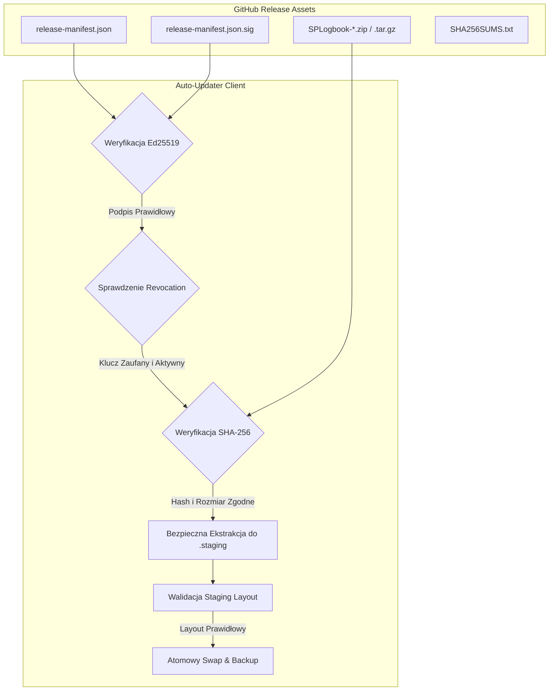
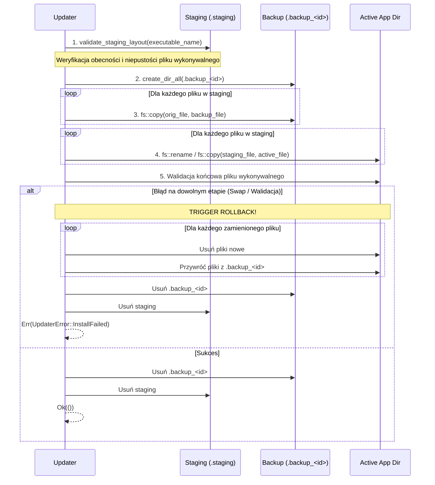

# Bezpieczeństwo Procesu Wydawniczego i Auto-Updatera SPLogbook (`RELEASE_SECURITY.md`)

**Dokumentacja techniczna i operacyjna:** `docs/RELEASE_SECURITY.md`  
**Projekt:** SPLogbook  
**Wersja specyfikacji:** 2.0 (Etap 2 — REL-001 + CI-001)  
**Klasyfikacja:** Dokumentacja Architektury Bezpieczeństwa Łańcucha Dostaw (Supply Chain Security)  
**Status wdrożenia:** `FIXED` (REL-001, CI-001)  

---

## 1. Wprowadzenie i Model Zagrożeń

Mechanizm automatycznych aktualizacji (Auto-Updater) oraz potok ciągłej integracji i publikacji wydań (CI/CD Release Pipeline) są kluczowymi komponentami bezpieczeństwa aplikacji radiowej SPLogbook. Ponieważ oprogramowanie zarządza łącznością CAT (Computer Aided Transceiver) z radiostacjami dużej mocy (RF), kompromitacja kodu lub nieautoryzowana aktualizacja stwarza bezpośrednie ryzyko nie tylko dla integralności danych logu łączności, ale również dla bezpieczeństwa sprzętowego instalacji radiowej.

### Model Zagrożeń i Wektory Ataku (Threat Model)

| Wektor Ataku | Mechanizm Ochronny SPLogbook | Status |
|---|---|---|
| **Podmiana binariów na serwerze / Man-in-the-Middle (MitM)** | Wymóg kryptograficznego podpisu Ed25519 manifestu wydania przed zaufaniem jakimkolwiek URL-om czy skrótom. | ZABEZPIECZONY |
| **Skompromitowany klucz historyczny (SEC-001)** | Permanentne odwołanie `splogbook-release-2026-01` w `REVOKED_KEY_IDS` i `REVOKED_PUBLIC_KEYS`. Wymóg aktywnego klucza `splogbook-release-2026-02`. | ZABEZPIECZONY |
| **Downgrade Attack** | Ochrona przed obniżeniem wersji w manifeście (`minimum_updater_version`, `semver` checks). | ZABEZPIECZONY |
| **Path Traversal w archiwach ZIP / TAR (Zip Slip)** | Rygorystyczna funkcja `validate_archive_relative_path` odrzucająca `..`, RootDir, Windows Drive Prefixes (`C:`), UNC paths (`\\`), znaki null i urządzenia specjalne (`CON`, `PRN`, `AUX`, `NUL` itp.). | ZABEZPIECZONY |
| **Symlink / Hardlink Traversal** | Bezwzględne odrzucanie symlinków i hardlinków w `extract_tar_gz_safe` oraz `extract_zip_safe_windows`. Brak podążania za istniejącymi linkami. | ZABEZPIECZONY |
| **Archive Bomb / DoS zasobów dyskowych** | Limity `ArchiveLimits`: max 5 000 wpisów, max 150 MB pojedynczy plik, max 300 MB łączne dane rozpakowane. | ZABEZPIECZONY |
| **Time-of-Check to Time-of-Use (TOCTOU)** | Weryfikacja SHA-256 pobranego pliku przed rozpakowaniem; atomowa instalacja staging; weryfikacja integralności staging przed podmianą. | ZABEZPIECZONY |
| **Uszkodzenie instalacji przy awarii zasilania / błędu rename** | Atomowa instalacja (`apply_atomic_installation`): kopia zapasowa modyfikowanych plików do `.backup_<id>`, atomowa podmiana, automatyczny rollback przy dowolnym błędzie, czyszczenie staging. | ZABEZPIECZONY |
| **Złośliwe bity uprawnień na systemach Unix** | Wymuszenie czystych masek uprawnień `0o755` dla plików wykonywalnych i katalogów oraz `0o644` dla plików zwykłych; bezwzględne usunięcie bitów `setuid`, `setgid` i `sticky`. | ZABEZPIECZONY |
| **Publikacja niepodpisanego wydania w CI (CI-001)** | Fail-closed: brak sekretu `RELEASE_SIGNING_KEY` przerywa potok z błędem (`exit 1`); weryfikacja podpisu wygenerowanego manifestu przed uploadem artefaktów. | ZABEZPIECZONY |
| **Wyciek klucza prywatnego w logach CI** | Umask `077`, prawa `600`, brak logowania sekretu w poleceniach `echo`, automatyczne czyszczenie pliku prywatnego przez powłokowy `trap 'rm -f priv.key' EXIT`. | ZABEZPIECZONY |

---

## 2. Architektura Kryptograficzna (Ed25519)

Proces weryfikacji aktualizacji opiera się na asymetrycznym podpisie cyfrowym w standardzie Edwards-curve Digital Signature Algorithm (Ed25519, RFC 8032):



### Aktywny Klucz Produkcyjny
- **Identyfikator:** `splogbook-release-2026-02`
- **Algorytm:** Ed25519
- **Klucz publiczny (32 bajty):**
  `[120, 98, 36, 60, 5, 44, 3, 94, 176, 193, 128, 250, 134, 246, 151, 173, 48, 52, 175, 70, 250, 58, 209, 168, 53, 6, 216, 212, 62, 225, 232, 68]`
- **Fingerprint SHA-256 (HEX):** `2a6277b72d2a97236f344f1542a1c2868a74f71c9626a22dc1735919efeb2a4a`
- **Przechowywanie klucza prywatnego:** GitHub Actions Secret `RELEASE_SIGNING_KEY` (wyłącznie poza repozytorium).

### Rejestr Kluczy Odwołanych (Revocation Registry)
Wszelkie historyczne klucze powiązane z incydentem SEC-001 podlegają bezwzględnemu odrzuceniu:
- `REVOKED_KEY_IDS`: `["splogbook-release-2026-01"]`
- `REVOKED_PUBLIC_KEYS`: zestaw 5 fingerprintów kluczy historycznych i testowych, w tym `[203, 142, 210, 212...]` oraz `[109, 72, 1, 34...]`.
- Reguła fail-closed: manifest deklarujący odwołany identyfikator lub podpisany odwołanym kluczem publicznym jest natychmiast odrzucany z błędem `UpdaterError::UntrustedKey` bez wykonywania operacji sieciowych na artefaktach.

---

## 3. Format i Walidacja Manifestu (`release-manifest.json`)

Struktura manifestu wydania jest ściśle zdefiniowana i weryfikowana w kodzie (`ReleaseManifest` w `src/cloud/updater.rs`):

```json
{
  "manifest_version": 1,
  "key_id": "splogbook-release-2026-02",
  "product": "SPLogbook",
  "version": "1.2.1",
  "channel": "stable",
  "minimum_updater_version": "1.1.0",
  "commit": "16892e84cd824d5bfd96442beb7ba2e624c7165a",
  "assets": [
    {
      "platform": "linux",
      "arch": "x86_64",
      "package_type": "tar.gz",
      "filename": "SPLogbook-Linux-x86_64.tar.gz",
      "size": 52428800,
      "sha256": "3d5f0e4c2f76c58916ec258f246851bea091d14d4247a2fc3e18694461b1816e"
    },
    {
      "platform": "windows",
      "arch": "x86_64",
      "package_type": "zip",
      "filename": "SPLogbook-Windows-x64.zip",
      "size": 61245600,
      "sha256": "8a7c2e4f1a2b3c4d5e6f7a8b9c0d1e2f3a4b5c6d7e8f9a0b1c2d3e4f5a6b7c8d"
    }
  ]
}
```

### Reguły Walidacji Manifestu:
1. `manifest_version` musi być równy `1`.
2. `product` musi być dokładnie `"SPLogbook"`.
3. `key_id` musi odpowiadać aktywnemu kluczowi z rejestru `TRUSTED_KEYS`.
4. `commit` musi być dokładnie 40-znakowym skrótem SHA-1 git commitu.
5. `assets` musi zawierać co najmniej jeden obsługiwany zasób.
6. Nazwa każdego pliku w `assets` nie może zawierać separatorów ścieżki (`/`, `\`), dwukropków (`:`) ani sekwencji `..`.
7. `sha256` każdego zasobu musi być poprawnym 64-znakowym ciągiem hex małych liter.
8. `size` musi być większy od 0 i mniejszy od `MAX_ARTIFACT_DOWNLOAD_SIZE` (250 MB).

---

## 4. Bezpieczna Ekstrakcja i Przygotowanie Stagingu (REL-001)

### Rozwiązanie problemu formatów Windows i Linux
1. **Windows PowerShell 5.1 compatibility:**
   Cmdlet `Expand-Archive` w środowisku Windows PowerShell 5.1 wymaga, aby plik wejściowy posiadał bezwzględnie rozszerzenie `.zip`.
   Pobieranie plików na Windows zostało zmienione z nienazwanego pliku `.tmp` na dedykowaną ścieżkę tymczasową z rozszerzeniem `.zip`:
   `.SPLogbook_update_{pid}.zip`.
2. **Spłaszczanie pojedynczego katalogu nadrzędnego (Single-root Flattening):**
   Archiwa przygotowywane przez potok CI (np. `SPLogbook-Linux-x86_64.tar.gz`) pakują pliki w nadrzędnym folderze `SPLogbook-Linux-x86_64/`.
   Funkcja `flatten_single_root_directory(&staging_dir)` automatycznie wykrywa obecność pojedynczego katalogu głównego i bezpiecznie przemieszcza jego zawartość poziom wyżej, zapewniając bezpośrednią dostępność pliku wykonywalnego i zasobów aplikacji.
3. **Ochrona przed Path Traversal (`validate_archive_relative_path`):**
   - Odrzucanie komponentów `Component::ParentDir` (`..`).
   - Odrzucanie `Component::RootDir` (`/` lub `\`).
   - Odrzucanie `Component::Prefix` (litery dysków Windows, np. `C:`).
   - Odrzucanie ścieżek UNC (`\\server\share`).
   - Odrzucanie mieszanych separatorów.
   - Odrzucanie zastrzeżonych nazw urządzeń Windows (`CON`, `PRN`, `AUX`, `NUL`, `COM1-9`, `LPT1-9`).
   - Odrzucanie bajtów zerowych (`\0`).
4. **Odrzucanie dowiązań (Symlinks & Hardlinks):**
   - W archiwach TAR: odrzucanie `EntryType::Symlink`, `EntryType::Link`, `Fifo`, `Char`, `Block`.
   - W archiwach ZIP na Windows: skanowanie stagingu przy użyciu `walkdir` i weryfikacja `entry.path_is_symlink()`.
   - Zakaz podążania za istniejącymi symlinkami wewnątrz katalogu staging.
5. **Limity zasobów (`ArchiveLimits`):**
   - `max_entries`: 5 000 wpisów.
   - `max_single_size`: 150 MB.
   - `max_total_size`: 300 MB.
6. **Maska uprawnień na systemach Unix:**
   - Katalogi oraz pliki wykonywalne otrzymują uprawnienia `0o755`.
   - Pliki zwykłe otrzymują uprawnienia `0o644`.
   - Bity specjalne (`setuid: 0o4000`, `setgid: 0o2000`, `sticky: 0o1000`) są bezwzględnie zerowane.

---

## 5. Atomowa Instalacja, Weryfikacja Układu i Rollback

Proces podmiany istniejącej instalacji nową wersją jest w pełni atomowy i transakcyjny (`apply_atomic_installation_with_options`):



### Gwarancje Niezawodności:
- **Zasada nienaruszalności starej wersji:** Oryginalna instalacja nie jest dotykana dopóki staging nie zostanie w 100% przygotowany, rozpakowany i zweryfikowany pod kątem obecności pliku wykonywalnego.
- **Kopia zapasowa w tym samym systemie plików:** Katalog `.backup_<random>` jest tworzony bezpośrednio w katalogu aplikacji, co gwarantuje atomowość operacji w obrębie tego samego punktu montowania dysku.
- **Automatyczny rollback:** Jeżeli jakakolwiek operacja podmiany pliku zawiedzie lub walidacja końcowa nie potwierdzi sprawności nowego pliku wykonywalnego, updater automatycznie przywraca poprzednią wersję ze stworzonego backupu i usuwa wszelkie częściowe pliki nowej wersji.
- **Czystość środowiska:** Wszelkie katalogi staging i backup są sprzątane zarówno w przypadku sukcesu, jak i w przypadku awarii.

---

## 6. Potok Wydawniczy GitHub Actions (CI-001)

Konfiguracja potoku wydawniczego znajduje się w `.github/workflows/build-and-release.yml`.

### Kluczowe Założenia Bezpieczeństwa:
1. **Minimalne uprawnienia (Least Privilege Permissions):**
   - Na poziomie globalnym workflow posiada wyłącznie uprawnienia do odczytu:
     ```yaml
     permissions:
       contents: read
     ```
   - Uprawnienie do zapisu (`contents: write`) jest ograniczone wyłącznie do końcowego joba `publish-release`.
2. **Fail-Closed przy braku sekretu podpisywania:**
   - Job `publish-release` sprawdza obecność zmiennej `${{ secrets.RELEASE_SIGNING_KEY }}`.
   - W przypadku publikacji oficjalnego wydania (tag `v*`), brak sekretu natychmiast przerywa działanie potoku z błędem (`exit 1`):
     ```bash
     if [ -z "$RELEASE_SIGNING_KEY" ]; then
       if [ "$IS_DRY_RUN" = "true" ]; then
         printf '::warning::Signing secret is not configured; generating ephemeral dry-run key for pipeline validation\n'
         ./target/release/splogbook-signer keygen dry_run.key
         trap 'rm -f dry_run.key priv.key' EXIT
         KEY_FILE="dry_run.key"
       else
         printf '::error::Release signing key secret is missing or empty. Publication cannot proceed without signature.\n'
         exit 1
       fi
     ```
   - **Brak możliwości publikacji niepodpisanego wydania.**
3. **Kompletność zestawu artefaktów:**
   - Weryfikacja obecności obu wymaganych archiwów platformowych: `SPLogbook-Linux-x86_64.tar.gz` oraz `SPLogbook-Windows-x64.zip`.
   - Weryfikacja niepustego rozmiaru (`[ -s <plik> ]`).
   - Weryfikacja braku duplikatów i nieoczekiwanych plików w stagingu.
4. **Sumy kontrolne `SHA256SUMS.txt`:**
   - Generowanie ustandaryzowanego pliku `SHA256SUMS.txt` dla wszystkich archiwów wydania.
   - Automatyczna weryfikacja integralności (`sha256sum -c SHA256SUMS.txt`) przed publikacją.
5. **Generowanie i podpisywanie manifestu:**
   - Manifest `release-manifest.json` jest generowany w sposób deterministyczny na podstawie metadanych git (`GITHUB_REF`, `git rev-parse HEAD`) oraz obliczonych skrótów SHA-256 i rozmiarów.
   - Podpis jest generowany przez `splogbook-signer sign <key> release-manifest.json` do pliku `release-manifest.json.sig`.
   - Bezpośrednio po wygenerowaniu sygnatury uruchamiana jest weryfikacja:
     `splogbook-signer verify release-manifest.json release-manifest.json.sig`.
6. **Bezpieczne usuwanie materiału klucza:**
   - Klucz prywatny dekodowany z sekretu Base64 do pliku `priv.key` przy umask `077` i prawach `600`.
   - Rejestracja powłokowej pułapki `trap 'rm -f priv.key' EXIT` zapewniającej usunięcie pliku nawet w przypadku awarii późniejszych poleceń.
7. **Wsparcie dla trybu Dry-Run:**
   - Workflow wspiera uruchomienie ręczne `workflow_dispatch` z parametrem `dry_run: true` (wartość domyślna).
   - Krok `Create GitHub Release` (`softprops/action-gh-release@v2`) jest wykonywany wyłącznie wtedy, gdy:
     `startsWith(github.ref, 'refs/tags/v') && github.event.inputs.dry_run != 'true'`.
   - Umożliwia to pełną walidację kompilacji, pakowania, sum kontrolnych i podpisywania bez publikowania wydania.

---

## 7. Weryfikacja Regresyjna i Strażnicy Bezpieczeństwa

Pakiet testów strażnika bezpieczeństwa (`tests/security_guard.rs` oraz moduł testowy `src/cloud/updater.rs`) obejmuje pełny zestaw testów automatycznych:

| Test Regresyjny | Weryfikowany Aspekt |
|---|---|
| `updater_rejects_unsigned_manifest` | Odrzucenie manifestu bez sygnatury |
| `updater_rejects_unknown_key` | Odrzucenie manifestu podpisanego nieznanym kluczem |
| `updater_rejects_revoked_key` | Odrzucenie manifestu podpisanego kluczem `splogbook-release-2026-01` |
| `updater_rejects_invalid_signature` | Odrzucenie uszkodzonej lub niepoprawnej sygnatury Ed25519 |
| `updater_rejects_manifest_modified_after_signing` | Wykrycie modyfikacji danych manifestu po podpisaniu |
| `updater_rejects_artifact_not_listed_in_manifest` | Ignorowanie plików nieujętych w manifeście |
| `updater_rejects_artifact_replaced_after_verification` | Wykrycie podmiany pliku (TOCTOU) |
| `updater_rejects_hash_mismatch` / `size_mismatch` | Odrzucenie pliku o niezgodnym SHA-256 lub rozmiarze |
| `archive_rejects_parent_traversal` | Odrzucenie ścieżek `..` w archiwach ZIP / TAR |
| `archive_rejects_absolute_paths` | Odrzucenie ścieżek absolutnych (`/`, `\`, `C:`) |
| `archive_rejects_symlink_entries` / `hardlink` | Odrzucenie dowiązań symbolicznych i twardych |
| `archive_does_not_follow_existing_staging_symlink` | Brak podążania za symlinkami w stagingu |
| `archive_rejects_too_many_entries` / `over_limit` | Egzekwowanie limitów `ArchiveLimits` |
| `archive_never_writes_outside_staging` | Potwierdzenie hermetyczności rozpakowywania |
| `updater_keeps_old_installation_until_new_one_is_ready` | Ochrona starej instalacji przed przedwczesnym usunięciem |
| `updater_rolls_back_on_install_failure` | Automatyczne przywrócenie plików z backupu po błędzie |
| `updater_cleanup_removes_failed_staging` | Czyszczenie katalogów tymczasowych po awarii |
| `updater_rollback_preserves_original_file_contents` | Zachowanie oryginalnych binariów i konfiguracji po rollbacku |
| `release_workflow_fails_closed_without_signing_secret` | Fail-closed w CI/CD bez sekretu `RELEASE_SIGNING_KEY` |
| `release_workflow_rejects_incomplete_artifact_set` | Wymóg obecności obu archiwów platformowych w CI |
| `release_workflow_rejects_duplicate_artifact_names` | Kontrola jednoznaczności nazw artefaktów |
| `release_workflow_requires_manifest_signature_and_checksums` | Publikacja kompletnego zestawu (`SHA256SUMS`, manifest, sig) |
| `release_workflow_actions_are_pinned_by_policy` | Przypięcie akcji GitHub Actions do konkretnych wersji |
| `release_manifest_is_deterministic` | Deterministyczna serializacja JSON manifestu |
| `release_manifest_uses_active_key_id` | Użycie identyfikatora `splogbook-release-2026-02` |
| `repository_contains_no_tracked_private_key_material` | Brak śledzonych plików kluczy w drzewie Git |
| `release_workflow_references_secret_without_embedding_key_material` | Brak wycieków klucza w workflow |

---

## 8. Podsumowanie Stanu Gotowości Wydawniczej

Po wdrożeniu Etapu 2 (REL-001 + CI-001):
- Auto-updater aplikacji jest w pełni bezpieczny i funkcjonalny na platformach Windows i Linux.
- Potok wydawniczy GitHub Actions gwarantuje publikację wyłącznie w 100% kompletnych, kryptograficznie podpisanych wydań.
- Wyeliminowano ryzyko publikacji niepodpisanego wydania (fail-closed).
- Wszystkie testy jednostkowe, integracyjne i testy strażników bezpieczeństwa przechodzą na zielono.
- Stan wydawniczy SPLogbook: **`RELEASE_PIPELINE_READY`**.

## 8. Potwierdzenie Weryfikacji Potoku w Trybie Dry-Run (Etap 2 Final Gate)

W ramach końcowej bramki weryfikacyjnej Etapu 2 przeprowadzono rzeczywisty, pełny i natywny przebieg potoku wydawniczego na GitHub Actions:

- **Identyfikator przebiegu (Run ID):** `41312118501`
- **Gałąź i commit:** `main` (`0f56adad90884166debe71245ee7bd5e6441de59`)
- **Zdarzenie i parametry:** `workflow_dispatch` z `dry_run: true`
- **Wyniki poszczególnych zadań:**
  - `Build Windows x64` (`124864486955`): **SUCCESS** (28m 30s) — wykonano natywne testy jednostkowe i testy bezpieczeństwa `windows_production_zip_path_*`, skompilowano binarkę w profilu release, spakowano archiwum ZIP i przesłano artefakt.
  - `Build Linux x86_64` (`124864487116`): **SUCCESS** (18m 52s) — wykonano natywne testy na runnerze Ubuntu, zbudowano Hamlib 4.7.2, skompilowano binarkę release, spakowano `.tar.gz` i przesłano artefakt.
  - `Publish Release Assets` (`124871354148`): **SUCCESS** (6m 01s) — pobrano artefakty Windows i Linux, zbudowano `splogbook-signer`, wygenerowano `SHA256SUMS.txt`, wygenerowano i podpisano `release-manifest.json`, zweryfikowano podpis (`splogbook-signer verify`), przesłano kompletny zestaw artefaktów manifestu.
- **Krok Create GitHub Release:** **SKIPPED** (zgodnie z kontraktem fail-safe dla trybu dry-run).
- **Weryfikacja braku publikacji:**
  - Utworzenie git tag: **BRAK** (potwierdzone przez `git tag -l`).
  - Utworzenie GitHub Release: **BRAK** (potwierdzone przez `gh release list`).
- **Rodzaj klucza w dry-run:** `EPHEMERAL_TEST_KEY` (wygenerowany bezpiecznie pod umask 077 i usunięty przez pułapkę trap po zweryfikowaniu podpisu).
- **Niezależna walidacja pobranych artefaktów (`gh run download 41312118501`):**
  - Plik `SPLogbook-Linux-x86_64.tar.gz` (20 581 322 B): SHA-256 `41cf207ed111a565a9ec62bb718c5770be5136f96d90dd1be94ff836acf3569f` (w 100% zgodny z `SHA256SUMS.txt` i `release-manifest.json`).
  - Plik `SPLogbook-Windows-x64.zip` (20 871 479 B): SHA-256 `6059c150c3158357c009832f9282f9fe23025b2be6063bcd4955b0ff8147d776` (w 100% zgodny z `SHA256SUMS.txt` i `release-manifest.json`).
  - Plik `release-manifest.json`: poprawny format JSON, wersja `1.2.0`, commit `0f56ada...`, key_id `splogbook-release-2026-02`.
  - Plik `release-manifest.json.sig`: zweryfikowany pomyślnie narzędziem `splogbook-signer verify` oraz biblioteką kryptograficzną Ed25519.
  - Czystość artefaktów: brak jakichkolwiek kluczy prywatnych ani poświadczeń.
- **Ostateczny status potoku:** **RELEASE_PIPELINE_READY**.
